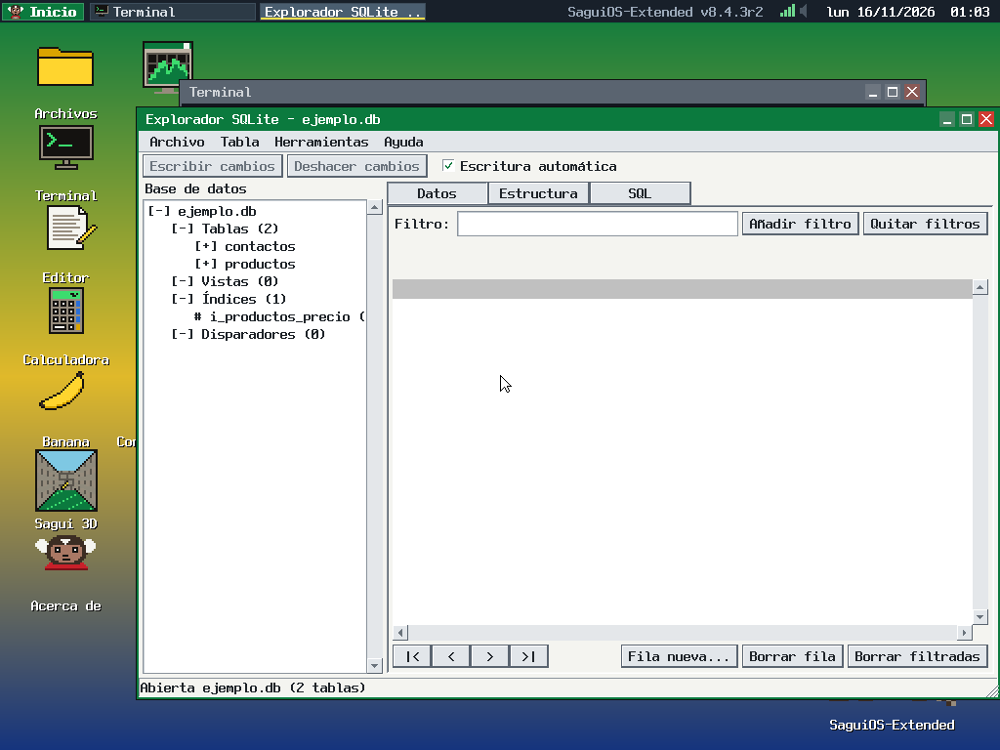
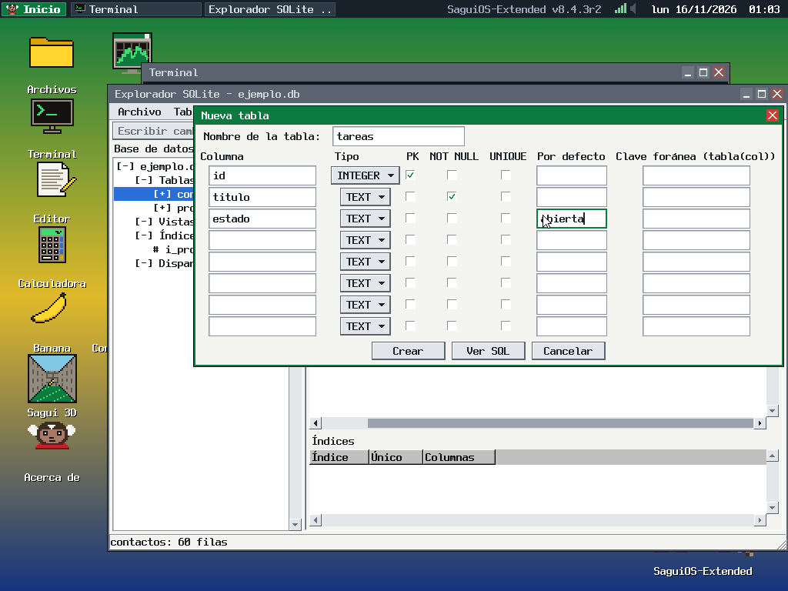
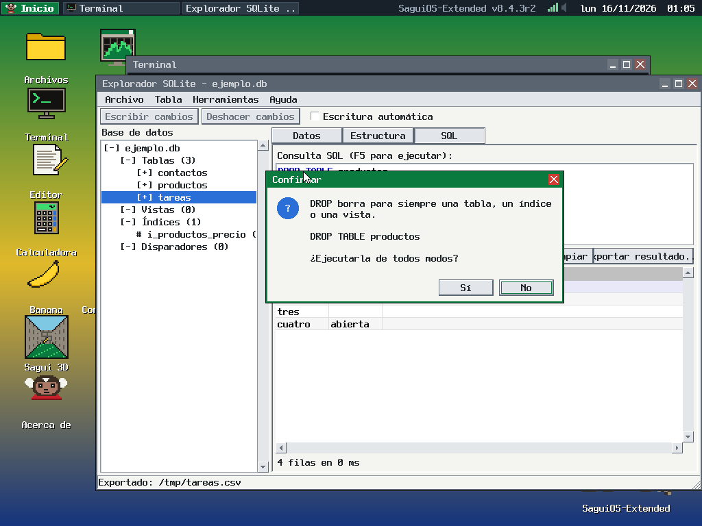
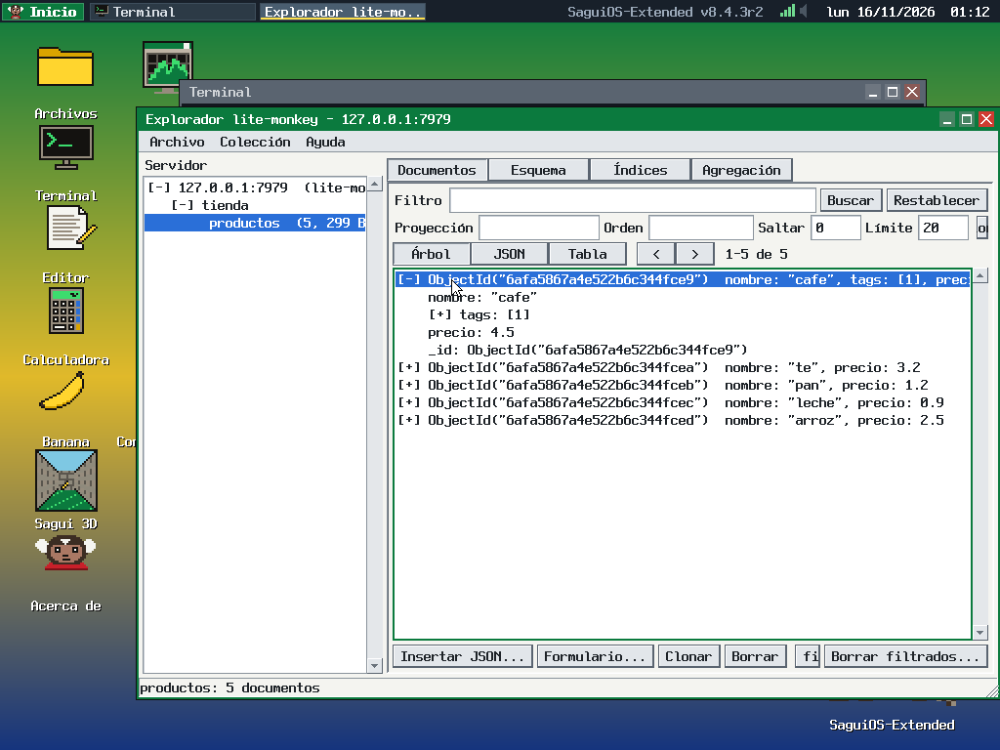
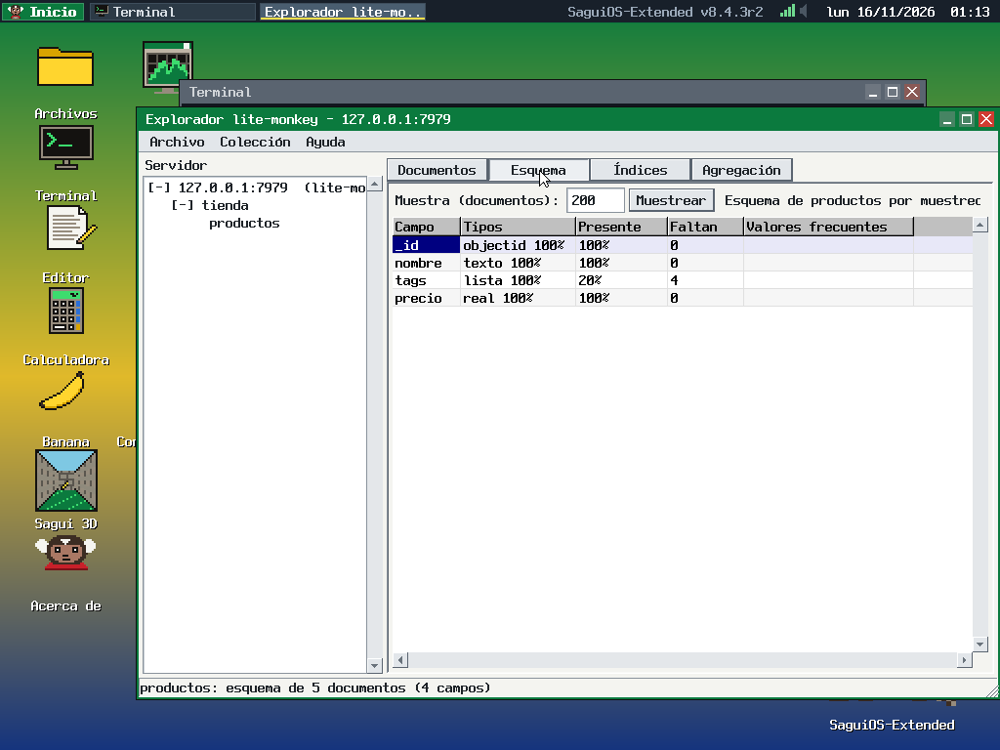

# Bases de datos en SaguiOS: `basedatos`, VisualPythonS y el Explorador

SaguiOS trae dos motores de bases de datos: **SQLite** (relacional, un fichero `.db`; D116, `docs/sqlite.md`) y
**lite-monkey** (de documentos, un servidor en el puerto 7979; D117, `docs/litemonkey.md`). Esta guía cuenta las tres
piezas que los manejan por igual (mejora 127, D304):

1. la biblioteca de Python **`basedatos`**: una API pequeña y la misma para los dos motores;
2. los componentes de **VisualPythonS**: `ConectorBD`, `RejillaDatos` y los controles enlazados;
3. el **Explorador de bases de datos** (Inicio > Accesorios): una aplicación para mirar y editar.

## 1. La biblioteca `basedatos`

```python
import basedatos

bd = basedatos.conectar("sqlite:/home/datos.db")                 # o ":memory:"
bd = basedatos.conectar("litemonkey://127.0.0.1:7979/mibase")    # lite-monkey
```

La cadena de conexión: `sqlite:/ruta/fichero.db` (también `sqlite:///ruta`, `:memory:` o una ruta que acabe en `.db`) y
`litemonkey://[usuario:clave@]host[:puerto]/base` (por defecto `127.0.0.1:7979` y la base `test`). Funciona en el
`python` de SaguiOS y en CPython (para probar en el PC: pon `rootfs/lib/python` y `litemonkey/python` en el `sys.path`).

### La API, en diez líneas

```python
bd.tablas()            # nombres de las tablas (SQLite) o colecciones (lite-monkey; también bd.colecciones())
bd.esquema(t)          # [{"nombre", "tipo", "clave", "obligatorio", "defecto"}]; en lite-monkey, los campos deducidos de una muestra
bd.consultar(t, filtro, orden, limite, desplazamiento)   # lista de diccionarios
bd.contar(t, filtro)                                      # cuántas filas cumplen el filtro
bd.insertar(t, {"campo": valor})                          # devuelve la clave de la fila nueva
bd.actualizar(t, {"campo": valor}, filtro=...)  # o clave=...; devuelve cuántas filas cambió
bd.borrar(t, filtro=...)                        # o clave=...; sin filtro ni clave se niega (salvo todos=True)
bd.ejecutar("SELECT * FROM t WHERE id = ?", [3])   # solo SQLite: parámetros enlazados, nunca concatenados
with bd.transaccion(): ...                         # solo SQLite (también bd.empezar() / confirmar() / revertir())
bd.cerrar()                                        # o `with basedatos.conectar(...) as bd:`
```

Además: `bd.indices(t)`, `bd.clave(t)` (la columna que identifica una fila: la clave primaria, o `rowid`; `_id` en
lite-monkey), `bd.columnas(t)` (en orden), `bd.crear_tabla(nombre, [(columna, tipo, clave)])`, `bd.borrar_tabla(nombre)` y,
en SQLite, `bd.sql(sentencia, parametros)` -> `(columnas, filas, afectadas)` (la usa el Explorador).

### Filtros

El mismo diccionario sirve en los dos motores (el de lite-monkey es el suyo; en SQLite se traduce a `WHERE` con
parámetros enlazados):

```python
{"ciudad": "Lima"}                                   # igualdad ({"campo": None} es «sin valor»)
{"edad": {"$gte": 18, "$lt": 65}}                    # $eq $ne $gt $gte $lt $lte
{"ciudad": {"$in": ["Lima", "Quito"]}}               # $in $nin
{"nombre": {"$contiene": "ana"}}                     # contiene (sin distinguir mayúsculas)
{"$or": [{"ciudad": "Lima"}, {"edad": {"$gt": 60}}]} # $and $or
```

Solo en SQLite también: una tupla `("edad > ? AND nombre LIKE ?", [18, "A%"])` (condición con parámetros) o un texto `"edad > 18"`
(la condición tal cual: para código del programador, **nunca** para lo que escribe un usuario). En lite-monkey, un texto es el
JSON del filtro: `'{"edad": {"$gt": 18}}'`. Un `_id` escrito como 24 cifras hexadecimales se convierte en `ObjectId`.

`orden` es `"nombre"`, `"-nombre"` (descendente), `["ciudad", "-edad"]` o `[("edad", -1)]`.

### Ejemplo con SQLite

```python
import basedatos
bd = basedatos.conectar("sqlite:/home/ejemplo.db")
bd.ejecutar("CREATE TABLE contactos (id INTEGER PRIMARY KEY, nombre TEXT NOT NULL, ciudad TEXT, edad INTEGER)")
with bd.transaccion():                                  # o todo o nada
    bd.insertar("contactos", {"nombre": "O'Brien", "ciudad": "Lima", "edad": 41})   # la comilla no rompe nada
    bd.insertar("contactos", {"nombre": "Ana", "ciudad": "Madrid", "edad": 30})
for c in bd.consultar("contactos", {"edad": {"$gt": 35}}, orden="nombre", limite=10):
    print(c["id"], c["nombre"])
bd.actualizar("contactos", {"ciudad": "Quito"}, clave=1)
print(bd.ejecutar("SELECT ciudad, count(*) AS n FROM contactos GROUP BY ciudad"))
bd.cerrar()
```

`/ejemplos/bd/crear_ejemplo.py` crea una base de ejemplo con 60 contactos y una tabla de productos.

### Ejemplo con lite-monkey

```python
import basedatos
bd = basedatos.conectar("litemonkey://127.0.0.1:7979/tienda")   # antes: servicio iniciar litemonkey
bd.insertar("productos", {"nombre": "café", "precio": 4.5, "tags": ["bebida", "caliente"]})
bd.insertar("productos", {"nombre": "pan", "precio": 1.2})
print(bd.esquema("productos"))        # campos deducidos de una muestra: nombre texto, precio real, tags lista...
print(bd.consultar("productos", {"precio": {"$lt": 4}}, orden="-precio"))
bd.actualizar("productos", {"precio": 1.3}, {"nombre": "pan"})
bd.cerrar()
```

Los documentos pueden tener campos distintos: `esquema` mira hasta 200 y dice el tipo de cada campo (`entero`, `real`, `texto`,
`logico`, `lista`, `documento`, `objectid`...; si un campo cambia de tipo, `entero|texto`) y en qué porcentaje de
documentos aparece. `/ejemplos/bd/lmk_ejemplo.py` inserta tres documentos de ejemplo.

### Errores

Todos heredan de `basedatos.ErrorBD`: `ErrorConexion` (no se abre el fichero o el servidor no contesta),
`ErrorConsulta` (SQL mal escrito, tabla que no existe, filtro no válido, `ejecutar()` en lite-monkey) y
`ErrorIntegridad` (clave repetida, `NOT NULL`...; es una `ErrorConsulta`). Los mensajes son claros:
`no se pudo conectar con lite-monkey en 127.0.0.1:7979 (...)`. Un error en una sentencia deshace la transacción
implícita que abrió, para que la siguiente no choque con ella.

### Seguridad

Los valores **nunca** se concatenan al SQL: van como parámetros enlazados (`?`). Los nombres de tablas y columnas se
entrecomillan, así que un nombre con comillas o con `; DROP TABLE` no es SQL. Un `actualizar` o un `borrar` sin filtro ni
clave se niega, para no vaciar una tabla por un descuido.

## 2. Componentes de VisualPythonS

Los componentes de datos están en el módulo `vps` (`from vps import *`) y en la caja de herramientas del diseñador.

### `ConectorBD` (sin ventana, como el `Temporizador`)

| Propiedad | Qué es |
|---|---|
| `origen` | la cadena de conexión; en el diseñador, un diálogo para elegir un fichero `.db` o escribir el servidor de lite-monkey |
| `tabla` | la tabla o colección; en el diseñador, un menú con las que tiene la base |
| `filtro` | condición SQL (el `WHERE` sin la palabra) en SQLite, JSON en lite-monkey |
| `orden` | `"nombre"` o `"-nombre"` (varios, separados por comas) |
| `tam_pagina` | filas por página (50) |

Métodos: `abrir()`, `cerrar()`, `recargar()`, `guardar()`, `nuevo()`, `borrar()`, `primero()`, `anterior()`, `siguiente()`,
`ultimo()`, `ir_a(posicion)`, `ordenar(campo)`, `valor(campo)`, `poner(campo, valor)` y `tablas()`. Datos: `registro` (el
diccionario del registro actual), `filas` (la página), `columnas`, `total`, `posicion`, `pagina`, `paginas`, `modificado`,
`abierta`, `error` y `bd` (el objeto de `basedatos`, para consultas propias).

Eventos: **`conectado`** (se abrió y cargó) y **`error`** (con el texto en `error`; si no hay manejador, sale un mensaje).
También `registro` (cambió el registro actual) y `datos` (se cargó otra página).

El conector abre solo al empezar si tiene `origen`; si no, `ConectorBD1.abrir()`. **Moverse guarda**: si el registro tiene
cambios sin guardar, `siguiente()`, `ir_a()` o `nuevo()` los guardan antes (un fallo se queda en el registro y dispara `error`).

### `RejillaDatos`

Se enlaza con `fuente=ConectorBD1` (en el diseñador, un menú con los conectores del formulario). Enseña la página actual, con
paginación para tablas grandes, **orden por columna** (un clic en la cabecera; otro, para invertirlo) y una **barra** con
primero, anterior, siguiente, último, nuevo, borrar (con confirmación) y guardar. Con `editable=True`, **doble clic en una celda**
(o escribir sobre ella) la edita y **escribe en la base**; la columna clave no se edita. Eventos: `seleccion` y `cambio`.

### Controles enlazados

`CuadroTexto`, `Casilla`, `Numerico` y `Combo` aceptan `fuente` (el conector) y `campo`: al moverse por la rejilla o por la
barra se **rellenan** con el registro actual y, cuando el usuario los cambia, **escriben** en él; `guardar()` (o moverse) lo lleva a la
base. Así se hacen las fichas («maestro»). Un texto vacío en una columna numérica es `NULL`; el texto se convierte al tipo de la
columna (`INTEGER` a entero, `REAL` a número...).

> En estos controles, `fuente` es el conector (en el resto sigue siendo la tipografía).

### Una agenda de contactos con rejilla y ficha, en 5 minutos

El proyecto terminado está en `/ejemplos/vps/agenda-bd` (ábrelo desde el diseñador, Archivo > Abrir proyecto).


1. **Inicio > Accesorios > VisualPythonS (diseñador)**; formulario nuevo de 540 x 372.
2. Caja de herramientas: elige **ConectorBD** y pulsa en una esquina del formulario. En propiedades, `origen`: se abre el
   diálogo; pulsa **Elegir fichero...** y busca tu `.db` (o escribe `127.0.0.1:7979/base` para lite-monkey). Después, `tabla`:
   un menú con las tablas de la base; elige `contactos`.
3. Elige **RejillaDatos** y dibújala en la mitad de arriba. En `fuente` elige `ConectorBD1` y pon `editable` a `True`.
4. Pon un **Marco** («Ficha») debajo y dentro tres controles: un **CuadroTexto** con `fuente = ConectorBD1` y
   `campo = nombre` (el menú de `campo` enseña las columnas de la tabla), otro con `campo = telefono` y un **Combo** con
   `campo = ciudad`; una **Casilla** con `campo = favorito`.
5. Escribe el código (doble clic en el formulario): abre el conector al cargar.

```python
def Formulario_cargar():
    ConectorBD1.abrir()

def ConectorBD1_error():
    Etiqueta4.texto = "Error: " + ConectorBD1.error
```

6. **F5**. Pulsa filas de la rejilla: la ficha se rellena; escribe en la ficha y pulsa **Guardar** de la barra (o cambia de fila:
   se guarda sola); **Nuevo** vacía la ficha para un contacto nuevo; doble clic en una celda de la rejilla la edita.

Con **Generar aplicación** queda en Inicio > Mis aplicaciones.

### En el diseñador

Los componentes tienen su icono en la caja de herramientas; `origen` abre su diálogo, `tabla` y `campo` sacan un menú con lo que hay
en la base (el diseñador se conecta un momento para leerlo) y `fuente` uno con los conectores del formulario. El autocompletado
conoce los métodos (`ConectorBD1.` ofrece `abrir`, `guardar`, `siguiente`...). La rejilla se dibuja en el diseño como una maqueta.

## 3. Los dos exploradores (v8.4.4, D333)

Desde la v8.4.4 el Explorador de la 127 son **dos aplicaciones**, una por tipo de base, en **Inicio > Accesorios** con iconos
distintos: **Explorador SQLite** (cilindro azul, relacional) y **Explorador lite-monkey** (cara de mono, documental).
`explorador.py` queda como alias (una dirección `litemonkey://` abre el de lite-monkey; lo demás, el de SQLite). Un doble clic en un
`.db`, `.sqlite` o `.sqlite3` en Archivos abre el de SQLite. Los textos van con `_()` (D313, `basedatos/_idioma.py`).

### 3.1. Explorador SQLite

`python /lib/python/basedatos/explorador_sqlite.py [fichero.db]`



- **Árbol:** tablas, vistas, índices y disparadores (cada grupo se pliega con doble clic; doble clic en una tabla despliega sus
  columnas). Un clic en un índice o disparador enseña su SQL en la pestaña Estructura.
- **Datos:** rejilla con paginación, orden (clic en la cabecera) y edición de celdas (doble clic). **NULL se distingue del texto
  vacío**: se dibuja «NULL» en gris, y al editar, escribir `NULL` guarda un nulo. **Filtro por columna**: escribe `columna:valor`
  (o solo el valor, para la columna elegida en la rejilla) y pulsa Intro; se pueden añadir varios (se unen con AND). Sintaxis del valor:
  `x` igual, `>5 <5 >=5 <=5 <>x`, `~x` contiene, `NULL`, `!NULL` y `""` (texto vacío). **Fila nueva...**, **Borrar fila** y
  **Borrar filtradas** (enseña cuántas son antes de pedir confirmación).
- **Estructura:** las columnas con tipo, clave, obligatoria, valor por defecto, único y clave foránea, los índices y el `CREATE TABLE`.
  El **asistente de columnas** (Nueva tabla... y Modificar tabla...) edita nombre, tipo, PK, NOT NULL, UNIQUE, DEFAULT y FK; **Ver SQL**
  enseña la sentencia. Modificar una tabla usa el método estándar de SQLite (crear la nueva, copiar los datos, borrar la vieja y
  renombrar, en una transacción); borrar una columna la quita dejando su nombre en blanco, y renombrarla conserva sus datos.
  Nuevo índice... y Borrar índice.

  
- **SQL:** editor con resaltado, varias sentencias, resultado en rejilla con el tiempo (`4 filas en 12 ms`), **Autocompletar** (o
  Ctrl+Espacio: tablas, columnas y palabras de SQL; si solo hay una opción la pone), **Plan** (`EXPLAIN QUERY PLAN`), historial e
  **Exportar resultado...** a CSV.
- **Cambios:** la **escritura automática** está marcada por defecto (como antes). Si la desmarcas, el primer cambio abre una
  transacción: **Escribir cambios** la confirma y **Deshacer cambios** la deshace (también crear tablas e índices). Al cerrar con cambios
  pendientes pregunta.
- **Archivo:** abrir y crear bases, **Importar CSV...** (la primera fila son los nombres de columna; entra en la tabla elegida o crea
  una nueva), **Exportar tabla a CSV...** (con el filtro; ofrece abrirlo en Macaco), **Exportar base a SQL (volcado)...** y
  **Ejecutar archivo SQL...**. **Herramientas:** comprobar integridad (`PRAGMA integrity_check`) y compactar (`VACUUM`).
- **Seguridad (D304):** `DROP` y `DELETE`/`UPDATE` sin `WHERE` (en la pestaña SQL o en un archivo SQL) piden confirmación con el
  botón por defecto en **«No»**; igual el borrado de una fila, de las filas filtradas, de una tabla o de un índice. Abrir un fichero no
  ejecuta nada.

  

### 3.2. Explorador lite-monkey

`python /lib/python/basedatos/explorador_litemonkey.py [litemonkey://host:7979/base]`



- **Conexión:** Archivo > Conectar a lite-monkey... (servidor, usuario y clave opcionales). Si el servidor no está arrancado ofrece
  arrancarlo (`servicio iniciar litemonkey`). El árbol lista **las bases y sus colecciones con su número de documentos y su tamaño**.
- **Documentos**, en tres vistas (botones Árbol, JSON y Tabla): lista de documentos como **árbol plegable** (doble clic despliega;
  doble clic en un campo escalar lo edita), el **JSON** del documento elegido (editable; se **valida antes de guardar**: un JSON roto no
  se guarda y un `_id` distinto se rechaza; los `ObjectId` y fechas van como `{"$oid": ...}` y `{"$fecha": ms}`; un documento con binarios
  no se edita aquí) y una **tabla** con las claves de primer nivel (editable).
- **Barra de consulta:** filtro (JSON: `{"edad": {"$gt": 30}}`), **proyección** (`nombre, precio` o `-tags` o JSON), **orden**
  (`-precio, nombre` o JSON), **saltar** y **límite** (`<` y `>` pasan de página), con **historial** y **consultas favoritas**.
- **Editar:** Insertar JSON... (con una plantilla sacada del esquema; admite una lista), Insertar formulario..., **Clonar**, **Borrar**
  (con confirmación), **Actualizar filtrados...** (operadores `$set`, `$inc`... sobre todos los que casan) y **Borrar filtrados...**: los dos
  enseñan antes cuántos documentos son y piden confirmación (más severa si el filtro está vacío).
- **Esquema:** muestreo de la colección (200 documentos por defecto): por campo, sus **tipos con porcentaje**, **cuántos documentos
  lo tienen y cuántos no (huecos)** y sus **valores más frecuentes**.
- **Índices:** listar, crear (campo, único, descendente) y borrar (el de `_id` no).
- **Agregación:** constructor de etapas **`$match`, `$group`, `$sort`, `$project`, `$limit`, `$skip`, `$unwind` y `$count`** (las
  que el motor soporta, D117) con **vista previa tras cada etapa** (al elegir una etapa en la lista se ve el resultado hasta ella,
  50 documentos como mucho). El motor **no tiene** `$lookup`, `$facet`, `$bucket` ni expresiones de fecha: eso sería una mejora del motor.
- **Importar y exportar:** Importar JSON... (una lista JSON o un documento por línea) y Exportar a JSON, JSON por líneas y CSV
  (aplanando los campos de primer nivel), con el filtro y el orden de la barra.

  

## 4. Pruebas

- `python3 tests/basedatos_unidad.py`: pruebas de unidad de `basedatos` en el PC (CPython, `sqlite3` y el servidor
  `litemonkey` de `make -C litemonkey`): CRUD, filtros, parámetros hostiles, transacciones, conversiones, análisis de SQL peligroso.
- `tests/h304_bd_visual.py` (QEMU): la autoprueba de `basedatos` y de los componentes dentro de SaguiOS
  (`python /lib/python/basedatos/autoprueba.py`), el Explorador con el ratón (abrir, árbol, editar una celda y comprobarla en la
  base, estructura, consulta, confirmación, CSV y Macaco), lite-monkey (arrancar el servicio y ver los documentos) y la agenda de
  VisualPythonS. Capturas en `docs/capturas/H304-*.png`.
- `tests/h335_explorador_sqlite.py` y `tests/h336_explorador_lmk.py` (QEMU, v8.4.4): los dos exploradores con ratón y teclado (asistente de
  columnas, cambios pendientes, NULL y filtro, SQL con autocompletado y plan, confirmaciones, índices; documentos en árbol, tabla y JSON,
  consulta, edición validada, insertar y borrar, esquema, índices y agregación). Capturas `docs/capturas/H335-*.png` y `H336-*.png`.
