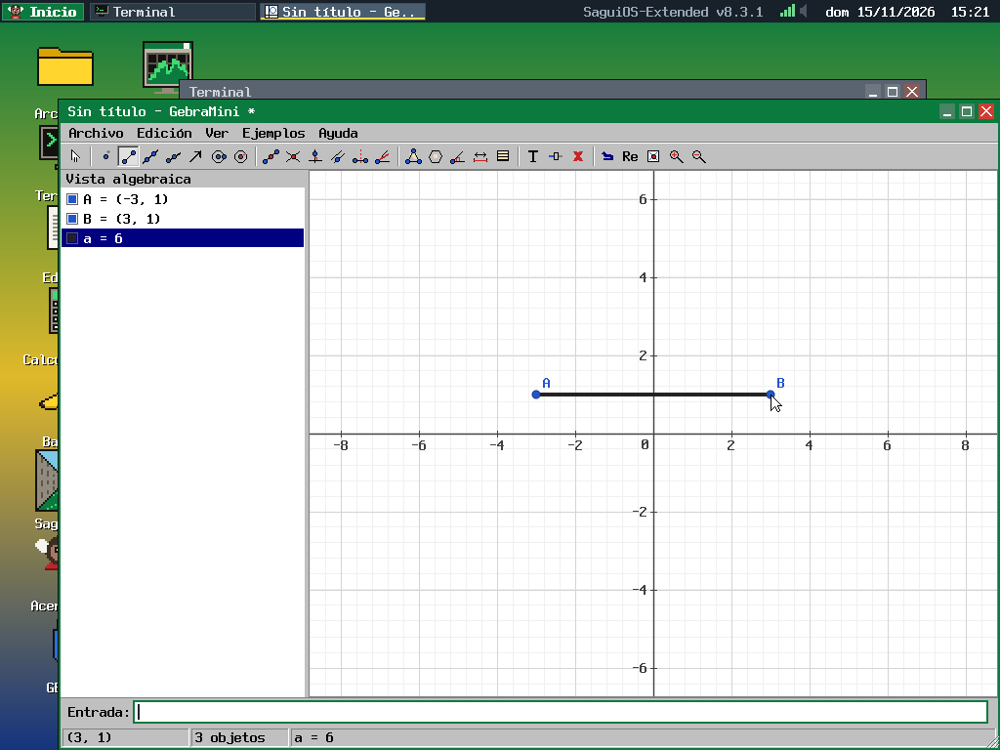
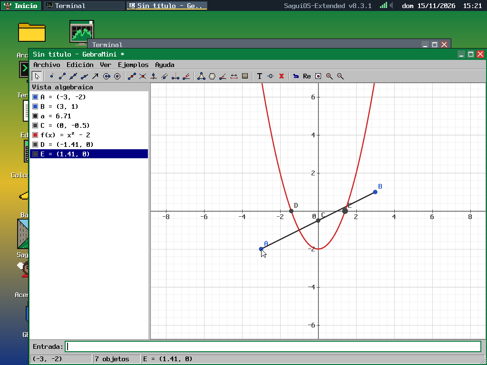
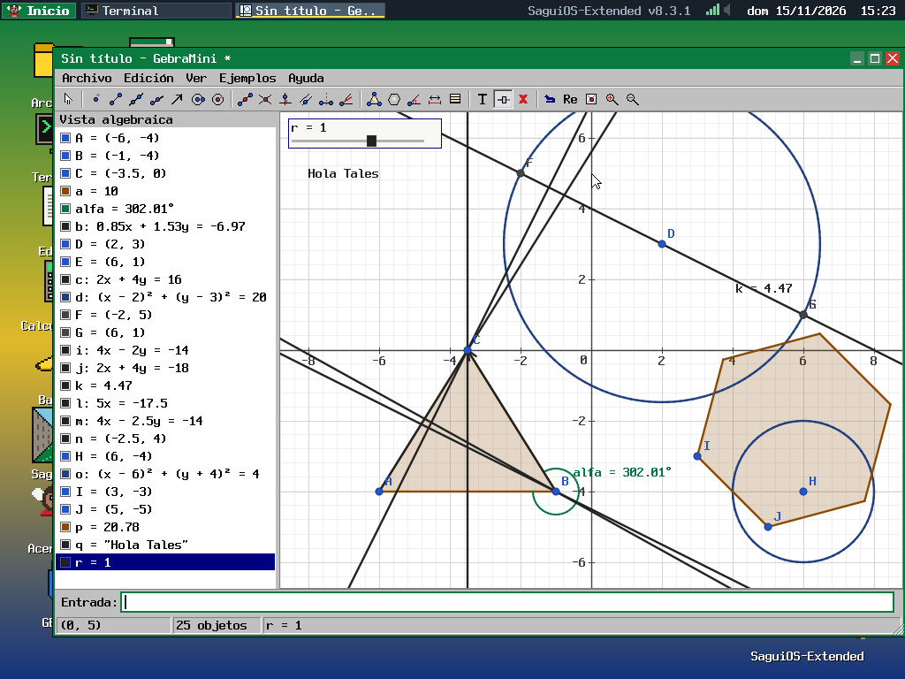
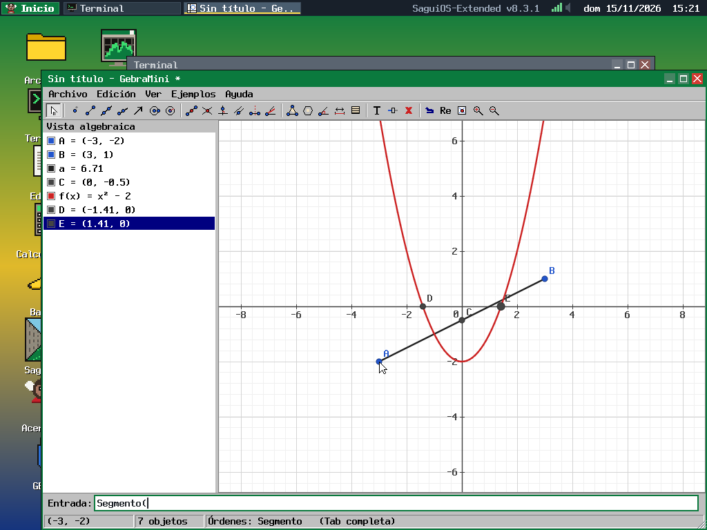
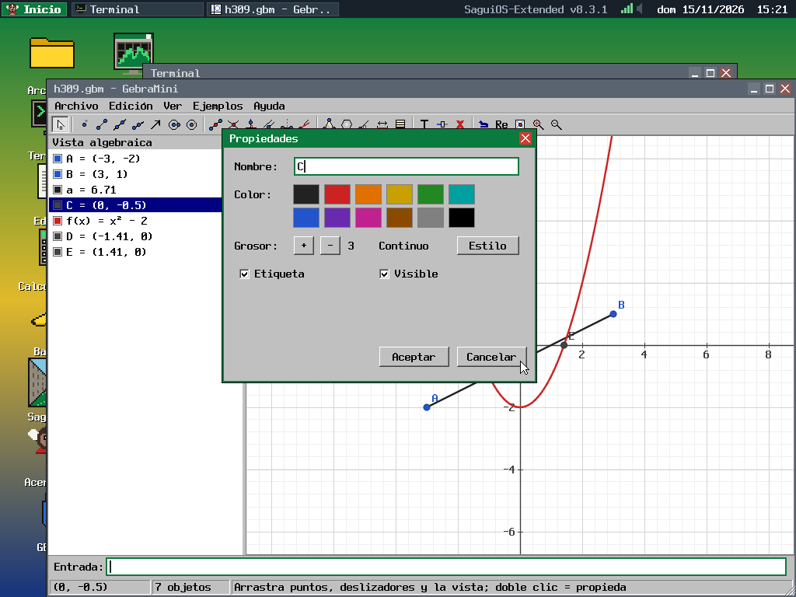
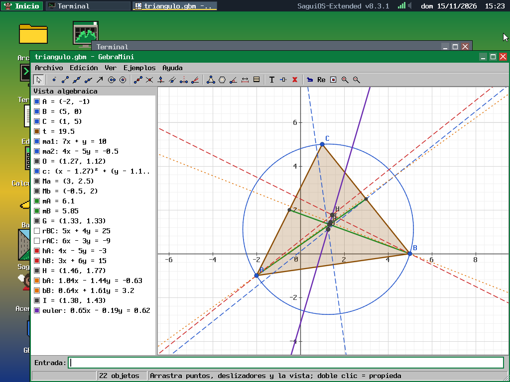
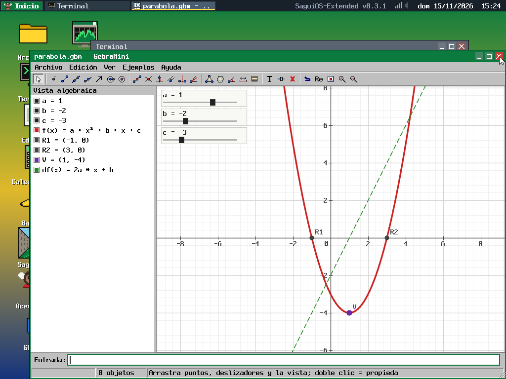
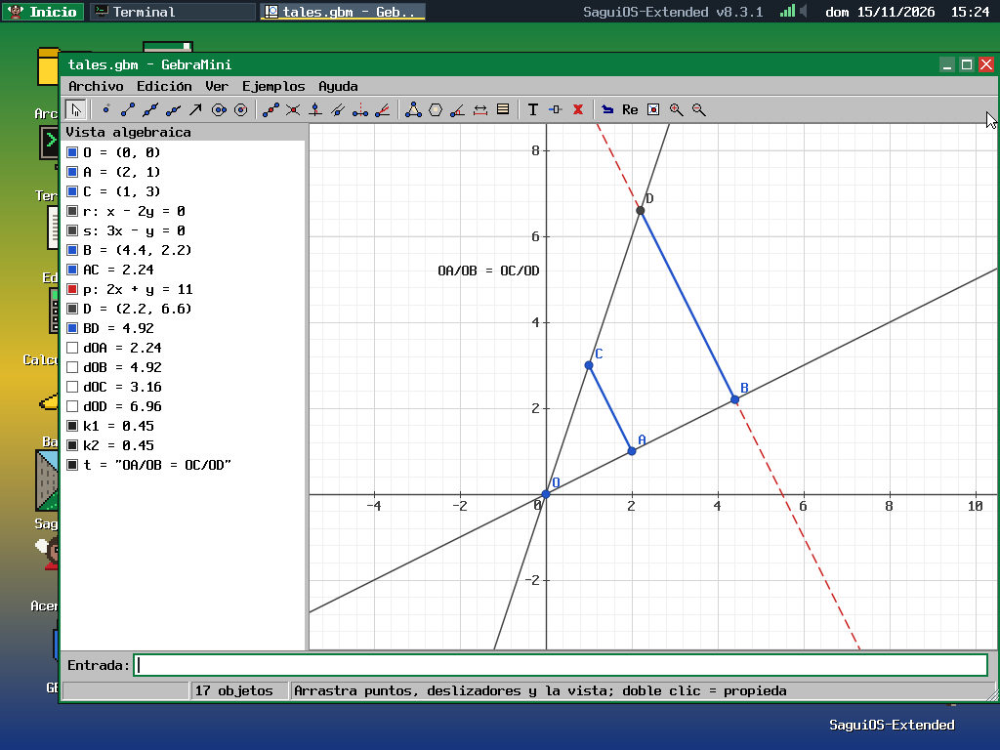
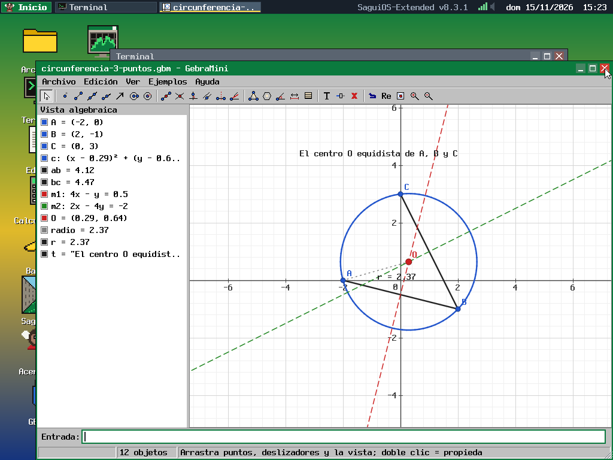

# GebraMini: geometría dinámica y funciones

> Mejora 128, decisión D309 (v8.3.2). Programa `gebramini`, en el menú Inicio, grupo «Educación».
> Licencia **GPL-3.0-or-later**, © 2026 Alejandro Anuncibay.

## Créditos

GebraMini nace del **prototipo GebraMini de Alejandro Anuncibay** (C++/SDL 2, unas 150 líneas: plano con
cuadrícula, puntos arrastrables, segmentos, circunferencias, zoom con la rueda y desplazamiento con el botón
derecho). La aplicación nativa de SaguiOS está **escrita desde cero** a partir de esas ideas y es
independiente: sin SDL y sin código, iconos ni nombres de marca de otros programas de geometría dinámica
(de los que solo toma la inspiración de la idea).

## Qué es

Un plano en el que se construyen figuras que **dependen unas de otras**: el punto medio sigue a los extremos
del segmento, una intersección se recalcula, la gráfica de una función cambia al mover un deslizador. Se
trabaja con el ratón (barra de herramientas) o escribiendo órdenes (barra de entrada). Todo se puede guardar
(`.gbm`), exportar a imagen (PNG) y a PDF vectorial.



## La ventana

- **Barra de menús**: Archivo (nuevo, abrir, guardar, exportar a PNG y a PDF), Edición (deshacer, rehacer,
  borrar, propiedades), Ver (ver todo, cuadrícula, ejes, vista algebraica, decimales), Ejemplos y Ayuda.
- **Barra de herramientas**: 22 herramientas conmutables, más deshacer, rehacer, «ver todo» y zoom.
- **Vista algebraica** (izquierda): cada objeto con su valor (`A = (1, 2)`, `c: (x - 1)² + (y - 2)² = 9`,
  `f(x) = x² - 2`, longitudes, áreas y ángulos). El cuadradito de color muestra u oculta el objeto; un clic
  lo elige; el doble clic abre sus propiedades. La barra entre las dos vistas se arrastra para cambiar el
  ancho.
- **Vista gráfica** (centro): ejes graduados con números, cuadrícula, antialias. **Rueda**: zoom hacia el
  cursor. **Arrastrar** el fondo (o con el botón derecho): desplazar. Los deslizadores aparecen arriba a la
  izquierda y se arrastran.
- **Barra de entrada** (abajo): escribe una orden y pulsa Intro. **Tab** completa el nombre de una orden;
  **↑ ↓** recorren las órdenes anteriores. Los errores se explican en la barra de estado.



## Herramientas

Cada herramienta dice en la barra de estado qué hay que elegir. En todas, un clic en el plano vacío crea un
punto libre y un clic sobre una recta, circunferencia, polígono o función crea un punto **sobre** ella (que
luego se desliza por el objeto). **Esc** cancela lo elegido; con nada pendiente, vuelve a «Mover».

| Herramienta | Qué se elige | Orden equivalente |
| --- | --- | --- |
| Mover | arrastra puntos, deslizadores, rectas y polígonos de puntos libres, textos y la vista; doble clic = propiedades | |
| Punto | clic en el plano (o sobre un objeto) | `Punto(x, y)`, `PuntoEn(objeto, t)` |
| Segmento / Recta / Semirrecta / Vector | dos puntos | `Segmento(A, B)`, `Recta(A, B)`, `Semirrecta(A, B)`, `Vector(A, B)` |
| Circunferencia (centro y punto) | el centro y un punto | `Circunferencia(A, B)` |
| Circunferencia (centro y radio) | el centro; después se escribe el radio | `Circunferencia(A, 3)` |
| Punto medio | dos puntos o un segmento | `PuntoMedio(A, B)` |
| Intersección | dos objetos (se crean todos los cortes) | `Interseca(a, b)` |
| Perpendicular / Paralela | un punto y una recta | `Perpendicular(P, r)`, `Paralela(P, r)` |
| Mediatriz | dos puntos o un segmento | `Mediatriz(A, B)` |
| Bisectriz | tres puntos (el vértice en medio) | `Bisectriz(A, B, C)` |
| Polígono | los vértices; clic en el primero para cerrar | `Poligono(A, B, C, ...)` |
| Polígono regular | dos puntos; después el número de lados | `Poligono(A, B, 6)` |
| Ángulo | tres puntos (vértice en medio; sentido contrario a las agujas) | `Angulo(A, B, C)` |
| Distancia | dos puntos, un segmento, o un punto y una recta | `Distancia(A, B)` |
| Área | un polígono o una circunferencia | `Area(p)` |
| Texto | un clic; después se escribe | `Texto("hola", x, y)` |
| Deslizador | un clic | `Deslizador(min, max, paso, valor)` |
| Borrar | un objeto (se borra también lo que depende de él) | |



## Expresiones y órdenes

La barra de entrada acepta:

```
A = (1, 2)              un punto libre
B = A + (3, 0)          un punto que depende de A (no se arrastra; sigue a A)
f(x) = sin(x) + x^2/4   una función de x   (también y = x^2 o g = 2x + 1)
a = 2                   un deslizador (cambia el valor si a ya existe)
d = a * 3               un número que depende del deslizador
Recta(A, B)             una orden (sin distinguir mayúsculas ni tildes: Raíz = raiz)
r = Recta(A, B)         con nombre
Perpendicular(P, Recta(A, B))   las órdenes se pueden anidar
```

- **Números**: se escriben con **punto decimal** (`1.5`, `2e-3`); la coma separa argumentos.
- **Operadores**: `+ - * / ^`; `^` asocia por la derecha y `-x^2` es `-(x^2)`. El producto puede ir
  implícito (`2x`, `3(x+1)`, `(x+1)(x-1)`); `²` y `³` valen como `^2` y `^3`.
- **Funciones**: `sin cos tan asin acos atan sinh cosh tanh exp ln log` (base 10; `log(b, x)` con base) `log2
  log10 sqrt cbrt abs floor ceil round sign`, de dos argumentos `atan2 min max mod hypot pow`, y sobre puntos
  `abscisa(P)`, `ordenada(P)`. También en español: `sen`, `tg`, `arcsen`, `piso`, `techo`, `redondear`, `signo`.
  Constantes: `pi` y `e`.
- **Puntos y vectores** valen en las expresiones: `(1, 2) + (3, 4)`, `2 * (1, 2)`, `abs((3, 4))`.

### Órdenes

| Orden | Resultado |
| --- | --- |
| `Punto(x, y)`, `PuntoEn(objeto, t)` | punto libre / punto sobre un objeto (`t` = posición) |
| `PuntoMedio(A, B)`, `PuntoMedio(s)` | punto medio de dos puntos o de un segmento |
| `Interseca(a, b)`, `Interseca(a, b, k)` | todos los cortes / el k-ésimo; vale con rectas, semirrectas, segmentos, circunferencias, polígonos y funciones |
| `Recta`, `Semirrecta`, `Segmento`, `Vector` `(A, B)` | |
| `Circunferencia(centro, punto)`, `(centro, radio)`, `(A, B, C)` | |
| `Perpendicular(P, r)`, `Paralela(P, r)`, `Mediatriz(A, B)`, `Bisectriz(A, B, C)` | |
| `Poligono(A, B, C, ...)`, `Poligono(A, B, n)` | polígono / regular de n lados sobre AB |
| `Angulo(A, B, C)`, `Distancia(A, B)`, `Distancia(P, r)`, `Area(p)` | medidas (dependen de los puntos) |
| `Texto("mensaje", x, y)`, `Deslizador(min, max, paso, valor)` | |
| `Derivada(f)`, `Derivada(f, n)` | derivada simbólica (numérica si no hay más remedio) |
| `Raiz(f)`, `Raiz(f, k)`, `Extremo(f)`, `Extremo(f, k)` | raíces / extremos de f entre -30 y 30 |

### Funciones

La gráfica de `y = f(x)` se muestrea de forma adaptativa: se afina donde la curva se dobla y se corta donde
la función no existe o salta (por ejemplo `tan(x)` o `1/x`). Las raíces, los extremos y los cortes de dos
funciones se buscan numéricamente en x entre -30 y 30; una raíz doble (`(x-1)^2`) se encuentra una sola vez.



## Propiedades, deshacer y rehacer

Doble clic en un objeto (o Edición → Propiedades): **nombre**, **color**, **grosor**, **estilo** (continuo,
discontinuo, punteado), **etiqueta** visible y **visible**; en un texto, el mensaje; en un deslizador, los
límites y el paso. **Ctrl+Z** y **Ctrl+Y** deshacen y rehacen (40 pasos).



## Ficheros

- **`.gbm`** (Ctrl+S, Ctrl+O): texto legible, una orden por línea, en orden de dependencia:

  ```
  # GebraMini 1
  vista 0 0 40
  A = (-3, -2)
  B = (3, 1)
  a = Segmento(A, B)
  C = PuntoMedio(A, B)
  f(x) = x^2 - 2
  D = Raiz(f, 1)
  propiedades A: color=ff0000 grosor=5 estilo=0 rotulo=1 visible=1
  ```

  Se puede editar a mano. Si una línea falla, el error dice cuál.
- **PNG** (Archivo → Exportar a PNG): la vista tal como está, con antialias.
- **PDF** (Ctrl+P): A4 apaisado, **vectorial**: líneas, curvas y circunferencias son trazos finos; el texto es
  texto (se puede buscar y copiar).
- Sin ventana, para scripts y pruebas: `gebramini --abrir f.gbm [--pdf s.pdf] [--png s.png] [--guardar s.gbm]`
  y `gebramini --orden "f(x)=x^2-2" "Raiz(f)" [--pdf ...]` (imprime cada objeto con su valor).

## Ejemplos (Ejemplos, o `/ejemplos/gebramini/`)

| Ejemplo | Qué enseña |
| --- | --- |
| `triangulo.gbm` | un triángulo con sus rectas notables: mediatrices y circuncentro O, medianas y baricentro G, alturas y ortocentro H, bisectrices e incentro I, y la recta de Euler por O, G y H. Mueve A, B o C. |
| `circunferencia-3-puntos.gbm` | la circunferencia por tres puntos: su centro es el corte de dos mediatrices |
| `parabola.gbm` | `f(x) = a x² + b x + c` con los deslizadores `a`, `b`, `c`, sus raíces, su vértice y su derivada |
| `tales.gbm` | el teorema de Tales: `OA/OB = OC/OD` para una paralela a AC |






## Cómo está hecho

El motor (`userland/gebramini/`) no dibuja ni toca el sistema: analizador y evaluador de expresiones con
`double` de la FPU x87 (sin libm), derivada simbólica, objetos con grafo de dependencias y recálculo
perezoso. El programa (`userland/programas/gebramini.c`) trae la interfaz, un dibujo único que sirve para la
ventana, el PNG y el PDF, y los ficheros. Las pruebas: `tests/gebramini_unidad.c` (en el PC) y
`tests/h309_gebramini.py` (en QEMU, con el ratón). Detalles y decisiones en D309 (`docs/decisoes.md`).

## Límites

Sin cónicas implícitas, tangentes, transformaciones (simetría, giro), lugares geométricos ni animación de
deslizadores; cortes, raíces y extremos de funciones solo entre x = -30 y 30; los valores se muestran con 2
decimales por defecto (Ver → Decimales).
