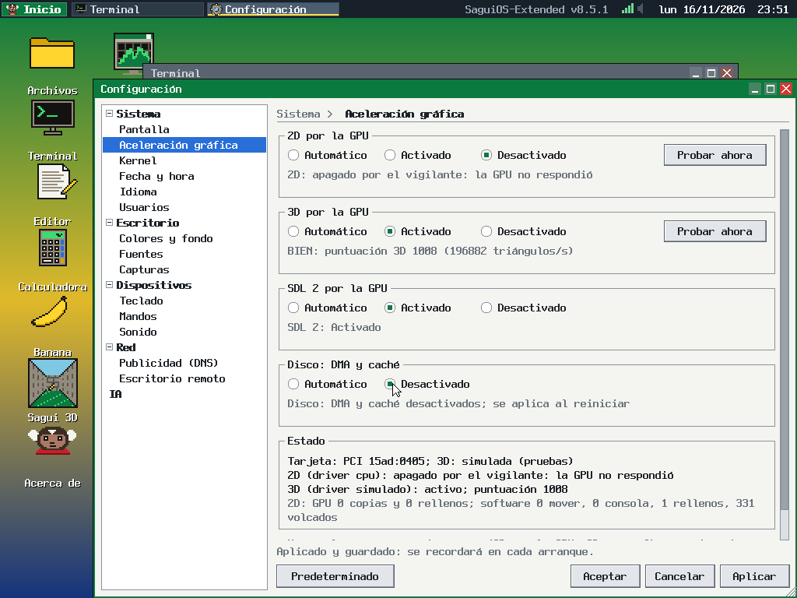

# Soporte de tarjetas gráficas (GPU) por versión

Estado a 2026-11-16 (v8.0; 3dfx, Mach64 y S3, v8.3.3; Radeon de la v8.3 completadas, D357; Intel Gen7-Gen8, v8.5.2). **Leyenda:** ✅ funciona y probado · 🟡 hecho, falta confirmarlo en hardware real ·
🔧 en desarrollo · 📅 planificado · — no previsto. El 3D por software (SaguiGL) funciona en **todas** las tarjetas.

## Lo que hay hoy y lo que viene

| Familia (ejemplos) | Imagen (pantalla) | 2D acelerado | 3D por GPU | Vulkan | Máquina de prueba |
| --- | --- | --- | --- | --- | --- |
| **Cualquier GPU** con VESA (BIOS) o GOP (UEFI) | ✅ VBE desde siempre; GOP desde v8.0 | — (copia por la CPU, optimizada) | — (SaguiGL por software) | — | todas |
| **QEMU estándar** (Bochs/BGA), virtio | ✅ cambio de resolución en caliente | — | — | — | QEMU |
| **VMware SVGA II** (VMware, `-device vmware-svga`) | ✅ | ✅ v7.2 (D195) | — | — | QEMU/VMware |
| **Intel Gen3** GMA 900/950, 3100 (945, G33) | ✅ | ✅ v7.2, blitter (D195) | 🔧 **v8.3** (D285); etapas, robustez y RAM en el GTT en v8.5.2 (D358) | — | portátiles con 945 |
| **Intel Gen4-Gen5** GM45, HD de 1.ª gen. Core (Ironlake) | ✅ | ✅ v7.2, blitter (D195) | 📅 v11 (111) | — | Toshiba L635 (Gen5) |
| **Intel Gen6** HD 2000/3000 (Sandy Bridge) | ✅ | ✅ v7.2, blitter por BCS (D195) | 📅 v11 (111) | — | Lenovo G470 |
| **Intel Gen7** HD 2500/4000 (Ivy Bridge), Gen7.5 HD 4200-5200 (Haswell) | ✅ (VESA/GOP) | 🟡 **v8.5.2**, blitter por el anillo BCS heredado, con VESA y con GOP (D359), sin probar en hardware | 📅 v11 (111) | 📅 v11, hasvk (64 bits) | **Toshiba L850** (HD 4000, `8086:0166`) |
| **Intel Gen8** HD 5300-6300, Iris 6100 (Broadwell) | ✅ (VESA/GOP) | 🟡 **v8.5.2**, blitter por el anillo BCS heredado (D359), sin probar en hardware | 📅 v11 (111) | 📅 v11, ANV (64 bits) | (ninguna) |
| **Intel Gen9-Gen12** Skylake…Alder Lake (HD/UHD 6xx, Iris Xe) | ✅ (GOP) | 📅 v11 (111): necesita execlists; hoy la CPU, con el motivo en el log (D359) | 📅 v11 (111) | 📅 v11, ANV (64 bits) | **mini PC i3-1220P** (Gen12) |
| **Radeon R5xx** X1300-X1950 (Mobility X1400) | ✅ | 🟡 v7.2 (issue #3) | 🟡 **v8.3** (D287): escrito sobre `gpu3d`, apagado hasta `gpu3d encender`; falta probarlo en el Amilo (#24); diagnóstico por etapas (D357) | — | Fujitsu Amilo |
| **Radeon R6xx/R7xx** HD 2000-4000 (HD 4530/4550) | ✅ | 🟡 v7.4, motor DMA (D223, D246; issues #1, #2); R6xx solo con `--acel2d=radeon` | 🟡 **v8.3** (D284; R6xx desde la D357, v8.5.2): escrito sobre `gpu3d`, apagado hasta `gpu3d probar`/`gpu3d encender`; falta probarlo en el dv7 (#23) | — | **HP dv7** |
| **Radeon Evergreen/NI** HD 5000-6000 (Cedar…Hemlock, Barts, Turks, Caicos, Cayman; sin las APU) | ✅ (VESA/GOP) | 🟡 **v8.3**, motor DMA (D286), sin probar en hardware | — | — | Toshiba L635 (Mobility HD 5000, `1002:68e0`) |
| **Radeon GCN 1.0** HD 7700-7900, R7 240/250, R9 270/280 (Tahiti, Pitcairn, Cape Verde, Oland) | ✅ (VESA/GOP) | 🟡 **v8.5.2**, motor DMA sin microcódigo (D360), sin probar en hardware | 📅 v11 (110) | 📅 v11, RADV (64 bits) (108) | (por definir; Ryzen B450 si lleva una) |
| **Radeon GCN 1.1-5** HD 7790, R9 290/390, RX 400/500 (Polaris), Vega | ✅ (GOP) | 📅 v11 por SDMA (110); desde v8.5.2 el log dice la familia y por qué copia la CPU (D360) | 📅 v11 (110) | 📅 v11, RADV (64 bits) (108) | (por definir) |
| **Radeon RDNA 1/2/3** RX 5000-7000 | ✅ (GOP) | 📅 v11 (110, tras GCN) | 📅 v11 (110) | 📅 v11, RADV (64 bits) (108) | (por definir) |
| **NVIDIA GeForce 6/7**, nForce 6100-7050 | ✅ | 🟡 v7.4 (D226), sin probar en hardware | — | — | — |
| **NVIDIA posteriores** (8000 en adelante) | ✅ (VESA/GOP) | — | — | — | — |
| **3dfx Banshee/Voodoo3/4/5** (Banshee, Voodoo3 1000-3500, Velocity, Voodoo4/5 VSA-100) | ✅ (VESA) | 🟡 **v8.3.3** (D305), motor 2D por MMIO, también a 16 y 24 bits; probado solo en 86Box | — | — | 86Box (`p2-voodoo3`, `p2-450-voodoo3500`) |
| **ATI Mach64 / Rage** GX, CT, VT, 3D Rage II/IIC, Rage Pro, LT Pro, XL, Mobility | ✅ (VESA) | 🟡 **v8.3.3** (D308), motor 2D por MMIO; en 24 bits con x3; probado solo en 86Box (VT2) | — | — | 86Box `p2-mach64` |
| **S3 Trio64 / ViRGE** Trio64, V+, UV+, V2; ViRGE, VX, DX/GX, GX2, Trio3D, Trio3D/2X | ✅ (VESA con BIOS VBE 2.0; con las VBE 1.2, 800x600x16 con bancos y la ventana lineal del chip abierta por la etapa 2, D331, #40; 🟡 en hardware real) | 🟡 **v8.3.3** (D308): Trio64 por puertos, ViRGE por MMIO; probado solo en 86Box (Trio64V2/DX, ViRGE/DX, ViRGE/GX2 AGP y Trio3D/2X) | — | — | 86Box `p2-s3trio64`, `p2-s3virge`, `p2-s3trio64-vbe12`, `p2-s3virge-vbe12`, `p2-s3virgegx2` (con una Voodoo como segunda tarjeta), `p2-s3trio3d2x` |

## Cómo activar la aceleración (D323)

Desde la v8.4.3 no hace falta la terminal: **Configuración > Pantalla > «Aceleración gráfica»** (botón arriba a la
derecha) enseña la tarjeta, el driver 2D y el 3D con su estado, y deja elegir **Automático / Activado / Desactivado**
para el 2D y el 3D por la GPU, la SDL 2 por la GPU (juegos y emuladores) y el DMA y la caché del disco, con «Probar
ahora» (autoprueba) y «Restablecer valores seguros». Lo elegido se aplica al momento y en cada arranque
(`/home/.config/sagui.conf`, más la cabecera de arranque del disco para lo que va antes del kernel). Cambiar la GPU pide
el diálogo de administrador.

- Las tarjetas **sin probar en hardware** (Radeon R5xx y R7xx: 3D apagado por defecto) enseñan un aviso: «Experimental:
  si la pantalla se queda congelada, reinicia; el sistema volverá al modo seguro».
- **Modo seguro:** si un arranque con la aceleración activada a mano no llega al escritorio, el siguiente restablece
  todo en automático y avisa. También se fuerza con **Mayús pulsado al arrancar** (2D por la CPU, 3D por software, sin
  aplicar la configuración).
- Orden equivalente (soporte y SSH): `configuracion aceleracion [2d|3d|sdl auto|si|no | disco auto|no | restablecer]`.

## Otras piezas gráficas por versión

| Versión | Qué trae |
| --- | --- |
| v7.2 | Capa 2D común con autoprueba (D195); Intel Gen3-Gen6, X1400 y VMware |
| v7.4 | Radeon R6xx/R7xx por DMA (D223), GeForce 6/7 (D226) |
| v8.0b-v8.0b4 | Pestaña GPU en Información del PC con benchmark 2D (D243), vigilante del 2D y tormentas de IRQ (D244), write-combining (D245), R7xx revisado (D246) |
| v8.0 | Arranque UEFI con **GOP**: imagen en cualquier GPU moderna sin BIOS (D264) |
| **v8.3** (en desarrollo) | **3D por GPU** en R5xx, R6xx/R7xx e Intel Gen3, **2D en Radeon Evergreen/NI** con una **capa 3D común** (pensada ya para amdgpu/Vulkan), renderizador de la SDL 2 por GPU, varias pantallas (fase 1), puntuación 3D |
| v8.3.1 | Ejemplos y benchmarks 3D, monitor de uso de la GPU |
| v8.3.3 | Drivers de la época (mejora 126): **2D en las 3dfx** Banshee/Voodoo3/Voodoo4/5 (D305), con la capa 2D común ya en 16 y 24 bits, y **2D en ATI Mach64/Rage y S3 Trio64/ViRGE** (D308); probados en 86Box |
| v8.5.2 | **2D en Intel Gen7, Gen7.5 y Gen8** (Ivy Bridge, Haswell, Broadwell) por el anillo BCS heredado, con VESA y con GOP (D359); Gen9-Gen12 reconocidas, en la CPU con el motivo |
| v10.0 | SaguiOS de **64 bits** (base para Vulkan), sin quitar los 32 bits |
| **v11** | **GPU modernas, Intel primero**: Intel Gen5-Gen12 (111) y luego AMD GCN/RDNA (107, 110): pantalla nativa, 2D, 3D en 32 bits y **Vulkan** en 64 bits (ANV/hasvk, RADV) (108) |

## Qué probar en una Intel HD 4000 (L850) o en el mini PC i3-1220P (D359)

1. Arrancar normal (BIOS/VESA y, si se puede, también por UEFI/GOP) y guardar el registro: `dmesg > /home/acel.txt`
   (o una foto de las líneas `[ACEL2D]`).
2. **L850 (HD 4000):** tiene que salir `la pantalla (…) es de la tarjeta 8086:0166`, `plano A: … lineal, 32 bits, mismo pitch`,
   `GTT …: valido y contiguo`, `GPU despierta`, `el anillo BCS ejecuta ordenes` y la autoprueba completa. Si pone
   `[ACEL2D] activo: Intel HD 4000 M …`: `acel2d`, `acel2d probar --detalle`, otro `dmesg`, la pestaña GPU de Información
   del PC, mover ventanas y desplazar texto en el terminal. Si pone `[ACEL2D] CPU: …`, el motivo dice qué no cuadró
   (plano, GTT, forcewake, anillo): enviar el registro entero.
3. **Mini PC i3-1220P (Gen12):** tiene que quedarse en la CPU con `(Intel Gen12, Alder Lake-P): el 2D necesita execlists`
   (o `ninguna tarjeta de video tiene la pantalla` si el GOP dejó la apertura por encima de 4 GB). Nada debe cambiar.
4. Ante cualquier problema de imagen: `acel2d apagar`, o arrancar con `--sin-acel2d` (o Mayús al arrancar, D323).

## Qué probar en una Mach64/Rage o una S3 Trio64/ViRGE de verdad (D308)

1. Arrancar normal y guardar el registro: `dmesg > /home/acel.txt` (o una foto de las líneas `[ACEL2D]`).
2. Si pone `[ACEL2D] activo: ATI …` o `S3 …`: `acel2d`, `acel2d probar --detalle`, otro `dmesg`, la pestaña GPU de
   Información del PC, mover ventanas y desplazar texto en el terminal.
3. Si pone `[ACEL2D] CPU: …`, el motivo dice qué no cuadró (registros que no responden, pitch o formato del CRTC
   distinto del VBE, otra tarjeta en los puertos de la VGA…): enviar el registro entero.
4. Ante cualquier problema de imagen: `acel2d apagar`, o arrancar con `--sin-acel2d`.
5. Con una S3 cuya BIOS sea VBE 1.2 (D331): la línea `[5/6] video: 800x600x16 (S3: bancos + ventana lineal)` de la
   etapa 2. Si la pantalla sale rota o negra, una foto, y arrancar sin `--vesa` (modo texto).

## Qué probar en el Toshiba L635 (Radeon Evergreen, D286)

1. Arrancar normal y guardar el registro: `dmesg > /home/evg.txt` (o una foto de las líneas `[ACEL2D]`).
2. Si pone `[ACEL2D] activo: Radeon HD 5400 (Cedar) …`: `acel2d`, `acel2d probar --detalle`, otro `dmesg`, y la pestaña GPU de Información del PC (benchmark 2D). Mover ventanas, desplazar texto en el terminal, abrir un juego.
3. Si pone `[ACEL2D] CPU: …`, el motivo dice qué comprobación no cuadró (controlador de pantalla, memoria, DMA ocupado…): enviar el registro entero. Si la pantalla es de la Intel del portátil (`es de la tarjeta 8086:…`), el driver de la Radeon ni se intenta.
4. Ante cualquier problema de imagen: `acel2d apagar`, o arrancar con `--sin-acel2d`.

## Qué probar en una Radeon GCN (D360)

1. Arrancar normal y guardar el registro: `dmesg > /home/gcn.txt` (o una foto de las líneas `[ACEL2D]`), y `lspci`.
2. **GCN 1.0** (HD 7700-7900, R7 240/250, R9 270/280): si pone `[ACEL2D] activo: Radeon … (Pitcairn) …`: `acel2d`,
   `acel2d probar --detalle`, otro `dmesg`, la pestaña GPU de Información del PC, mover ventanas y desplazar texto. La
   línea `prueba de CONSTANT_FILL` dice si los rellenos van por el relleno de la GPU o copiando una fila.
3. Si pone `[ACEL2D] CPU: …`, el motivo dice qué comprobación no cuadró (BAR por encima de 4 GB: desactivar «Above 4G
   Decoding» y «Resizable BAR» en la BIOS; controlador de pantalla, memoria virtual, DMA ocupado, prueba del anillo…):
   enviar el registro entero.
4. **GCN 1.1 en adelante** (R9 290/390, RX 460-590, Vega): no se toca la tarjeta; el registro dice la familia, los BAR
   y por qué copia la CPU. Enviarlo igualmente: sirve para planificar la v11.
5. Ante cualquier problema de imagen: `acel2d apagar`, o arrancar con `--sin-acel2d`.

## Qué probar en una 3dfx Voodoo3 (o Banshee, Voodoo4/5) real (D305)

Hasta ahora solo se ha probado en 86Box (Voodoo3 2000 y 3500 AGP con un Pentium II, a 1024x768 y 24 bits).

1. Arrancar normal y guardar el registro: `dmesg > /home/tdfx.txt` (o una foto de las líneas `[ACEL2D]`).
2. Si pone `[ACEL2D] activo: 3dfx Voodoo3 …`: `acel2d`, `acel2d probar --detalle` (los tiempos de cada copia por la
   GPU y por la CPU dicen desde qué tamaño compensa: hoy la CPU hace las de menos de 64x64), otro `dmesg`, y la
   pestaña GPU de Información del PC. Mover ventanas despacio y deprisa, desplazar texto en el terminal (`ls /bin`) y
   mirar que no queden letras rotas ni copias del cursor.
3. Si pone `[ACEL2D] CPU: …`, el motivo dice qué no cuadró (formato del escritorio, stride, inicio, BAR); enviar el
   registro entero. Probar también con `mkimagem.py --bpp 16` y `--bpp 32` si la BIOS los ofrece.
4. Ante cualquier problema de imagen: `acel2d apagar`, o arrancar con `--sin-acel2d`.

Más detalle: mejoras 054, 055, 060, 106-111 y la discusión de GitHub sobre v9.x/v10/v11.

Nota (v8.4.3r2): las **3dfx Voodoo Graphics y Voodoo2** (121a:0001/0002) son aceleradores 3D adicionales, en cadena con la tarjeta de vídeo, sin driver en SaguiOS; infopc las nombra y lo dice (PCI y GPU).
