# Instalar SaguiOS en un disco duro, un SSD o un pendrive (D318)

SaguiOS funciona desde el pendrive (o el CD) en el que lo grabaste: es el **modo en vivo**. Para que
arranque desde el disco del ordenador y guarde lo que hagas, se **instala**: el asistente copia el
sistema que está funcionando a otro disco, con las particiones, las opciones y la configuración que
elijas. Antes de borrar o cambiar nada enseña un resumen y pide confirmación.

> Antes de instalar en un disco con datos, **haz una copia** de lo que te importe. El asistente no
> borra nada sin decirlo, pero un corte de luz o un disco que falla no avisan.

## Abrir el asistente

- En el escritorio del modo en vivo (arrancado de un pendrive o de un CD), el icono **Instalar SaguiOS**;
- o **Inicio > Sistema > Instalar SaguiOS**;
- o, en el Terminal, `instalar --ventana` (con `admin` si no eres administrador).

`instalar` en el Terminal, sin nada más, lista los discos donde se puede instalar; el modo de terminal
completo se explica al final.

## Paso a paso

### 1. Bienvenida

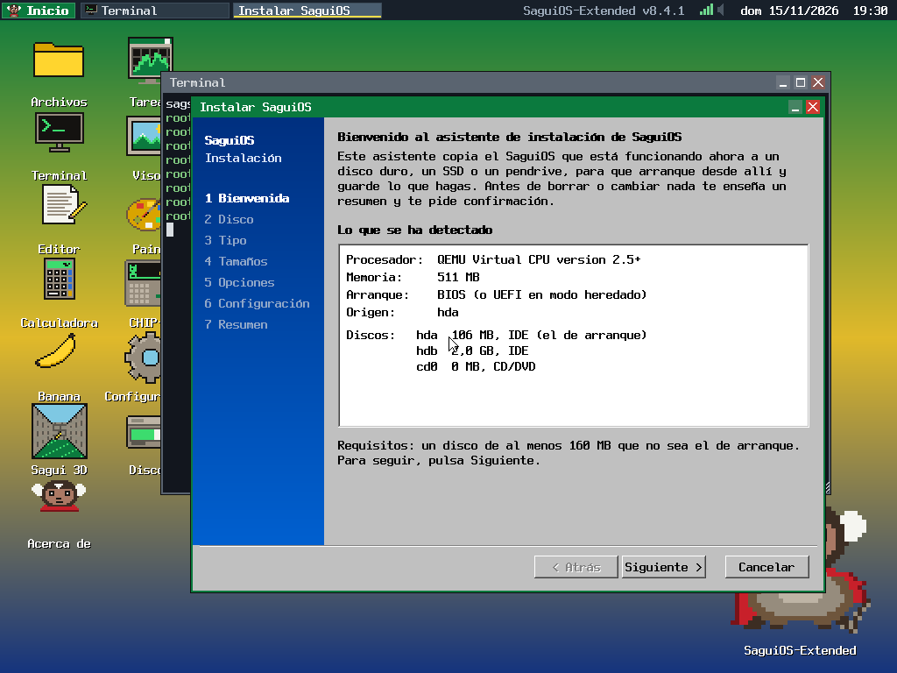

Lo que se ha detectado: el procesador, la memoria, si el ordenador arrancó por **BIOS** o por **UEFI**, el
disco del que se copia el sistema y los demás discos. Hace falta un disco de al menos 160 MB que no sea
el de arranque.

### 2. Disco de destino

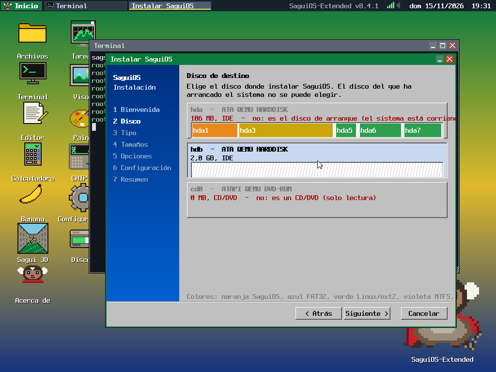

Cada disco con su modelo, su tamaño, su tipo (IDE, SATA, NVMe —también de bloques de 4096— o pendrive USB)
y sus particiones dibujadas en una barra (naranja SaguiOS, azul FAT32, verde Linux/ext2, violeta NTFS,
rayado lo libre). El disco del que ha arrancado el sistema no se puede elegir.

### 3. Tipo de instalación

**Usar todo el disco**: se borra todo lo que tiene. El asistente dice qué se pierde (cada partición con su
formato y su etiqueta) y no deja seguir hasta que escribes el nombre del disco (`hdb`, `usb0`...).

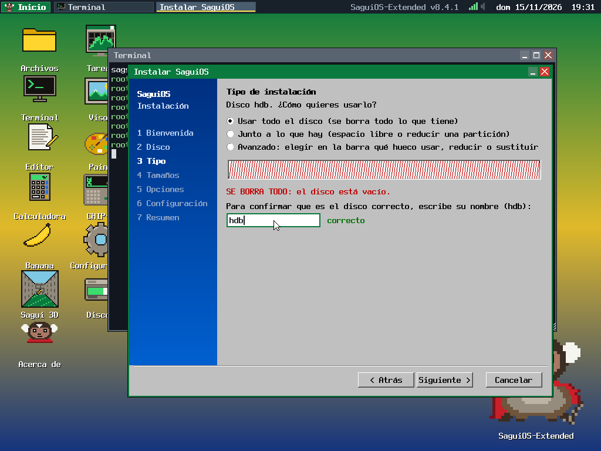

**Junto a lo que hay**: SaguiOS se instala sin tocar lo que ya hay. Si el disco tiene espacio libre, se usa;
si no, se **reduce** una partición FAT32 o ext2 (por ejemplo, la de datos de un pendrive o de Windows en
FAT32). Mueve el **tirador** de la barra (o usa las flechas, o escribe el tamaño nuevo en MB): lo naranja es
lo que tendrá SaguiOS.

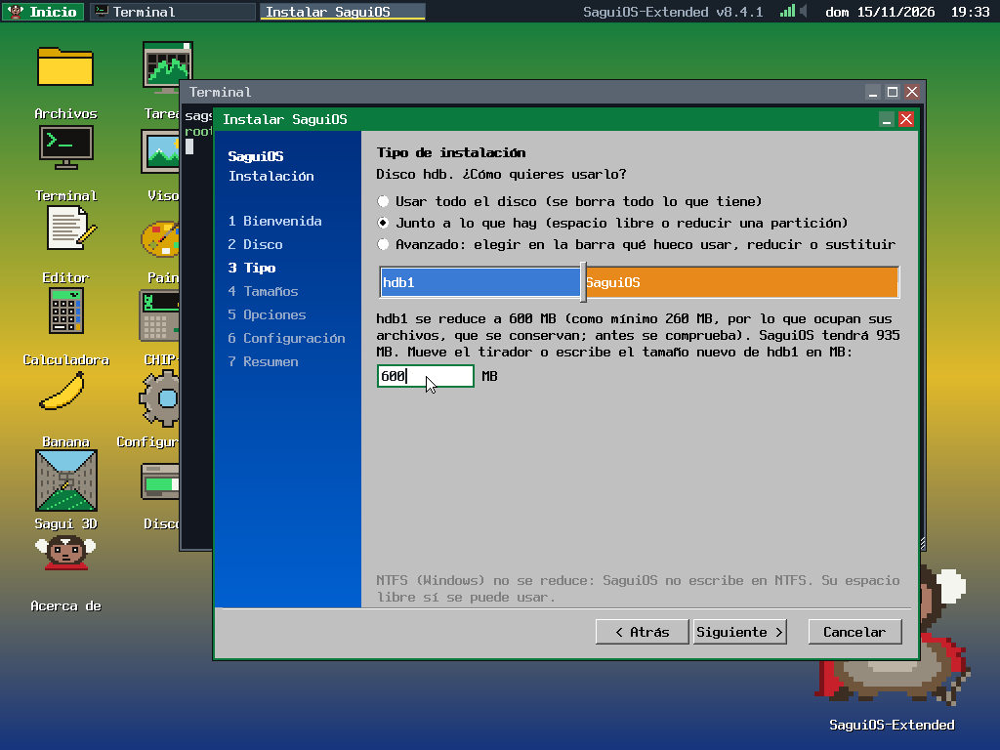

- Reducir **no mueve datos**: solo se corta el final de la partición si allí no hay nada. El mínimo es lo
  que ocupan sus archivos (y, en FAT32, 65.525 clústeres: por debajo dejaría de ser FAT32). Si los datos
  están repartidos hasta el final, desfragmenta antes la partición desde Windows.
- Antes de reducir se comprueba el sistema de archivos (sin escribir nada); si algo no cuadra, no se toca.
- **NTFS no se reduce**: SaguiOS no escribe en NTFS. Redúcela antes desde Windows (Administración de
  discos) y usa aquí el espacio libre que quede.
- **El arranque por BIOS de ese disco pasa a ser el de SaguiOS**: el otro sistema sigue ahí, pero no arranca
  desde ese disco hasta que se restaure su cargador. El resumen lo recuerda.

**Avanzado**: pulsa en la barra un hueco libre (se usa), una partición FAT32/ext2 (se reduce con el tirador)
u otra partición primaria y «Sustituir (borrar)» (con su propia confirmación). Para crear, borrar o formatear
particiones a mano está **Discos > Particiones**.

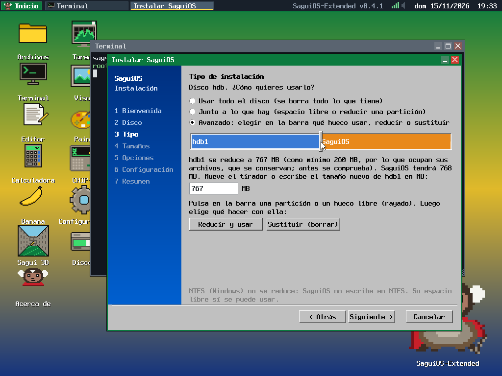

### 4. Tamaños

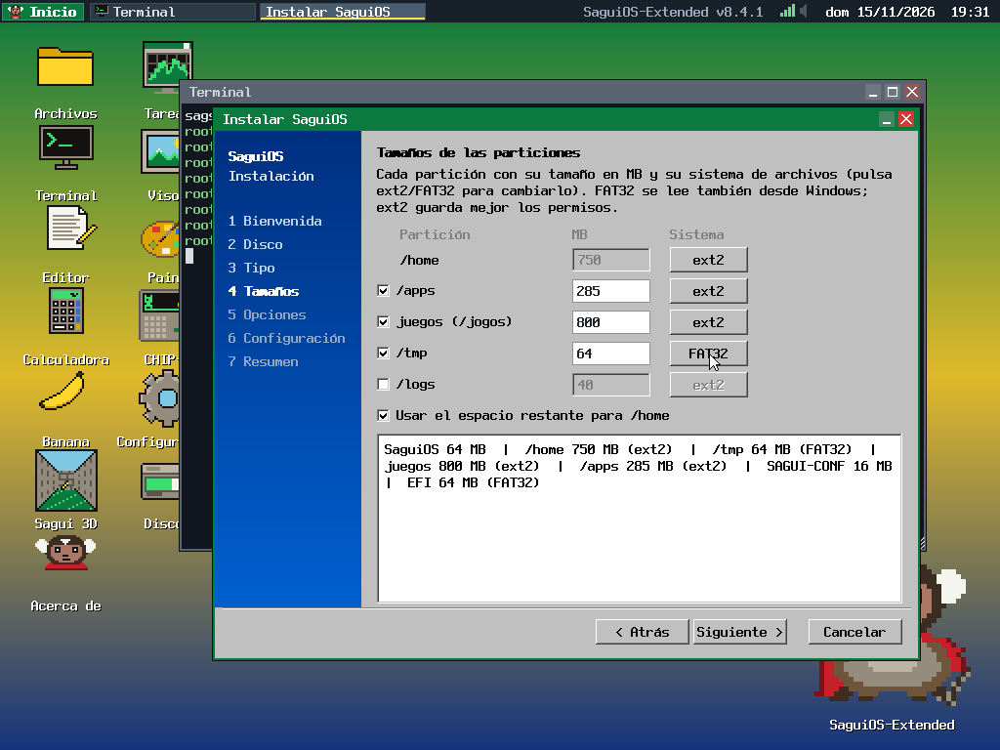

Las particiones de datos, cada una con su tamaño en MB y su sistema de archivos (pulsa **ext2/FAT32** para
cambiarlo: FAT32 se lee también desde Windows; ext2 guarda mejor los permisos):

| Partición | Etiqueta | Para qué |
| --- | --- | --- |
| `/home` | `SAGUI-DATOS` | tus archivos y tu configuración |
| `/apps` | `SAGUI-APPS` | las aplicaciones que no van en la memoria (D194) |
| juegos | `SAGUI-JOGOS` | `/jogos`, un juego por carpeta (D181, D228) |
| `/tmp` | `SAGUI-TMP` | temporales en disco (si no, en la memoria) |
| `/logs` | `SAGUI-LOGS` | los registros del sistema, que sobreviven a un reinicio |

Además siempre se crean la partición de SaguiOS (el doble de lo que ocupa el sistema, al menos 64 MB) y
`SAGUI-CONF` (16 MB, la configuración del sistema: usuarios, contraseñas, claves; D256). Los valores por
defecto salen del tamaño del disco; **Usar el espacio restante para /home** le da a `/home` todo lo que sobra.
Abajo se ve el plan entero, o en rojo por qué no cabe.

### 5. Opciones

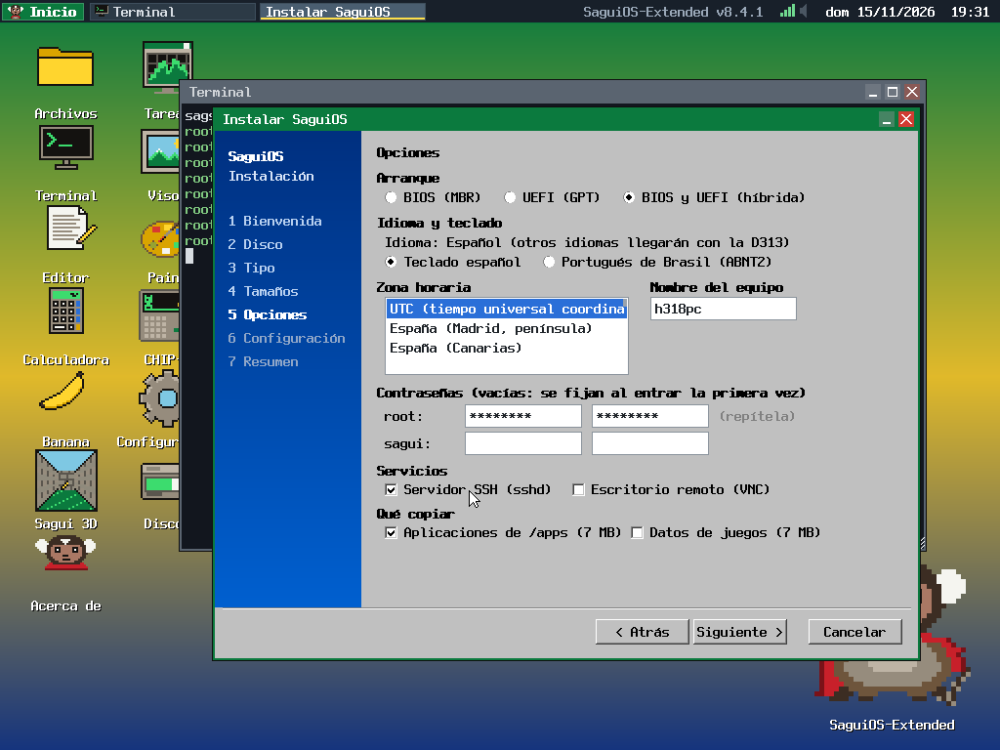

- **Arranque**: *BIOS (MBR)*, *UEFI (GPT)* —solo con el disco entero: EFI, SaguiOS, `/home` y la
  configuración, sin `/apps` ni juegos— o *BIOS y UEFI* (MBR con partición EFI, como la imagen: arranca de
  las dos maneras; es la opción por defecto). Ver [uefi.md](uefi.md).
- **Idioma** (por ahora, español) y **teclado** (español o ABNT2).
- **Zona horaria**.
- **Contraseñas** de `root` y del usuario `sagui` (dos veces cada una). Se guardan como hash PBKDF2 en
  `SAGUI-CONF`; vacías, se fijan al entrar por primera vez.
- **Nombre del equipo** (lo que dice `hostname`).
- **Servicios**: el servidor SSH y el escritorio remoto (VNC), apagados por defecto.
- **Qué copiar**: las aplicaciones de `/apps` y los datos de juegos de este sistema.

### 6. Configuración de esta sesión

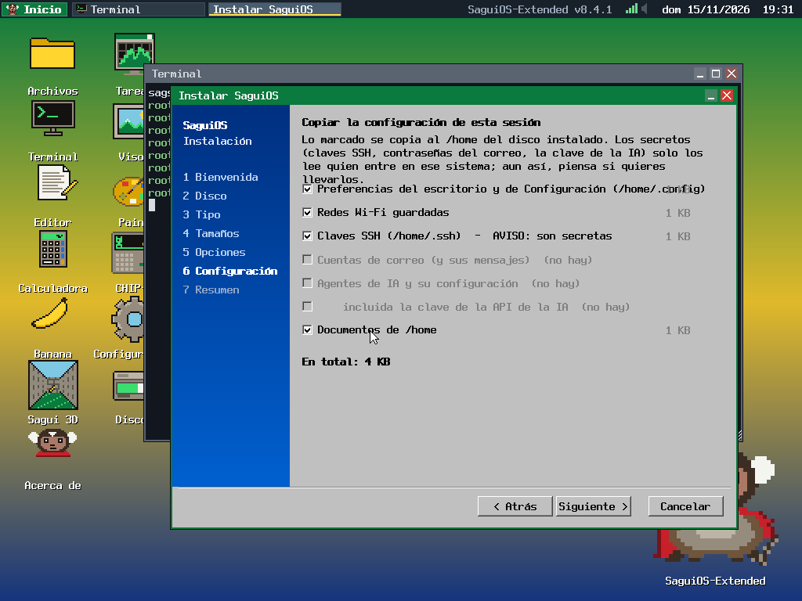

Lo marcado se copia al `/home` del disco instalado, con su tamaño al lado: las preferencias del escritorio y
de Configuración, las redes Wi-Fi guardadas, las claves SSH (son secretas: piensa si quieres llevarlas), las
cuentas de correo con sus mensajes, los agentes de IA (la clave de la API solo si marcas también esa casilla)
y los documentos de `/home`.

### 7. Resumen

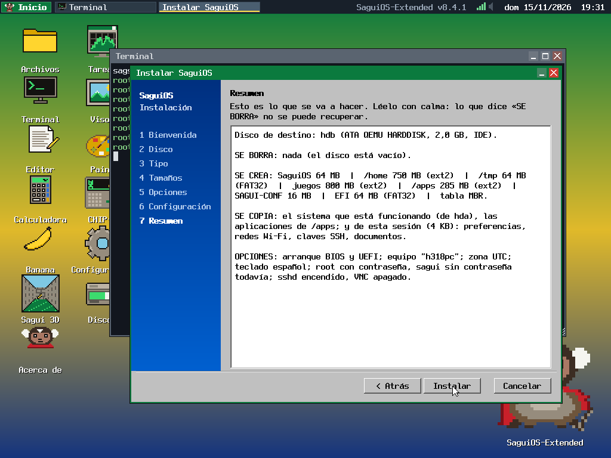

Qué se **reduce**, qué se **borra**, qué se **crea** y qué se **copia**, y las opciones elegidas, en texto
claro. **Instalar** pide una confirmación más.

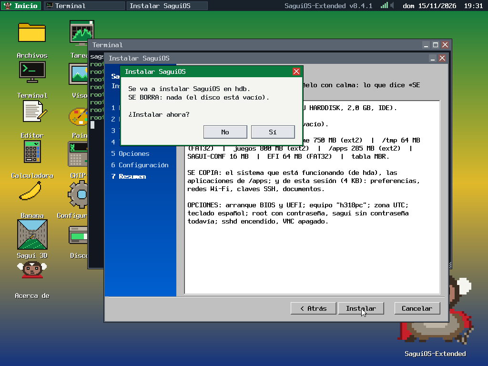

### 8. Instalación

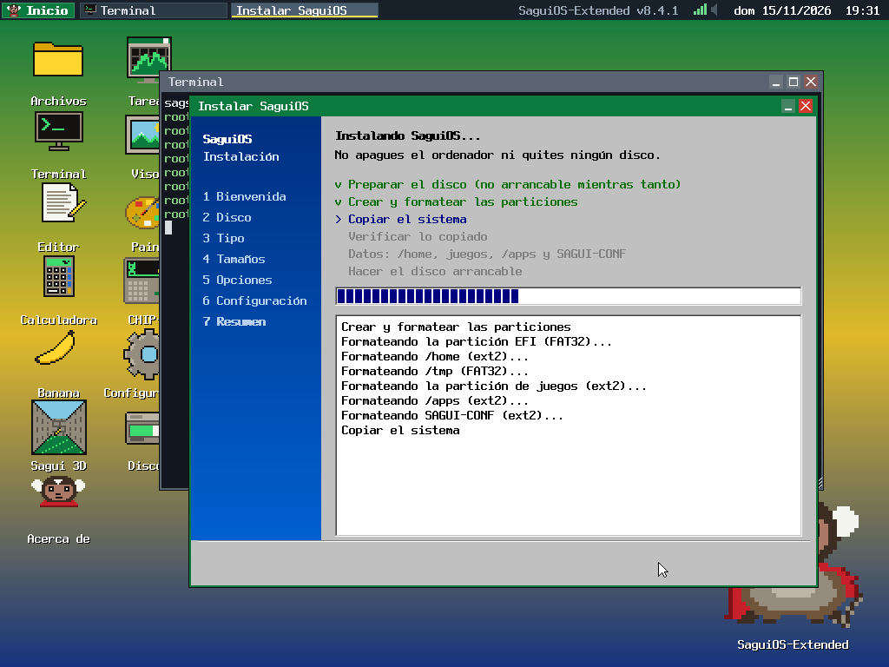

Las fases, una barra y el registro de lo que va haciendo. El orden protege el disco:

1. si se reduce una partición, primero su sistema de archivos y después la tabla (si se corta, el disco queda
   como estaba);
2. el disco se marca como **no arrancable** mientras dura la instalación;
3. la tabla nueva y los formatos;
4. se copia el sistema y **se relee entero** para compararlo con el original; cada archivo copiado se relee
   también;
5. `/home`, juegos, `/apps`, la configuración y las opciones;
6. solo al final, el disco se hace arrancable.

Si algo falla, el asistente dice en qué fase y que el disco **ha quedado no arrancable** (se puede repetir la
instalación); una partición reducida conserva sus archivos.

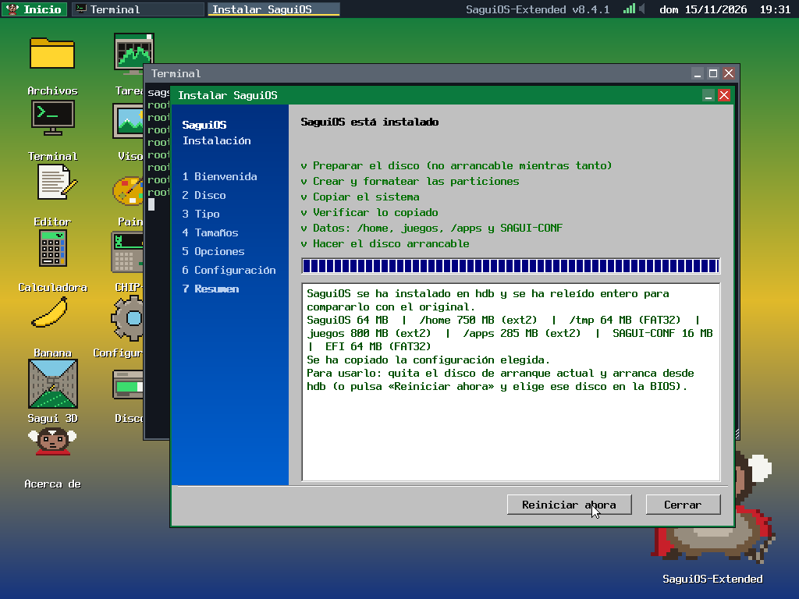

Al terminar, **Reiniciar ahora** y elige en la BIOS (o en el menú de arranque del ordenador) el disco
instalado; si arrancaste de un CD, sácalo.

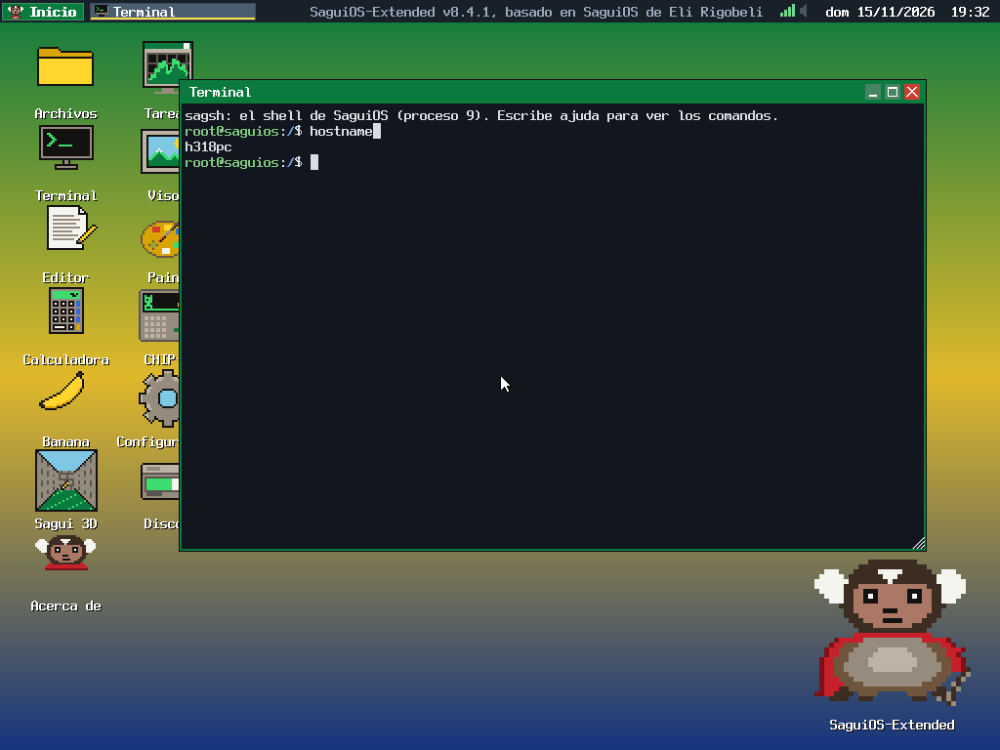

## Ampliar /home (pendrive o disco mayor que la imagen)

Si grabas la imagen de SaguiOS en un pendrive o un disco mucho mayor que ella, el resto queda sin usar. En el
**primer arranque** SaguiOS lo ve y pregunta (una sola vez) si quieres **ampliar /home para usar todo el
espacio libre**:

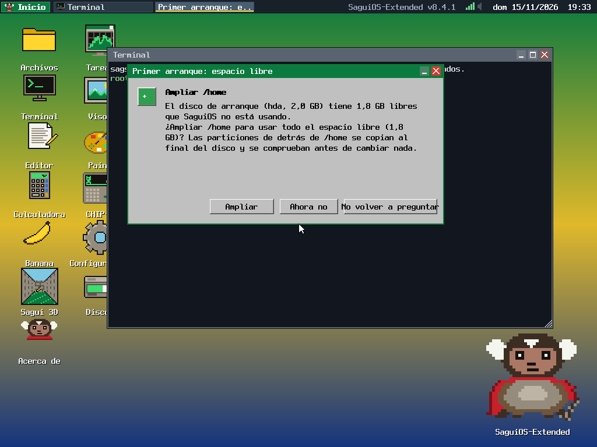

- **Ampliar**: comprueba el sistema de archivos de `/home`, copia al final del disco las particiones que van
  detrás (juegos, `/apps`, `SAGUI-CONF`), las relee para compararlas y solo entonces cambia la tabla; después
  crece `/home` y su sistema de archivos. Lo que guardaste sigue ahí.
- **Ahora no**: vuelve a preguntar en el siguiente arranque.
- **No volver a preguntar**: no pregunta más (se recuerda en `SAGUI-CONF`; `servicio desactivar ampliar-home`
  lo quita del todo).

Si la imagen no tenía partición de `/home` (la básica, que guarda `/home` en la memoria), se le **crea** una con
el espacio libre y se copia lo que haya.

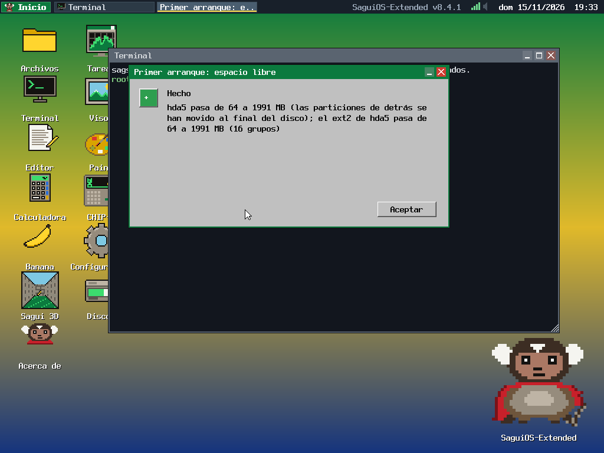

Lo mismo a mano, cuando quieras:

```
ampliar-home --ventana            el mismo diálogo
particiones ampliar /home         en el Terminal: /home hasta todo el espacio libre
particiones tamaño /home 8G       /home a 8 GB (crecer o encoger)
particiones tamaño hdb1 512M      cualquier partición FAT32 o ext2 (encoger: sin mover datos)
```

Qué se puede cambiar de tamaño y con qué garantías:

| | Crecer | Encoger |
| --- | --- | --- |
| ext2 | sí (D213), hasta el espacio libre; las lógicas de detrás se mueven si hace falta | sí, si lo que se corta está libre (no mueve datos) |
| FAT32 | sí, hasta donde le dé su FAT (las de SaguiOS y las imágenes traen sitio) | sí, si lo que se corta está libre y quedan 65.525 clústeres |
| NTFS, ext3/ext4 y otros | no | no (solo una partición sin formato) |
| SaguiOS y la partición EFI | no | no |

Siempre: comprobación del sistema de archivos antes y después; al crecer, primero la tabla y después el
sistema de archivos; al encoger, al revés; las particiones que se mueven se copian a espacio libre que no se
solapa con el suyo y se comparan antes de cambiar la tabla. En el disco de arranque solo se toca `/home` (y lo
que haya que mover para ampliarla), desmontándola el momento justo.

## Instalar desde el Terminal

El modo de terminal hace lo mismo que el asistente (es el que usan las pruebas):

```
instalar                                  los discos y si se puede instalar en cada uno
instalar hdb                              disco entero, con lo de por defecto (pregunta el nombre del disco)
instalar hdb --reducir 1:4096             reduce hdb1 a 4 GB e instala en el hueco
instalar hdb --hueco 2048                 en el espacio libre que empieza en el MB 2048
instalar hdb --gpt                        disco entero con GPT (UEFI)
instalar hdb --esp                        MBR con partición EFI (BIOS y UEFI)
  --home-mb N --apps-mb N --jogos-mb N --tmp-mb N --logs-mb N --fat32 home,tmp
  --nombre EQUIPO --zona Europe/Madrid --teclado es|abnt2 --clave-root X --clave-usuario X
  --sshd --vncd --copiar-config prefs,wifi,ssh,correo,ia,ia-clave,docs|todo
  --sin-jogos --sin-apps --copiar-jogos --formatear-conf --sin-home -s
```

Detalles técnicos y decisiones: D179 (instalador), D213 (redimensionar), D256 (SAGUI-CONF), D266/D270 (GPT y
UEFI) y **D318** en [decisoes.md](decisoes.md).
