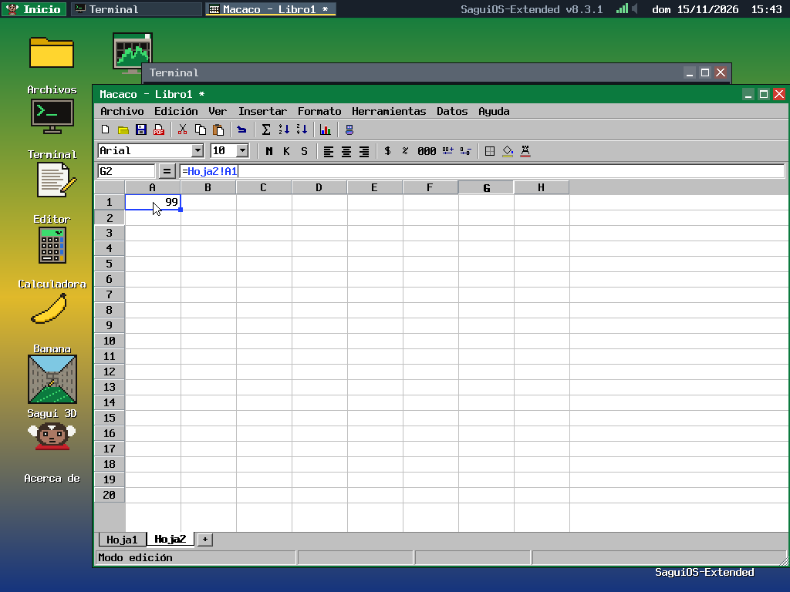
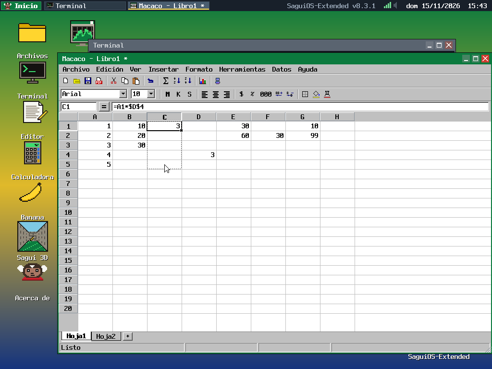
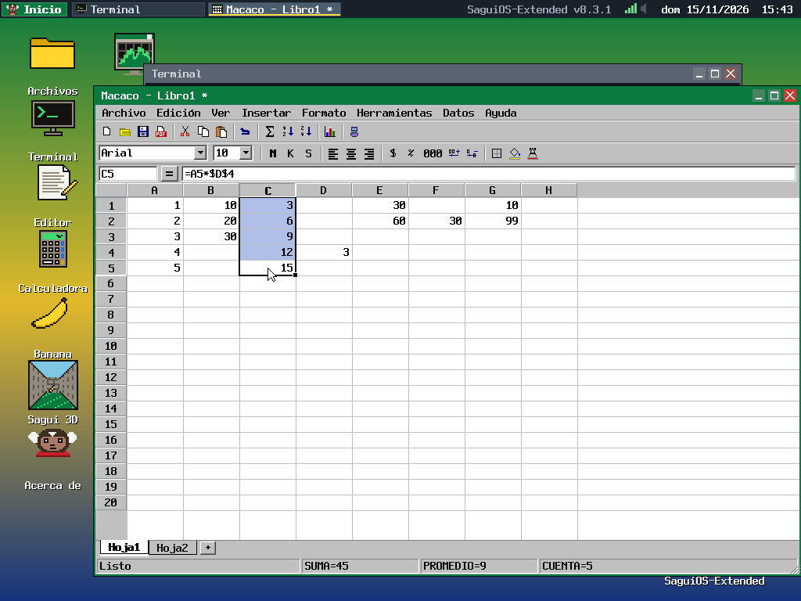
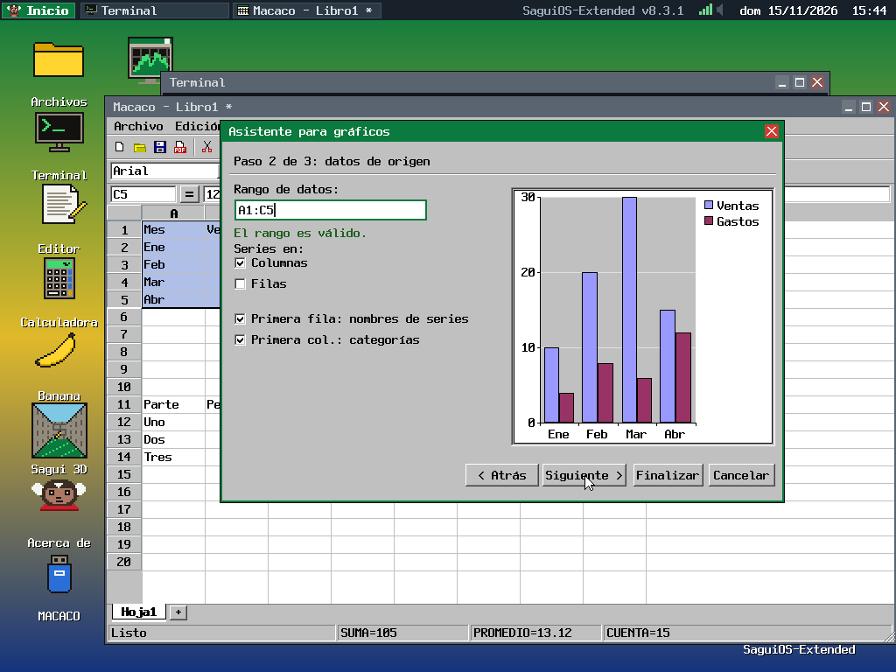
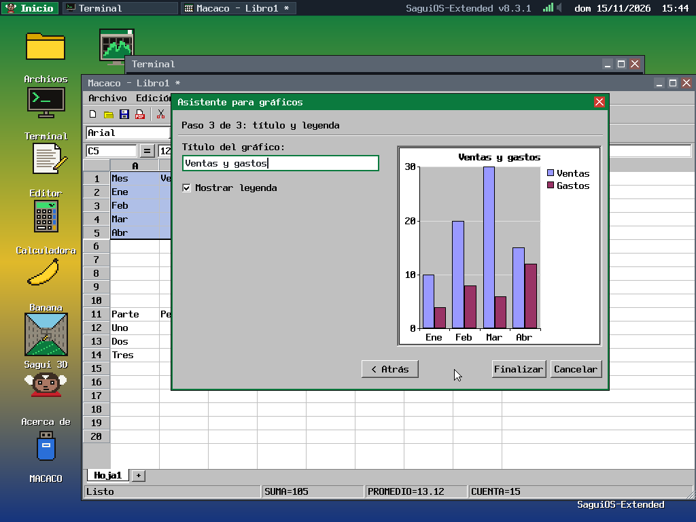
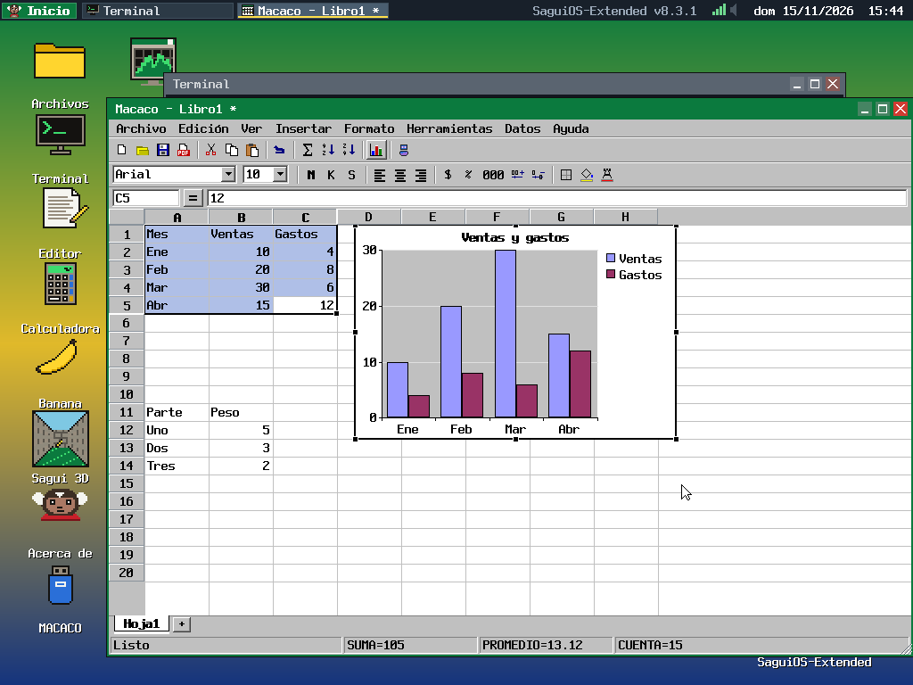
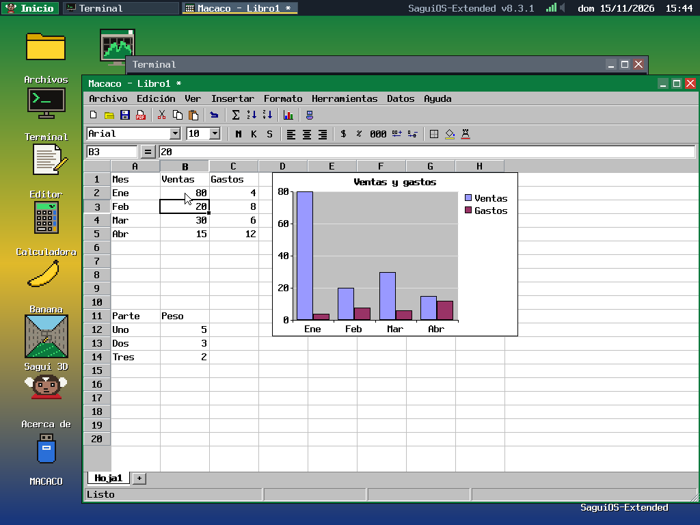

# Macaco, la hoja de cálculo

Macaco (`/bin/macaco`) es la hoja de cálculo de SaguiOS, con el aspecto de Excel 97 (D293). Esta guía recoge las funciones de la
v8.3.2 (D311). Las capturas se regeneran con `tests/h311_macaco_formulas.py`.

## 1. Señalar celdas al escribir fórmulas

Escribe `=` en una celda (o en la barra de fórmulas) y **pulsa una celda**: su referencia se inserta en la fórmula. Funciona tras `=`,
un operador (`+ - * / ^ & < > =`), `(`, `,` o `;`.

- **Clic** = una celda (`B3`); **arrastrar** = un rango (`B3:D7`); las **flechas** también señalan y con **Mayús** amplían el rango.
- Una **pestaña de otra hoja** y un clic inserta `Hoja2!B3`.
- Cada referencia sale de un **color** distinto en el texto y su celda lleva un borde del mismo color con un cuadradito. Arrastra el
  borde para **mover** la referencia y el cuadradito para **cambiar el tamaño** del rango.
- **F4** sobre una referencia: `A1` → `$A$1` → `A$1` → `$A1` → `A1`.
- Intro confirma. Funciones: `SUM`/`SUMA`, `AVERAGE`/`PROMEDIO`, `MIN`, `MAX`, `COUNT`/`CONTAR`, `IF`/`SI`, `ROUND`/`REDONDEAR`,
  `PRODUCT`/`PRODUCTO`, `ABS`; separador `,` o `;`.

## 2. Controlador de relleno

El cuadradito de la esquina inferior derecha de la selección:

- **Arrastrarlo** (abajo, arriba, derecha, izquierda) copia fórmulas ajustando lo **relativo** y respetando lo **absoluto**
  (`$D$4` fija todo; `D$4` la fila; `$D4` la columna), y copia el formato.
- Con **dos o más números** continúa la serie (1, 2 → 3, 4, 5); con **uno** lo repite; **con Ctrl** se invierte (un número se
  incrementa; varios se copian). Días y meses (español e inglés) y textos con número final («Item 1») también continúan.
  No hay tipo fecha: una fecha escrita como número o texto se trata como tal.
- **Doble clic** en el cuadradito: rellena hacia abajo hasta donde haya datos en la columna de al lado.
- **Ctrl+D** / **Ctrl+R**: rellenar hacia abajo / la derecha (copian la primera fila o columna, o la de arriba / la de la izquierda).
- **Ctrl+C / Ctrl+V** de una fórmula ajusta las relativas; cortar y pegar no.
- Todo se deshace con un solo **Ctrl+Z**.

## 3. Gráficos incrustados

**Insertar > Gráfico...**, el botón de gráficos de la barra Estándar o el clic derecho abren el asistente en tres pasos: tipo
(columnas, barras, líneas, área, circular, dispersión XY), rango y series (por columnas o filas, primera fila/columna como títulos)
y título y leyenda, con vista previa. El gráfico flota sobre la hoja:

- clic = seleccionar; arrastrar = **mover**; las 8 asas = **cambiar el tamaño**; **doble clic** (o Intro) = volver al asistente;
  **Supr** = borrar; **Ctrl+C** = copiarlo como imagen (para pegarlo en Pluma);
- **se actualiza solo** al cambiar los datos del rango;
- se guarda en el `.mxs` (los Macaco antiguos lo ignoran) y se exporta a **PDF** como imagen, una página por gráfico;
- el asistente de IA tiene `macaco_crear_grafico` (con confirmación).

Límites: 16 gráficos, 8 series de 48 puntos; los rangos no siguen a filas o columnas insertadas; los gráficos no entran en el deshacer.
