# Macaco, la hoja de cálculo

Macaco (`/bin/macaco`) es la hoja de cálculo de SaguiOS, con el aspecto de Excel 97 (D293). Esta guía recoge las funciones de la
v8.3.2 (D311). Las capturas se regeneran con `tests/h311_macaco_formulas.py`.

## 1. Señalar celdas al escribir fórmulas

Escribe `=` en una celda (o en la barra de fórmulas) y **pulsa una celda**: su referencia se inserta en la fórmula. Funciona tras `=`,
un operador (`+ - * / ^ & < > =`), `(`, `,` o `;`.

- **Clic** = una celda (`B3`); **arrastrar** = un rango (`B3:D7`); las **flechas** también señalan y con **Mayús** amplían el rango.
- Una **pestaña de otra hoja** y un clic inserta `Hoja2!B3`.
- Cada referencia sale de un **color** distinto en el texto y su celda lleva un borde del mismo color con un cuadradito. Arrastra el
  borde para **mover** la referencia y el cuadradito para **cambiar el tamaño** del rango.
- **F4** sobre una referencia: `A1` → `$A$1` → `A$1` → `$A1` → `A1`.
- Intro confirma. Funciones: `SUM`/`SUMA`, `AVERAGE`/`PROMEDIO`, `MIN`, `MAX`, `COUNT`/`CONTAR`, `IF`/`SI`, `ROUND`/`REDONDEAR`,
  `PRODUCT`/`PRODUCTO`, `ABS`; separador `,` o `;`.

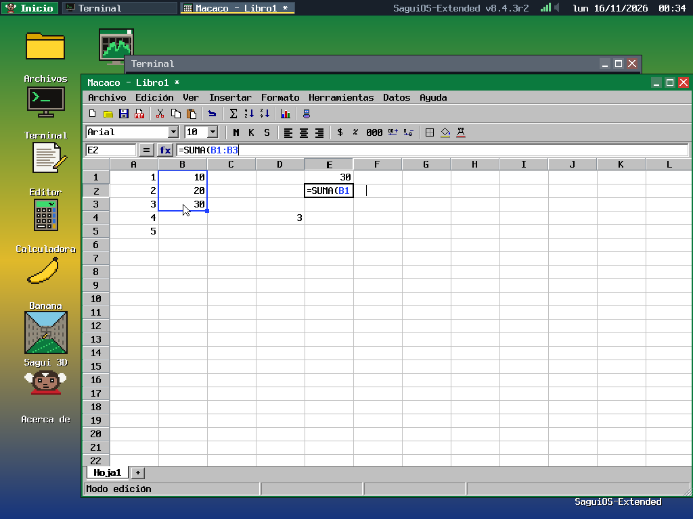

## 2. Controlador de relleno

El cuadradito de la esquina inferior derecha de la selección:

- **Arrastrarlo** (abajo, arriba, derecha, izquierda) copia fórmulas ajustando lo **relativo** y respetando lo **absoluto**
  (`$D$4` fija todo; `D$4` la fila; `$D4` la columna), y copia el formato.
- Con **dos o más números** continúa la serie (1, 2 → 3, 4, 5); con **uno** lo repite; **con Ctrl** se invierte (un número se
  incrementa; varios se copian). Días y meses (español e inglés) y textos con número final («Item 1») también continúan.
  No hay tipo fecha: una fecha escrita como número o texto se trata como tal.
- **Doble clic** en el cuadradito: rellena hacia abajo hasta donde haya datos en la columna de al lado.
- **Ctrl+D** / **Ctrl+R**: rellenar hacia abajo / la derecha (copian la primera fila o columna, o la de arriba / la de la izquierda).
- **Ctrl+C / Ctrl+V** de una fórmula ajusta las relativas; cortar y pegar no.
- Todo se deshace con un solo **Ctrl+Z**.

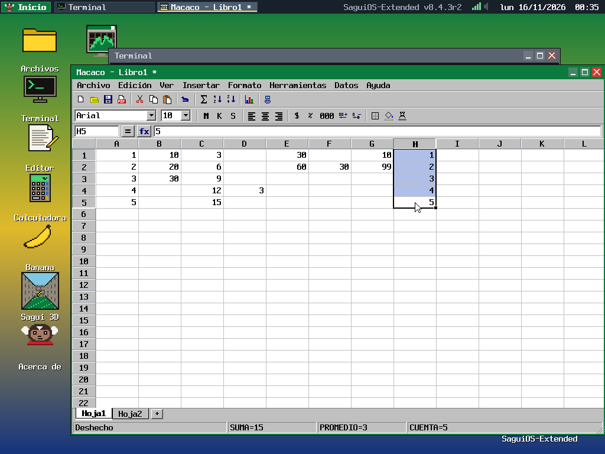

## 3. Gráficos incrustados

**Insertar > Gráfico...**, el botón de gráficos de la barra Estándar o el clic derecho abren el asistente en tres pasos: tipo
(columnas, barras, líneas, área, circular, dispersión XY), rango y series (por columnas o filas, primera fila/columna como títulos)
y título y leyenda, con vista previa. El gráfico flota sobre la hoja:

- clic = seleccionar; arrastrar = **mover**; las 8 asas = **cambiar el tamaño**; **doble clic** (o Intro) = volver al asistente;
  **Supr** = borrar; **Ctrl+C** = copiarlo como imagen (para pegarlo en Pluma);
- **se actualiza solo** al cambiar los datos del rango;
- se guarda en el `.mxs` (los Macaco antiguos lo ignoran) y se exporta a **PDF** como imagen, una página por gráfico;
- el asistente de IA tiene `macaco_crear_grafico` (con confirmación).

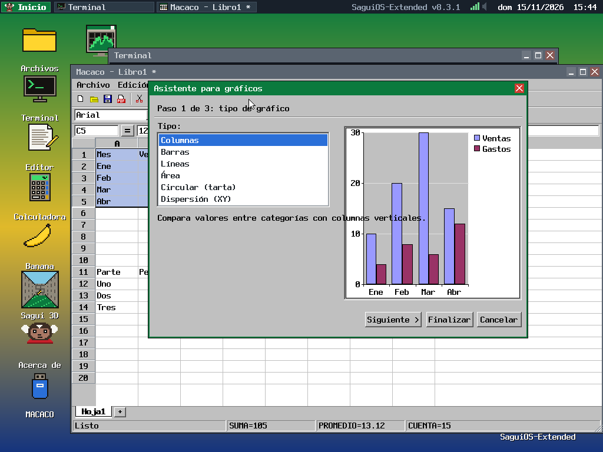

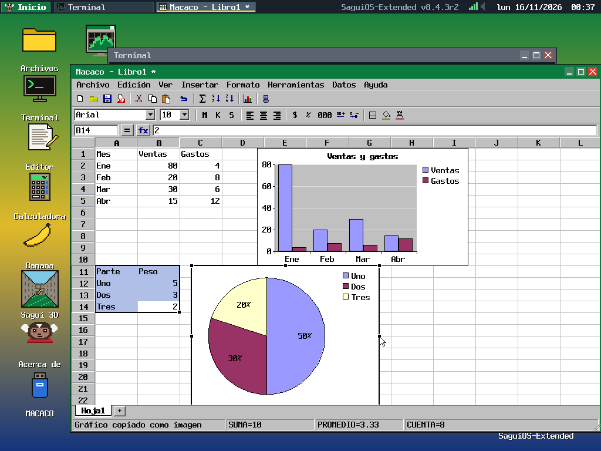

Límites: 16 gráficos, 8 series de 48 puntos; los rangos no siguen a filas o columnas insertadas; los gráficos no entran en el deshacer.

## 4. Funciones: el asistente «Insertar función», el autocompletado y la ayuda de argumentos

Macaco tiene un **catálogo único de funciones** (`userland/programas/macaco_funciones.h`): el evaluador de fórmulas, el asistente
y la ayuda al escribir salen de la misma tabla, así que no se anuncia ninguna función que no exista. Cada una lleva su nombre en
español y su alias en inglés (`SUMA` / `SUM`), categoría, descripción, argumentos y un ejemplo. Los argumentos se separan con `;`
(o `,`). El operador `&` une textos y la precedencia es la de Excel (`=1+2>2` da 1).

**Insertar función** se abre desde **Insertar > Función...**, el botón **fx** junto al cuadro de nombre o **Mayús+F3**.

- **Paso 1, elegir:** buscador (por nombre, alias o descripción), categoría (*Usadas recientemente*, *Todas* y las seis de abajo) y
  lista, con la sintaxis y la descripción de la seleccionada debajo. Doble clic, Intro o **Aceptar** pasan al paso 2.
- **Paso 2, argumentos:** un cuadro por argumento (los obligatorios en negrita) con su descripción y, a la derecha, su valor en vivo
  (`= 15`, `= {10;20;30}`, `= "texto"` o `= error`); los que se repiten añaden cuadros a medida que se rellenan (hasta 8). Abajo, el
  **resultado de la fórmula** en vivo. El botón de la derecha de cada cuadro **contrae el diálogo**: la ventana se cierra, aparece
  una barra sobre la hoja y se **señala con el ratón** (clic, arrastre, flechas, otra pestaña) con el modo señalar de la sección 1;
  **Intro** o **Aceptar** devuelven la referencia al cuadro, **Esc** la descarta.
- **Aceptar** escribe `=FUNCION(arg1;arg2...)` en la celda. Si se estaba editando una fórmula, la **inserta en el cursor**
  (así se anidan: `=SI(` + fx + `SUMA(B1:B3)` + `>10;"alto";"bajo")`). Al abrirlo sobre una celda que ya es una sola función se abre
  **en el paso 2** con sus argumentos y Aceptar la sustituye.
- «Usadas recientemente» guarda las últimas 8 (solo durante la sesión).

**Autocompletado:** al escribir letras tras `=` o un operador aparece bajo la celda la lista de funciones que empiezan así (por nombre
o por alias); **Tab** acepta (`=BUS` + Tab da `=BUSCARV(`), **↑ ↓** eligen y **Esc** la cierra. **Ayuda de argumentos:** al abrir el
paréntesis una etiqueta amarilla muestra `BUSCARV(valor_buscado; matriz; indicador_columnas; [ordenado])` con el argumento actual
en negrita.

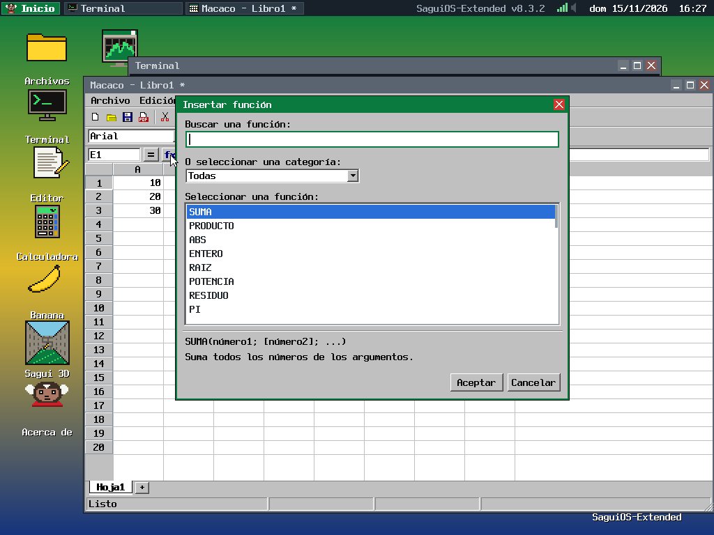
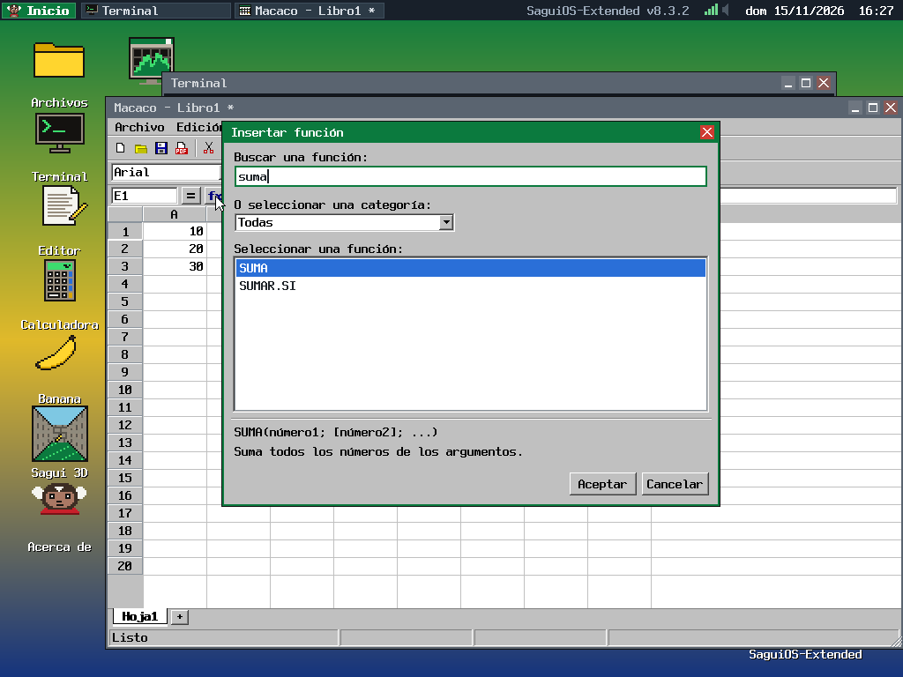
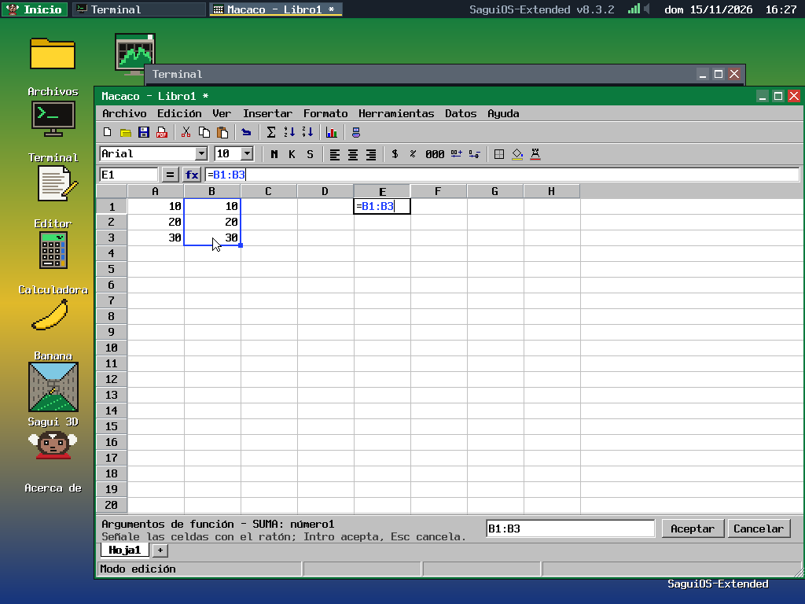
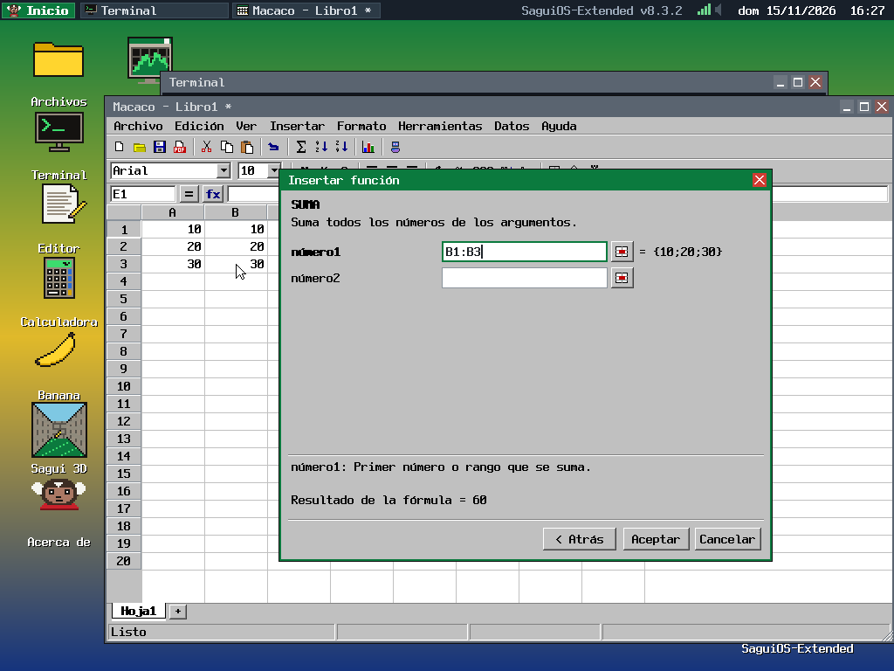
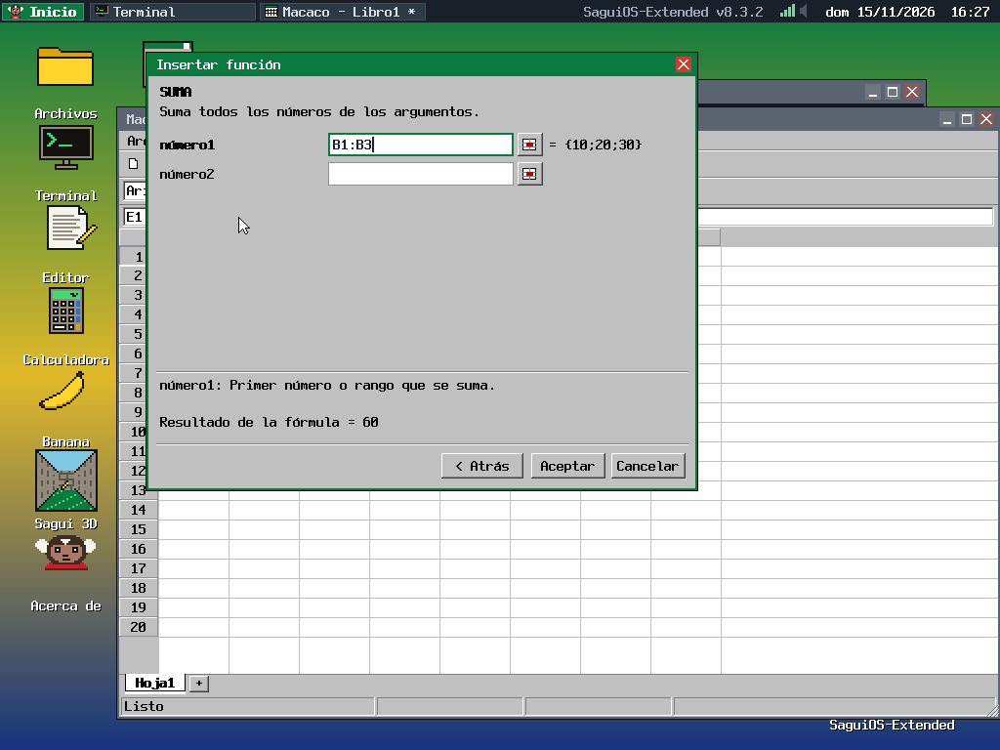
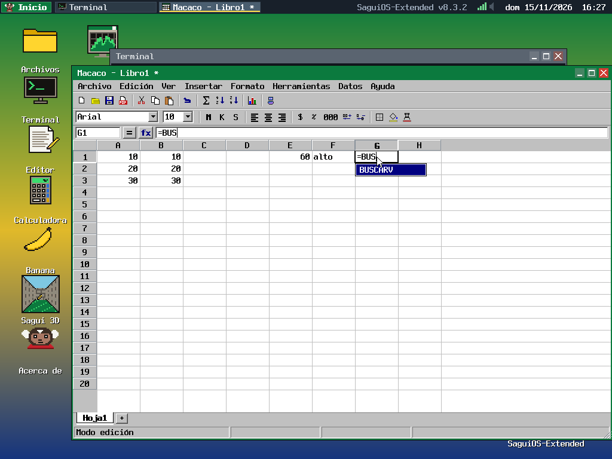
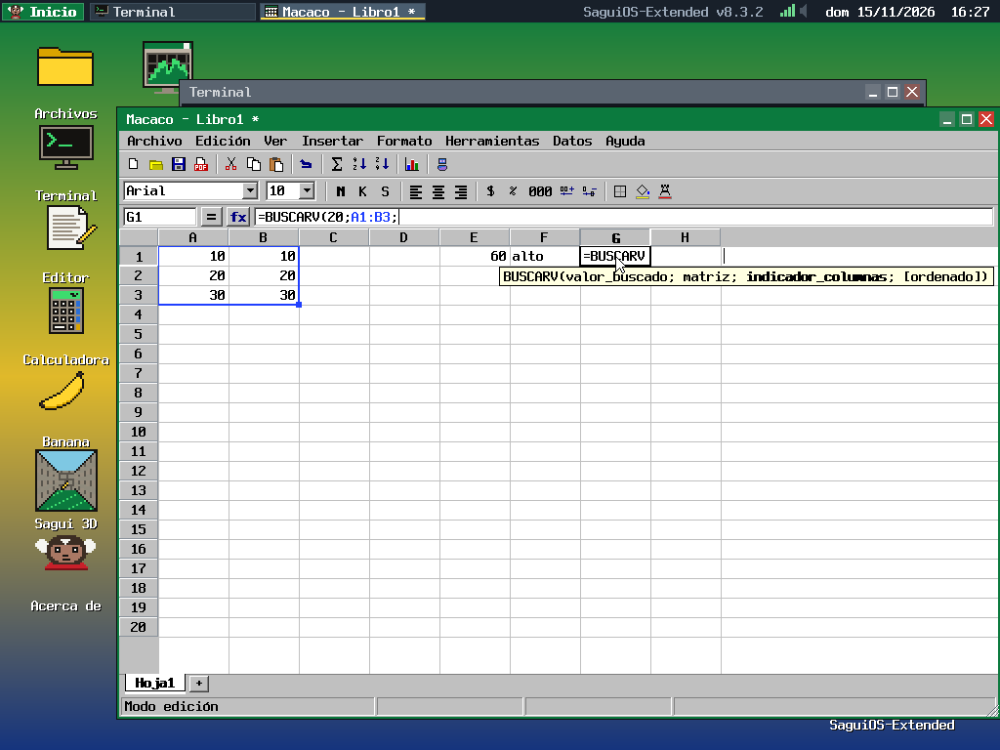

### Funciones disponibles

Los números son **centésimas en punto fijo** (como el resto de Macaco): `PI()` da 3,14 y `ALEATORIO()` un número de dos decimales.
Los ejemplos de abajo se comprueban solos con `macaco --fx` (datos `A1:A5` = 10..50 y `B1:B5` = a, b, a, c, a).
Las fechas son **números de serie como en Excel** (36526 = 2000-01-01; `HOY()` y `AHORA()` usan la zona horaria del sistema); no hay
tipo fecha, así que hay que dar formato de número. Las celdas cuyo cálculo falla muestran `#VALOR!` y `SI.ERROR` lo recoge.
(La lista siguiente la genera `tools/macaco_funciones_doc.py --escribir` desde el catálogo.)

<!-- catalogo-funciones:inicio -->

### Matemáticas

| Función | Inglés | Sintaxis | Descripción | Ejemplo |
|---|---|---|---|---|
| `SUMA` | `SUM` | `SUMA(número1; [número2]; ...)` | Suma todos los números de los argumentos. | `=SUMA(1;2;3)` |
| `PRODUCTO` | `PRODUCT` | `PRODUCTO(número1; [número2]; ...)` | Multiplica todos los números de los argumentos. | `=PRODUCTO(2;3;4)` |
| `ABS` | `ABS` | `ABS(número)` | Devuelve el valor absoluto de un número. | `=ABS(-5)` |
| `ENTERO` | `INT` | `ENTERO(número)` | Redondea un número hacia abajo hasta el entero más próximo. | `=ENTERO(8.9)` |
| `RAIZ` | `SQRT` | `RAIZ(número)` | Devuelve la raíz cuadrada de un número. | `=RAIZ(16)` |
| `POTENCIA` | `POWER` | `POTENCIA(número; potencia)` | Eleva un número a una potencia entera (o 0,5). | `=POTENCIA(2;3)` |
| `RESIDUO` | `MOD` | `RESIDUO(número; divisor)` | Devuelve el resto de una división. | `=RESIDUO(10;3)` |
| `PI` | `PI` | `PI()` | Devuelve el valor de pi (3,14, con dos decimales). | `=PI()` |
| `ALEATORIO` | `RAND` | `ALEATORIO()` | Devuelve un número aleatorio entre 0 y 1 (con dos decimales). | `=ALEATORIO()` |
| `REDONDEAR` | `ROUND` | `REDONDEAR(número; [decimales])` | Redondea un número a los decimales indicados (0 o 1). | `=REDONDEAR(3.14;1)` |

### Estadísticas

| Función | Inglés | Sintaxis | Descripción | Ejemplo |
|---|---|---|---|---|
| `PROMEDIO` | `AVERAGE` | `PROMEDIO(número1; [número2]; ...)` | Devuelve la media aritmética de los argumentos. | `=PROMEDIO(2;4;9)` |
| `MAX` | `MAX` | `MAX(número1; [número2]; ...)` | Devuelve el valor máximo de los argumentos. | `=MAX(3;9;5)` |
| `MIN` | `MIN` | `MIN(número1; [número2]; ...)` | Devuelve el valor mínimo de los argumentos. | `=MIN(3;9;5)` |
| `CONTAR` | `COUNT` | `CONTAR(valor1; [valor2]; ...)` | Cuenta las celdas que contienen números. | `=CONTAR(A1:A5)` |
| `CONTARA` | `COUNTA` | `CONTARA(valor1; [valor2]; ...)` | Cuenta las celdas que no están vacías. | `=CONTARA(A1:B5)` |
| `MEDIANA` | `MEDIAN` | `MEDIANA(número1; [número2]; ...)` | Devuelve la mediana (el valor central) de los números. | `=MEDIANA(A1:A5)` |
| `CONTAR.SI` | `COUNTIF` | `CONTAR.SI(rango; criterio)` | Cuenta las celdas de un rango que cumplen un criterio. | `=CONTAR.SI(B1:B5;"a")` |
| `SUMAR.SI` | `SUMIF` | `SUMAR.SI(rango; criterio; [rango_suma])` | Suma las celdas de un rango que cumplen un criterio. | `=SUMAR.SI(A1:A5;">20")` |

### Lógicas

| Función | Inglés | Sintaxis | Descripción | Ejemplo |
|---|---|---|---|---|
| `SI` | `IF` | `SI(prueba_lógica; valor_si_verdadero; [valor_si_falso])` | Devuelve un valor si la condición es cierta y otro si no. | `=SI(A2>15;"alto";"bajo")` |
| `Y` | `AND` | `Y(valor_lógico1; [valor_lógico2]; ...)` | Cierto si todos los argumentos son ciertos. | `=Y(1<2;2<3)` |
| `O` | `OR` | `O(valor_lógico1; [valor_lógico2]; ...)` | Cierto si algún argumento es cierto. | `=O(1>2;2<3)` |
| `NO` | `NOT` | `NO(valor_lógico)` | Invierte una condición: cierto pasa a falso y al revés. | `=NO(1>2)` |
| `SI.ERROR` | `IFERROR` | `SI.ERROR(valor; valor_si_error)` | Devuelve un valor alternativo si el primero da error. | `=SI.ERROR(RAIZ(-1);0)` |

### Texto

| Función | Inglés | Sintaxis | Descripción | Ejemplo |
|---|---|---|---|---|
| `CONCATENAR` | `CONCATENATE` | `CONCATENAR(texto1; [texto2]; ...)` | Une varios textos en uno (también con el operador &). | `=CONCATENAR("Sa";"gui";1)` |
| `LARGO` | `LEN` | `LARGO(texto)` | Devuelve el número de caracteres de un texto. | `=LARGO("Sagui")` |
| `IZQUIERDA` | `LEFT` | `IZQUIERDA(texto; [núm_de_caracteres])` | Devuelve los primeros caracteres de un texto. | `=IZQUIERDA("Sagui";2)` |
| `DERECHA` | `RIGHT` | `DERECHA(texto; [núm_de_caracteres])` | Devuelve los últimos caracteres de un texto. | `=DERECHA("Sagui";2)` |
| `EXTRAE` | `MID` | `EXTRAE(texto; posición_inicial; núm_de_caracteres)` | Devuelve caracteres del medio de un texto. | `=EXTRAE("Sagui";2;3)` |
| `MAYUSC` | `UPPER` | `MAYUSC(texto)` | Convierte un texto a mayúsculas. | `=MAYUSC("sagui")` |
| `MINUSC` | `LOWER` | `MINUSC(texto)` | Convierte un texto a minúsculas. | `=MINUSC("SAGUI")` |
| `ESPACIOS` | `TRIM` | `ESPACIOS(texto)` | Quita los espacios sobrantes de un texto. | `=ESPACIOS("  a   b ")` |
| `TEXTO` | `TEXT` | `TEXTO(valor; formato)` | Convierte un número en texto con un formato (0, 0.00, 0%). | `=TEXTO(2.5;"0.00")` |

### Fecha y hora

| Función | Inglés | Sintaxis | Descripción | Ejemplo |
|---|---|---|---|---|
| `HOY` | `TODAY` | `HOY()` | Devuelve la fecha de hoy como número de serie. | `=HOY()` |
| `AHORA` | `NOW` | `AHORA()` | Devuelve la fecha y la hora actuales como número de serie. | `=AHORA()` |
| `AÑO` | `YEAR` | `AÑO(núm_de_serie)` | Devuelve el año de una fecha (número de serie). | `=YEAR(36526)` |
| `MES` | `MONTH` | `MES(núm_de_serie)` | Devuelve el mes de una fecha (1 a 12). | `=MES(36526)` |
| `DIA` | `DAY` | `DIA(núm_de_serie)` | Devuelve el día del mes de una fecha (1 a 31). | `=DIA(36556)` |
| `FECHA` | `DATE` | `FECHA(año; mes; día)` | Devuelve el número de serie de una fecha. | `=FECHA(2000;1;1)` |

### Búsqueda y referencia

| Función | Inglés | Sintaxis | Descripción | Ejemplo |
|---|---|---|---|---|
| `BUSCARV` | `VLOOKUP` | `BUSCARV(valor_buscado; matriz; indicador_columnas; [ordenado])` | Busca un valor en la primera columna y devuelve otra de la fila. | `=BUSCARV(30;A1:B5;2;0)` |
| `INDICE` | `INDEX` | `INDICE(matriz; núm_fila; [núm_columna])` | Devuelve el valor de una posición de un rango. | `=INDICE(A1:A5;3)` |
| `COINCIDIR` | `MATCH` | `COINCIDIR(valor_buscado; matriz_buscada; [tipo_de_coincidencia])` | Devuelve la posición de un valor dentro de un rango. | `=COINCIDIR(40;A1:A5;0)` |

41 funciones.
<!-- catalogo-funciones:fin -->
