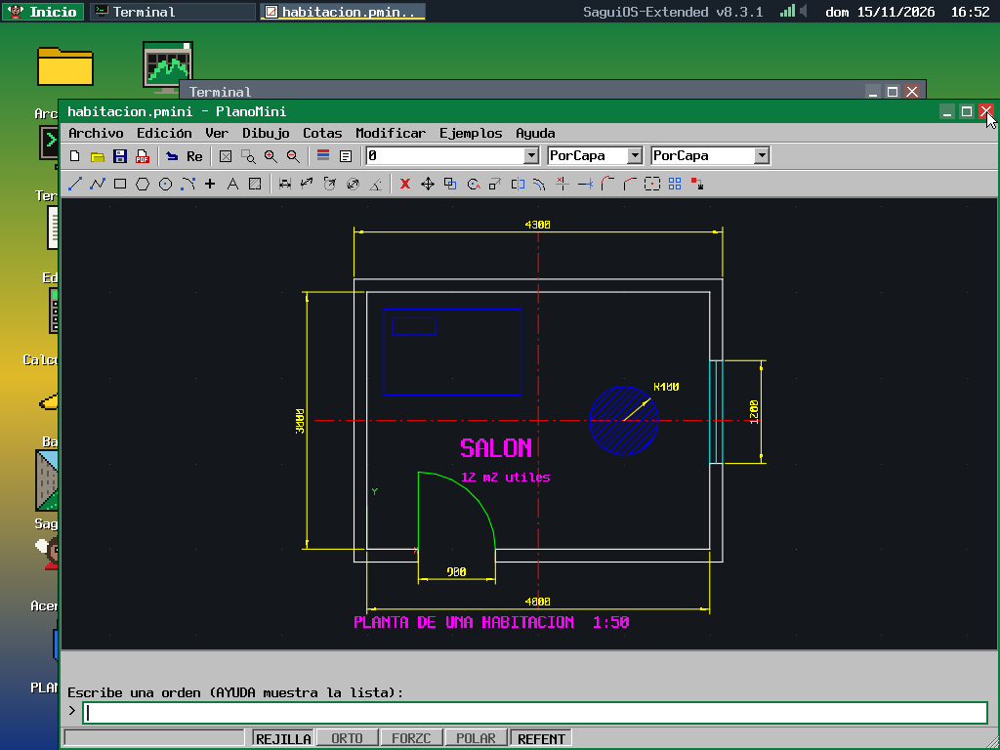
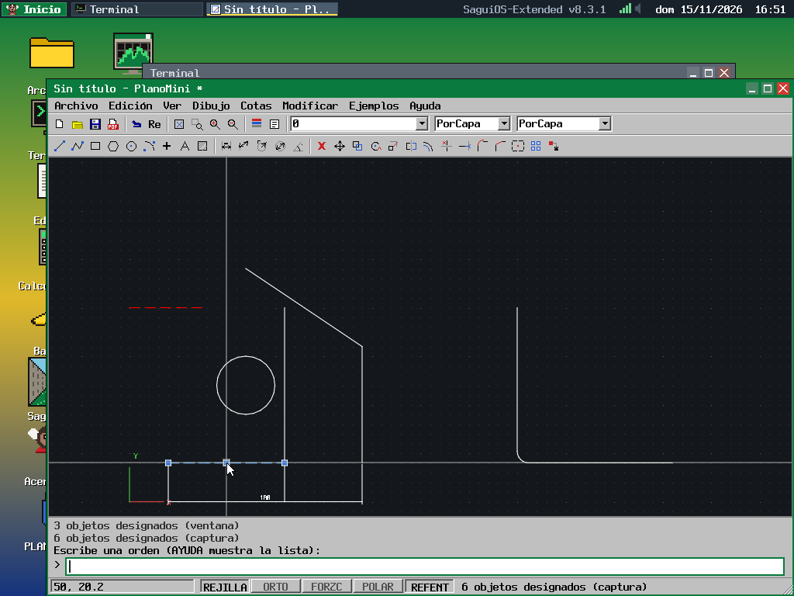
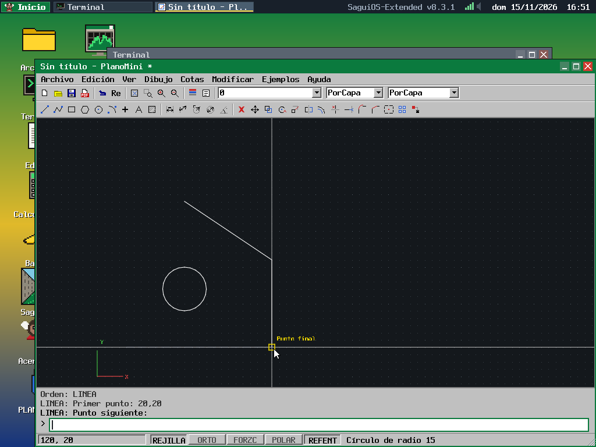
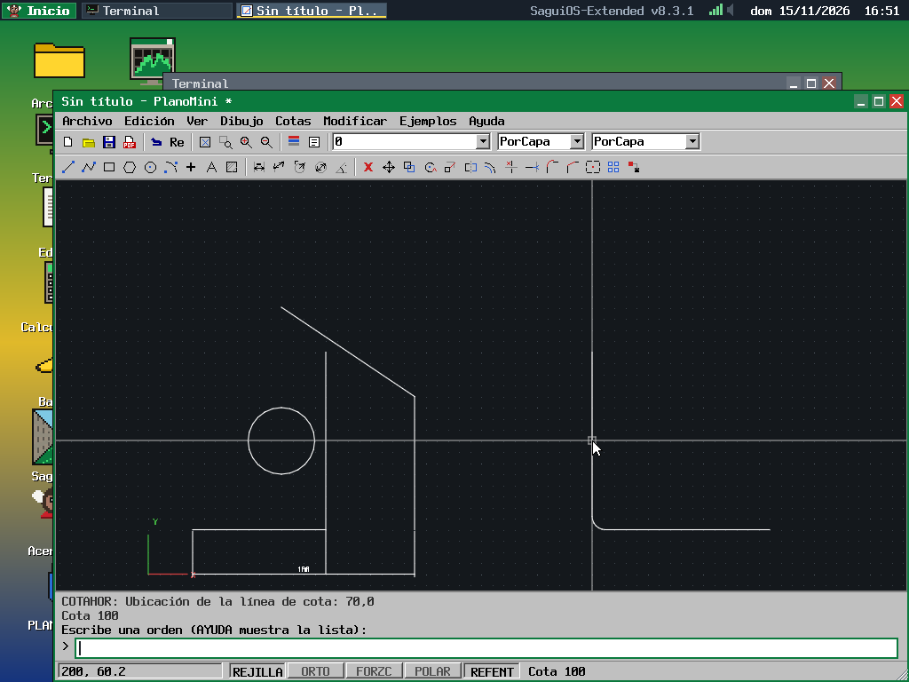
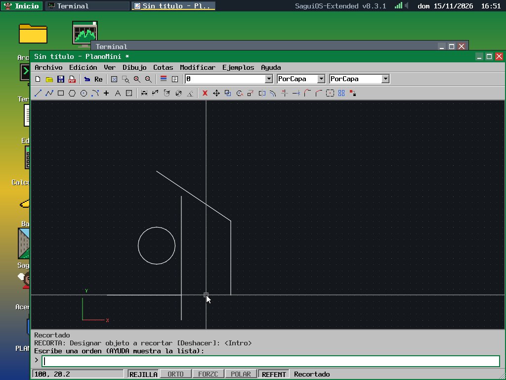
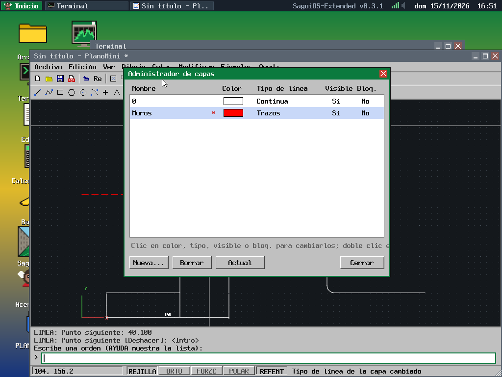
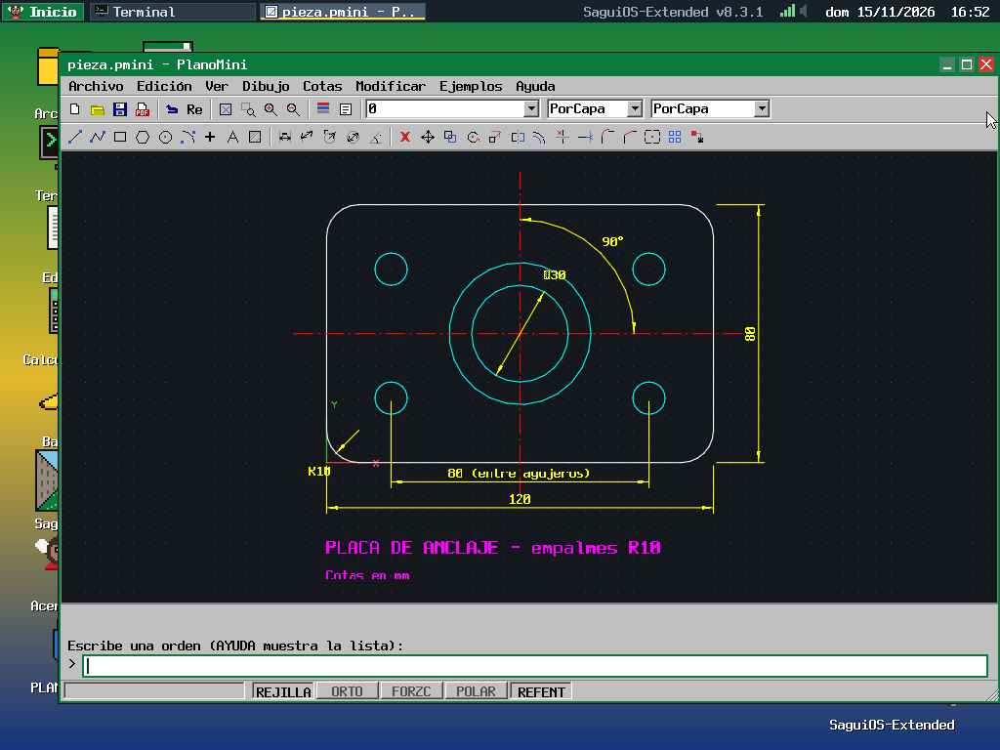

# PlanoMini - mini CAD 2D (D312, mejora 129)

PlanoMini es el «mini AutoCAD» de SaguiOS: dibujo 2D por órdenes y con el ratón, capas, cotas, sombreado,
referencia a objetos, DXF, PDF a escala y PNG. Menú Inicio, **Gráficos**, «PlanoMini (CAD 2D)», o `planomini
[archivo.pmini|archivo.dxf]`.

**Créditos.** Nace del prototipo **PlanoMini** de Alejandro Anuncibay (C++/SDL, © 2026, GPL-3.0-or-later). Esta versión
nativa está escrita desde cero a partir de sus ideas y se distribuye con la misma licencia. Está inspirada en los CAD
de órdenes clásicos, pero es independiente: sin código, iconos, marcas ni formatos propietarios de terceros (no hay DWG;
DXF es un formato de intercambio documentado públicamente).

## La ventana
- **Menús** (Archivo, Edición, Ver, Dibujo, Cotas, Modificar, Ejemplos, Ayuda) y dos barras de iconos: arriba, archivo,
  deshacer, zoom, capas, propiedades y los combos de **capa, color y tipo de línea**; debajo, **Dibujo**, **Cotas** y
  **Modificar**.
- **Área de dibujo** con cursor en cruz, fondo oscuro o claro (Ver) y rejilla.
- **Línea de órdenes** abajo: historial, aviso de la orden y caja de entrada con autocompletado (Tab).
- **Barra de estado:** coordenadas del cursor y los botones **REJILLA (F7), ORTO (F8), FORZC (F9), POLAR (F10), REFENT (F3)**.

## Órdenes
Se escriben en español o en inglés (con alias). Intro o espacio (con la caja vacía) repiten la última; Esc cancela.

| Dibujo | Alias | Modificar | Alias |
|---|---|---|---|
| `LINEA` / `LINE` | `L` | `MOVER` / `MOVE` | `M` |
| `PLINEA` / `PLINE` | `PL` | `COPIAR` / `COPY` | `CO` |
| `RECTANG` / `RECTANGLE` | `REC` | `GIRAR` / `ROTATE` | `RO` |
| `POLIGONO` / `POLYGON` | `POL` | `ESCALA` / `SCALE` | `SC` |
| `CIRCULO` / `CIRCLE` | `C` | `SIMETRIA` / `MIRROR` | `MI` |
| `ARCO` / `ARC` | `A` | `EQUIDIST` / `OFFSET` | `O` |
| `PUNTO` / `POINT` | `PO` | `RECORTA` / `TRIM` | `TR` |
| `TEXTO` / `TEXT` | `T` | `ALARGA` / `EXTEND` | `EX` |
| `SOMBREADO` / `HATCH` | `H` | `EMPALME` / `FILLET` | `F` |
| `COTALIN` `COTAHOR` `COTAVER` `COTAALI` | `DLI` `DAL` | `CHAFLAN` / `CHAMFER` | `CHA` |
| `COTARAD` `COTADIAM` `COTAANG` `COTAESTILO` | `DRA` `DDI` `DAN` | `BORRAR` `EXPLOTA` `MATRIZ` `IGUALAPROP` | `E` `X` `AR` `MA` |

Vista y ayudas: `ZOOM` (`Z`: extensión, ventana, previo, factor), `PAN`, `REGEN`, `REJILLA`, `ORTO`, `FORZC`, `POLAR [ángulo]`,
`REFENT [fin medio centro interseccion perpendicular tangente cuadrante cercano|ninguno|todo]`. Capas: `CAPA` (administrador),
`CAPA NUEVA|ACTUAL|APAGAR|ACTIVAR|BLOQUEAR|DESBLOQUEAR nombre`, `CAPA COLOR nombre 1-255`, `CAPA LTIPO nombre trazos`; `COLOR`
y `TLINEA` fijan las propiedades de lo que se dibuja. Archivo: `GUARDAR`, `ABRIR`, `NUEVO`, `EXPORTAR pdf|png|dxf archivo`,
`IMPORTAR dxf archivo`, `SALIR`. Consulta: `DIST`, `LISTA`, `PROPIEDADES`, `DESHACER` (`U`), `REHACER`, `AYUDA`.

**Compatibilidad con el prototipo:** `LINE 0 0 10 10`, `CIRCLE 3 4 2`, `RECTANGLE 0 0 4 3`, `POINT 1 2`, `PAN dx dy`, `ZOOM factor`,
`GRID`, `SNAP`, `UNDO`, `SAVE`, `OPEN`. (F3 es ahora REFENT; F2 = LINEA y F4 = RECTANG siguen.)

### Entrada de puntos
`x,y` absolutas; `@dx,dy` relativas al último punto; `@d<ángulo` polares; con **ORTO** o **POLAR** basta escribir la distancia
y el punto se coloca en la dirección del cursor. Las **opciones** de cada orden aparecen entre corchetes (`[Deshacer/Cerrar]`)
y se eligen con su inicial o su nombre en español o en inglés.

### Selección
Clic en un objeto (Mayús quita); **ventana** de izquierda a derecha (lo que queda dentro) y **captura** de derecha a izquierda
(lo que toca). Con una selección hecha, las órdenes de modificar la usan sin preguntar. Los **pinzamientos** (cuadros azules)
estiran y mueven con el ratón. Doble clic = **propiedades** (capa, color, tipo de línea, coordenadas, radio, longitud...).

### Referencia a objetos
Punto final, medio, centro, intersección, perpendicular, tangente, cuadrante y cercano, con marcador y nombre.

## Cotas y sombreado
Lineal horizontal y vertical, alineada, radio, diámetro y angular, con estilo (`COTAESTILO`: altura del texto, flechas y
decimales). Un texto fijo puede llevar `<>` para la medida. El sombreado cubre un contorno cerrado (polilínea o círculo) con
líneas a 45 grados o sólido (`H`: `Solido`, `Lineas`, `Angulo`, `Espaciado`).

## Modificar
`RECORTA` y `ALARGA` usan como bordes lo designado (Intro = todos). `EMPALME` pide el radio (`R`) y dos líneas, o `P` para
todas las esquinas de una polilínea; `EQUIDIST` crea la paralela del lado donde se pincha.

## Capas
Cada una tiene nombre, color, tipo de línea (continua, trazos, puntos, trazo y punto), visible y bloqueada; una está
actual. Lo dibujado y las entidades «PorCapa» toman su color y tipo.

## Ficheros
- **`.pmini` v2:** texto legible (capas, estilo de cotas, vista y una entidad por línea). Abre los `.pmini` v1 del prototipo.
- **DXF ASCII:** se escribe R12 (LibreCAD, QCAD y otros lo leen) y se lee R12/2000: LINE, CIRCLE, ARC, TEXT/MTEXT, POINT,
  LWPOLYLINE, POLYLINE, SOLID y DIMENSION (con su bloque). Las cotas y sombreados se escriben explotados. Lo no soportado se
  cuenta como omitido.
- **PDF** vectorial a escala (1:1, 1:2... o «Ajustar») en A4 o A3 apaisado con cajetín; la unidad del dibujo es el milímetro.
- **PNG** de toda la extensión del dibujo.

Ejemplos en `/ejemplos/planomini/` (menú Ejemplos): `habitacion.pmini`, `pieza.pmini` y `plano.dxf`.

## Atajos
`Ctrl+N/O/S` nuevo/abrir/guardar, `Ctrl+P` PDF, `Ctrl+Z/Y` deshacer/rehacer, `Ctrl+A` todo, `Supr` borrar la selección, `F1`
órdenes, `F2` línea, `F3` REFENT, `F4` rectángulo, `F7` rejilla, `F8` orto, `F9` forzc, `F10` polar, rueda = zoom hacia el cursor,
botón derecho arrastrando = desplazar (un clic derecho = Intro).

## Estructura y pruebas
`userland/planomini/` (motor: `pm_geo.c`, `pm_mod.c`, `pm_cmd.c`, `pm_io.c`), `userland/programas/planomini.c`,
`tests/planomini_unidad.c` (más de 500 comprobaciones en el anfitrión) y `tests/h312_planomini.py`. Modos sin ventana:
`planomini --abrir f [--orden "o1" "o2"] [--guardar f] [--dxf f] [--pdf f --escala N --papel A3] [--png f] [--listar]`.
