# Manual de VisualPythonS

Para quien empieza: aquí se aprende a hacer ventanas con botones, cuadros de texto, tablas y dibujos
usando **Python**, sin más herramientas que las del propio SaguiOS. Cada ejemplo está probado y vive en
`/ejemplos/vps/<nombre>/`: se puede abrir en el diseñador (`python /lib/python/vps/disenador.py /ejemplos/vps/calculadora`)
o lanzar tal cual (`python /ejemplos/vps/calculadora/lanzador.py`). El código de este manual **es** el de esos
ejemplos (lo comprueba la prueba `tests/h303_vps_manual.py`). La referencia corta está en
[visualpythons.md](visualpythons.md); aquí se explica con calma y con capturas.

## Índice

1. [Primeros pasos](#1-primeros-pasos)
2. [Propiedades](#2-propiedades)
3. [Eventos](#3-eventos)
4. [Ejemplos completos](#4-ejemplos-completos)
   (calculadora, lista de tareas, cronómetro, formulario modal, validar con `msgbox`, abrir y guardar,
   pestañas, tabla, numérico, lienzo, enlace, barra de estado, selector de color, reloj, archivo)
   y, de la v8.4.1, guardar al cerrar, un botón con el ratón y validar al perder el foco
5. [Los componentes nuevos de la v8.3.2](#5-los-componentes-nuevos-de-la-v832)
6. [Herramientas del entorno](#6-herramientas-del-entorno) (incluye el [explorador del proyecto](#el-explorador-del-proyecto))
7. [Referencia de la API `vps`](#7-referencia-de-la-api-vps)
8. [Errores frecuentes y trucos](#8-errores-frecuentes-y-trucos)

---

## 1. Primeros pasos

### Abrir el diseñador

**Inicio > Accesorios > VisualPythonS**, o desde el terminal:

```
python /lib/python/vps/disenador.py
```

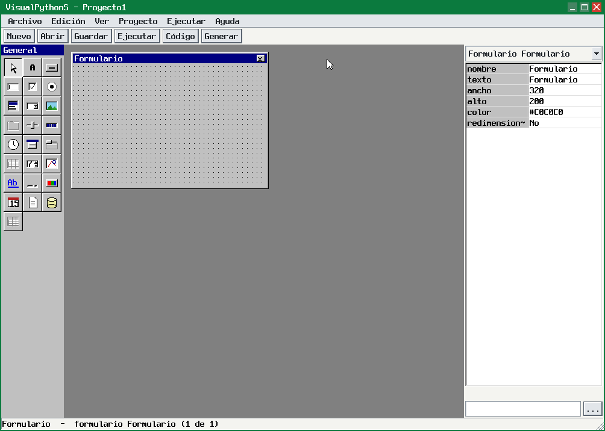

### Las partes de la ventana

| Zona | Dónde | Para qué sirve |
| --- | --- | --- |
| **Caja de herramientas** | izquierda | Un botón por tipo de control. Se elige uno y se hace clic (tamaño normal) o se arrastra (el tamaño dibujado) sobre el formulario. El **puntero** (la flecha) selecciona y mueve. |
| **Formulario** | centro | La ventana que se está diseñando, con una rejilla de puntos de 8 píxeles. Los controles se colocan, se mueven y se estiran con el ratón. |
| **Propiedades** | derecha | Una fila por propiedad del control elegido (o del formulario si no hay ninguno). Se elige la fila y el valor se escribe en el cuadro de abajo (Intro lo aplica). |
| **Código** | ventana aparte (F7, o doble clic en un control) | El editor de Python. Arriba, los combos **Control** y **Evento**: elegir uno crea `def Control_evento():` y lleva el cursor allí. |

### Tu primera aplicación: un botón que escribe un saludo

1. En la caja de herramientas pulsa **Etiqueta** y arrastra un rectángulo en el formulario.
2. Pulsa **Boton** y arrastra otro rectángulo debajo.
3. Con el puntero, pulsa el botón. En **Propiedades** elige la fila `texto`, escribe `Saludar` en el cuadro
   de abajo y pulsa Intro.

   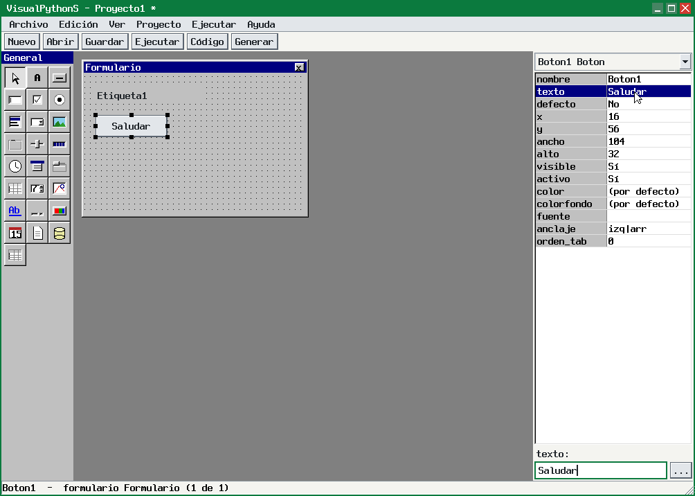

4. **Doble clic en el botón**: se abre el editor de código en `def Boton1_click():`. Borra la línea
   `pass` y escribe lo que ocurre al pulsar. Al teclear `Etiqueta1.te` el editor ofrece las propiedades
   (con **Tab** se acepta `texto`):

   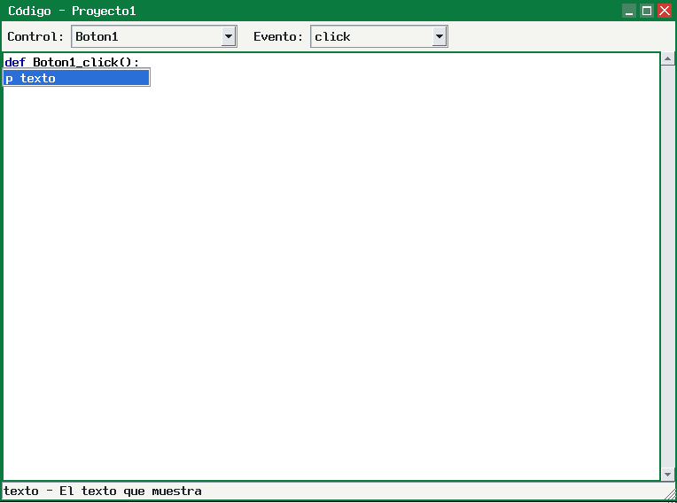

   El código completo:

   ```python
   def Boton1_click():
       Etiqueta1.texto = "Hola desde VPS"
   ```

   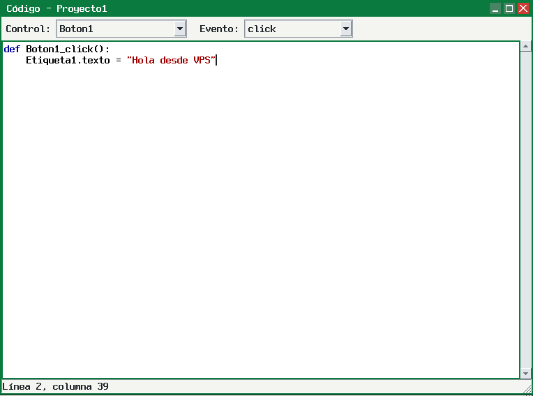

5. **F5** ejecuta la aplicación en su ventana. Al pulsar **Saludar** cambia la etiqueta:

   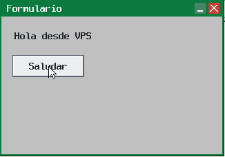

6. **Ctrl+S** guarda el proyecto en una carpeta con `formulario.vpf` (los controles) y `codigo.py` (tu código).

Si Python da un error, el editor salta a la línea y la marca en rojo.

---

## 2. Propiedades

Una **propiedad** es un dato de un control: su texto, su posición, su color. Todas tienen nombre en
español y se leen y escriben igual que una variable.

### Cambiarlas en el diseñador

Se elige el control, se pulsa la fila de la propiedad y, según su tipo:

- **Texto o número** (`texto`, `x`, `ancho`...): se escribe en el cuadro de abajo y se pulsa Intro.
- **Sí/No** (`visible`, `activo`, `valor` de una Casilla...): un clic alterna.
- **Opciones** (`alineacion`) y **colores**: abren un menú.
- **Listas** (`elementos`, `columnas`, `filas`): abren un cuadro con una línea por elemento.

Si hay varios controles seleccionados (Mayús+clic), el cambio vale para todos.

### Cambiarlas por código

En el código se escribe `Control.propiedad`:

```python
Etiqueta1.texto = "Hola"            # el texto
Boton1.activo = False               # el botón deja de responder
Boton1.x = 40                       # posición y tamaño, en píxeles
Boton1.y = 100
Boton1.ancho = 120
Boton1.alto = 30
Etiqueta1.color = ROJO              # color del texto (también 0xFF0000, "#ff0000" o "rojo")
Etiqueta1.colorfondo = AMARILLO     # color de fondo
Etiqueta1.visible = False           # se esconde
Etiqueta1.fuente = "DejaVu Sans 18 negrita"   # tamaño y estilo (Etiqueta y Boton)
Casilla1.valor = True               # marcada
Lista1.elementos = ["uno", "dos"]   # el contenido de una lista
Boton2.anclaje = "der|abj"          # se queda pegado al borde derecho e inferior al redimensionar
print(Etiqueta1.texto, Lista1.valor)   # también se leen
```

Los colores pueden ser un número `0xRRGGBB`, un texto `"#rrggbb"`, un nombre en español o inglés
(`"rojo"`, `"blue"`) o una de las constantes `NEGRO`, `BLANCO`, `ROJO`, `VERDE`, `AZUL`, `AMARILLO`, `GRIS`,
`PLATA`, `NARANJA`, `MORADO`, `MARRON`, `ROSA`, `CIAN`.

### Propiedades comunes a todos los controles visibles

| Propiedad | Qué es |
| --- | --- |
| `nombre` | Cómo se llama el control; con él se conectan los eventos (`Boton1_click`) |
| `x`, `y`, `ancho`, `alto` | Posición y tamaño en píxeles, relativos al formulario o al contenedor (Marco, Pestanas) |
| `visible`, `activo` | Si se ve y si responde al ratón y al teclado |
| `color`, `colorfondo` | Color del texto y de fondo |
| `fuente` | Tamaño y estilo del texto (solo Etiqueta y Boton): `"DejaVu Sans 18 negrita subrayado"` |
| `anclaje` | `izq`, `der`, `arr`, `abj` separados por `\|`: qué hace al redimensionar el formulario (por defecto `izq\|arr`: nada) |
| `orden_tab` | Posición en el orden del Tab (se fija con **Ver > Orden de tabulación**) |
| `pagina` | Solo dentro de unas **Pestanas**: en qué página está el control (0 es la primera) |

### Propiedades propias de cada control

| Control | Propiedades propias | Se leen pero no se escriben |
| --- | --- | --- |
| `Formulario` | `texto` (título), `ancho`, `alto`, `color`, `redimensionable` | `resultado`, `datos` |
| `Etiqueta` | `texto`, `alineacion` (`izquierda`, `centro`, `derecha`) | |
| `Boton` | `texto`, `defecto` (Intro lo pulsa) | |
| `CuadroTexto` | `texto`, `multilinea`, `clave` (muestra `*`), `solo_lectura` | `tecla`, `caracter` |
| `Casilla` | `texto`, `valor` (`True`/`False`) | |
| `Opcion` | `texto`, `valor`, `grupo` | |
| `Lista` | `elementos`, `seleccion` (índice o -1) | `valor` (el texto elegido) |
| `Combo` | `elementos`, `texto`, `editable`, `seleccion` | |
| `Imagen` | `archivo` (BMP, PNG o PPM), `ajustar` | |
| `Marco` | `texto` | |
| `Deslizador` | `valor`, `minimo`, `maximo`, `vertical` | |
| `BarraProgreso` | `valor`, `maximo` | |
| `Temporizador` | `intervalo` (ms), `activo` | |
| `Menu` | `elementos` (títulos sin sangría, opciones con sangría) | |
| `Pestanas` | `elementos` (los títulos), `seleccion` (la página que se ve) | `valor` (el título de la página) |
| `Tabla` | `columnas`, `filas`, `seleccion`, `editable`, `ordenable` | `valor` (la fila elegida), `columna` |
| `Numerico` | `valor`, `minimo`, `maximo`, `paso`, `decimales` | |
| `Lienzo` | (ninguna propia; dibuja con métodos) | `raton_x`, `raton_y` |
| `Enlace` | `texto`, `url` | |
| `BarraEstado` | `texto`, `elementos` (paneles de la derecha) | |
| `SelectorColor` | `valor` (el color, `0xRRGGBB`) | |
| `Reloj` | `intervalo`, `activo` | `anio`, `mes`, `dia`, `hora`, `minuto`, `segundo`, `dia_semana`, `fecha`, `hora_texto`, `nombre_dia`, `nombre_mes` |
| `Archivo` | `ruta`, `separador` | |

---

## 3. Eventos

Un **evento** es algo que ocurre: se pulsa un botón, se escribe en un cuadro, se abre el formulario.
Tú escribes una función y VisualPythonS la llama cuando ocurre.

### La convención `Control_evento`

El nombre de la función es el del control, un guion bajo y el del evento. Se conecta sola:

```python
def Boton1_click():                 # al pulsar Boton1
    Etiqueta1.texto = "pulsado"

def CuadroTexto1_cambio():          # cada vez que cambia el texto
    Etiqueta2.texto = CuadroTexto1.texto

def Formulario_cargar():            # al abrirse el formulario
    CuadroTexto1.texto = "hola"

def Formulario_tecla():             # al pulsar una tecla con el foco en el formulario
    print(Formulario.tecla, Formulario.caracter)

def Lista1_seleccion():             # al elegir un elemento
    print(Lista1.valor)

def Temporizador1_tic():            # cada intervalo milisegundos
    pass
```

En el diseñador, el **doble clic** en un control abre su evento más habitual (o crea la función si
no existe); los combos **Control** y **Evento** del editor llegan a cualquiera.

### Los datos del evento están en el control

Los manejadores **no llevan parámetros**. Lo que el evento sabe se lee del control:

| Evento | Dónde está el dato |
| --- | --- |
| `Formulario_tecla` | `Formulario.tecla` (nombre de la tecla) y `Formulario.caracter` |
| `CuadroTexto1_tecla` | `CuadroTexto1.tecla`, `CuadroTexto1.caracter` |
| `Lista1_seleccion` | `Lista1.seleccion` (índice) y `Lista1.valor` (texto) |
| `Tabla1_seleccion`, `Tabla1_doble_click` | `Tabla1.seleccion`, `Tabla1.valor` (la fila) y `Tabla1.columna` |
| `Lienzo1_click`, `_arrastrar`, `_soltar`, `_mover` | `Lienzo1.raton_x` y `Lienzo1.raton_y` |
| `Pestanas1_cambio` | `Pestanas1.seleccion` y `Pestanas1.valor` |
| `SelectorColor1_cambio`, `Numerico1_cambio` | `SelectorColor1.valor`, `Numerico1.valor` |
| `_doble_click`, `_raton_abajo`, `_raton_arriba`, `_raton_entra`, `_raton_sale`, `_raton_mueve`, `_menu_contextual` (v8.4.1) | `Control.raton_x`, `Control.raton_y` (en píxeles del control) y, en los de pulsar y soltar, `Control.boton` (1 izquierdo, 2 central, 3 derecho) |
| `_rueda` | `Control.rueda_delta` (entalles: positivo hacia arriba, negativo hacia abajo) y `raton_x`, `raton_y` |
| `_tecla_abajo`, `_tecla_arriba` | `Control.tecla` (nombre de la tecla), `Control.caracter`, `Control.ctrl` y `Control.mayus` (`True` si se pulsa Ctrl o Mayús) |
| `Formulario_cerrando` | `Formulario.cancelar`: ponerlo a `True` impide que se cierre |
| `CuadroTexto1_validar` | `CuadroTexto1.cancelar`: ponerlo a `True` devuelve el foco al cuadro |
| `CuadroTexto1_intro` | `CuadroTexto1.texto` |
| `Tabla1_celda_cambio` | `Tabla1.fila`, `Tabla1.columna` (la celda editada) y `Tabla1.celda(fila, columna)` |
| `Tabla1_ordenar` | `Tabla1.columna` (por la que se ordenó) y `Tabla1.descendente` |
| `Casilla1_cambio`, `Opcion1_cambio` | `Casilla1.valor`, `Opcion1.valor` |

### Otras dos formas de conectar

```python
@evento(Boton1, "click")            # con un decorador
def saludar():
    Etiqueta1.texto = "Hola"

def otra():
    Etiqueta1.texto = "Adiós"
Boton2.conectar("click", otra)      # o con conectar
```

Se pueden mezclar y un mismo evento puede tener varias funciones.

### Eventos comunes a todos los controles visibles (v8.4.1)

Todos los controles con ventana (los que no son `Temporizador`, `Reloj`, `Menu`, `Archivo` ni `ConectorBD`)
tienen estos eventos, además de los suyos. Se escriben como siempre, `Control_evento`:

<!-- eventos-comunes -->
| Evento | Cuándo | Datos en el control |
| --- | --- | --- |
| `doble_click` | Doble clic | `raton_x`, `raton_y` |
| `raton_abajo` | Se pulsa un botón del ratón sobre el control | `raton_x`, `raton_y`, `boton` |
| `raton_arriba` | Se suelta el botón | `raton_x`, `raton_y`, `boton` |
| `raton_entra` | El puntero entra en el control | `raton_x`, `raton_y` |
| `raton_sale` | El puntero sale del control | `raton_x`, `raton_y` |
| `raton_mueve` | El puntero se mueve sobre el control | `raton_x`, `raton_y` |
| `rueda` | Gira la rueda con el puntero encima | `rueda_delta`, `raton_x`, `raton_y` |
| `foco_gana` | El control recibe el foco |  |
| `foco_pierde` | El control pierde el foco |  |
| `tecla_abajo` | Se pulsa una tecla con el foco en el control | `tecla`, `caracter`, `ctrl`, `mayus` |
| `tecla_arriba` | Tras `tecla_abajo` (el sistema no avisa de soltar la tecla) | `tecla`, `caracter`, `ctrl`, `mayus` (se dispara tras `tecla_abajo`) |
| `menu_contextual` | Clic derecho | `raton_x`, `raton_y`, `boton` (3) |
<!-- /eventos-comunes -->

`raton_mueve`, `raton_entra`, `raton_sale`, `rueda` y los demás solo calculan algo **si hay un manejador
conectado**: una aplicación que no los usa no pierde rendimiento. Dos límites del sistema, que se anotan aquí
para no buscarlos: el sistema **no avisa de cuándo se suelta una tecla**, así que `tecla_arriba` se dispara justo
después de `tecla_abajo` con los mismos datos; y **no hay arrastrar y soltar archivos sobre las ventanas**, así que
el formulario no tiene `soltar_archivo` por ahora.

### Eventos del formulario (v8.4.1)

| Evento | Cuándo | Datos |
| --- | --- | --- |
| `cargar` | Al abrirse | |
| `cerrando` | Al pulsar la X (o cerrar desde el sistema), **antes** de cerrar | `Formulario.cancelar = True` cancela el cierre (por ejemplo para preguntar «¿Guardar cambios?») |
| `cerrado` | Cuando ya se cerró | |
| `redimensionar` | Al cambiar de tamaño | `Formulario.ancho`, `Formulario.alto` |
| `activar`, `desactivar` | El formulario recibe o pierde el foco (un control suyo pasa a tenerlo, o lo pierde hacia otra ventana) | |
| `tecla`, `click` | | `Formulario.tecla`, `Formulario.caracter` |
| `cerrar` | El evento antiguo: devolver `False` impedía cerrar. Se mantiene por compatibilidad; usa `cerrando` | |

`Formulario.cerrar()` (por código) cierra sin preguntar: `cerrando` es solo para el cierre del usuario.

### Eventos de cada control

La tabla sale del código (`tools/vps_manual.py`). A los propios se suman los comunes de arriba.

<!-- eventos-tabla -->
| Control | Eventos propios | Comunes |
| --- | --- | --- |
| `Formulario` | `cargar`, `cerrando`, `cerrado`, `redimensionar`, `activar`, `desactivar`, `tecla`, `click`, `cerrar` | no |
| `Etiqueta` | `click` | sí |
| `Boton` | `click` | sí |
| `CuadroTexto` | `cambio`, `tecla`, `click`, `intro`, `validar` | sí |
| `Casilla` | `click`, `cambio` | sí |
| `Opcion` | `click`, `cambio` | sí |
| `Lista` | `seleccion`, `doble_click`, `click` | sí |
| `Combo` | `seleccion`, `cambio` | sí |
| `Imagen` | `click` | sí |
| `Marco` | `click` | sí |
| `Deslizador` | `cambio` | sí |
| `BarraProgreso` | (ninguno) | sí |
| `Temporizador` | `tic` | no |
| `Menu` | uno por opción: `MnuAbrir_click` | no |
| `Pestanas` | `cambio`, `click` | sí |
| `Tabla` | `seleccion`, `cambio`, `doble_click`, `click`, `celda_cambio`, `ordenar` | sí |
| `Numerico` | `cambio` | sí |
| `Lienzo` | `click`, `arrastrar`, `soltar`, `mover` | sí |
| `Enlace` | `click` | sí |
| `BarraEstado` | `click` | sí |
| `SelectorColor` | `cambio`, `click` | sí |
| `Reloj` | `tic` | no |
| `Archivo` | (ninguno) | no |
| `ConectorBD` | `conectado`, `error`, `registro`, `datos` | no |
| `RejillaDatos` | `seleccion`, `cambio` | sí |
| `SelectorDeArchivos` | `seleccionado`, `cancelado` | no |
| `SelectorDeCarpetas` | `seleccionado`, `cancelado` | no |
| `CampoArchivo` | `cambio`, `seleccionado`, `cancelado` | sí |
| `CampoCarpeta` | `cambio`, `seleccionado`, `cancelado` | sí |
| `SelectorDeColor` | `seleccionado`, `cancelado` | no |
| `SelectorDeFuente` | `seleccionado`, `cancelado` | no |
| `ComboFuentes` | `seleccion`, `cambio` | sí |
| `Calendario` | `cambio` | sí |
| `SelectorFecha` | `cambio` | sí |
<!-- /eventos-tabla -->

--- | --- |
| `Formulario` | `cargar`, `cerrar` (devolver `False` impide cerrar), `tecla`, `click`, `redimensionar` |
| `Etiqueta`, `Imagen`, `Marco` | `click` |
| `Boton`, `Casilla`, `Opcion` | `click` |
| `CuadroTexto` | `cambio`, `tecla`, `click` |
| `Lista` | `seleccion`, `doble_click`, `click` |
| `Combo` | `seleccion`, `cambio` |
| `Deslizador` | `cambio` |
| `Temporizador`, `Reloj` | `tic` |
| `Menu` | uno por opción: `MnuAbrir_click` |
| `Pestanas` | `cambio`, `click` |
| `Tabla` | `seleccion`, `cambio` (se editó una celda), `doble_click`, `click` |
| `Numerico` | `cambio` |
| `Lienzo` | `click`, `arrastrar`, `soltar`, `mover` |
| `Enlace`, `BarraEstado` | `click` |
| `SelectorColor` | `cambio`, `click` |

---

## 4. Ejemplos completos

Cada ejemplo trae la tabla de sus controles (para rehacerlo desde cero en el diseñador), su código
completo y una captura. Se abren con `python /lib/python/vps/disenador.py /ejemplos/vps/<nombre>`.

### 4.1 Una calculadora

*Aprendes:* leer cuadros de texto, un `Combo`, convertir a número y avisar de un error con `msgbox`.
Carpeta: `/ejemplos/vps/calculadora`.

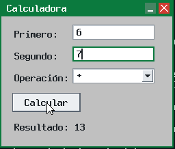

<!-- controles:calculadora -->
| Control | Nombre | x, y, ancho, alto | Propiedades |
| --- | --- | --- | --- |
| Formulario | `Formulario` | 250 x 190 | `texto = "Calculadora"`, `ancho = 250`, `alto = 190` |
| Etiqueta | `Etiqueta1` | 16, 16, 80, 20 | `texto = "Primero:"` |
| CuadroTexto | `CuadroTexto1` | 104, 12, 120, 22 | `texto = "0"` |
| Etiqueta | `Etiqueta2` | 16, 48, 80, 20 | `texto = "Segundo:"` |
| CuadroTexto | `CuadroTexto2` | 104, 44, 120, 22 | `texto = "0"` |
| Etiqueta | `Etiqueta3` | 16, 80, 80, 20 | `texto = "Operación:"` |
| Combo | `Combo1` | 104, 76, 120, 22 | `elementos = ['+', '-', '*', '/']`, `texto = "+"` |
| Boton | `Boton1` | 16, 112, 100, 28 | `texto = "Calcular"` |
| Etiqueta | `Etiqueta4` | 16, 152, 210, 20 | `texto = "Resultado: "` |
<!-- /controles -->

<!-- ejemplo:cronometro -->
```python
# Cronómetro: un Temporizador que dispara «tic» cada 100 ms.
import sagui

inicio = 0
acumulado = 0


def mostrar():
    d = (acumulado + (sagui.ticks_ms() - inicio if Temporizador1.activo else 0)) // 100
    Etiqueta1.texto = "%02d:%02d.%d" % (d // 600, (d // 10) % 60, d % 10)


def Boton1_click():
    global inicio, acumulado
    if Temporizador1.activo:
        acumulado += sagui.ticks_ms() - inicio
        Temporizador1.activo = False
        Boton1.texto = "Iniciar"
    else:
        inicio = sagui.ticks_ms()
        Temporizador1.activo = True
        Boton1.texto = "Parar"
    mostrar()


def Boton2_click():
    global acumulado
    acumulado = 0
    Temporizador1.activo = False
    Boton1.texto = "Iniciar"
    mostrar()


def Temporizador1_tic():
    mostrar()
```
<!-- /ejemplo -->

### 4.5 Validar una entrada con `msgbox`

*Aprendes:* `msgbox` con distintos iconos y botones, qué devuelve y `enfocar()`. Carpeta:
`/ejemplos/vps/validar-entrada`.

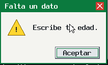
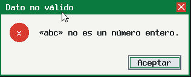
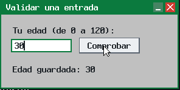

<!-- controles:validar-entrada -->
| Control | Nombre | x, y, ancho, alto | Propiedades |
| --- | --- | --- | --- |
| Formulario | `Formulario` | 290 x 120 | `texto = "Validar una entrada"`, `ancho = 0x000122`, `alto = 120` |
| Etiqueta | `Etiqueta1` | 16, 16, 260, 20 | `texto = "Tu edad (de 0 a 120):"` |
| CuadroTexto | `CuadroTexto1` | 16, 40, 100, 22 |  |
| Boton | `Boton1` | 128, 38, 100, 26 | `texto = "Comprobar"` |
| Etiqueta | `Etiqueta2` | 16, 80, 260, 20 |  |
<!-- /controles -->

<!-- ejemplo:pestanas -->
```python
# Pestañas: cada control está en una página (su propiedad `pagina`); `cambio` salta al cambiar de pestaña.

def Pestanas1_cambio():
    Etiqueta3.texto = "Página: %s (%d)" % (Pestanas1.valor, Pestanas1.seleccion)


def Casilla2_click():
    Pestanas1.colorfondo = 0x404040 if Casilla2.valor else None
```
<!-- /ejemplo -->

### 4.9 Un cuadro numérico

*Aprendes:* `Numerico`: un número con flechas, `minimo`, `maximo`, `paso` y `decimales`. Carpeta:
`/ejemplos/vps/numerico`.

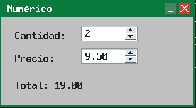
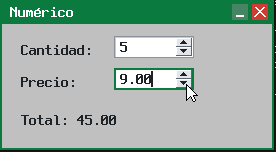

<!-- controles:numerico -->
| Control | Nombre | x, y, ancho, alto | Propiedades |
| --- | --- | --- | --- |
| Formulario | `Formulario` | 270 x 124 | `texto = "Numérico"`, `ancho = 0x00010E`, `alto = 124` |
| Etiqueta | `Etiqueta1` | 16, 16, 90, 20 | `texto = "Cantidad:"` |
| Numerico | `Numerico1` | 112, 12, 80, 22 | `valor = 2`, `minimo = 1`, `maximo = 10` |
| Etiqueta | `Etiqueta2` | 16, 48, 90, 20 | `texto = "Precio:"` |
| Numerico | `Numerico2` | 112, 44, 80, 22 | `valor = 9.5`, `paso = 0.5`, `decimales = 2` |
| Etiqueta | `Etiqueta3` | 16, 84, 240, 24 |  |
<!-- /controles -->

<!-- ejemplo:enlace -->
```python
# Enlace: una etiqueta que se pulsa. `url` es un dato que guarda el control para tu programa.

def Enlace1_click():
    Etiqueta1.texto = "Abrirías: " + Enlace1.url


def Enlace2_click():
    msgbox("VisualPythonS para SaguiOS", "Acerca de")
```
<!-- /ejemplo -->

### 4.13 Elegir un color

*Aprendes:* `SelectorColor`: un botón con la muestra del color; al pulsarlo abre una paleta.
Carpeta: `/ejemplos/vps/selector-color`.


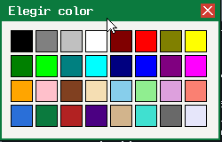
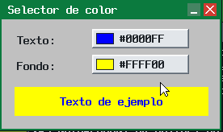

<!-- controles:selector-color -->
| Control | Nombre | x, y, ancho, alto | Propiedades |
| --- | --- | --- | --- |
| Formulario | `Formulario` | 270 x 136 | `texto = "Selector de color"`, `ancho = 0x00010E`, `alto = 136` |
| Etiqueta | `Etiqueta1` | 16, 16, 90, 20 | `texto = "Texto:"` |
| SelectorColor | `SelectorColor1` | 112, 12, 120, 24 | `valor = 255` |
| Etiqueta | `Etiqueta2` | 16, 48, 90, 20 | `texto = "Fondo:"` |
| SelectorColor | `SelectorColor2` | 112, 44, 120, 24 | `valor = 0xFFFF00` |
| Etiqueta | `Etiqueta3` | 16, 84, 240, 36 | `color = 255`, `colorfondo = 0xFFFF00`, `texto = "Texto de ejemplo"`, `alineacion = "centro"` |
<!-- /controles -->

<!-- ejemplo:archivo -->
```python
# Archivo: sin ventana; lee y escribe el archivo de su propiedad `ruta` (texto, líneas o CSV).

def Formulario_cargar():
    if Archivo1.existe():
        CuadroTexto1.texto = Archivo1.leer()
        Etiqueta1.texto = "Cargado de " + Archivo1.ruta


def Boton1_click():
    Archivo1.escribir(CuadroTexto1.texto)
    Etiqueta1.texto = "Guardado (%d letras)" % len(CuadroTexto1.texto)


def Boton2_click():
    CuadroTexto1.texto = Archivo1.leer()
    Etiqueta1.texto = "Cargado"


def Boton3_click():
    Etiqueta1.texto = "El archivo tiene %d líneas" % len(Archivo1.leer_lineas())
```
<!-- /ejemplo -->

### 4.17 Un botón que cambia de color con el ratón

*Aprendes:* `raton_entra`, `raton_sale`, `doble_click`, `rueda` y los datos `raton_x`, `raton_y` y `rueda_delta`.
Carpeta: `/ejemplos/vps/boton-raton`.

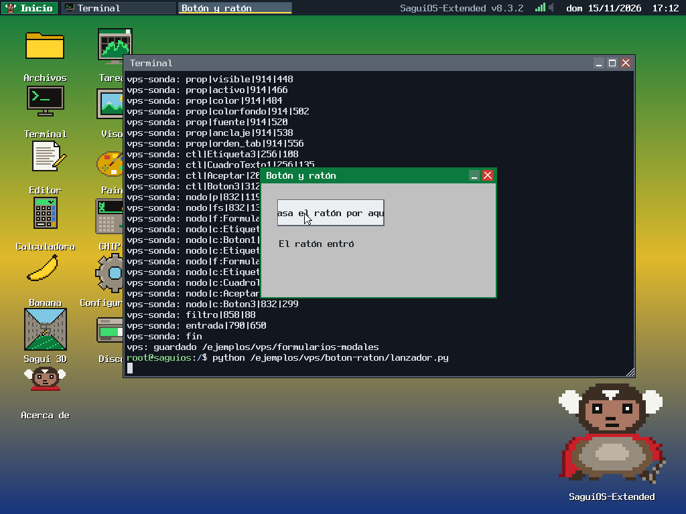

<!-- controles:boton-raton -->
| Control | Nombre | x, y, ancho, alto | Propiedades |
| --- | --- | --- | --- |
| Formulario | `Formulario` | 350 x 170 | `texto = "Botón y ratón"`, `ancho = 0x00015E`, `alto = 170` |
| Boton | `Boton1` | 24, 24, 160, 40 | `texto = "Pasa el ratón por aquí"` |
| Etiqueta | `Etiqueta1` | 24, 80, 300, 20 |  |
| Etiqueta | `Etiqueta2` | 24, 104, 300, 20 |  |
| Etiqueta | `Etiqueta3` | 24, 128, 300, 20 |  |
<!-- /controles -->

<!-- ejemplo:editor-notas -->
<!-- /ejemplo -->

---

## 6. Herramientas del entorno

### Deshacer y rehacer

**Ctrl+Z** y **Ctrl+Y** valen para todo lo que se hace en el diseñador (colocar, mover, estirar, cambiar una
propiedad, borrar, pegar, renombrar...) y también, aparte, dentro del editor de código.

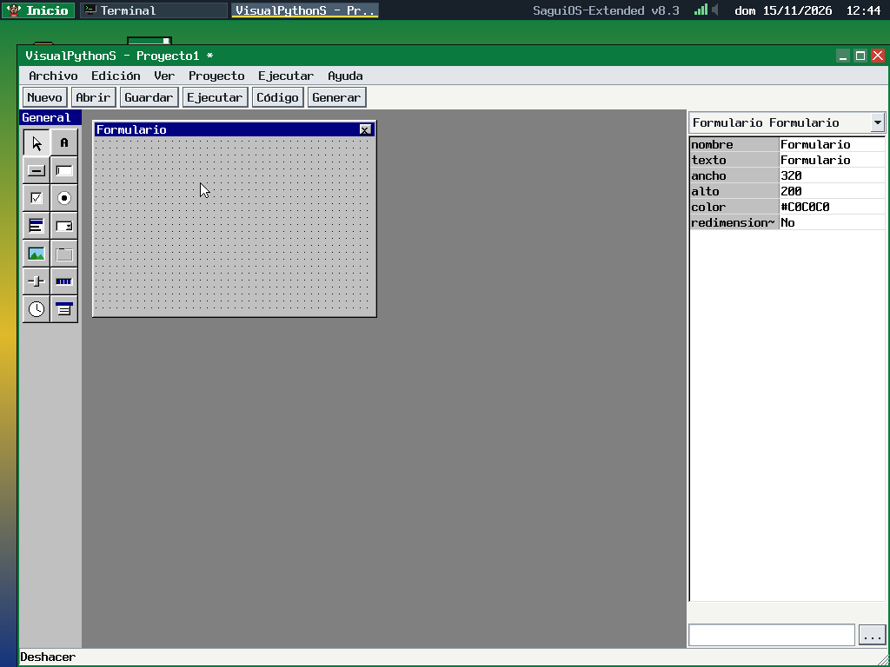

### El explorador del proyecto

**Ver > Explorador** (o **Ctrl+R**) muestra, encima de las propiedades, un árbol **Proyecto > Formularios >
controles** con el icono y el nombre de cada uno, respetando los contenedores (un `Marco`, las páginas de unas
`Pestanas`) y con los controles sin ventana (`Temporizador`, `Reloj`, `Archivo`, `ConectorBD`). Al final, **Código**
lista los manejadores de eventos que ya existen en `codigo.py`.

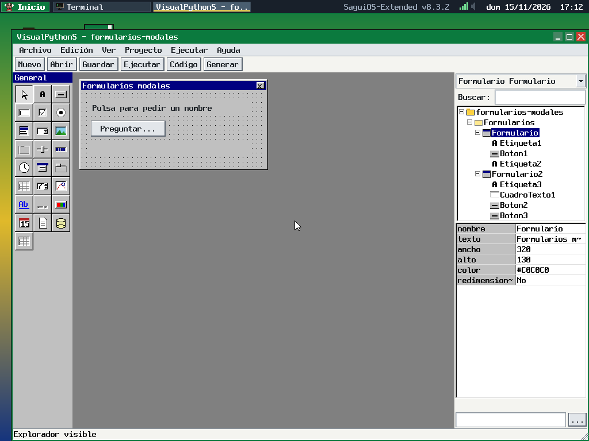

| Gesto | Qué hace |
| --- | --- |
| Clic en un control | Lo selecciona en el diseñador: cambia de formulario y de pestaña si hace falta y enseña sus propiedades |
| Doble clic en un control o un formulario | Abre su evento por defecto en el editor |
| Doble clic en un manejador | Salta a su línea en el editor |
| `+` / `-` del nodo | Abre o cierra la rama |
| Clic derecho | Menú: Ver código, Renombrar (con la refactorización del código), Eliminar, Traer al frente, Enviar atrás y Agregar formulario |
| **F2** / **Supr** | Renombrar / eliminar el nodo elegido |
| Flechas arriba y abajo, Intro | Recorrer el árbol |
| Cuadro **Buscar** | Deja solo los nodos cuyo nombre contiene el texto (y sus ascendientes) |

El árbol se mantiene al día al colocar, borrar, renombrar, deshacer o escribir código (la lista de manejadores
se actualiza a los pocos instantes de escribir).

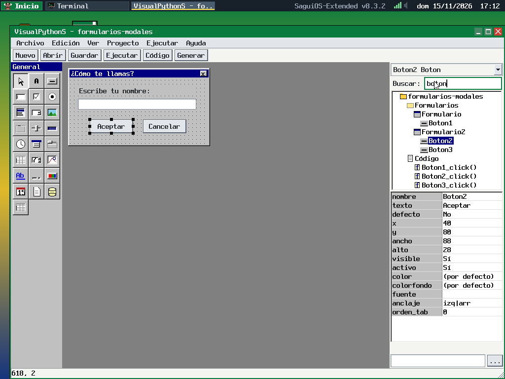

### Renombrar un control

Cambiar la propiedad `nombre` actualiza el código: `Boton1_click` pasa a `Aceptar_click` y
`Boton1.texto` a `Aceptar.texto`, sin tocar las cadenas ni los comentarios. Antes de aplicar se enseña
la lista de líneas que cambian.

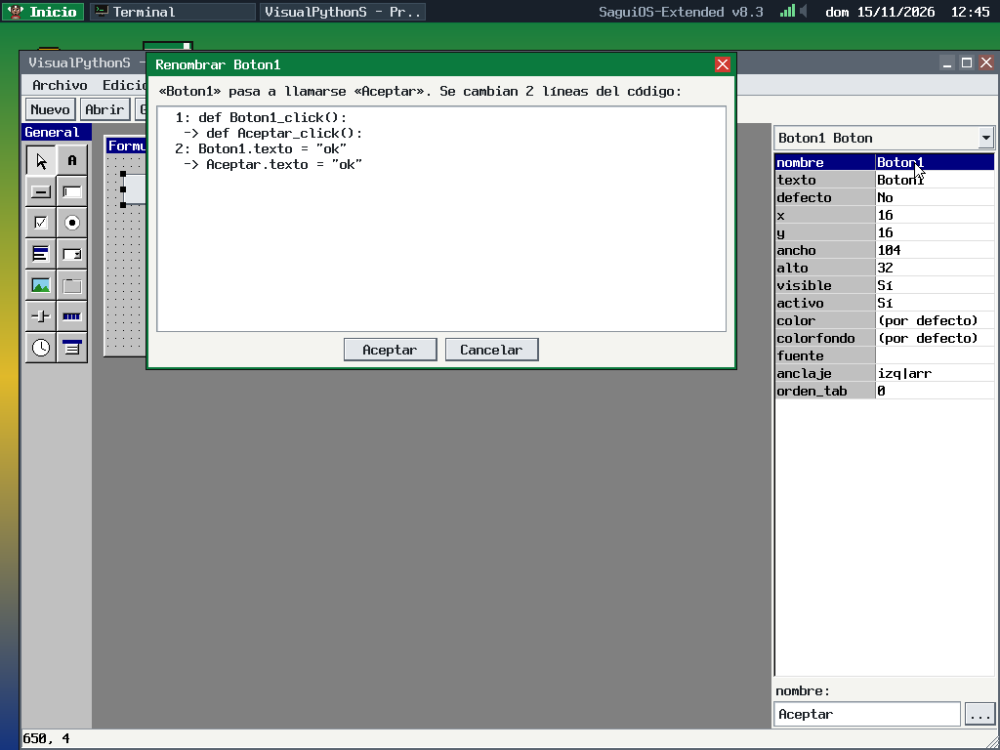

### Autocompletado y ayuda

El editor ofrece, con **Tab** o **Intro** para aceptar, **Esc** para cerrar y **Ctrl+Espacio** para
abrirla a mano:

- tras un punto: las **propiedades** (`p`), los **métodos** (`m`) y los **eventos** (`e`) del control, o la API tras `vps.`;
- tras **dos letras**: los controles y formularios, las funciones de `vps`, las **palabras clave** de Python
  (`k`), las **funciones integradas** (`i`: `print`, `len`, `range`...) y **los nombres de tu propio código**
  (`v` variables, `f` funciones, `C` clases);
- al abrir un paréntesis: la **firma** de la función, también las tuyas (con la primera línea de su texto de
  ayuda, el que va entre `"""` bajo el `def`).

No molesta: la lista solo sale tras dos caracteres, no sale dentro de un texto entre comillas ni de un
comentario, y **Esc** la cierra hasta que empieces otra palabra.

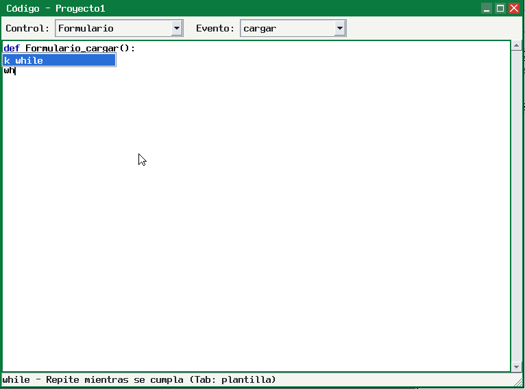

**Plantillas:** escribe `def`, `if`, `elif`, `else`, `for`, `while`, `try`, `class` o `with` y pulsa **Tab**:
se escribe el bloque entero (respetando la sangría) y el cursor queda en el primer hueco.

| Escribes + Tab | Se expande a |
| --- | --- |
| `def` | `def ():` + `pass` (cursor en el nombre) |
| `if` / `elif` | `if :` + `pass` (cursor en la condición) |
| `for` | `for  in range(10):` + `pass` |
| `while` | `while :` + `pass` |
| `try` | `try:` + `pass`, `except Exception as e:` + `print(e)` (cursor en el cuerpo del `try`) |
| `class` | `class :` con un `__init__` |
| `with` | `with open() as f:` + `pass` |

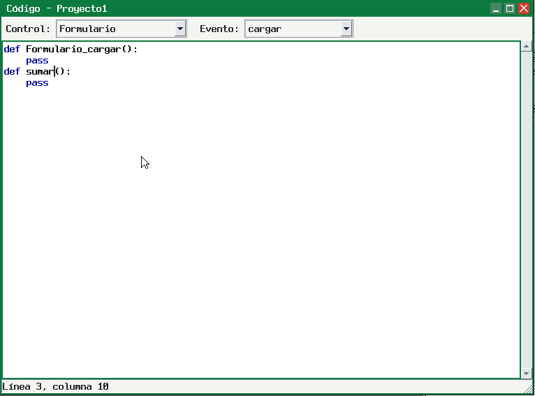

**Sangría automática:** tras un `:` Intro sangra cuatro espacios; tras `return`, `pass`, `break`, `continue` o
`raise` quita un nivel; entre `(` y `)` pone el cierre en su propia línea.

**Cierre automático:** `(`, `[`, `{`, `"` y `'` escriben también el cierre con el cursor en medio; si
escribes el cierre, salta el que ya está; borrar entre un par vacío quita los dos. No cierra comillas
tras una letra (un apóstrofo) ni dentro de un comentario.

### Depurador

**F9** pone un punto de parada en la línea del cursor; **F5** ejecuta y para en él; **F8** ejecuta paso
a paso. Se abre una ventana con las variables.

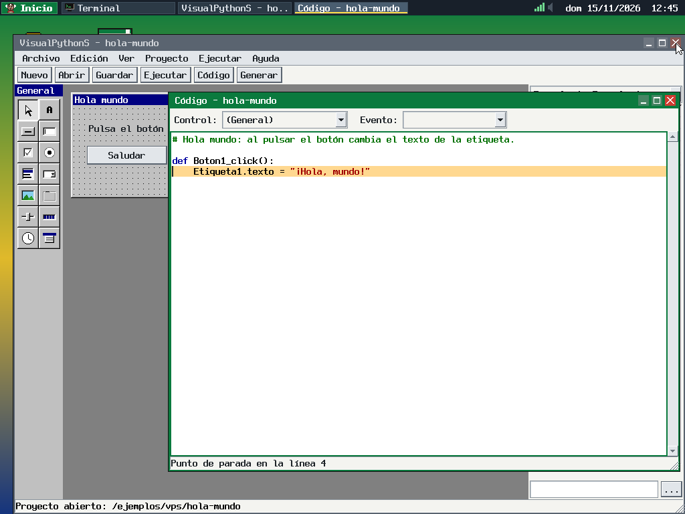
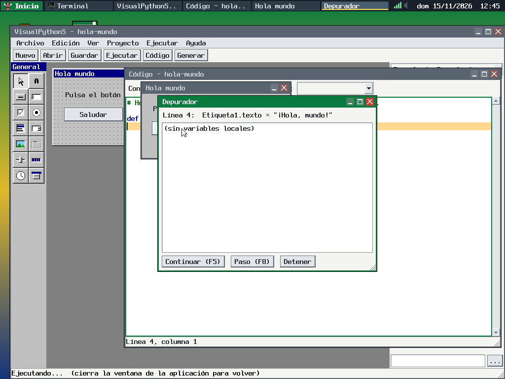

### Orden de tabulación y anclajes

**Ver > Orden de tabulación...** abre una lista de controles que se sube y se baja: fija `orden_tab`
(1, 2, 3...) y el Tab recorre los controles en ese orden. El **anclaje** (`izq`, `der`, `arr`, `abj`)
mueve o estira el control cuando cambia el tamaño del formulario: un botón con `anclaje="der|abj"` se
queda en la esquina inferior derecha; un cuadro con `izq|der|arr|abj` se estira en las cuatro
direcciones. Para que el usuario pueda redimensionar, pon `redimensionable` en el formulario.

### Generar la aplicación para el menú Inicio

**Archivo > Generar aplicación** copia el proyecto y un `lanzador.py` a `/apps/vps/<Nombre>/` (o
`/home/vps/<Nombre>/` si no hay partición de apps). Aparece en **Inicio > Mis aplicaciones** y se abre sin el
diseñador (`python /apps/vps/<Nombre>/lanzador.py`).

---

## 7. Referencia de la API `vps`

Todo se importa con `from vps import *` (el diseñador ya lo hace por ti).

| Función | Qué hace |
| --- | --- |
| `msgbox(texto, titulo="", botones="aceptar", icono="info")` | Mensaje modal. `botones`: `aceptar`, `aceptar_cancelar`, `si_no`, `si_no_cancelar`, `reintentar_cancelar`. `icono`: `info`, `aviso`, `error`, `pregunta`. Devuelve `"aceptar"`, `"cancelar"`, `"si"`, `"no"` o `"reintentar"` |
| `inputbox(texto, titulo="", defecto="")` | Pide un texto; devuelve `None` si se cancela |
| `dialogo_abrir(titulo="Abrir", carpeta=None, tipos=None)` | Diálogo de abrir del sistema. `tipos=[("Imágenes", "*.bmp *.png"), ("Todo", "*")]`. Devuelve la ruta o `""` |
| `dialogo_guardar(titulo="Guardar como", carpeta=None, tipos=None, nombre=None)` | Diálogo de guardar (pregunta si ya existe). Devuelve la ruta o `""` |
| `dialogo_carpeta(titulo="Elegir carpeta", carpeta=None)` | Diálogo de elegir carpeta |
| `ejecutar(globals())` | Muestra el primer formulario, conecta los eventos y no vuelve hasta que se cierre |
| `salir()` | Cierra todos los formularios y termina |
| `Formulario2.mostrar(modal=False, datos=None)` | Abre un formulario; con `modal=True` espera y devuelve lo que se dio a `cerrar(valor)` |
| `Formulario2.cerrar(resultado=None)` | Cierra (un secundario solo se esconde); el principal termina la aplicación |
| `Formulario2.ocultar()` | Esconde un formulario sin cerrarlo |
| `pausa(ms)` | Espera sin congelar la ventana |
| `depurar(variables=None)` | Para el programa y enseña las variables (`depurar(locals())` enseña las de la función) |
| `evento(control, "nombre")` | Decorador que conecta una función a un evento |
| `control.conectar("nombre", funcion)` | Lo mismo sin decorador |

Solo con código (sin diseñador):

```python
from vps import *

f = Formulario("Hola", 300, 150)
etiqueta = Etiqueta(f, "Pulsa el botón", 20, 20, 250, 20)
boton = Boton(f, "Saludar", 20, 50, 120, 28, nombre="Boton1")

def Boton1_click():
    etiqueta.texto = "¡Hola!"

ejecutar(globals())
```

---

## 8. Errores frecuentes y trucos

| Síntoma | Causa y arreglo |
| --- | --- |
| El botón no hace nada | El nombre de la función no coincide: `def Boton1_click():` (mayúsculas, guion bajo). Mira el combo **Control/Evento** del editor: lo escribe por ti |
| `NameError: name 'Etiqueta1' is not defined` | El control se llama de otra forma (¿lo renombraste?) o está en otro formulario: `Formulario2.Etiqueta1` |
| `ValueError: invalid syntax for integer` | `int("")` o `int("abc")`: valida antes con `try ... except ValueError` (ver «Validar una entrada») |
| El texto de un cuadro es siempre un texto | `CuadroTexto1.texto` es `str`: conviértelo con `int(...)` o `float(...)` |
| Cambio una propiedad y no se ve | Estás cambiando una variable local, no el control: `Etiqueta1.texto = ...`, no `texto = ...` |
| Un control no aparece en las Pestanas | Está en otra página (`pagina`) o no es hijo de las Pestanas: arrástralo **dentro** del cuerpo, con la página elegida |
| La tabla no se ordena bien | Las celdas numéricas se ordenan como números solo si todas lo son; si no, como texto |
| El Lienzo se borra al cambiar de tamaño | Lo dibujado no se guarda: vuelve a dibujar en el evento `redimensionar` |
| Un error en un manejador | Sale una ventana con el error y el editor salta a la línea; la aplicación sigue |
| La lista de sugerencias molesta | **Esc** la cierra; escribe de un tirón y no saldrá hasta la siguiente palabra |

Trucos:

- **F8** ejecuta paso a paso: ideal para ver por qué algo no hace lo que esperas.
- `print(...)` escribe en el terminal desde el que lanzaste la aplicación.
- Con **Mayús+clic** se eligen varios controles; **Edición > Alinear** los iguala.
- Para ver todos los controles de un formulario por código: `Formulario.controles` (un diccionario por nombre).
- Los ejemplos de `/ejemplos/vps/` son un buen punto de partida: ábrelos en el diseñador y cámbialos.
- Un `Temporizador` o un `Reloj` con `activo = False` se paran; con `True` siguen.
- Para una tecla rápida en cualquier parte: `def Formulario_tecla():` y mira `Formulario.tecla`.

Más: [visualpythons.md](visualpythons.md) (referencia), decisiones D297, D299 y D303, mejoras 123 y 124.

## Bases de datos

Para enseñar y editar una tabla de SQLite o lite-monkey hay `ConectorBD`, `RejillaDatos` y los controles enlazados (`fuente` y `campo`); la `Tabla` de este manual es para datos en memoria. Guía con una agenda paso a paso: [bases-de-datos.md](bases-de-datos.md).
