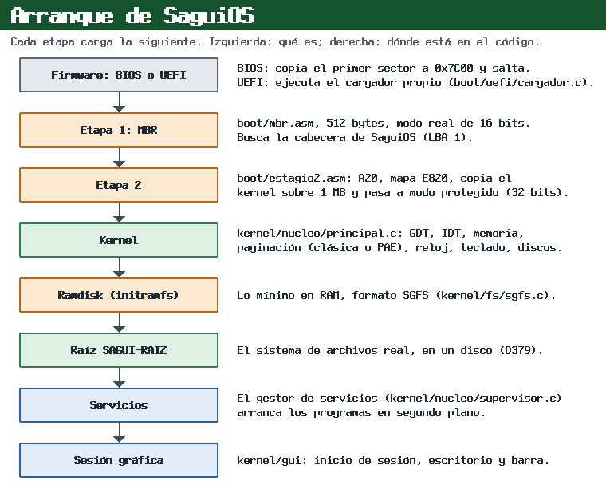

<!-- categoria: Conoce SaguiOS/Sistemas operativos; orden: 2; titulo: Arranque -->
# Arranque

[Español](02-arranque.md) · [Português](02-arranque_PT.md) · [English](02-arranque_EN.md)

> Objetivo: seguir el camino desde el botón de encendido hasta el escritorio, paso a paso, y ver por qué el arranque es
> una cadena de cargadores.

## 1. Teoría

### 1.1 El problema del huevo y la gallina

Al encender, la memoria RAM está vacía y el procesador ejecuta un código fijo que el fabricante ha grabado en la placa:
el **firmware**. El sistema operativo todavía no existe en memoria, así que hace falta una cadena: un programa pequeño
carga otro algo más grande, y así hasta llegar al núcleo. Cada eslabón tiene que caber en lo que el anterior sabe
hacer.

### 1.2 BIOS y UEFI

- **BIOS** (sistema básico de entrada y salida, de los PC clásicos): lee el primer sector del disco (512 bytes), lo
  copia a la dirección `0x7C00` y salta allí. El procesador arranca en **modo real** de 16 bits y la BIOS ofrece
  servicios por interrupciones (`INT 13h` para disco, `INT 15h` para el mapa de memoria, llamado **E820**).
- **UEFI** (interfaz de firmware extensible): no se limita a un sector; busca un fichero ejecutable en una partición
  EFI (FAT) y lo lanza con servicios ya en 32 o 64 bits. Su tabla de particiones suele ser GPT, no MBR.
- **Tabla MBR**: los primeros 446 bytes del sector son código, después vienen cuatro entradas de partición y la firma
  `0x55AA`. Es el formato clásico, limitado a discos de 2 TB y cuatro particiones primarias.

### 1.3 Modo real y modo protegido

El x86 arranca en **modo real**: 16 bits, sin protección de memoria, con direcciones de 20 bits. Para usar toda la
memoria y los anillos de protección (capítulo 3) hay que pasar al **modo protegido** de 32 bits: se carga una tabla de
segmentos (GDT), se pone el bit `PE` de `CR0` y se hace un salto largo para vaciar la cola de instrucciones. Antes hay
que activar la **línea A20**, que la compatibilidad con el 8086 mantiene a cero; sin ella, la dirección 1 MB se
«envuelve» a 0.

### 1.4 Del arranque al kernel

Una vez en modo protegido, el cargador debe:

1. Obtener el **mapa de memoria** (qué rangos son RAM y cuáles son dispositivos o están reservados).
2. Copiar el núcleo y los datos de arranque por encima de 1 MB (el modo real solo podía cargar por debajo).
3. Entregar al núcleo una estructura con esa información: memoria, ubicación del disco de arranque, el *ramdisk*.
4. Saltar al punto de entrada del núcleo.

### 1.5 initramfs y raíz real

Un **initramfs** (en SaguiOS, *ramdisk*) es un pequeño sistema de archivos cargado en RAM con lo imprescindible para
montar el sistema de verdad (drivers de disco, utilidades de montaje). Una vez montada la raíz real, el initramfs deja
de hacer falta. Linux lo hace con `initramfs` y la llamada `pivot_root` para cambiar la raíz.

### 1.6 Servicios

Después de montar la raíz, el sistema arranca **servicios**: procesos que no tienen ventana (red, cron, registro) y que
un supervisor reinicia si fallan. Es la idea de *daemons* de Unix, con sus unidades en systemd o `rc.d` en otros
sistemas.

### 1.7 Un cálculo: cuántas lecturas cuesta cargar el núcleo

Supón un núcleo de **300 KB** y sectores de 512 bytes. Son 300 × 1024 / 512 = **600 sectores**. La función INT 13h con
direccionamiento LBA (`AH=42h`, que usa `boot/mbr.asm` cuando la BIOS lo permite) suele leer como mucho 127 sectores por
llamada. Hacen falta ceil(600 / 127) = **5 llamadas**. Con direccionamiento CHS antiguo, cada pista tiene 63 sectores, así que
harían falta ceil(600 / 63) = 10 pistas distintas y más cabezas. Es el motivo por el que la etapa 2 prefiere LBA, y por el que
la cabecera de arranque dice dónde está cada parte: la etapa 1 no tiene espacio para razonar sobre el disco.

### 1.8 Comparativa: cargadores de arranque

| Sistema | Cargador | Qué hace antes del núcleo |
| --- | --- | --- |
| Linux | GRUB 2 (u otro) | Lee el sistema de archivos, carga el núcleo y el initramfs, pasa parámetros |
| Windows | Administrador de arranque (BCD) y `winload` | Elige el sistema y carga el núcleo y los controladores de arranque |
| FreeBSD | `loader` | Lee el kernel y los módulos, y lee la configuración de `/boot` |
| SaguiOS | Etapas 1 y 2 propias, y cargador UEFI propio | Mapa de memoria, copia al mega, modo protegido, cabecera |

## 2. Así lo hace SaguiOS

SaguiOS sigue la cadena clásica, con un cargador propio (sin GRUB):

| Paso | Qué hace | Fichero |
| --- | --- | --- |
| Firmware | BIOS (o UEFI) lee el primer sector | - |
| Etapa 1 | Sector de 512 bytes: busca la cabecera de arranque en el LBA 1 | `boot/mbr.asm`, `boot/cabecalho.inc` |
| Etapa 2 | Línea A20, mapa E820, carga del kernel por encima de 1 MB, modo protegido | `boot/estagio2.asm` |
| UEFI | Cargador propio con servicios GOP (decisión D264) | `boot/uefi/cargador.c`, `boot/uefi/trampolim.asm` |
| Kernel | Punto de entrada en C; enciende las piezas en orden | `kernel/nucleo/principal.c` |
| Ramdisk | Sistema SGFS en RAM con lo mínimo | `kernel/fs/sgfs.c`, `kernel/fs/ramfs.c` |
| Raíz | Partición `SAGUI-RAIZ` (ext2), montada como `/` | `kernel/fs/raiz.c` (decisión D379) |

Algunos detalles verificables:

- La etapa 1 comenta explícitamente que la BIOS copia el sector a `0x7C00`, y su `org` lo fija (`boot/mbr.asm`).
- La etapa 2 numera sus pasos: `[1/6]` línea A20, `[2/6]` mapa de memoria (E820), `[3/6]` kernel copiado a 1 MB,
  y `[6/6]` modo protegido con GDT propia y salto al kernel (`boot/estagio2.asm`).
- El kernel informa de cada paso con `etapa(...)` en `kernel/nucleo/principal.c`. Son los mismos mensajes que se ven en
  el arranque: «Interrupciones: GDT e IDT propias, PIC reasignado, reloj a 100 Hz» y «Procesos: round-robin cada 20 ms,
  programas en el anillo 3, int 0x80».
- `conferir_ramdisk()` comprueba el ramdisk antes de seguir.
- Con UEFI, el mensaje «Arranque UEFI ... sin servicios de la BIOS» sale en el mismo fichero.
- La decisión **D379** separa lo imprescindible para arrancar (initramfs en RAM) de «el sistema» (la raíz en disco).
- **El initramfs solo lleva programas estáticos** (decisión **D462**): los 18 programas del modo rescate (`sagsh`, `ls`,
  `mount`, `ps`...) corren antes de montar la raíz y sin `/lib`, así que no pueden necesitar bibliotecas compartidas;
  `tools/mkinitramfs.py` se niega a incluir un ejecutable con `PT_INTERP` (capítulo 6).
- **Los procesadores secundarios** (solo con la imagen `--smp`, decisión D164) los enciende el principal más tarde, con la
  secuencia INIT-SIPI de `kernel/nucleo/smp.c` y el trampolín `kernel/arch/ap_trampolim.asm`: cada uno arranca en modo
  real y repite en pequeño el paso a modo protegido (anexo de ensamblador).
- Los servicios en segundo plano los gestiona el supervisor `kernel/nucleo/supervisor.c` (decisión D216).

### 2.1 Decisiones, alternativas y límites actuales

- **Decisión: cargador propio, sin GRUB.** Así todo el arranque se lee en el repositorio (`boot/`). La decisión **D264**
  añade el arranque UEFI con servicios GOP e imagen híbrida BIOS+UEFI.
- **Decisión: raíz separada del initramfs.** La decisión **D379** deja en RAM lo mínimo y monta `SAGUI-RAIZ` como `/`. Así
  el mismo medio sirve para instalar, para arrancar en vivo y para arreglar el sistema.
- **Decisión: opciones del kernel que valen al reiniciar.** La decisión **D353** guarda configuración para el siguiente
  arranque (`kconfig`, de `kernel/nucleo/kconf.c`).
- **Límite: cada formato de arranque se mantiene a mano.** La herramienta `tools/mkimagem.py` escribe la cabecera; un
  cambio de disposición de memoria obliga a tocar cargador, cabecera y kernel a la vez.
- **Límite: el arranque de 2 TB.** Las particiones MBR llegan a 2 TB; el arranque UEFI con GPT es el camino para discos
  mayores (teoría del apartado 1.2, no probado en esta versión con esos discos).

## 3. Experimento en SaguiOS

1. Tras arrancar, abre **Visor de registros** (Inicio > Sistema > Visor de registros). Busca las líneas que empiezan por
   «Interrupciones» o «Procesos»: son las etapas del kernel.
2. En el terminal, escribe `dmesg -n 30` para ver las últimas líneas del registro del kernel. Busca `ramdisk` o `raiz`.
3. Escribe `df` para ver qué sistemas de archivos están montados y dónde. La raíz `/` debería ser `ext2` en `SAGUI-RAIZ`
   si se arrancó desde disco.
4. Escribe `servicios` para ver los servicios que ha arrancado el supervisor.

**Qué observar:** cada etapa deja una marca. Si una falla, el registro dice en qué paso se quedó: el arranque es una
cadena, y un error en un eslabón se localiza por su marca.

**Ejercicio práctico adicional.** Abre el Visor de registros y copia, en orden, las líneas del arranque que empiezan
por «Interrupciones», «Procesos» y «Teclado». Dibuja una línea de tiempo con esos tres pasos y di en cuál se
encendería el reloj a 100 Hz y en cuál se activarían los procesos con su quantum de 20 ms.

## 4. Preguntas de repaso

1. ¿Por qué la BIOS copia el primer sector a `0x7C00` y no lo ejecuta desde el disco?
2. ¿Qué problema resuelve la línea A20 y qué pasaría si no se activara?
3. ¿Por qué la etapa 1 de SaguiOS solo lee una cabecera y no el kernel entero?
4. ¿Qué diferencia hay entre el initramfs y la raíz `/`? ¿Por qué no basta con un solo sistema de archivos?

5. Un núcleo de 180 KB y sectores de 512 bytes, con llamadas LBA de 127 sectores como máximo: ¿cuántas llamadas hacen
   falta? ¿Y con llamadas CHS de 63 sectores por pista?
6. En Linux el driver de disco puede ir en un módulo cargado tras el initramfs. ¿Por qué el initramfs necesita el driver
   de disco y no puede esperar al módulo de la raíz?

## 5. Soluciones

1. Porque `0x7C00` es la dirección que el firmware usa por convención: el firmware no conoce el sistema de archivos y
   solo sabe copiar un sector. El código del sector es el que sabe leer más.
2. En modo real, el bit 20 de la dirección está fijado a cero para compatibilidad con el 8086, así que las direcciones
   por encima de 1 MB se «envuelven». Sin A20, el kernel no puede ocupar memoria alta.
3. Porque 512 bytes no caben para entender un sistema de archivos. La cabecera (LBA 1) dice dónde está cada parte, y la
   etapa 2 (más grande) hace el resto.
4. El initramfs es mínimo y solo sirve para montar la raíz. La raíz es el sistema completo, en disco. Separarlos permite
   arrancar desde un pendrive en modo *live* o instalado (D379) sin cambiar el núcleo.

### Respuestas a las preguntas adicionales

5. 180 × 1024 / 512 = 360 sectores. LBA: ceil(360 / 127) = 3 llamadas. CHS: ceil(360 / 63) = 6 pistas con cabezales distintos
   (con más saltos, más lento).
6. Porque el sistema de la raíz está en el disco, y para leer el disco hace falta el driver de ese disco. El initramfs
   lleva el driver mínimo para montar la raíz; los módulos de la raíz solo sirven cuando ya se ha montado el disco.
