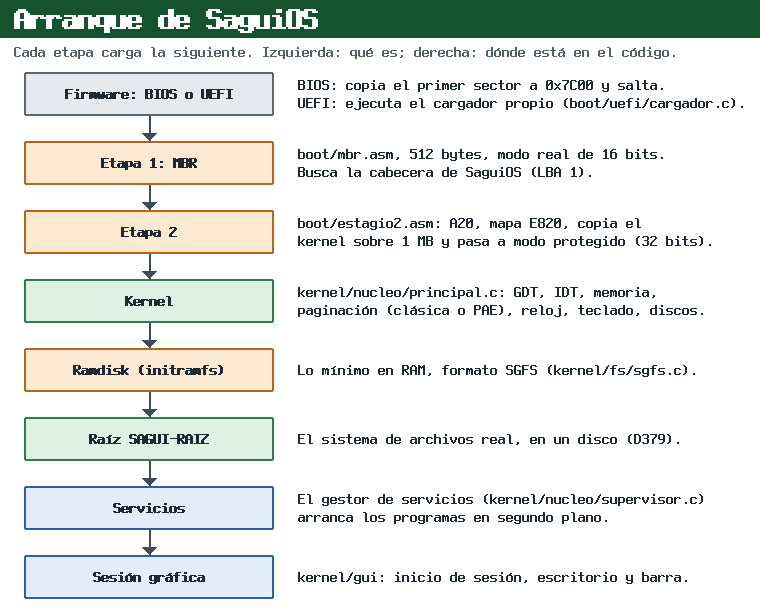

<!-- categoria: Conoce SaguiOS/Sistemas operativos; orden: 2; titulo: Boot -->
# Boot

[Español](02-arranque.md) · [Português](02-arranque_PT.md) · [English](02-arranque_EN.md)

> Goal: follow the path from the power button to the desktop, step by step, and see why booting is a chain of loaders.

## 1. Theory

### 1.1 The chicken and egg problem

When the computer is switched on, RAM is empty and the processor runs a fixed piece of code burned into the board: the
**firmware**. The operating system is not in memory yet, so a chain is needed: a small program loads a somewhat larger
one, and so on until the kernel. Each link must fit in what the previous one knows how to do.

### 1.2 BIOS and UEFI

- **BIOS** (basic input/output system, of classic PCs): reads the first sector of the disk (512 bytes), copies it to
  address `0x7C00` and jumps there. The processor starts in **real mode** of 16 bits and the BIOS offers services through
  interrupts (`INT 13h` for disk, `INT 15h` for the memory map, called **E820**).
- **UEFI** (unified extensible firmware interface): it does not limit itself to one sector; it looks for an executable
  file in an EFI partition (FAT) and launches it with services already in 32 or 64 bits. Its partition table is usually
  GPT, not MBR.
- **MBR partition table**: the first 446 bytes of the sector are code, then come four partition entries and the
  signature `0x55AA`. It is the classic format, limited to disks of 2 TB and four primary partitions.

### 1.3 Real mode and protected mode

The x86 starts in **real mode**: 16 bits, no memory protection, 20-bit addresses. To use all the memory and the
protection rings (chapter 3) the processor must switch to 32-bit **protected mode**: a segment table (GDT) is loaded, the
`PE` bit of `CR0` is set, and a far jump empties the instruction queue. First the **A20 line** must be enabled, which
compatibility with the 8086 keeps at zero; without it, address 1 MB "wraps" to 0.

### 1.4 From boot to the kernel

Once in protected mode, the loader must:

1. Obtain the **memory map** (which ranges are RAM and which are devices or reserved).
2. Copy the kernel and the boot data above 1 MB (real mode could only load below it).
3. Hand the kernel a structure with that information: memory, boot disk location, the *ramdisk*.
4. Jump to the kernel's entry point.

### 1.5 initramfs and the real root

An **initramfs** (in SaguiOS, *ramdisk*) is a small file system loaded into RAM with what is needed to mount the real
system (disk drivers, mount utilities). Once the real root is mounted, the initramfs is no longer needed. Linux does it
with `initramfs` and the `pivot_root` call to change the root.

### 1.6 Services

After mounting the root, the system starts **services**: processes without a window (network, cron, logging) that a
supervisor restarts if they fail. It is the idea of Unix *daemons*, with their units in systemd or `rc.d` in other
systems.

### 1.7 A calculation: how many reads it takes to load the kernel

Suppose a kernel of **300 KB** and 512-byte sectors. That is 300 × 1024 / 512 = **600 sectors**. The BIOS LBA function
(`AH=42h`, used by `boot/mbr.asm` when the BIOS allows it) usually reads at most 127 sectors per call. That takes
ceil(600 / 127) = **5 calls**. With the old CHS addressing, each track has 63 sectors, so ceil(600 / 63) = 10 tracks, with more
heads to switch. That is why stage 2 prefers LBA, and why the boot header says where each part is: stage 1 has no room to
reason about the disk.

### 1.8 Comparison: boot loaders

| System | Loader | What it does before the kernel |
| --- | --- | --- |
| Linux | GRUB 2 (or another) | Reads the file system, loads the kernel and the initramfs, passes parameters |
| Windows | Boot Manager (BCD) and `winload` | Chooses the system and loads the kernel and the boot drivers |
| FreeBSD | `loader` | Reads the kernel and modules, and the configuration in `/boot` |
| SaguiOS | Own stages 1 and 2, and own UEFI loader | Memory map, copy above 1 MB, protected mode, header |

## 2. How SaguiOS does it

SaguiOS follows the classic chain, with its own loader (no GRUB):

| Step | What it does | File |
| --- | --- | --- |
| Firmware | BIOS (or UEFI) reads the first sector | - |
| Stage 1 | 512-byte sector: looks for the boot header at LBA 1 | `boot/mbr.asm`, `boot/cabecalho.inc` |
| Stage 2 | A20 line, E820 map, kernel loaded above 1 MB, protected mode | `boot/estagio2.asm` |
| UEFI | Own loader with GOP services (decision D264) | `boot/uefi/cargador.c`, `boot/uefi/trampolim.asm` |
| Kernel | Entry point in C; turns on the parts in order | `kernel/nucleo/principal.c` |
| Ramdisk | SGFS system in RAM with the minimum | `kernel/fs/sgfs.c`, `kernel/fs/ramfs.c` |
| Root | `SAGUI-RAIZ` partition (ext2), mounted as `/` | `kernel/fs/raiz.c` (decision D379) |

Some verifiable details:

- The stage 1 comments state that the BIOS copies the sector to `0x7C00`, and its `org` sets it (`boot/mbr.asm`).
- Stage 2 numbers its steps: `[1/6]` A20 line, `[2/6]` memory map (E820), `[3/6]` kernel copied to 1 MB,
  and `[6/6]` protected mode with its own GDT and a jump to the kernel (`boot/estagio2.asm`).
- The kernel reports each step with `etapa(...)` in `kernel/nucleo/principal.c`. These are the same messages seen at
  boot: "Interrupciones: GDT e IDT propias, PIC reasignado, reloj a 100 Hz" and "Procesos: round-robin cada 20 ms,
  programas en el anillo 3, int 0x80" (they are shown in Spanish, the interface language).
- `conferir_ramdisk()` checks the ramdisk before continuing.
- With UEFI, the message "Arranque UEFI ... sin servicios de la BIOS" (boot via UEFI, no BIOS services) is printed in the
  same file.
- Decision **D379** separates what is needed to boot (initramfs in RAM) from "the system" (the root on disk).
- **The initramfs carries only static programs** (decision **D462**): the 18 programs of the rescue mode (`sagsh`, `ls`,
  `mount`, `ps`...) run before the root is mounted and without `/lib`, so they cannot need shared libraries;
  `tools/mkinitramfs.py` refuses to include an executable with `PT_INTERP` (chapter 6).
- **The secondary processors** (only with the `--smp` image, decision D164) are started later by the main one, with the
  INIT-SIPI sequence in `kernel/nucleo/smp.c` and the trampoline `kernel/arch/ap_trampolim.asm`: each one starts in real
  mode and repeats the switch to protected mode in miniature (assembly annex).
- Background services are managed by the supervisor `kernel/nucleo/supervisor.c` (decision D216).

### 2.1 Decisions, alternatives and current limits

- **Decision: own loader, no GRUB.** The whole boot is then readable in the repository (`boot/`). Decision **D264** adds
  UEFI boot with GOP services and a hybrid BIOS+UEFI image.
- **Decision: root separate from the initramfs.** Decision **D379** keeps the minimum in RAM and mounts `SAGUI-RAIZ` as
  `/`. The same medium can then install, boot live and repair the system.
- **Decision: kernel options that take effect at reboot.** Decision **D353** stores configuration for the next boot
  (`kconfig`, from `kernel/nucleo/kconf.c`).
- **Limit: each boot format is maintained by hand.** The tool `tools/mkimagem.py` writes the header; a change in the memory
  layout forces changes to loader, header and kernel at once.
- **Limit: 2 TB boot.** MBR partitions reach 2 TB; UEFI boot with GPT is the path for larger disks (theory in section 1.2,
  not tested in this version on such disks).

## 3. Experiment in SaguiOS

1. After booting, open the **Visor de registros** (Start > System > Visor de registros; the menu keeps the Spanish name). Look for the lines that start with "Interrupciones"
   or "Procesos": they are the kernel stages.
2. In the terminal, type `dmesg -n 30` to see the last lines of the kernel log. Look for `ramdisk` or `raiz`.
3. Type `df` to see which file systems are mounted and where. The root `/` should be `ext2` on `SAGUI-RAIZ` if you
   booted from disk.
4. Type `servicios` to see the services the supervisor started.

**What to observe:** each stage leaves a mark. If one fails, the log says at which step it stopped: boot is a chain, and
an error in one link is located by its mark.

**Additional practical exercise.** Open the Event viewer and copy, in order, the boot lines that start with
"Interrupciones", "Procesos" and "Teclado" (they are Spanish messages). Draw a timeline with those three steps and say at
which one the 100 Hz clock is set and at which one the processes get their 20 ms quantum.

## 4. Review questions

1. Why does the BIOS copy the first sector to `0x7C00` instead of executing it from the disk?
2. What problem does the A20 line solve, and what would happen if it were not enabled?
3. Why does the SaguiOS stage 1 read only a header and not the whole kernel?
4. What is the difference between the initramfs and the root `/`? Why is one file system not enough?

5. A kernel of 180 KB and 512-byte sectors, with LBA calls of at most 127 sectors: how many calls are needed? And with CHS
   calls of 63 sectors per track?
6. In Linux, the disk driver can live in a module loaded after the initramfs. Why does the initramfs need the disk driver
   and cannot wait for the root's module?

## 5. Answers

1. Because `0x7C00` is the address the firmware uses by convention: the firmware does not know the file system and can
   only copy a sector. The code in the sector is the one that knows how to read more.
2. In real mode, bit 20 of the address is forced to zero for compatibility with the 8086, so addresses above 1 MB
   "wrap around". Without A20, the kernel cannot occupy high memory.
3. Because 512 bytes are not enough to understand a file system. The header (LBA 1) says where each part is, and stage 2
   (larger) does the rest.
4. The initramfs is minimal and only serves to mount the root. The root is the complete system, on disk. Separating them
   allows booting from a pendrive in *live* mode or installed (D379) without changing the kernel.

### Answers to the additional questions

5. 180 × 1024 / 512 = 360 sectors. LBA: ceil(360 / 127) = 3 calls. CHS: ceil(360 / 63) = 6 tracks, with head switches (slower).
6. Because the root file system is on the disk, and reading the disk requires that disk's driver. The initramfs carries the
   minimal driver to mount the root; the root's modules only help once the disk is already mounted.
