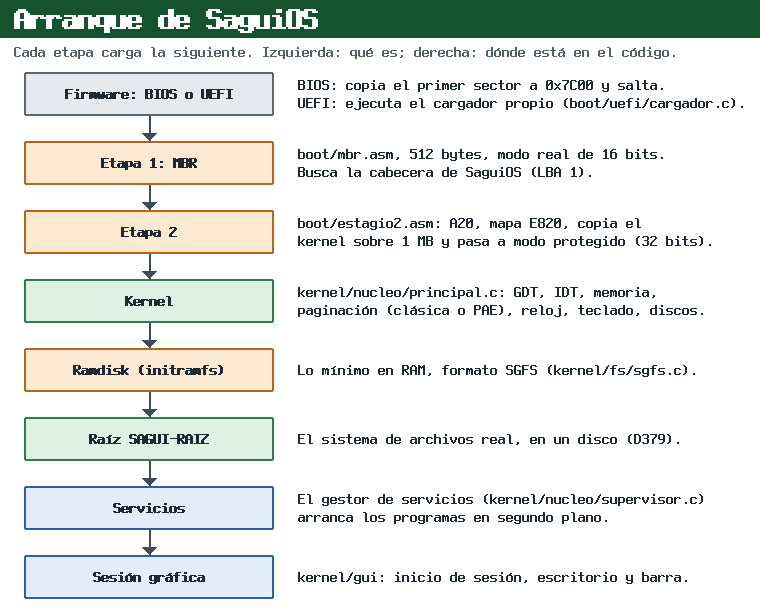

<!-- categoria: Conoce SaguiOS/Sistemas operativos; orden: 2; titulo: Inicialização -->
# Inicialização

[Español](02-arranque.md) · [Português](02-arranque_PT.md) · [English](02-arranque_EN.md)

> Objetivo: seguir o caminho do botão de ligar até a área de trabalho, passo a passo, e entender por que a inicialização é uma
> cadeia de carregadores.

## 1. Teoria

### 1.1 O problema do ovo e da galinha

Ao ligar o computador, a RAM está vazia e o processador executa um trecho fixo de código gravado na placa: o **firmware**.
O sistema operacional ainda não está na memória, então é preciso uma cadeia: um programa pequeno carrega outro um pouco
maior, e assim por diante até chegar ao núcleo. Cada elo precisa caber no que o anterior sabe fazer.

### 1.2 BIOS e UEFI

- **BIOS** (sistema básico de entrada e saída, dos PCs clássicos): lê o primeiro setor do disco (512 bytes), copia-o para o
  endereço `0x7C00` e salta até lá. O processador começa em **modo real** de 16 bits, e a BIOS oferece serviços por interrupções
  (`INT 13h` para disco, `INT 15h` para o mapa de memória, chamado **E820**).
- **UEFI** (interface de firmware extensível): não se limita a um setor; procura um arquivo executável numa partição EFI (FAT) e o
  inicia com serviços já em 32 ou 64 bits. Sua tabela de partições costuma ser GPT, não MBR.
- **Tabela de partições MBR**: os primeiros 446 bytes do setor são código, depois vêm quatro entradas de partição e a assinatura
  `0x55AA`. É o formato clássico, limitado a discos de 2 TB e quatro partições primárias.

### 1.3 Modo real e modo protegido

O x86 começa em **modo real**: 16 bits, sem proteção de memória, com endereços de 20 bits. Para usar toda a memória e os anéis de
proteção (capítulo 3) é preciso passar ao **modo protegido** de 32 bits: carrega-se uma tabela de segmentos (GDT), ativa-se o bit
`PE` de `CR0` e um salto longo esvazia a fila de instruções. Antes disso é preciso ativar a **linha A20**, que a compatibilidade com
o 8086 mantém em zero; sem ela, o endereço 1 MB "dá a volta" e cai em 0.

### 1.4 Do início ao kernel

Já em modo protegido, o carregador deve:

1. Obter o **mapa de memória** (quais faixas são RAM e quais são dispositivos ou estão reservadas).
2. Copiar o núcleo e os dados de inicialização acima de 1 MB (o modo real só conseguia carregar abaixo disso).
3. Entregar ao núcleo uma estrutura com essas informações: memória, localização do disco de boot, o *ramdisk*.
4. Saltar para o ponto de entrada do núcleo.

### 1.5 initramfs e a raiz real

Um **initramfs** (no SaguiOS, *ramdisk*) é um pequeno sistema de arquivos carregado na RAM com o indispensável para montar o sistema
real (drivers de disco, utilitários de montagem). Depois que a raiz real é montada, o initramfs deixa de ser necessário. O Linux faz isso
com `initramfs` e a chamada `pivot_root` para trocar a raiz.

### 1.6 Serviços

Depois de montar a raiz, o sistema inicia **serviços**: processos sem janela (rede, cron, registro) que um supervisor reinicia se falharem.
É a ideia dos *daemons* do Unix, com suas unidades no systemd ou no `rc.d` em outros sistemas.

### 1.7 Um cálculo: quantas leituras custa carregar o núcleo

Suponha um núcleo de **300 KB** e setores de 512 bytes. São 300 × 1024 / 512 = **600 setores**. A função LBA da INT 13h (`AH=42h`, usada
por `boot/mbr.asm` quando a BIOS permite) costuma ler no máximo 127 setores por chamada. São necessárias ceil(600 / 127) = **5 chamadas**.
Com o endereçamento CHS antigo, cada trilha tem 63 setores, então seriam ceil(600 / 63) = 10 trilhas, com mais troca de cabeças. Por isso
a etapa 2 prefere LBA, e por isso o cabeçalho de boot diz onde está cada parte: a etapa 1 não tem espaço para raciocinar sobre o disco.

### 1.8 Comparação: carregadores de inicialização

| Sistema | Carregador | O que faz antes do núcleo |
| --- | --- | --- |
| Linux | GRUB 2 (ou outro) | Lê o sistema de arquivos, carrega o núcleo e o initramfs, passa parâmetros |
| Windows | Gerenciador de inicialização (BCD) e `winload` | Escolhe o sistema e carrega o núcleo e os drivers de boot |
| FreeBSD | `loader` | Lê o núcleo e os módulos, e a configuração em `/boot` |
| SaguiOS | Etapas 1 e 2 próprias, e carregador UEFI próprio | Mapa de memória, cópia acima de 1 MB, modo protegido, cabeçalho |

## 2. Como o SaguiOS faz

O SaguiOS segue a cadeia clássica, com um carregador próprio (sem GRUB):

| Passo | O que faz | Arquivo |
| --- | --- | --- |
| Firmware | BIOS (ou UEFI) lê o primeiro setor | - |
| Etapa 1 | Setor de 512 bytes: procura o cabeçalho de boot no LBA 1 | `boot/mbr.asm`, `boot/cabecalho.inc` |
| Etapa 2 | Linha A20, mapa E820, carga do núcleo acima de 1 MB, modo protegido | `boot/estagio2.asm` |
| UEFI | Carregador próprio com serviços GOP (decisão D264) | `boot/uefi/cargador.c`, `boot/uefi/trampolim.asm` |
| Núcleo | Ponto de entrada em C; liga as partes em ordem | `kernel/nucleo/principal.c` |
| Ramdisk | Sistema SGFS na RAM com o mínimo | `kernel/fs/sgfs.c`, `kernel/fs/ramfs.c` |
| Raiz | Partição `SAGUI-RAIZ` (ext2), montada como `/` | `kernel/fs/raiz.c` (decisão D379) |

Alguns detalhes verificáveis:

- A etapa 1 comenta que a BIOS copia o setor para `0x7C00`, e seu `org` fixa esse endereço (`boot/mbr.asm`).
- A etapa 2 numera seus passos: `[1/6]` linha A20, `[2/6]` mapa de memória (E820), `[3/6]` núcleo copiado para 1 MB,
  e `[6/6]` modo protegido com GDT própria e salto ao núcleo (`boot/estagio2.asm`).
- O núcleo informa cada passo com `etapa(...)` em `kernel/nucleo/principal.c`. São as mesmas mensagens vistas no boot:
  "Interrupciones: GDT e IDT propias, PIC reasignado, reloj a 100 Hz" e "Procesos: round-robin cada 20 ms, programas en el anillo 3,
  int 0x80" (aparecem em espanhol, o idioma da interface).
- `conferir_ramdisk()` verifica o ramdisk antes de seguir.
- Com UEFI, a mensagem "Arranque UEFI ... sin servicios de la BIOS" (boot por UEFI, sem serviços da BIOS) sai no mesmo arquivo.
- A decisão **D379** separa o que é necessário para iniciar (initramfs na RAM) de "o sistema" (a raiz no disco).
- **O initramfs só leva programas estáticos** (decisão **D462**): os 18 programas do modo de resgate (`sagsh`, `ls`, `mount`,
  `ps`...) rodam antes de montar a raiz e sem `/lib`, de modo que não podem precisar de bibliotecas compartilhadas;
  `tools/mkinitramfs.py` se recusa a incluir um executável com `PT_INTERP` (capítulo 6).
- **Os processadores secundários** (só com a imagem `--smp`, decisão D164) são ligados mais tarde pelo principal, com a sequência
  INIT-SIPI de `kernel/nucleo/smp.c` e o trampolim `kernel/arch/ap_trampolim.asm`: cada um começa em modo real e repete em
  miniatura a passagem ao modo protegido (anexo de assembly).
- Os serviços em segundo plano são geridos pelo supervisor `kernel/nucleo/supervisor.c` (decisão D216).

### 2.1 Decisões, alternativas e limites atuais

- **Decisão: carregador próprio, sem GRUB.** Assim todo o boot pode ser lido no repositório (`boot/`). A decisão **D264** acrescenta o boot
  UEFI com serviços GOP e uma imagem híbrida BIOS+UEFI.
- **Decisão: raiz separada do initramfs.** A decisão **D379** mantém o mínimo na RAM e monta `SAGUI-RAIZ` como `/`. O mesmo meio pode então
  instalar, iniciar ao vivo e reparar o sistema.
- **Decisão: opções do núcleo que valem ao reiniciar.** A decisão **D353** guarda configuração para o próximo boot (`kconfig`, de `kernel/nucleo/kconf.c`).
- **Limite: cada formato de boot é mantido à mão.** A ferramenta `tools/mkimagem.py` escreve o cabeçalho; uma mudança no layout de memória obriga
  a alterar carregador, cabeçalho e núcleo ao mesmo tempo.
- **Limite: boot com mais de 2 TB.** As partições MBR chegam a 2 TB; o boot UEFI com GPT é o caminho para discos maiores (teoria na seção 1.2,
  não testado nesta versão nesses discos).

## 3. Experimento no SaguiOS

1. Depois de iniciar, abra o **Visor de registros** (Início > Sistema > Visor de registros). Procure as linhas que começam por "Interrupciones"
   ou "Procesos": são as etapas do núcleo.
2. No terminal, digite `dmesg -n 30` para ver as últimas linhas do registro do núcleo. Procure `ramdisk` ou `raiz`.
3. Digite `df` para ver quais sistemas de arquivos estão montados e onde. A raiz `/` deve ser `ext2` em `SAGUI-RAIZ` se você iniciou pelo disco.
4. Digite `servicios` para ver os serviços que o supervisor iniciou.

**O que observar:** cada etapa deixa uma marca. Se uma falhar, o registro diz em que passo ela parou: a inicialização é uma cadeia, e um erro
em um elo é localizado pela sua marca.

**Exercício prático adicional.** Copie do Visor de registros, em ordem, as linhas de boot que começam por "Interrupciones", "Procesos" e
"Teclado" (são mensagens em espanhol). Desenhe uma linha do tempo com esses três passos e diga em qual deles o relógio de 100 Hz é configurado
e em qual os processos recebem o seu quantum de 20 ms.

## 4. Perguntas de revisão

1. Por que a BIOS copia o primeiro setor para `0x7C00` em vez de executá-lo a partir do disco?
2. Que problema resolve a linha A20, e o que aconteceria se ela não fosse ativada?
3. Por que a etapa 1 do SaguiOS só lê um cabeçalho e não o núcleo inteiro?
4. Qual a diferença entre o initramfs e a raiz `/`? Por que um único sistema de arquivos não basta?
5. Um núcleo de 180 KB e setores de 512 bytes, com chamadas LBA de até 127 setores: quantas chamadas são necessárias? E com chamadas CHS de 63 setores por trilha?
6. No Linux, o driver de disco pode estar num módulo carregado depois do initramfs. Por que o initramfs precisa do driver de disco e não pode esperar pelo módulo da raiz?

## 5. Respostas

1. Porque `0x7C00` é o endereço que o firmware usa por convenção: o firmware não conhece o sistema de arquivos e só sabe copiar um setor.
   O código do setor é que sabe ler mais.
2. No modo real, o bit 20 do endereço é forçado a zero por compatibilidade com o 8086, então os endereços acima de 1 MB "dão a volta".
   Sem A20, o núcleo não consegue ocupar a memória alta.
3. Porque 512 bytes não bastam para entender um sistema de arquivos. O cabeçalho (LBA 1) diz onde está cada parte, e a etapa 2 (maior) faz o resto.
4. O initramfs é mínimo e serve só para montar a raiz. A raiz é o sistema completo, no disco. Separá-los permite iniciar por um pendrive em modo
   *live* ou instalado (D379) sem trocar o núcleo.
5. 180 × 1024 / 512 = 360 setores. LBA: ceil(360 / 127) = 3 chamadas. CHS: ceil(360 / 63) = 6 trilhas, com trocas de cabeça (mais lento).
6. Porque o sistema de arquivos da raiz está no disco, e ler o disco exige o driver desse disco. O initramfs leva o driver mínimo para montar
   a raiz; os módulos da raiz só ajudam depois que o disco já está montado.
