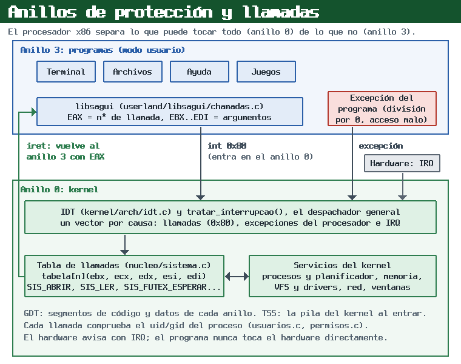
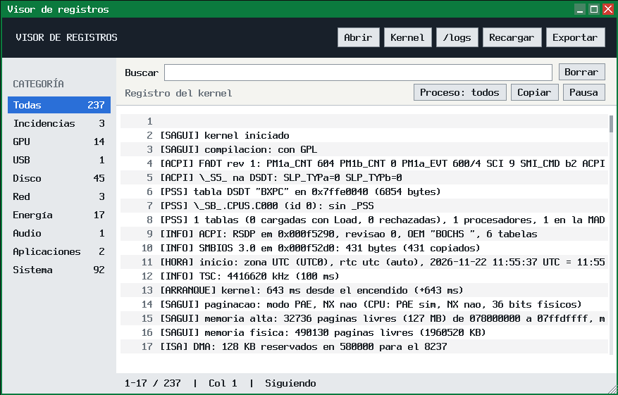

<!-- categoria: Conoce SaguiOS/Sistemas operativos; orden: 3; titulo: Modo núcleo y modo usuario -->
# Modo núcleo y modo usuario

[Español](03-modo-nucleo-usuario.md) · [Português](03-modo-nucleo-usuario_PT.md) · [English](03-modo-nucleo-usuario_EN.md)

> Objetivo: entender cómo el procesador separa el código del núcleo del de los programas, y cómo un programa pide
> un servicio sin romper esa separación.

## 1. Teoría

### 1.1 Por qué hace falta protección

Si cualquier programa pudiera ejecutar cualquier instrucción, un programa mal escrito podría desactivar las
interrupciones, cambiar la tabla de páginas de otro proceso o leer el disco sin pasar por el sistema de archivos. La
protección se apoya en un hecho de hardware: el procesador tiene **niveles de privilegio** y solo el más alto puede
ejecutar ciertas instrucciones.

### 1.2 Los anillos de x86

Los procesadores x86 tienen cuatro anillos de privilegio, del 0 (máximo) al 3 (mínimo). Los sistemas reales usan dos:

| Anillo | Quién lo usa | Puede |
| --- | --- | --- |
| 0 | Núcleo | Todo: `cli`, `lgdt`, `lidt`, cargar `CR3`, acceder a puertos de E/S |
| 3 | Programas de usuario | Solo instrucciones normales; las demás provocan una excepción |

El nivel actual (CPL) se guarda en los selectores de segmento. El **GDT** (tabla de segmentos) define qué segmentos son
de cada anillo; el capítulo 2 explicó cómo se carga.

### 1.3 Interrupciones y excepciones

Hay tres fuentes de «cambio de control» hacia el núcleo:

- **Interrupciones de hardware**: el reloj, el teclado o un disco avisan de que tienen algo que atender (son
  asíncronas).
- **Excepciones**: las provoca la propia instrucción en curso: división entre cero (vector 0), fallo de página (14),
  protección general (13). Son síncronas.
- **Interrupciones de software**: `int n`. Es la forma clásica de llamar al sistema en x86.

En todos los casos, la CPU busca en la **IDT** (tabla de descriptores de interrupción) la entrada del vector, guarda
el estado del programa (registros, `EIP`, `CS`, `EFLAGS`) en la pila del núcleo y salta al manejador. Al terminar,
`iret` restaura el estado. Si la interrupción viene de un programa de anillo 3, la CPU cambia primero a la pila del
núcleo, cuya dirección está en la **TSS** (*task state segment*).

### 1.4 Llamadas al sistema

Un programa pide un servicio al núcleo con una instrucción que cambia de anillo. En Linux x86 de 32 bits la vía
clásica es `int 0x80`; en 64 bits, `syscall`. La convención dice qué registro lleva el número de la llamada y cuáles los
argumentos. El núcleo valida todo antes de usarlo, porque el programa no es de fiar: un puntero puede apuntar a memoria
del núcleo. Esa comprobación se llama **validación de punteros de usuario**.

### 1.5 Alternativas

- **Llamadas rápidas** (`sysenter`/`sysexit`, `syscall`): la misma idea sin el coste de la puerta de interrupción.
- **Llamadas por mensaje** (micronúcleos): el programa envía un mensaje a un servicio que es otro proceso (capítulo 1).
- **Llamadas en el espacio de usuario** (`vDSO` de Linux): algunas consultas, como la hora, se resuelven sin cambiar de
  anillo.

### 1.6 Cálculo: el tamaño de las tablas de protección

Una IDT de x86 tiene **256 entradas** de **8 bytes** cada una: 256 × 8 = **2048 bytes**, medio página de 4 KB. Una GDT
con cinco descriptores ocupa 5 × 8 = 40 bytes. El coste de la protección en memoria es, por tanto, despreciable; lo caro
es el cambio de anillo en cada llamada. Si un programa hace 10 000 llamadas por segundo y cada cambio de anillo cuesta
unos 100 ciclos de CPU, eso son 2 × 100 × 10 000 = **2 millones de ciclos por segundo** (entrada y salida), es decir,
aproximadamente el 0,1 % de un procesador de 2 GHz. Por eso se cuida el número de llamadas, no solo su velocidad.

### 1.7 Comparativa: cómo se entra al núcleo

| Sistema | Vía de llamada en 32 bits | Nota |
| --- | --- | --- |
| Linux | `int 0x80` o `sysenter` (la vía rápida) | `sysenter` evita la puerta de interrupción |
| Windows | `sysenter` a través de `KiFastSystemCall` | Las bibliotecas del sistema hacen de intermediario |
| FreeBSD | `int 0x80` y `sysenter` | Vías distintas según la CPU |
| MS-DOS | `int 21h` (modo real) | No hay anillos: cualquier programa toca todo el hardware |
| SaguiOS | solo `int 0x80` | No hay `sysenter` en el código del núcleo |

## 2. Así lo hace SaguiOS

- **GDT e IDT propias.** `kernel/arch/gdt.c` define los segmentos de núcleo (anillo 0) y de usuario (anillo 3). Tiene
  también la **TSS** de cada CPU: el planificador cambia en ella la pila de núcleo de cada proceso (decisiones D157).
- **IDT.** `kernel/arch/idt.c` tiene la tabla de interrupciones. Todas las entradas llaman a `tratar_interrupcao()`,
  que es el despachador general, y la puerta `0x80` es la de las llamadas.
- **Excepciones con pantalla de error.** `kernel/arch/excecoes.c` muestra el estado del procesador cuando un programa
  falla de forma grave, en vez de colgar el sistema.
- **Llamada `int 0x80`.** La cabecera `kernel/inc/abi.h` dice el contrato: «int 0x80, número en EAX, argumentos en EBX,
  ECX, EDX (...), resultado en EAX». Por ejemplo, `SIS_ESCREVER` vale 12.
- **Despachador.** `kernel/nucleo/sistema.c` tiene `tratar_sistema` y la función `usuario_ok`, que comprueba que los
  punteros del programa están dentro de su memoria antes de usarlos.
- **Re-ejecución de la llamada.** Si una llamada tiene que esperar, el núcleo retrocede `EIP` dos bytes (`eip -= 2`,
  el tamaño de `int 0x80`) para que la instrucción se repita al despertar. Es la solución sencilla al bloqueo de una
  llamada (capítulo 7).
- **Varias CPU.** Cada CPU tiene su TSS y entra por la misma puerta `0x80`: `tratar_interrupcao()` toma el cerrojo general
  (`kernel/nucleo/trava_geral.c`, decisión D165) al entrar y lo suelta al volver a modo usuario, así que el despachador
  sigue siendo código de un solo procesador (capítulo 7).
- **Libc y libsagui.** `userland/libc/posix.c` y `userland/libsagui/chamadas.c` ponen los números en los registros.



### Recorrido de un `write`

```
programa (anillo 3)  write(fd, buf, n)        userland/libc/posix.c
  -> escrever()                                userland/libsagui/chamadas.c
     EAX=12; EBX=fd; ECX=buf; EDX=n; int $0x80
------------ cambio de anillo ----------------
kernel (anillo 0)    IDT, puerta 0x80         kernel/arch/idt.c -> tratar_interrupcao()
  tratar_sistema()                            kernel/nucleo/sistema.c
  usuario_ok(), permisos                      kernel/nucleo/permisos.c
  sis_escrever()                              kernel/fs/arquivos.c -> vfs_escrever() (kernel/fs/vfs.c)
------------ vuelta: EAX = bytes escritos ----
```

### 2.1 Decisiones, alternativas y límites actuales

- **Decisión: la llamada es `int 0x80`.** Es la vía más sencilla de leer y de depurar, y funciona en todos los i686. El
  contrato está en `kernel/inc/abi.h`.
- **Decisión: una TSS por CPU.** La decisión **D157** da a cada procesador su TSS, así que la pila de núcleo se cambia en
  cada CPU sin interferir con las demás (`kernel/arch/gdt.c`).
- **Decisión: los MSR no derriban el núcleo.** La decisión **D092** lee los registros especiales de forma segura: si un
  MSR no existe, el monitor de hardware lo informa en vez de caer.
- **Límite: sin llamadas rápidas.** Al no haber `sysenter`, cada llamada paga la puerta de interrupción completa. Es un
  coste aceptable para un sistema educativo, y se puede medir con el experimento de abajo.
- **Límite: validación de punteros.** `usuario_ok` comprueba el rango de cada puntero; no comprueba el contenido, que es
  responsabilidad de cada llamada.

## 3. Experimento en SaguiOS

1. Abre el Visor de registros y busca la palabra `excepción`. Si no hubo ninguna, la búsqueda no encuentra nada.
2. En el terminal, escribe `ls /bin` y observa la lista. Cada orden de esa lista es un programa que, para mostrarte los
   nombres, pide a `read` y `write` que el núcleo ejecute en su nombre.
3. Compara con `dmesg -n 20`: el núcleo escribe en su registro mientras los programas siguen en el anillo 3.



**Qué observar:** el registro del kernel (un anillo de 128 KB, según el propio Visor) se lee con una llamada al sistema
(`INFO_LOG`), no con acceso directo a la memoria del núcleo.

**Ejercicio práctico adicional.** En `kernel/inc/abi.h`, busca tres llamadas distintas (por ejemplo `SIS_ESCREVER`,
`SIS_BIFURCAR` y `SIS_MATAR`) y anota su número. Después busca en `userland/libsagui/chamadas.c` cómo se pasan los
argumentos de una de ellas. Dibuja la tabla de registros (EAX, EBX, ECX, EDX) para esa llamada con un ejemplo concreto.

## 4. Preguntas de repaso

1. ¿Qué diferencia hay entre una interrupción de hardware, una excepción y `int 0x80`? Pon un ejemplo de cada una.
2. ¿Por qué el núcleo necesita una pila propia al recibir una interrupción desde el anillo 3?
3. ¿Qué pasaría si el núcleo no validara el puntero `buf` de `write`?
4. Explica por qué `eip -= 2` hace que una llamada bloqueada se repita.

5. Una IDT de 256 entradas de 8 bytes ocupa 2048 bytes. ¿Cuántas páginas de 4 KB ocupa? ¿Y si cada entrada ocupara 16
   bytes (como en 64 bits)?
6. ¿Por qué la puerta `0x80` puede llamarse desde el anillo 3 y las demás puertas de excepción normalmente no? Explica
   qué campo de la entrada lo controla.

## 5. Soluciones

1. Hardware: el reloj o el teclado (asíncrona, la envía un dispositivo). Excepción: división entre cero o fallo de página
   (síncrona, la causa la instrucción). `int 0x80`: interrupción de software que pide una llamada al sistema.
2. Porque la pila del programa está en su espacio de memoria, que no es de fiar, y el núcleo no debe usarla. La TSS da la
   dirección de la pila de núcleo.
3. Un programa podría pasar una dirección del núcleo y el `write` leería o escribiría memoria privilegiada. Por eso
   `usuario_ok` comprueba el rango antes de usarlo.
4. El procesador deja el puntero de instrucción en `int 0x80`, así que al volver a ejecutar la instrucción se repite la
   llamada. Retroceder dos bytes es exactamente el tamaño de `int 0x80`.

### Respuestas a las preguntas adicionales

5. 2048 / 4096 = medio página (una página, con redondeo). Con 16 bytes por entrada serían 4096 bytes: exactamente una
   página. La diferencia es pequeña, pero muestra por qué las tablas de 64 bits crecen.
6. El campo DPL (nivel de privilegio de la entrada) de la puerta: la puerta `0x80` tiene DPL 3, así que un programa de
   anillo 3 puede usar `int 0x80`. Las excepciones tienen DPL 0: un programa no puede lanzarlas a voluntad.
