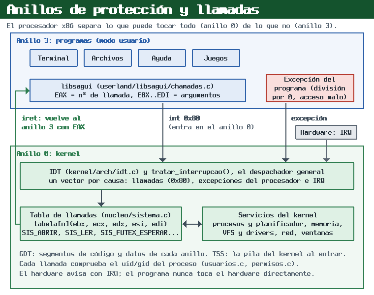

<!-- categoria: Conoce SaguiOS/Sistemas operativos; orden: 3; titulo: Kernel mode and user mode -->
# Kernel mode and user mode

[Español](03-modo-nucleo-usuario.md) · [Português](03-modo-nucleo-usuario_PT.md) · [English](03-modo-nucleo-usuario_EN.md)

> Goal: understand how the processor separates the kernel's code from the programs' code, and how a program asks for a
> service without breaking that separation.

## 1. Theory

### 1.1 Why protection is needed

If any program could execute any instruction, a badly written program could disable interrupts, change the page table of
another process or read the disk without going through the file system. Protection relies on a hardware fact: the
processor has **privilege levels**, and only the highest one can execute certain instructions.

### 1.2 The x86 rings

x86 processors have four privilege rings, from 0 (maximum) to 3 (minimum). Real systems use two:

| Ring | Who uses it | Can |
| --- | --- | --- |
| 0 | Kernel | Everything: `cli`, `lgdt`, `lidt`, load `CR3`, access I/O ports |
| 3 | User programs | Only ordinary instructions; the others cause an exception |

The current level (CPL) is stored in the segment selectors. The **GDT** (segment table) defines which segments belong to
each ring; chapter 2 explained how it is loaded.

### 1.3 Interrupts and exceptions

There are three sources of "change of control" toward the kernel:

- **Hardware interrupts**: the clock, the keyboard or a disk signal that they need attention (they are asynchronous).
- **Exceptions**: caused by the instruction being executed: division by zero (vector 0), page fault (14), general
  protection (13). They are synchronous.
- **Software interrupts**: `int n`. It is the classic way to call the system on x86.

In every case, the CPU looks up the vector's entry in the **IDT** (interrupt descriptor table), saves the program's state
(registers, `EIP`, `CS`, `EFLAGS`) on the kernel stack and jumps to the handler. When it finishes, `iret` restores the
state. If the interrupt comes from a ring 3 program, the CPU first switches to the kernel stack, whose address is in the
**TSS** (*task state segment*).

### 1.4 System calls

A program asks the kernel for a service with an instruction that changes ring. In 32-bit Linux on x86 the classic route is
`int 0x80`; in 64 bits, `syscall`. The convention states which register holds the call number and which hold the
arguments. The kernel validates everything before using it, because the program cannot be trusted: a pointer may point to
kernel memory. That check is called **validation of user pointers**.

### 1.5 Alternatives

- **Fast calls** (`sysenter`/`sysexit`, `syscall`): the same idea without the cost of the interrupt gate.
- **Message-based calls** (microkernels): the program sends a message to a service that is another process (chapter 1).
- **Calls in user space** (Linux `vDSO`): some queries, such as the time, are answered without changing ring.

### 1.6 Calculation: the size of the protection tables

An x86 IDT has **256 entries** of **8 bytes** each: 256 × 8 = **2048 bytes**, half a 4 KB page. A GDT with five descriptors
takes 5 × 8 = 40 bytes. The memory cost of protection is therefore negligible; what is expensive is the ring change on
each call. If a program makes 10,000 calls per second and each ring change costs about 100 CPU cycles, that is 2 × 100 ×
10,000 = **2 million cycles per second** (entry and exit), about 0.1 % of a 2 GHz processor. That is why the number of
calls is watched, not only their speed.

### 1.7 Comparison: how the kernel is entered

| System | 32-bit call path | Note |
| --- | --- | --- |
| Linux | `int 0x80` or `sysenter` (the fast path) | `sysenter` avoids the interrupt gate |
| Windows | `sysenter` through `KiFastSystemCall` | System libraries act as intermediaries |
| FreeBSD | `int 0x80` and `sysenter` | Different paths depending on the CPU |
| MS-DOS | `int 21h` (real mode) | There are no rings: any program can touch all the hardware |
| SaguiOS | only `int 0x80` | There is no `sysenter` in the kernel code |

## 2. How SaguiOS does it

- **Own GDT and IDT.** `kernel/arch/gdt.c` defines the kernel (ring 0) and user (ring 3) segments. It also has the **TSS**
  of each CPU: the scheduler changes the kernel stack of each process in it (decision D157).
- **IDT.** `kernel/arch/idt.c` holds the interrupt table. Entries call `tratar_interrupcao()`, the general dispatcher, and
  gate `0x80` is the one for calls.
- **Exceptions with an error screen.** `kernel/arch/excecoes.c` shows the processor state when a program fails badly,
  instead of freezing the system.
- **The `int 0x80` call.** The header `kernel/inc/abi.h` states the contract: "int 0x80, número en EAX, argumentos en EBX,
  ECX, EDX (...), resultado en EAX" (in Spanish in the header). For example, `SIS_ESCREVER` is 12.
- **Dispatcher.** `kernel/nucleo/sistema.c` has `tratar_sistema` and the function `usuario_ok`, which checks that the
  program's pointers are inside its memory before using them.
- **Re-execution of the call.** If a call has to wait, the kernel rewinds `EIP` by two bytes (`eip -= 2`, the size of
  `int 0x80`) so the instruction repeats when it wakes up. It is the simple solution for a blocked call (chapter 7).
- **Several CPUs.** Each CPU has its own TSS and enters through the same `0x80` gate: `tratar_interrupcao()` takes the
  kernel-wide lock (`kernel/nucleo/trava_geral.c`, decision D165) on entry and releases it when returning to user mode, so
  the dispatcher is still single-processor code (chapter 7).
- **libc and libsagui.** `userland/libc/posix.c` and `userland/libsagui/chamadas.c` put the numbers in the registers.



### Path of a `write`

```
programa (anillo 3)  write(fd, buf, n)        userland/libc/posix.c
  -> escrever()                                userland/libsagui/chamadas.c
     EAX=12; EBX=fd; ECX=buf; EDX=n; int $0x80
------------ cambio de anillo ----------------
kernel (anillo 0)    IDT, puerta 0x80         kernel/arch/idt.c -> tratar_interrupcao()
  tratar_sistema()                            kernel/nucleo/sistema.c
  usuario_ok(), permisos                      kernel/nucleo/permisos.c
  sis_escrever()                              kernel/fs/arquivos.c -> vfs_escrever() (kernel/fs/vfs.c)
------------ vuelta: EAX = bytes escritos ----
```

### 2.1 Decisions, alternatives and current limits

- **Decision: the call is `int 0x80`.** It is the easiest path to read and debug, and it works on every i686. The contract
  is in `kernel/inc/abi.h`.
- **Decision: one TSS per CPU.** Decision **D157** gives each processor its own TSS, so the kernel stack is switched on each
  CPU without interfering with the others (`kernel/arch/gdt.c`).
- **Decision: MSRs do not bring the kernel down.** Decision **D092** reads special registers safely: if an MSR does not
  exist, the hardware monitor reports it instead of crashing.
- **Limit: no fast calls.** With no `sysenter`, each call pays the full interrupt gate. It is an acceptable cost for an
  educational system, and it can be measured with the experiment below.
- **Limit: pointer validation.** `usuario_ok` checks the range of each pointer; it does not check the content, which is
  the responsibility of each call.

## 3. Experiment in SaguiOS

1. Open the Event viewer (Visor de registros, the name in the Spanish menu) and search for the word `excepción`. If there
   was none, the search finds nothing.
2. In the terminal, type `ls /bin` and look at the list. Each command in that list is a program that, to show you the
   names, asks `read` and `write` to run the kernel on its behalf.
3. Compare with `dmesg -n 20`: the kernel writes to its log while the programs keep running in ring 3.


**What to observe:** the kernel log (a 128 KB ring, according to the viewer itself) is read with a system call (`INFO_LOG`),
not by direct access to kernel memory.

**Additional practical exercise.** In `kernel/inc/abi.h`, find three different calls (for example `SIS_ESCREVER`,
`SIS_BIFURCAR` and `SIS_MATAR`) and note their numbers. Then look in `userland/libsagui/chamadas.c` at how the arguments of
one of them are passed. Draw the register table (EAX, EBX, ECX, EDX) for that call with a concrete example.

## 4. Review questions

1. What is the difference between a hardware interrupt, an exception and `int 0x80`? Give an example of each.
2. Why does the kernel need its own stack when it receives an interrupt from ring 3?
3. What would happen if the kernel did not validate the pointer `buf` of `write`?
4. Explain why `eip -= 2` makes a blocked call repeat.

5. An IDT of 256 entries of 8 bytes takes 2048 bytes. How many 4 KB pages does it occupy? And if each entry took 16 bytes
   (as in 64-bit mode)?
6. Why can the gate `0x80` be called from ring 3 while the exception gates normally cannot? Explain which field of the
   entry controls it.

## 5. Answers

1. Hardware: the clock or the keyboard (asynchronous, sent by a device). Exception: division by zero or page fault
   (synchronous, caused by the instruction). `int 0x80`: software interrupt that requests a system call.
2. Because the program's stack is in its own memory space, which cannot be trusted, and the kernel must not use it. The
   TSS gives the address of the kernel stack.
3. A program could pass an address of the kernel and `write` would read or write privileged memory. That is why
   `usuario_ok` checks the range before using it.
4. The processor leaves the instruction pointer at `int 0x80`, so when the instruction runs again the call is repeated.
   Rewinding two bytes is exactly the size of `int 0x80`.

### Answers to the additional questions

5. 2048 / 4096 = half a page (one page, rounded up). With 16 bytes per entry it would be 4096 bytes: exactly one page. The
   difference is small, but it shows why 64-bit tables grow.
6. The DPL field (the privilege level of the gate): gate `0x80` has DPL 3, so a ring 3 program can use `int 0x80`.
   Exceptions have DPL 0: a program cannot raise them at will.
