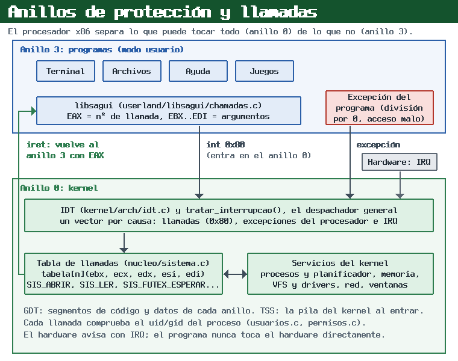

<!-- categoria: Conoce SaguiOS/Sistemas operativos; orden: 3; titulo: Modo núcleo e modo usuário -->
# Modo núcleo e modo usuário

[Español](03-modo-nucleo-usuario.md) · [Português](03-modo-nucleo-usuario_PT.md) · [English](03-modo-nucleo-usuario_EN.md)

> Objetivo: entender como o processador separa o código do núcleo do código dos programas, e como um programa pede um serviço
> sem quebrar essa separação.

## 1. Teoria

### 1.1 Por que a proteção é necessária

Se qualquer programa pudesse executar qualquer instrução, um programa mal escrito poderia desligar as interrupções, trocar a tabela
de páginas de outro processo ou ler o disco sem passar pelo sistema de arquivos. A proteção se apoia num fato de hardware: o
processador tem **níveis de privilégio**, e só o mais alto pode executar certas instruções.

### 1.2 Os anéis do x86

Os processadores x86 têm quatro anéis de privilégio, do 0 (máximo) ao 3 (mínimo). Os sistemas reais usam dois:

| Anel | Quem usa | Pode |
| --- | --- | --- |
| 0 | Núcleo | Tudo: `cli`, `lgdt`, `lidt`, carregar `CR3`, acessar portas de E/S |
| 3 | Programas de usuário | Só instruções normais; as demais causam uma exceção |

O nível atual (CPL) fica guardado nos seletores de segmento. A **GDT** (tabela de segmentos) define quais segmentos são de cada
anel; o capítulo 2 explicou como ela é carregada.

### 1.3 Interrupções e exceções

Há três fontes de "mudança de controle" para o núcleo:

- **Interrupções de hardware**: o relógio, o teclado ou um disco avisam que têm algo a atender (são assíncronas).
- **Exceções**: são causadas pela própria instrução em execução: divisão por zero (vetor 0), falha de página (14), proteção geral (13).
  São síncronas.
- **Interrupções de software**: `int n`. É a forma clássica de chamar o sistema no x86.

Em todos os casos, a CPU procura na **IDT** (tabela de descritores de interrupção) a entrada do vetor, guarda o estado do programa
(registradores, `EIP`, `CS`, `EFLAGS`) na pilha do núcleo e salta para o tratador. Ao terminar, `iret` restaura o estado. Se a
interrupção vem de um programa de anel 3, a CPU troca primeiro para a pilha do núcleo, cujo endereço está na **TSS** (*task state segment*).

### 1.4 Chamadas ao sistema

Um programa pede um serviço ao núcleo com uma instrução que muda de anel. No Linux de 32 bits no x86, a via clássica é `int 0x80`;
em 64 bits, `syscall`. A convenção diz qual registrador leva o número da chamada e quais levam os argumentos. O núcleo valida tudo
antes de usar, porque o programa não é confiável: um ponteiro pode apontar para a memória do núcleo. Essa verificação se chama
**validação de ponteiros de usuário**.

### 1.5 Alternativas

- **Chamadas rápidas** (`sysenter`/`sysexit`, `syscall`): a mesma ideia sem o custo da porta de interrupção.
- **Chamadas por mensagem** (microkernels): o programa envia uma mensagem a um serviço que é outro processo (capítulo 1).
- **Chamadas no espaço de usuário** (`vDSO` do Linux): algumas consultas, como a hora, são respondidas sem mudar de anel.

### 1.6 Cálculo: o tamanho das tabelas de proteção

Uma IDT do x86 tem **256 entradas** de **8 bytes** cada: 256 × 8 = **2048 bytes**, meia página de 4 KB. Uma GDT com cinco descritores
ocupa 5 × 8 = 40 bytes. O custo da proteção em memória é, portanto, desprezível; o caro é a troca de anel em cada chamada. Se um programa
faz 10 000 chamadas por segundo e cada troca de anel custa cerca de 100 ciclos de CPU, são 2 × 100 × 10 000 = **2 milhões de ciclos por
segundo** (entrada e saída), cerca de 0,1 % de um processador de 2 GHz. Por isso se cuida do número de chamadas, não só da velocidade.

### 1.7 Comparação: como se entra no núcleo

| Sistema | Via de chamada em 32 bits | Observação |
| --- | --- | --- |
| Linux | `int 0x80` ou `sysenter` (a via rápida) | `sysenter` evita a porta de interrupção |
| Windows | `sysenter` por meio de `KiFastSystemCall` | As bibliotecas do sistema servem de intermediárias |
| FreeBSD | `int 0x80` e `sysenter` | Vias diferentes conforme a CPU |
| MS-DOS | `int 21h` (modo real) | Não há anéis: qualquer programa mexe em todo o hardware |
| SaguiOS | só `int 0x80` | Não há `sysenter` no código do núcleo |

## 2. Como o SaguiOS faz

- **GDT e IDT próprias.** `kernel/arch/gdt.c` define os segmentos do núcleo (anel 0) e de usuário (anel 3). Tem também a **TSS** de cada
  CPU: o escalonador troca nela a pilha de núcleo de cada processo (decisão D157).
- **IDT.** `kernel/arch/idt.c` tem a tabela de interrupções. Todas as entradas chamam `tratar_interrupcao()`, o despachante geral, e a porta
  `0x80` é a das chamadas.
- **Exceções com tela de erro.** `kernel/arch/excecoes.c` mostra o estado do processador quando um programa falha gravemente, em vez de travar
  o sistema.
- **A chamada `int 0x80`.** O cabeçalho `kernel/inc/abi.h` diz o contrato: "int 0x80, número en EAX, argumentos en EBX, ECX, EDX (...), resultado
  en EAX" (em espanhol, no cabeçalho). Por exemplo, `SIS_ESCREVER` vale 12.
- **Despachante.** `kernel/nucleo/sistema.c` tem `tratar_sistema` e a função `usuario_ok`, que verifica se os ponteiros do programa estão dentro
  da sua memória antes de usá-los.
- **Reexecução da chamada.** Se uma chamada precisa esperar, o núcleo recua `EIP` em dois bytes (`eip -= 2`, o tamanho de `int 0x80`) para que a
  instrução se repita ao acordar. É a solução simples para uma chamada bloqueada (capítulo 7).
- **Várias CPUs.** Cada CPU tem a sua TSS e entra pela mesma porta `0x80`: `tratar_interrupcao()` pega a trava geral
  (`kernel/nucleo/trava_geral.c`, decisão D165) ao entrar e a solta ao voltar ao modo usuário, de modo que o despachante continua
  sendo código de um só processador (capítulo 7).
- **libc e libsagui.** `userland/libc/posix.c` e `userland/libsagui/chamadas.c` colocam os números nos registradores.



### Caminho de um `write`

```
programa (anillo 3)  write(fd, buf, n)        userland/libc/posix.c
  -> escrever()                                userland/libsagui/chamadas.c
     EAX=12; EBX=fd; ECX=buf; EDX=n; int $0x80
------------ cambio de anillo ----------------
kernel (anillo 0)    IDT, puerta 0x80         kernel/arch/idt.c -> tratar_interrupcao()
  tratar_sistema()                            kernel/nucleo/sistema.c
  usuario_ok(), permisos                      kernel/nucleo/permisos.c
  sis_escrever()                              kernel/fs/arquivos.c -> vfs_escrever() (kernel/fs/vfs.c)
------------ vuelta: EAX = bytes escritos ----
```

### 2.1 Decisões, alternativas e limites atuais

- **Decisão: a chamada é `int 0x80`.** É o caminho mais simples de ler e depurar, e funciona em todos os i686. O contrato está em `kernel/inc/abi.h`.
- **Decisão: uma TSS por CPU.** A decisão **D157** dá a cada processador a sua TSS, assim a pilha de núcleo é trocada em cada CPU sem interferir nas outras (`kernel/arch/gdt.c`).
- **Decisão: os MSR não derrubam o núcleo.** A decisão **D092** lê os registradores especiais com segurança: se um MSR não existe, o monitor de hardware o informa em vez de cair.
- **Limite: sem chamadas rápidas.** Sem `sysenter`, cada chamada paga a porta de interrupção completa. É um custo aceitável para um sistema educativo, e pode ser medido com o experimento abaixo.
- **Limite: validação de ponteiros.** `usuario_ok` verifica o intervalo de cada ponteiro; não verifica o conteúdo, que é responsabilidade de cada chamada.

## 3. Experimento no SaguiOS

1. Abra o Visor de registros e procure a palavra `excepción`. Se não houve nenhuma, a busca não encontra nada.
2. No terminal, digite `ls /bin` e observe a lista. Cada comando dessa lista é um programa que, para mostrar os nomes, pede a `read` e `write` que o núcleo execute em seu nome.
3. Compare com `dmesg -n 20`: o núcleo escreve no seu registro enquanto os programas continuam rodando no anel 3.


**O que observar:** o registro do núcleo (um anel de 128 KB, segundo o próprio Visor) é lido com uma chamada ao sistema (`INFO_LOG`),
não com acesso direto à memória do núcleo.

**Exercício prático adicional.** Em `kernel/inc/abi.h`, procure três chamadas diferentes (por exemplo `SIS_ESCREVER`, `SIS_BIFURCAR` e
`SIS_MATAR`) e anote seus números. Depois procure em `userland/libsagui/chamadas.c` como são passados os argumentos de uma delas. Desenhe a tabela
de registradores (EAX, EBX, ECX, EDX) para essa chamada com um exemplo concreto.

## 4. Perguntas de revisão

1. Qual a diferença entre uma interrupção de hardware, uma exceção e `int 0x80`? Dê um exemplo de cada uma.
2. Por que o núcleo precisa de uma pilha própria ao receber uma interrupção vinda do anel 3?
3. O que aconteceria se o núcleo não validasse o ponteiro `buf` do `write`?
4. Explique por que `eip -= 2` faz uma chamada bloqueada ser repetida.
5. Uma IDT de 256 entradas de 8 bytes ocupa 2048 bytes. Quantas páginas de 4 KB ocupa? E se cada entrada ocupasse 16 bytes (como no modo de 64 bits)?
6. Por que a porta `0x80` pode ser chamada a partir do anel 3 e as portas de exceção normalmente não? Explique qual campo da entrada controla isso.

## 5. Respostas

1. Hardware: o relógio ou o teclado (assíncrona, enviada por um dispositivo). Exceção: divisão por zero ou falha de página (síncrona, causada pela
   instrução). `int 0x80`: interrupção de software que pede uma chamada ao sistema.
2. Porque a pilha do programa está no espaço de memória dele, que não é confiável, e o núcleo não deve usá-la. A TSS dá o endereço da pilha de núcleo.
3. Um programa poderia passar um endereço do núcleo e o `write` leria ou escreveria memória privilegiada. Por isso `usuario_ok` verifica o intervalo antes de usá-lo.
4. O processador deixa o ponteiro de instrução em `int 0x80`, então, ao executar de novo a instrução, a chamada se repete. Recuar dois bytes é exatamente o tamanho de `int 0x80`.
5. 256 × 8 = 2048 bytes, meia página (uma página, arredondando). Com 16 bytes por entrada seriam 4096 bytes: exatamente uma página. A diferença é pequena, mas mostra por que as tabelas de 64 bits crescem.
6. O campo DPL (nível de privilégio da porta): a porta `0x80` tem DPL 3, então um programa de anel 3 pode usar `int 0x80`. As exceções têm DPL 0: um programa não pode disparar exceções à vontade.
