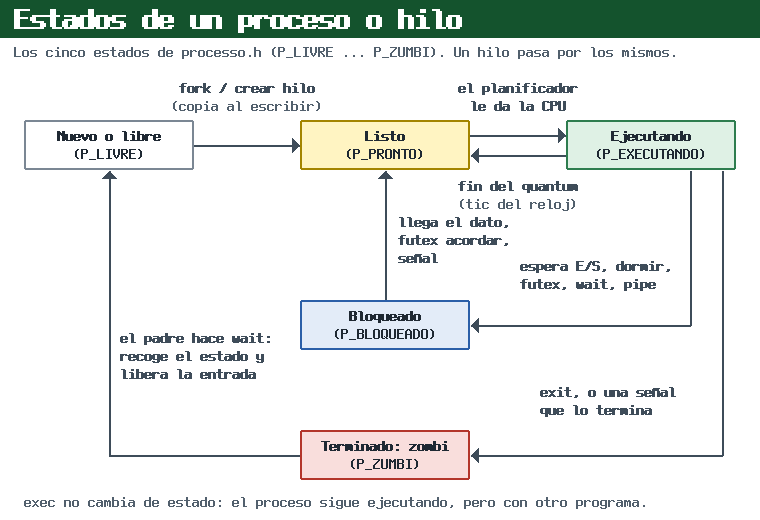

<!-- categoria: Conoce SaguiOS/Sistemas operativos; orden: 4; titulo: Procesos e hilos -->
# Procesos e hilos

[Español](04-procesos.md) · [Português](04-procesos_PT.md) · [English](04-procesos_EN.md)

> Objetivo: entender qué es un proceso por dentro, cómo nace con `fork` y `execve`, cómo espera con `waitpid` y por qué
> existen los procesos zombis.

## 1. Teoría

### 1.1 Qué es un proceso

Un **proceso** es un programa en ejecución más el contexto necesario para seguir ejecutándolo: su espacio de
direcciones (capítulo 6), sus descriptores de archivo, su usuario, su directorio actual y el estado de la CPU
(registros, contador de instrucciones, pila). El núcleo guarda todo eso en un registro llamado **PCB** (*process
control block*). Un proceso es la unidad que el planificador reparte (capítulo 5).

### 1.2 Estados

Un proceso pasa por varios estados:

- **Listo**: puede ejecutarse, espera turno de CPU.
- **Ejecutando**: está en una CPU ahora mismo.
- **Bloqueado**: espera algo (un teclado, una tubería vacía, la muerte de un hijo). No se planifica hasta que ocurre.
- **Zombi**: ha terminado, pero su padre todavía no ha recogido su estado de salida.
- **Libre**: la ranura de la tabla de procesos está vacía.

```
        planificador            espera (E/S, pipe, waitpid)
  listo --------------> ejecutando ------------------> bloqueado
   ^                       |   ^                          |
   +-----------------------+   +-------- despertar -------+
                           | exit()
                           v
                        zombi ---- waitpid del padre ---> libre
```

### 1.3 Crear procesos: `fork`, `exec` y `waitpid`

El modelo de Unix separa dos pasos:

1. **`fork()`** duplica el proceso actual. El hijo recibe una copia de todo, y el valor de retorno distingue a los dos:
   el padre recibe el PID del hijo y el hijo recibe `0`.
2. **`execve(ruta, argv, envp)`** sustituye la imagen del proceso por un programa nuevo, sin cambiar su PID. Los
   descriptores abiertos se conservan, y así funcionan las tuberías del shell.
3. **`waitpid(pid, &estado, opciones)`** espera a que un hijo termine y recoge su estado de salida.

Copiar toda la memoria en cada `fork` sería caro. La solución habitual es la **copia al escribir** (*copy-on-write*):
padre e hijo comparten las páginas como de solo lectura; la primera escritura de cualquiera de los dos provoca un fallo
de página que copia solo esa página. Así, `fork` seguido de `exec` casi no copia nada.

### 1.4 Señales

Una **señal** es un aviso asíncrono entre procesos (`SIGINT`, `SIGTERM`, `SIGKILL`, `SIGCHLD`). El destinatario puede
ignorarla, usar la acción por defecto (que suele terminarlo) o instalar un manejador. Una señal no se puede ignorar ni
capturar si es `SIGKILL`. Otros sistemas (Windows) usan eventos y excepciones asíncronas con un modelo distinto.

### 1.5 Zombis y huérfanos

- Un **zombi** conserva solo la entrada de la tabla con su código de salida, para que el padre pueda preguntar. Si el
  padre nunca llama a `waitpid`, el zombi permanece.
- Un **huérfano** es un proceso cuyo padre ha terminado: lo adopta el proceso de inicio (PID 1 en Unix), que lo recoge.

### 1.6 Hilos

Un **hilo** es una unidad de ejecución dentro de un proceso: comparte el espacio de direcciones y los descriptores, pero
tiene su propia pila y sus registros. Un hilo es más barato que un proceso. Linux implementa cada hilo como un proceso
ligero que comparte recursos (`clone`). Windows tiene procesos y hilos separados en el ejecutivo.

### 1.7 Un cálculo: cuánto cuesta un `fork`

Supón un proceso de **8 MB**, es decir 8192 KB / 4 KB = **2048 páginas**. Un `fork` que copiara todo costaría copiar
2048 páginas (8 MB) antes de poder hacer nada. Con copia al escribir, `fork` solo duplica las tablas de páginas y marca
las páginas como compartidas. Si el hijo escribe solo en 10 páginas (su pila y unas variables) antes de hacer `exec`,
solo se copian esas 10: 40 KB en lugar de 8 MB, unas **200 veces menos**. Además, `exec` descarta el espacio del hijo
entero, así que muchas de esas páginas ni llegan a copiarse.

### 1.8 Comparativa: el registro del proceso en otros sistemas

| Sistema | Estructura del proceso | Hilos | Notas |
| --- | --- | --- | --- |
| Linux | `task_struct` (con un registro por hilo) | Cada hilo es una tarea ligera con recursos compartidos (`clone`) | Modelo unificado: proceso e hilo son lo mismo para el planificador |
| Windows | `EPROCESS` (proceso) y `ETHREAD` (hilo) | Separados en el ejecutivo | Un hilo tiene su propio contexto y pila |
| FreeBSD | `struct proc` y `struct thread` | Separados desde FreeBSD 5 | Muy similar a Windows en la separación |
| SaguiOS | `processo_t` (`kernel/inc/processo.h`) | Entradas de la tabla que comparten el espacio del líder | Cercano al modelo de Linux |

### 1.9 El cambio de contexto, paso a paso

Cuando una interrupción o una llamada al sistema da la CPU al núcleo, la secuencia es siempre la misma:

1. El hardware guarda en la pila del núcleo `EIP`, `CS` y `EFLAGS` (y `ESP` y `SS` si venía de modo usuario).
2. Un trozo de ensamblador guarda el resto de registros y llama a una función en C.
3. La función en C atiende el motivo (la llamada, el reloj...) y, si toca cambiar de proceso, el planificador elige otro.
4. El ensamblador restaura los registros del proceso elegido y ejecuta `iret`.

«Cambiar de proceso» es solo **cambiar de pila**: cada proceso dejó sus registros guardados en la suya, y restaurar los de
otro es retomarlo donde se quedó. Si el nuevo proceso tiene otro espacio de direcciones, además se carga su tabla de
páginas (`CR3`, capítulo 6). El coste (guardar y restaurar registros, vaciar parte de la TLB, enfriar la caché) es el que
se contó en el ejemplo del capítulo 5.

## 2. Así lo hace SaguiOS

- **PCB.** `kernel/inc/processo.h` define el registro de cada proceso, con estados `P_LIVRE`, `P_PRONTO`, `P_EXECUTANDO`,
  `P_BLOQUEADO` y `P_ZUMBI` (`estado_t`), y la tabla que mantiene `kernel/nucleo/processos.c`.
- **Llamadas.** El número de cada llamada está en `kernel/inc/abi.h`:
  - `SIS_BIFURCAR` (140): `fork`, devuelve el PID al padre y 0 al hijo. Lo implementa `kernel/nucleo/bifurcar.c`
    (`sis_bifurcar`).
  - `SIS_EXECUTAR` (1): ejecuta un programa con `argv` y `envp`. Lo carga `kernel/nucleo/carregador.c`, que lee
    ejecutables **ELF32** con sus segmentos `PT_LOAD`.
  - `SIS_ESPERAR_PID` (142): `waitpid`. Devuelve 0 si ningún hijo ha terminado y se pide sin bloquear.
  - `SIS_MATAR` (5): matar un proceso por PID. Es lo que hace la orden `kill <pid>` (`userland/programas/kill.c`).
  - `SIS_SINAL` (143) y `SIS_SINAL_VOLTAR` (144): señales y su retorno (`sigreturn`). La lógica está en
    `kernel/nucleo/sinais.c`.
- **Copia al escribir.** `kernel/mem/copia_escrita.c` lleva la cuenta de referencias de las páginas compartidas por el
  `fork` (decisión D401).
- **Hilos.** `kernel/nucleo/hilos.c` implementa los hilos de usuario como entradas de la tabla que comparten el espacio de
  su líder (decisión D167).
- **Cambio de contexto.** `entrada_comum` (`kernel/arch/vetores.asm`) apila los registros, llama a `tratar_interrupcao()` y
  esta devuelve el **marco** (la pila guardada) del proceso que debe seguir; `mov esp, eax` cambia a esa pila y `iretd`
  reanuda el proceso elegido. Es el paso 4 de la lista anterior, línea a línea.
- **Programas dinámicos.** Si el ejecutable trae `PT_INTERP` (casi todos los de `/bin` desde la decisión **D462**), `execve`
  carga también el intérprete `/lib/ld-sagui.so.1` y le pasa un vector auxiliar (`kernel/nucleo/carregador.c`); el
  intérprete carga las bibliotecas y salta al programa (capítulo 6). Los estáticos no pasan por él.
- **Hilos en varias CPU.** Con la imagen `--smp`, los hilos de un mismo proceso pueden correr a la vez en CPU distintas:
  comparten el espacio y los descriptores, así que cuidan sus datos con cerrojos (capítulo 7).
- **Pila que crece.** `kernel/nucleo/pilha.c`: la pila de usuario crece bajo demanda, con una página de guarda
  (decisión D186).
- **Procesos del sistema.** Los servicios los supervisa `kernel/nucleo/supervisor.c` (decisión D216).



**Dato de diseño:** `SIS_ESPERAR_PID` documenta que, con `ESPERA_SEM_BLOQUEAR`, devuelve 0 cuando nadie ha terminado; es
la forma no bloqueante de `waitpid`.

### 2.1 Decisiones, alternativas y límites actuales

- **Decisión: `fork` con copia al escribir y `exec` que conserva el PID.** La decisión **D401** añade el modelo POSIX
  (`fork`, `execve`, `waitpid`, señales y `poll`/`select`). `exec` conserva el PID y los descriptores, salvo los marcados
  como `FD_CLOEXEC` (`userland/libc/unistd.h`).
- **Decisión: los hilos son entradas de la tabla.** La decisión **D167** comparte el espacio del líder. Es sencillo y se
  entiende en el código (`kernel/nucleo/hilos.c`).
- **Decisión: la pila crece bajo demanda.** La decisión **D186** pone una página de guarda, como en la mayoría de los
  sistemas.
- **Límite: `vfork` existe en la libc, pero es un `fork` completo.** Así se evita un fallo de compatibilidad sin
  introducir un modelo de memoria compartida peligroso. Linux usa `vfork` para evitar copiar; aquí no se gana ese ahorro.
- **Límite: los servicios los gestiona un supervisor sencillo.** La decisión **D216** arranca y reinicia servicios, pero
  no implementa dependencias complejas como las unidades de systemd.

## 3. Experimento en SaguiOS

1. Abre el **Administrador de tareas** (Inicio > Sistema > Administrador de tareas) y, en el terminal, escribe `ps`.
   Compara las columnas PID, PPID, estado y memoria. Los estados que muestra `ps` son los de la teoría: `libre`, `listo`,
   `ejecutando`, `bloqueado` y `zombi`.
2. Escribe `sleep 30 &` (el `&` deja la orden en segundo plano) y después `ps -n -p <PID>`. Verás un proceso en
   ejecución o bloqueado. Luego escribe `kill <PID>`.
3. Escribe `ps -c` para ordenar por CPU y `ps -s` para ordenar por memoria.


**Qué observar:** la columna PPID muestra quién creó cada proceso. Las órdenes que escribes en el shell tienen como padre al
propio shell, porque cada una nace con `fork` y después `execve`.

**Ejercicio práctico adicional.** Escribe `sleep 60 &` tres veces y después `ps`. Anota los PID y el PPID de los tres
procesos. Después mata uno con `kill <PID>` y comprueba que desaparece. Explica por qué el PPID de los tres es el mismo y
qué pasaría con un proceso que ya no tuviera padre.

## 4. Preguntas de repaso

1. ¿Por qué `fork` devuelve dos valores distintos según sea padre o hijo? ¿Cómo sabe cada uno cuál es?
2. ¿Qué ventaja tiene separar `fork` y `execve` en vez de crear un proceso con el programa directamente?
3. Un programa termina, pero su padre no llama nunca a `waitpid`. ¿En qué estado queda, qué ocupa y cómo se corrige?
4. ¿Qué diferencia hay entre un proceso y un hilo a nivel de memoria?

5. Un proceso de 16 MB escribe 25 páginas tras un `fork`. ¿Cuántos KB se copian con copia al escribir? ¿Y con copia total?
6. ¿Qué diferencia hay entre un zombi y un huérfano, y qué proceso los recoge en cada caso?
7. ¿Por qué `SIGKILL` no puede ignorarse ni capturarse? ¿Qué aviso lo sustituye en la práctica para un programa que quiere
   limpiar sus archivos antes de morir?
8. Un proceso escribe en una página compartida tras un `fork`. Describe, en orden, qué hacen el hardware y el núcleo hasta que
   el proceso sigue con su copia.

## 5. Soluciones

1. El valor de retorno del `fork` es el PID del hijo en el padre y `0` en el hijo. Cada uno compara ese valor para saber
   qué rama seguir.
2. El hijo puede preparar su entorno (redirecciones, tuberías, cambio de directorio) antes de sustituirse por el programa.
   El shell lo usa para cada orden.
3. Queda en estado **zombi**. Ocupa solo su entrada de la tabla con el código de salida. Se corrige cuando el padre
   llama a `waitpid`, o cuando termina el padre y lo adopta el proceso de inicio.
4. Un proceso tiene su propio espacio de direcciones. Un hilo comparte el espacio del proceso que lo creó y tiene solo su
   pila y sus registros.

### Respuestas a las preguntas adicionales

5. Con copia al escribir, 25 páginas × 4 KB = **100 KB**. Con copia total, 16 MB / 4 KB = 4096 páginas, es decir **16 MB**.
6. Un zombi ha terminado y espera a que su padre llame a `waitpid`; lo recoge el padre. Un huérfano sigue ejecutándose pero
   su padre ha terminado; lo adopta el proceso de inicio, que lo recoge al terminar.
7. Porque es el mecanismo que el núcleo usa para terminar un proceso aunque esté bloqueado o sea defectuoso: si el programa
   pudiera capturarla, nunca se podría matar. Para limpiar, un programa suele usar `SIGTERM`, que sí puede capturar y
   tratar antes de salir.
8. La escritura en una página marcada de solo lectura provoca un fallo de página (vector 14); la CPU guarda el marco y entra en
   el núcleo por la IDT. El manejador ve que la página está compartida por copia al escribir, reserva un marco nuevo, copia
   los 4 KB, apunta la entrada del proceso al marco nuevo con permiso de escritura, invalida esa entrada de la TLB y
   reanuda la instrucción con `iret`: el proceso no nota nada salvo el retraso.
