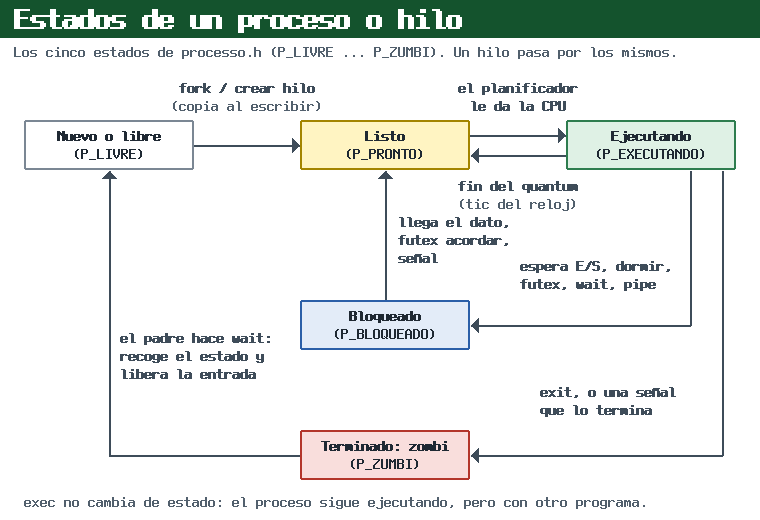

<!-- categoria: Conoce SaguiOS/Sistemas operativos; orden: 4; titulo: Processes and threads -->
# Processes and threads

[Español](04-procesos.md) · [Português](04-procesos_PT.md) · [English](04-procesos_EN.md)

> Goal: understand what a process is inside, how it is born with `fork` and `execve`, how it waits with `waitpid`, and
> why zombie processes exist.

## 1. Theory

### 1.1 What a process is

A **process** is a running program plus the context needed to keep running it: its address space (chapter 6), its file
descriptors, its user, its current directory and the CPU state (registers, instruction counter, stack). The kernel stores
all of that in a record called the **PCB** (*process control block*). A process is the unit the scheduler distributes
(chapter 5).

### 1.2 States

A process goes through several states:

- **Ready**: it can run and waits for its CPU turn.
- **Running**: it is on a CPU right now.
- **Blocked**: it waits for something (a keyboard, an empty pipe, the death of a child). It is not scheduled until that
  happens.
- **Zombie**: it has finished, but its parent has not yet collected its exit status.
- **Free**: the slot in the process table is empty.

```
        planificador            espera (E/S, pipe, waitpid)
  listo --------------> ejecutando ------------------> bloqueado
   ^                       |   ^                          |
   +-----------------------+   +-------- despertar -------+
                           | exit()
                           v
                        zombi ---- waitpid del padre ---> libre
```

### 1.3 Creating processes: `fork`, `exec` and `waitpid`

The Unix model separates two steps:

1. **`fork()`** duplicates the current process. The child receives a copy of everything, and the return value tells the
   two apart: the parent receives the child's PID and the child receives `0`.
2. **`execve(path, argv, envp)`** replaces the process image with a new program, without changing its PID. Open
   descriptors are kept, and that is how shell pipes work.
3. **`waitpid(pid, &status, options)`** waits until a child finishes and collects its exit status.

Copying all memory on every `fork` would be expensive. The usual solution is **copy-on-write**: parent and child share the
pages as read-only; the first write by either one causes a page fault that copies only that page. Thus, `fork` followed by
`exec` copies almost nothing.

### 1.4 Signals

A **signal** is an asynchronous notice between processes (`SIGINT`, `SIGTERM`, `SIGKILL`, `SIGCHLD`). The recipient can
ignore it, use the default action (usually terminating) or install a handler. `SIGKILL` cannot be ignored or caught.
Other systems (Windows) use events and asynchronous exceptions with a different model.

### 1.5 Zombies and orphans

- A **zombie** keeps only its table entry with the exit code, so the parent can ask for it. If the parent never calls
  `waitpid`, the zombie stays.
- An **orphan** is a process whose parent has finished: the init process (PID 1 in Unix) adopts it and collects it.

### 1.6 Threads

A **thread** is an execution unit inside a process: it shares the address space and the descriptors, but has its own
stack and registers. A thread is cheaper than a process. Linux implements each thread as a lightweight process that
shares resources (`clone`). Windows has separate processes and threads in the executive.

### 1.7 A calculation: what a `fork` costs

Suppose a process of **8 MB**, that is 8192 KB / 4 KB = **2048 pages**. A `fork` that copied everything would copy 2048
pages (8 MB) before doing anything. With copy-on-write, `fork` only duplicates the page tables and marks the pages as
shared. If the child writes to only 10 pages (its stack and a few variables) before calling `exec`, only those 10 are
copied: 40 KB instead of 8 MB, about **200 times less**. In addition, `exec` discards the child's whole space, so many of
those pages are never copied at all.

### 1.8 Comparison: the process record in other systems

| System | Process structure | Threads | Notes |
| --- | --- | --- | --- |
| Linux | `task_struct` (one record per thread) | Each thread is a lightweight task with shared resources (`clone`) | Unified model: for the scheduler a process and a thread are the same |
| Windows | `EPROCESS` (process) and `ETHREAD` (thread) | Separate in the executive | A thread has its own context and stack |
| FreeBSD | `struct proc` and `struct thread` | Separate since FreeBSD 5 | Very similar to Windows in the separation |
| SaguiOS | `processo_t` (`kernel/inc/processo.h`) | Table entries that share the leader's space | Close to the Linux model |

### 1.9 The context switch, step by step

When an interrupt or a system call hands the CPU to the kernel, the sequence is always the same:

1. The hardware saves `EIP`, `CS` and `EFLAGS` on the kernel stack (and `ESP` and `SS` if it came from user mode).
2. A piece of assembly saves the rest of the registers and calls a C function.
3. The C function handles the reason (the call, the clock...) and, if a process switch is due, the scheduler picks another.
4. The assembly restores the registers of the chosen process and runs `iret`.

"Switching process" is just **switching stacks**: each process left its registers saved on its own stack, and restoring
another's is resuming it where it stopped. If the new process has another address space, its page table is loaded too
(`CR3`, chapter 6). The cost (saving and restoring registers, flushing part of the TLB, cooling the cache) is the one
counted in the example of chapter 5.

## 2. How SaguiOS does it

- **PCB.** `kernel/inc/processo.h` defines the record of each process, with states `P_LIVRE`, `P_PRONTO`, `P_EXECUTANDO`,
  `P_BLOQUEADO` and `P_ZUMBI` (`estado_t`), and the table kept by `kernel/nucleo/processos.c`.
- **Calls.** The number of each call is in `kernel/inc/abi.h`:
  - `SIS_BIFURCAR` (140): `fork`; it returns the PID to the parent and 0 to the child. It is implemented by
    `kernel/nucleo/bifurcar.c` (`sis_bifurcar`).
  - `SIS_EXECUTAR` (1): runs a program with `argv` and `envp`. It is loaded by `kernel/nucleo/carregador.c`, which reads
    **ELF32** executables with their `PT_LOAD` segments.
  - `SIS_ESPERAR_PID` (142): `waitpid`. It returns 0 if no child has finished and it is asked without blocking.
  - `SIS_MATAR` (5): kills a process by PID. It is what the `kill <pid>` command does (`userland/programas/kill.c`).
  - `SIS_SINAL` (143) and `SIS_SINAL_VOLTAR` (144): signals and their return (`sigreturn`). The logic is in
    `kernel/nucleo/sinais.c`.
- **Copy-on-write.** `kernel/mem/copia_escrita.c` keeps the reference count of the pages shared by `fork` (decision D401).
- **Threads.** `kernel/nucleo/hilos.c` implements user threads as entries of the table that share the address space of
  their leader (decision D167).
- **Context switch.** `entrada_comum` (`kernel/arch/vetores.asm`) pushes the registers, calls `tratar_interrupcao()` and that
  returns the **frame** (the saved stack) of the process that must go on; `mov esp, eax` switches to that stack and `iretd`
  resumes the chosen process. It is step 4 of the list above, line by line.
- **Dynamic programs.** If the executable has `PT_INTERP` (almost all of `/bin` since decision **D462**), `execve` also loads
  the interpreter `/lib/ld-sagui.so.1` and hands it an auxiliary vector (`kernel/nucleo/carregador.c`); the interpreter loads
  the libraries and jumps to the program (chapter 6). Static programs do not go through it.
- **Threads on several CPUs.** With the `--smp` image, the threads of one process can run at the same time on different CPUs:
  they share the space and the descriptors, so they protect their data with locks (chapter 7).
- **Growing stack.** `kernel/nucleo/pilha.c`: the user stack grows on demand, with a guard page (decision D186).
- **System processes.** Services are supervised by `kernel/nucleo/supervisor.c` (decision D216).



**Design note:** `SIS_ESPERAR_PID` documents that, with `ESPERA_SEM_BLOQUEAR`, it returns 0 when nobody has finished; it is
the non-blocking form of `waitpid`.

### 2.1 Decisions, alternatives and current limits

- **Decision: `fork` with copy-on-write and `exec` that keeps the PID.** Decision **D401** adds the POSIX model (`fork`,
  `execve`, `waitpid`, signals and `poll`/`select`). `exec` keeps the PID and the descriptors, except those marked
  `FD_CLOEXEC` (`userland/libc/unistd.h`).
- **Decision: threads are table entries.** Decision **D167** shares the leader's space. It is simple and easy to follow in
  the code (`kernel/nucleo/hilos.c`).
- **Decision: the stack grows on demand.** Decision **D186** places a guard page, as most systems do.
- **Limit: `vfork` exists in the libc, but it is a full `fork`.** This avoids a compatibility failure without introducing a
  dangerous shared-memory model. Linux uses `vfork` to avoid copying; here that saving is not gained.
- **Limit: services are handled by a simple supervisor.** Decision **D216** starts and restarts services, but it does not
  implement complex dependencies like systemd units.

## 3. Experiment in SaguiOS

1. Open the **Task manager** (Administrador de tareas, Start > System) and, in the terminal, type `ps`. Compare the PID,
   PPID, state and memory columns. The states `ps` shows are the ones from the theory: `libre` (free), `listo` (ready),
   `ejecutando` (running), `bloqueado` (blocked) and `zombi` (zombie).
2. Type `sleep 30 &` (the `&` puts the command in the background) and then `ps -n -p <PID>`. You will see a process that
   is running or blocked. Then type `kill <PID>`.
3. Type `ps -c` to sort by CPU and `ps -s` to sort by memory.


**What to observe:** the PPID column shows who created each process. The commands you type in the shell have the shell as
their parent, because each one is born with `fork` and then `execve`.

**Additional practical exercise.** Type `sleep 60 &` three times and then `ps`. Note the PID and PPID of the three
processes. Then kill one with `kill <PID>` and check that it disappears. Explain why the PPID of the three is the same, and
what would happen to a process that no longer had a parent.

## 4. Review questions

1. Why does `fork` return two different values depending on whether you are the parent or the child? How does each one know
   which is which?
2. What is the advantage of separating `fork` and `execve` instead of creating a process with the program directly?
3. A program finishes, but its parent never calls `waitpid`. In what state does it stay, what does it occupy, and how is
   it fixed?
4. What is the difference between a process and a thread at the memory level?

5. A 16 MB process writes to 25 pages after a `fork`. How many KB are copied with copy-on-write? And with a full copy?
6. What is the difference between a zombie and an orphan, and which process collects each one?
7. Why can `SIGKILL` be neither ignored nor caught? What notice replaces it in practice for a program that wants to clean up
   its files before dying?
8. A process writes to a shared page after a `fork`. Describe, in order, what the hardware and the kernel do until the process
   goes on with its own copy.

## 5. Answers

1. The return value of `fork` is the child's PID in the parent and `0` in the child. Each one compares that value to know
   which branch to follow.
2. The child can prepare its environment (redirections, pipes, change of directory) before replacing itself with the
   program. The shell uses it for each command.
3. It stays as a **zombie**. It only occupies its table entry with the exit code. It is fixed when the parent calls
   `waitpid`, or when the parent ends and the init process adopts it.
4. A process has its own address space. A thread shares the space of the process that created it and has only its own
   stack and registers.

### Answers to the additional questions

5. With copy-on-write, 25 pages × 4 KB = **100 KB**. With a full copy, 16 MB / 4 KB = 4096 pages, that is **16 MB**.
6. A zombie has finished and waits for its parent to call `waitpid`; the parent collects it. An orphan is still running but
   its parent has finished; the init process adopts it and collects it when it ends.
7. Because it is the mechanism the kernel uses to end a process even when it is blocked or defective: if the program could
   catch it, it could never be killed. To clean up, a program usually uses `SIGTERM`, which it can catch and handle before
   exiting.
8. The write to a page marked read-only causes a page fault (vector 14); the CPU saves the frame and enters the kernel through the
   IDT. The handler sees that the page is shared by copy-on-write, reserves a new frame, copies the 4 KB, points the
   process's entry to the new frame with write permission, invalidates that TLB entry and resumes the instruction with `iret`:
   the process notices nothing except the delay.
