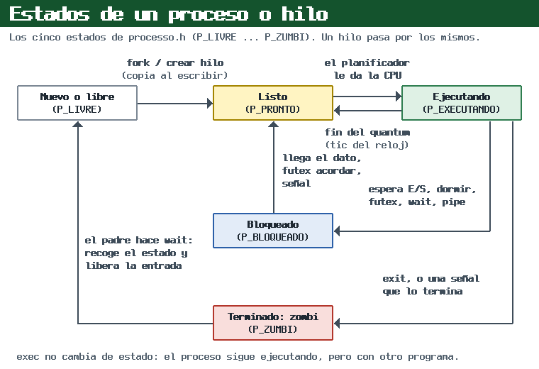
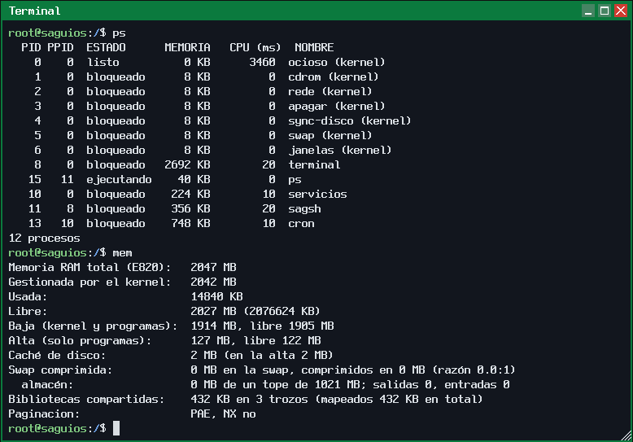

<!-- categoria: Conoce SaguiOS/Sistemas operativos; orden: 4; titulo: Processos e threads -->
# Processos e threads

[Español](04-procesos.md) · [Português](04-procesos_PT.md) · [English](04-procesos_EN.md)

> Objetivo: entender o que é um processo por dentro, como ele nasce com `fork` e `execve`, como espera com `waitpid` e por que existem
> os processos zumbis.

## 1. Teoria

### 1.1 O que é um processo

Um **processo** é um programa em execução mais o contexto necessário para continuar executando-o: seu espaço de endereçamento (capítulo 6),
seus descritores de arquivo, seu usuário, seu diretório atual e o estado da CPU (registradores, contador de instruções, pilha). O núcleo
guarda tudo isso num registro chamado **PCB** (*process control block*). Um processo é a unidade que o escalonador reparte (capítulo 5).

### 1.2 Estados

Um processo passa por vários estados:

- **Pronto**: pode executar e espera a sua vez de CPU.
- **Executando**: está numa CPU agora.
- **Bloqueado**: espera algo (um teclado, um pipe vazio, a morte de um filho). Não é escalonado até que isso aconteça.
- **Zumbi**: terminou, mas o pai ainda não recolheu o seu estado de saída.
- **Livre**: a posição da tabela de processos está vazia.

```
        planificador            espera (E/S, pipe, waitpid)
  listo --------------> ejecutando ------------------> bloqueado
   ^                       |   ^                          |
   +-----------------------+   +-------- despertar -------+
                           | exit()
                           v
                        zombi ---- waitpid del padre ---> libre
```

### 1.3 Criar processos: `fork`, `exec` e `waitpid`

O modelo do Unix separa dois passos:

1. **`fork()`** duplica o processo atual. O filho recebe uma cópia de tudo, e o valor de retorno distingue os dois: o pai recebe o PID
   do filho e o filho recebe `0`.
2. **`execve(caminho, argv, envp)`** substitui a imagem do processo por um programa novo, sem mudar o seu PID. Os descritores abertos
   são mantidos, e é assim que funcionam os pipes do shell.
3. **`waitpid(pid, &estado, opções)`** espera até que um filho termine e recolhe o seu estado de saída.

Copiar toda a memória a cada `fork` seria caro. A solução habitual é a **cópia na escrita** (*copy-on-write*): pai e filho compartilham
as páginas como somente leitura; a primeira escrita de qualquer um dos dois causa uma falha de página que copia apenas aquela página.
Assim, `fork` seguido de `exec` quase não copia nada.

### 1.4 Sinais

Um **sinal** é um aviso assíncrono entre processos (`SIGINT`, `SIGTERM`, `SIGKILL`, `SIGCHLD`). O destinatário pode ignorá-lo, usar a
ação padrão (que costuma encerrá-lo) ou instalar um tratador. `SIGKILL` não pode ser ignorado nem capturado. Outros sistemas (Windows)
usam eventos e exceções assíncronas, com um modelo diferente.

### 1.5 Zumbis e órfãos

- Um **zumbi** conserva apenas a entrada da tabela com o código de saída, para que o pai possa perguntar. Se o pai nunca chama `waitpid`,
  o zumbi permanece.
- Um **órfão** é um processo cujo pai já terminou: quem o adota é o processo de inicialização (PID 1 no Unix), que o recolhe.

### 1.6 Threads

Uma **thread** é uma unidade de execução dentro de um processo: compartilha o espaço de endereçamento e os descritores, mas tem sua própria
pilha e seus registradores. Uma thread é mais barata que um processo. O Linux implementa cada thread como um processo leve que compartilha
recursos (`clone`). O Windows tem processos e threads separados no executivo.

### 1.7 Um cálculo: quanto custa um `fork`

Suponha um processo de **8 MB**, ou seja 8192 KB / 4 KB = **2048 páginas**. Um `fork` que copiasse tudo copiaria 2048 páginas (8 MB) antes
de fazer qualquer coisa. Com cópia na escrita, o `fork` apenas duplica as tabelas de páginas e marca as páginas como compartilhadas. Se o
filho escreve em apenas 10 páginas (sua pilha e algumas variáveis) antes de chamar `exec`, só essas 10 são copiadas: 40 KB em vez de 8 MB,
cerca de **200 vezes menos**. Além disso, o `exec` descarta todo o espaço do filho, então muitas dessas páginas nem chegam a ser copiadas.

### 1.8 Comparação: o registro do processo em outros sistemas

| Sistema | Estrutura do processo | Threads | Observações |
| --- | --- | --- | --- |
| Linux | `task_struct` (um registro por thread) | Cada thread é uma tarefa leve com recursos compartilhados (`clone`) | Modelo unificado: para o escalonador, processo e thread são a mesma coisa |
| Windows | `EPROCESS` (processo) e `ETHREAD` (thread) | Separados no executivo | Uma thread tem contexto e pilha próprios |
| FreeBSD | `struct proc` e `struct thread` | Separados desde o FreeBSD 5 | Muito parecido com o Windows na separação |
| SaguiOS | `processo_t` (`kernel/inc/processo.h`) | Entradas da tabela que compartilham o espaço do líder | Próximo do modelo do Linux |

### 1.9 A troca de contexto, passo a passo

Quando uma interrupção ou uma chamada ao sistema entrega a CPU ao núcleo, a sequência é sempre a mesma:

1. O hardware guarda `EIP`, `CS` e `EFLAGS` na pilha do núcleo (e `ESP` e `SS` se vinha do modo usuário).
2. Um trecho de assembly guarda o resto dos registradores e chama uma função em C.
3. A função em C atende o motivo (a chamada, o relógio...) e, se for hora de trocar de processo, o escalonador escolhe outro.
4. O assembly restaura os registradores do processo escolhido e executa `iret`.

«Trocar de processo» é só **trocar de pilha**: cada processo deixou os seus registradores guardados na sua, e restaurar os de outro
é retomá-lo onde parou. Se o novo processo tem outro espaço de endereços, também se carrega a sua tabela de páginas (`CR3`,
capítulo 6). O custo (guardar e restaurar registradores, esvaziar parte da TLB, esfriar o cache) é o que foi contado no exemplo
do capítulo 5.

## 2. Como o SaguiOS faz

- **PCB.** `kernel/inc/processo.h` define o registro de cada processo, com os estados `P_LIVRE`, `P_PRONTO`, `P_EXECUTANDO`,
  `P_BLOQUEADO` e `P_ZUMBI` (`estado_t`), e a tabela mantida por `kernel/nucleo/processos.c`.
- **Chamadas.** O número de cada chamada está em `kernel/inc/abi.h`:
  - `SIS_BIFURCAR` (140): `fork`; devolve o PID ao pai e 0 ao filho. Implementada por `kernel/nucleo/bifurcar.c` (`sis_bifurcar`).
  - `SIS_EXECUTAR` (1): executa um programa com `argv` e `envp`. Carregado por `kernel/nucleo/carregador.c`, que lê executáveis **ELF32**
    com seus segmentos `PT_LOAD`.
  - `SIS_ESPERAR_PID` (142): `waitpid`. Devolve 0 se nenhum filho terminou e é pedido sem bloquear.
  - `SIS_MATAR` (5): mata um processo pelo PID. É o que faz o comando `kill <pid>` (`userland/programas/kill.c`).
  - `SIS_SINAL` (143) e `SIS_SINAL_VOLTAR` (144): sinais e o seu retorno (`sigreturn`). A lógica está em `kernel/nucleo/sinais.c`.
- **Cópia na escrita.** `kernel/mem/copia_escrita.c` mantém a contagem de referências das páginas compartilhadas pelo `fork` (decisão D401).
- **Threads.** `kernel/nucleo/hilos.c` implementa threads de usuário como entradas da tabela que compartilham o espaço do seu líder (decisão D167).
- **Troca de contexto.** `entrada_comum` (`kernel/arch/vetores.asm`) empilha os registradores, chama `tratar_interrupcao()` e esta
  devolve o **quadro** (a pilha guardada) do processo que deve continuar; `mov esp, eax` muda para essa pilha e `iretd` retoma o
  processo escolhido. É o passo 4 da lista acima, linha a linha.
- **Programas dinâmicos.** Se o executável traz `PT_INTERP` (quase todos os de `/bin` desde a decisão **D462**), o `execve` carrega
  também o interpretador `/lib/ld-sagui.so.1` e lhe passa um vetor auxiliar (`kernel/nucleo/carregador.c`); o interpretador carrega
  as bibliotecas e salta para o programa (capítulo 6). Os estáticos não passam por ele.
- **Threads em várias CPUs.** Com a imagem `--smp`, as threads de um mesmo processo podem rodar ao mesmo tempo em CPUs diferentes:
  compartilham o espaço e os descritores, então protegem os seus dados com travas (capítulo 7).
- **Pilha que cresce.** `kernel/nucleo/pilha.c`: a pilha de usuário cresce sob demanda, com uma página de guarda (decisão D186).
- **Processos do sistema.** Os serviços são supervisionados por `kernel/nucleo/supervisor.c` (decisão D216).



**Nota de projeto:** `SIS_ESPERAR_PID` documenta que, com `ESPERA_SEM_BLOQUEAR`, devolve 0 quando ninguém terminou; é a forma não
bloqueante do `waitpid`.

### 2.1 Decisões, alternativas e limites atuais

- **Decisão: `fork` com cópia na escrita e `exec` que mantém o PID.** A decisão **D401** acrescenta o modelo POSIX (`fork`, `execve`,
  `waitpid`, sinais e `poll`/`select`). O `exec` mantém o PID e os descritores, exceto os marcados como `FD_CLOEXEC` (`userland/libc/unistd.h`).
- **Decisão: as threads são entradas da tabela.** A decisão **D167** compartilha o espaço do líder. É simples e fácil de seguir no código
  (`kernel/nucleo/hilos.c`).
- **Decisão: a pilha cresce sob demanda.** A decisão **D186** coloca uma página de guarda, como a maioria dos sistemas.
- **Limite: `vfork` existe na libc, mas é um `fork` completo.** Assim se evita uma falha de compatibilidade sem introduzir um modelo de memória
  compartilhada perigoso. O Linux usa `vfork` para evitar copiar; aqui essa economia não existe (`userland/libc/sinais.c`: "vfork es fork").
- **Limite: os serviços são geridos por um supervisor simples.** A decisão **D216** inicia e reinicia serviços, mas não implementa dependências
  complexas como as unidades do systemd.

## 3. Experimento no SaguiOS

1. Abra o **Administrador de tarefas** (Início > Sistema > Administrador de tarefas) e, no terminal, digite `ps`. Compare as colunas PID, PPID,
   estado e memória. Os estados que o `ps` mostra são os da teoria: `libre` (livre), `listo` (pronto), `ejecutando` (executando), `bloqueado`
   (bloqueado) e `zombi` (zumbi).
2. Digite `sleep 30 &` (o `&` deixa o comando em segundo plano) e depois `ps -n -p <PID>`. Você verá um processo em execução ou bloqueado.
   Depois digite `kill <PID>`.
3. Digite `ps -c` para ordenar por CPU e `ps -s` para ordenar por memória.




**O que observar:** a coluna PPID mostra quem criou cada processo. Os comandos que você digita no shell têm como pai o próprio shell,
porque cada um nasce com `fork` e depois `execve`.

**Exercício prático adicional.** Escreva `sleep 60 &` três vezes e depois `ps`. Anote o PID e o PPID dos três processos. Depois mate um
com `kill <PID>` e confira que ele desaparece. Explique por que o PPID dos três é o mesmo e o que aconteceria com um processo que já não
tivesse pai.

## 4. Perguntas de revisão

1. Por que `fork` devolve dois valores diferentes conforme seja pai ou filho? Como cada um sabe qual é qual?
2. Qual a vantagem de separar `fork` e `execve` em vez de criar um processo já com o programa?
3. Um programa termina, mas o pai nunca chama `waitpid`. Em que estado ele fica, o que ocupa e como se corrige?
4. Qual a diferença entre um processo e uma thread no nível da memória?
5. Um processo de 16 MB escreve em 25 páginas depois de um `fork`. Quantos KB são copiados com cópia na escrita? E com cópia total?
6. Qual a diferença entre um zumbi e um órfão, e qual processo recolhe cada um?
7. Por que `SIGKILL` não pode ser ignorado nem capturado? Que aviso o substitui na prática para um programa que quer limpar seus arquivos antes de morrer?
8. Um processo escreve numa página compartilhada após um `fork`. Descreva, em ordem, o que fazem o hardware e o núcleo até o processo
   seguir com a sua cópia.

## 5. Respostas

1. O valor de retorno do `fork` é o PID do filho no pai e `0` no filho. Cada um compara esse valor para saber qual ramo seguir.
2. O filho pode preparar o seu ambiente (redirecionamentos, pipes, mudança de diretório) antes de se substituir pelo programa. O shell usa isso
   a cada comando.
3. Fica como **zumbi**. Ocupa apenas a sua entrada na tabela, com o código de saída. Corrige-se quando o pai chama `waitpid`, ou quando o pai
   termina e o processo de inicialização o adota.
4. Um processo tem espaço de endereçamento próprio. Uma thread compartilha o espaço do processo que a criou e tem apenas a sua pilha e os seus registradores.
5. Com cópia na escrita: 25 páginas × 4 KB = **100 KB**. Com cópia total: 16 MB / 4 KB = 4096 páginas, ou seja **16 MB**.
6. Um zumbi já terminou e espera que o pai chame `waitpid`; quem o recolhe é o pai. Um órfão continua executando, mas o pai terminou; quem o adota é o
   processo de inicialização, que o recolhe quando termina.
7. Porque é o mecanismo que o núcleo usa para encerrar um processo mesmo que esteja bloqueado ou com defeito: se o programa pudesse capturá-lo, nunca
   poderia ser morto. Para limpar, um programa costuma usar `SIGTERM`, que ele pode capturar e tratar antes de sair.
8. A escrita numa página marcada como somente leitura provoca uma falha de página (vetor 14); a CPU guarda o quadro e entra no núcleo pela
   IDT. O tratador vê que a página é compartilhada por cópia na escrita, reserva um quadro novo, copia os 4 KB, aponta a entrada do
   processo para o quadro novo com permissão de escrita, invalida essa entrada da TLB e retoma a instrução com `iret`: o processo
   não percebe nada além do atraso.
