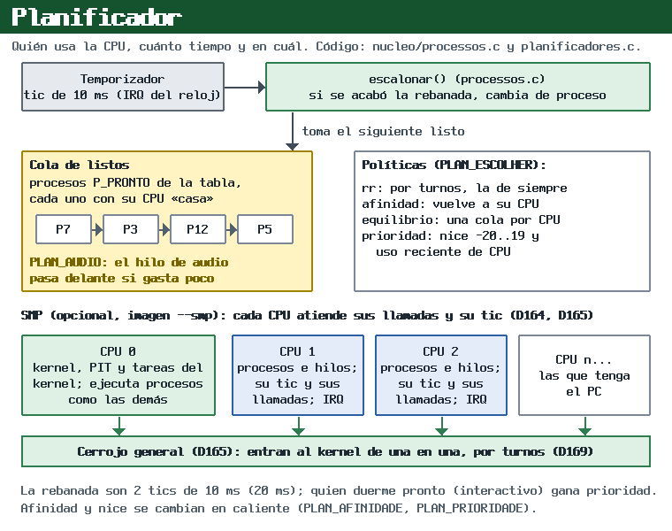
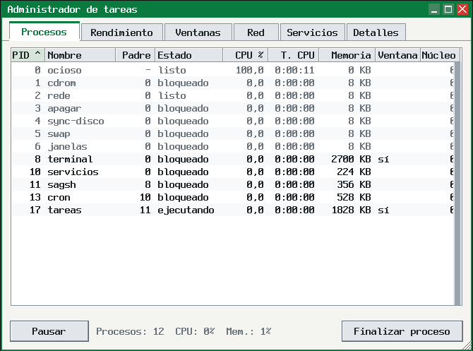

<!-- categoria: Conoce SaguiOS/Sistemas operativos; orden: 5; titulo: Planificación -->
# Planificación

[Español](05-planificacion.md) · [Português](05-planificacion_PT.md) · [English](05-planificacion_EN.md)

> Objetivo: entender cómo el núcleo decide qué proceso usa la CPU y cuánto tiempo, cómo se reparte entre varios
> procesadores y cómo se mide si el reparto es bueno.

## 1. Teoría

### 1.1 El problema

Hay más procesos listos que CPU. El **planificador** decide, cada vez que una CPU queda libre, qué proceso ejecuta a
continuación. Son decisiones con objetivos en conflicto:

- **Equidad**: que ningún proceso se quede sin CPU.
- **Respuesta**: que un programa interactivo (un teclado, una ventana) responda pronto.
- **Rendimiento**: que la CPU trabaje mucho y la caché siga caliente.
- **Tiempo real o casi real**: que un flujo de audio tenga su turno a tiempo para no cortarse.

### 1.2 Apropiación y quantum

Un planificador es **apropiativo** si puede quitar la CPU a un proceso que no la ha cedido. Se apoya en el
**temporizador**: en cada interrupción de reloj el núcleo cuenta cuánto ha corrido el proceso. Cuando agota su
**quantum** (su rodaja de tiempo), el núcleo lo pone en la cola de listos y elige otro.

- Quantum corto: buena respuesta, pero más cambios de contexto (cada cambio tiene un coste).
- Quantum largo: menos cambios, pero peor respuesta.

El algoritmo básico es **round-robin** (turnos circulares). Se combina con **prioridades** (valores que adelantan o
retrasan a un proceso) o con colas de niveles múltiples, como hace Linux con su planificador CFS o los BSD con sus colas.

### 1.3 Prioridades

Un proceso con prioridad alta recibe antes la CPU. Para evitar la inanición (un proceso de baja prioridad que no corre
nunca), los sistemas suben la prioridad de los que llevan mucho esperando (*aging*). En Unix, el valor **nice** de
-20 a 19 ajusta la prioridad: cuanto más bajo, más prioridad.

### 1.4 Multiprocesador

Con varias CPU, el planificador decide también **dónde** corre cada proceso:

- **Cola global**: todas las CPU toman de una sola lista. Es simple, pero hay contención por el cerrojo de la lista.
- **Colas por CPU**: cada CPU tiene su cola y periódicamente se reparte la carga (*load balancing*).
- **Afinidad**: un proceso vuelve a la CPU donde corrió, porque su caché y sus datos siguen allí.

El modelo **maestro/esclavo** (el núcleo solo corre en una CPU) es el más sencillo de validar. El modelo simétrico (SMP
completo) permite que el núcleo entero corra en varias CPU a la vez, con mucha más complejidad. Entre los dos hay un punto
intermedio muy usado: **todas las CPU pueden atender llamadas al sistema, pero entran al núcleo de una en una bajo un cerrojo
general** (el *big kernel lock* del Linux antiguo). Es lo que hace SaguiOS (capítulo 7).

### 1.5 Medir

No basta con que «parezca rápido». Se miden:

- **Latencia**: tiempo desde que un proceso está listo hasta que corre. Es lo que nota el usuario.
- **Rendimiento** (*throughput*): trabajo completado por unidad de tiempo.
- **Equidad**: que la CPU repartida se acerque a la proporción pedida.

Los benchmarks sintéticos (cuántas operaciones por segundo) sirven para comparar, pero los de latencia (cuánto tarda en
responder una interacción) son los que describen la experiencia.

### 1.6 Algoritmos con un ejemplo resuelto

Tres procesos llegan a la vez con ráfagas de CPU (tiempo que necesitan) de **P1 = 24**, **P2 = 3** y **P3 = 3** unidades
de tiempo. Se compara el tiempo medio de espera (lo que cada proceso pasa sin CPU antes de terminar, sin contar su
propio trabajo).

**FCFS** (primero en llegar, primero en servirse, sin apropiación):

```
 P1                          P2   P3
 0                           24   27   30
```
Esperas: P1 = 0, P2 = 24, P3 = 27. Media = **17**. Un proceso corto detrás de uno largo espera mucho: es el efecto
convoy.

**SJF** (el de ráfaga más corta primero, sin apropiación):

```
 P2   P3   P1
 0    3    6                          30
```
Esperas: P2 = 0, P3 = 3, P1 = 6. Media = **3**. Es óptimo para la espera media, pero necesita conocer las ráfagas
futuras, que en la práctica se estiman.

**Round-robin** con cuanto de 4 unidades:

```
 P1   P2   P3   P1   P1   P1   P1   P1
 0    4    7    10   14   18   22   26   30
```
P2 termina en 7 (espera 7 - 3 = 4), P3 en 10 (espera 10 - 3 = 7) y P1 en 30 (espera 30 - 24 = 6). Media = (4 + 7 + 6) / 3
aprox. **5,7**. Es peor que SJF en espera media, pero reparte la CPU y responde antes a cada proceso que llega.

Un cálculo más: si el cambio de proceso cuesta **s = 10 µs** y el cuanto es **q**, la fracción de CPU perdida es
s / (q + s). Con q = 1 ms son 10 / 1010 aprox. **1 %**; con q = 20 ms, 10 / 20010 aprox. **0,05 %**. Por eso el cuanto no puede ser
arbitrariamente corto.

### 1.7 Comparativa: planificadores reales

- **Linux** usa un planificador de reparto justo (CFS, sustituido en versiones recientes por EEVDF, con el «tiempo virtual» de cada tarea) y, para tiempo real, colas
  de prioridad fija.
- **Windows** tiene 32 niveles de prioridad y ajusta el cuanto y la prioridad de los hilos interactivos.
- **FreeBSD** usa colas por prioridad con un planificador ULE pensado para muchas CPU.
- Todos combinan round-robin dentro de un mismo nivel con prioridades entre niveles.

### 1.8 Más políticas: colas múltiples, envejecimiento y política frente a mecanismo

- **Procesos limitados por CPU o por E/S.** Un proceso que calcula casi siempre agota su quantum; uno interactivo se
  bloquea pronto esperando teclado o disco. Un buen planificador favorece a los segundos: ocupan poca CPU y se nota mucho
  si tardan.
- **Colas múltiples con realimentación.** Hay varias colas, de mayor a menor prioridad, con un quantum creciente (por
  ejemplo 1, 2, 4 y 8 unidades). Un proceso entra en la primera y, cada vez que agota su quantum, baja a la siguiente. Uno
  que necesita 15 unidades de CPU recibe 1 + 2 + 4 + 8 = 15 en solo **4 turnos**, y no 15 turnos con quantum fijo de 1:
  hay menos cambios de contexto y los procesos interactivos, que casi no agotan su turno, se quedan arriba.
- **Predecir la ráfaga para SJF.** No se conoce la próxima ráfaga de CPU, así que se estima con una media que olvida el
  pasado: *T siguiente = (ráfaga medida + T anterior) / 2*. Con una estimación inicial de 10 y ráfagas medidas de 6, 4, 6
  y 4, las estimaciones son 8, 6, 6 y 5.
- **Envejecimiento.** Subir poco a poco la prioridad de quien lleva mucho esperando impide que un proceso de baja
  prioridad no corra nunca.
- **Política frente a mecanismo.** El mecanismo (la cola, el cambio de contexto, el valor `nice`) y la política (a quién
  le toca) pueden separarse. SaguiOS lo hace: el núcleo ofrece el mecanismo y la política se elige entre cuatro con la
  orden `planificador`.
- **Planificación garantizada y de dos niveles.** En la garantizada se promete a cada uno de los *n* procesos 1/*n* de la CPU y
  se ejecuta al que lleva menos de lo prometido. En la de dos niveles, un planificador de bajo nivel reparte la CPU entre los
  procesos que están en memoria y otro, de alto nivel, decide cuáles se quedan en memoria y cuáles se sacan a disco.

### 1.9 Cuánta multiprogramación hace falta

Si cada proceso pasa una fracción *p* de su tiempo esperando la E/S, con *n* procesos en memoria la CPU está ociosa solo
cuando todos esperan a la vez (probabilidad *p* elevada a *n*, suponiendo que son independientes). La utilización es
**1 - p^n**. Con *p* = 0,8: un proceso usa la CPU el 20 %; dos, el 36 %; cuatro, el **59 %**; ocho, el **83 %**. Por eso
conviene tener varios procesos listos, pero cada uno ocupa memoria (capítulo 6): más procesos no siempre es mejor.

## 2. Así lo hace SaguiOS

- **Quantum.** `kernel/inc/processo.h` define `QUANTUM_TIQUES` como 2 tics, o sea 20 ms, con el reloj a 100 Hz
  (`kernel/inc/relogio.h`). El arranque lo anuncia así: «Procesos: round-robin cada 20 ms».
- **Cuatro políticas.** `kernel/nucleo/planificadores.c` las describe en su cabecera:
  - `rr`: round-robin global, el de siempre y el de por defecto;
  - `afinidad`: cada proceso vuelve a su CPU, y otra CPU solo se lo lleva si él lleva `FRIO_TIQUES` (30 ms) sin correr;
  - `equilibrio`: una cola por CPU y reparto cada `PERIODO_EQUILIBRIO` (50 ms);
  - `prioridad`: cada proceso tiene un `nice` (-20 a 19) y su uso reciente.

  Se elige al arrancar (`mkimagem.py --planificador`, bits de la cabecera de arranque) y en caliente con la orden
  `planificador` (`userland/programas/planificador.c`), que muestra la política activa y su explicación.
- **Prioridad de audio.** La decisión **D436** añade `PLAN_AUDIO` (`kernel/inc/abi.h`): un hilo marcado que queda listo
  pasa delante de los demás, con cualquier política, y si su CPU ejecuta otro proceso se le pide planificar ya. Solo
  mientras gaste poco: `PLAN_AUDIO_MAX_USO` vale 5 tics por periodo de unos 250 ms, así que un hilo que acapara la CPU
  vuelve a turnarse. No hace falta ser administrador. El campo `prio_audio` de `processo_t` la guarda.
- **Nice.** `PLAN_PRIORIDADE` cambia el `nice` de un proceso (-20 a 19) y `PLAN_INFO` lo consulta (`kernel/inc/abi.h`).
  Solo cuenta en la política `prioridad`.
- **Varias CPU.** El SMP es opcional (imagen `--smp`, decisión D164). Con él, **cada CPU ejecuta procesos y atiende sus
  propias llamadas al sistema, fallos e IRQ** (decisión D165), pero entran al núcleo de una en una, bajo el cerrojo general
  de `kernel/nucleo/trava_geral.c` (capítulo 7). La CPU 0 también ejecuta procesos, lleva el tic del PIT y es la única que
  corre las tareas del kernel. Mientras una CPU tiene elegido un proceso (`na_cpu`), ninguna otra se lo lleva, y una CPU
  ociosa duerme con `hlt` hasta que otra le manda una IPI de despertar. Las IRQ de los dispositivos se reparten entre las
  CPU secundarias (decisión D168). La elección de la CPU para cada proceso está en `kernel/nucleo/planificadores.c`, que
  también trata la topología SMT (los dos hilos de un mismo núcleo físico) (decisión D174).
- **Medir.** `userland/programas/benchmark.c` mide monoprocesador y multiprocesador con una puntuación (decisión D176).
  Para ver la carga en vivo: `top` (muestra CPU y memoria) y el Administrador de tareas.





### 2.1 Decisiones, alternativas y límites actuales

- **Decisión: cuatro políticas elegibles.** La decisión **D174** deja elegir entre `rr`, `afinidad`, `equilibrio` y
  `prioridad`, al arrancar y en caliente. Así se compara en el aula con la misma máquina.
- **Decisión: prioridad de audio sin privilegios.** La decisión **D436** añade `PLAN_AUDIO`, limitado por uso, para que
  un hilo que mezcla sonido no se corte sin que nadie necesite ser administrador.
- **Decisión: SMP opcional con cerrojo general.** La decisión **D164** enciende las CPU secundarias solo si se pide; la
  **D165** deja que cada CPU atienda sus llamadas bajo un cerrojo general (con turnos por orden de llegada desde la
  **D169**). Sustituyó al modelo maestro/esclavo de la D164, en el que los secundarios devolvían a la CPU 0 todo lo que
  pedía el núcleo.
- **Límite: no hay garantías de tiempo real.** `PLAN_AUDIO` mejora la respuesta, pero no garantiza plazos (un sistema de
  tiempo real garantiza el plazo con un análisis previo).
- **Límite: `nice` solo cuenta en la política `prioridad`.** En las otras políticas se ignora.
- **Límite: medir es caro.** El benchmark (D176) mide rendimiento, no latencia de cada interacción. Un estudio de latencia
  necesitaría trazas del planificador que el curso no incluye.

## 3. Experimento en SaguiOS

1. Escribe `planificador`. Verás la política activa (por ejemplo `rr`) y la lista de las cuatro con su explicación.
2. Abre `top` y déjalo un momento. Usa `top -n 3 -b` para una salida fija de tres vueltas. Anota qué proceso gasta
   más CPU.
3. Lanza el benchmark con `benchmark` y apunta la puntuación. Repite con otra política (si la imagen se ha arrancado con
   `--smp`, `planificador` permite cambiar en caliente) y compara.
4. Con `ps -c` ordena por CPU y compara con `top`.

**Qué observar:** con dos programas que trabajan a la vez, cada uno recibe la mitad de la CPU, en turnos de 20 ms. Si
lanzas un programa interactivo mientras tanto, responde en pocos turnos: esa es la latencia de la que habla la teoría.

**Ejercicio práctico adicional.** Con los procesos P1 = 5, P2 = 2 y P3 = 8 (todos llegan en el instante 0), dibuja en papel
el diagrama de Gantt de FCFS, de SJF y de round-robin con cuanto 2. Calcula la espera media de cada uno. Después, en
SaguiOS, lanza tres programas de larga duración (por ejemplo `sleep 60 &` tres veces) y comprueba con `top` que reparten
la CPU. Explica por qué el reparto real no es igual al del papel.

## 4. Preguntas de repaso

1. Si el quantum es de 20 ms y hay tres procesos listos sin prioridades, ¿cuánto espera como máximo un proceso antes de
   volver a correr?
2. ¿Por qué un planificador de afinidad puede ser más rápido que uno de cola global, aunque reparta la carga peor?
3. Un reproductor de audio pierde muestras cuando otro programa usa mucho la CPU. Explica cómo ayuda `PLAN_AUDIO` y por
   qué se limita por uso.
4. ¿Qué medirías para decidir si una política es mejor que otra: el tiempo medio de ejecución, la latencia o el
   rendimiento? Razona la respuesta.

5. Tres procesos llegan a la vez con ráfagas 10, 1 y 1. ¿Cuál es la espera media con FCFS y con SJF? Explica por qué
   FCFS es malo aquí.
6. Con cambios de proceso de 10 µs y cuanto de 1 ms, ¿qué fracción de la CPU se pierde? ¿Y con cuanto de 20 ms?
7. Con *p* = 0,6, ¿qué utilización de la CPU da la multiprogramación con 3 procesos? ¿Y con 6?
8. Con colas múltiples (quantum 1, 2, 4, 8 y 16), ¿cuántos turnos necesita un proceso que pide 40 unidades de CPU?
   ¿Y con quantum fijo de 1?

## 5. Soluciones

1. Con tres procesos listos y un turno de 20 ms, cada uno espera los turnos de los otros dos: como máximo 40 ms antes de
   volver a correr (round-robin, sin prioridades).
2. Mantiene la caché caliente: un proceso que vuelve a la misma CPU encuentra sus datos. El coste de reparto es menor.
   Pero puede dejar una CPU ociosa si el reparto es desigual, por eso existe el robo de trabajo tras `FRIO_TIQUES`.
3. `PLAN_AUDIO` hace que el hilo de audio pase delante. Se limita por uso porque, si no, un programa podría acaparar la
   CPU pidiendo siempre esa prioridad. Sin límite no sería equitativo.
4. Depende del objetivo. Para un sistema interactivo importa la latencia; para cálculo por lotes, el rendimiento. El tiempo
   medio por sí solo oculta los picos que nota el usuario, por eso conviene medir las dos cosas.

### Respuestas a las preguntas adicionales

5. FCFS: P1 (10) primero, luego P2 y P3. Esperas 0, 10 y 11: media = 7. SJF: P2 (0), P3 (1), P1 (2): esperas 0, 1 y 2, media =
   1. FCFS es malo porque los procesos cortos esperan detrás de uno largo (efecto convoy).
6. Con 1 ms: 10 / (1000 + 10) aprox. 1 %. Con 20 ms: 10 / (20000 + 10) aprox. 0,05 %. El cuanto corto mejora la respuesta pero
   cuesta más CPU; por eso se elige un compromiso (SaguiOS usa 20 ms).
7. Con 3 procesos: 1 - 0,6³ = 1 - 0,216 = **78,4 %**. Con 6: 1 - 0,6^6 aprox. 1 - 0,047 = **95,3 %**. Cada proceso extra rinde menos.
8. Quantums 1, 2, 4, 8 y 16 suman 31; faltan 9, que caben en un sexto turno (en la cola de 32): **6 turnos**. Con quantum
   fijo de 1 son 40 turnos, es decir, 34 cambios de contexto más.
