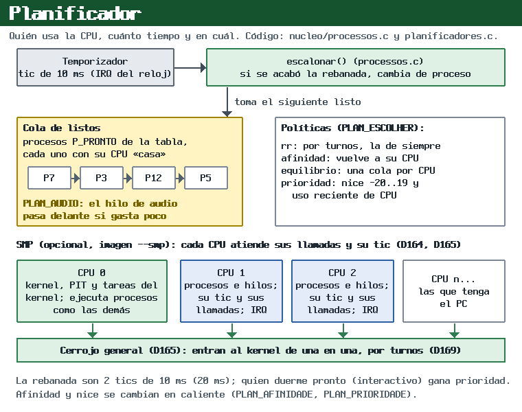

<!-- categoria: Conoce SaguiOS/Sistemas operativos; orden: 5; titulo: Scheduling -->
# Scheduling

[Español](05-planificacion.md) · [Português](05-planificacion_PT.md) · [English](05-planificacion_EN.md)

> Goal: understand how the kernel decides which process uses the CPU and for how long, how work is shared among several
> processors, and how it is measured whether the sharing is good.

## 1. Theory

### 1.1 The problem

There are more ready processes than CPUs. Whenever a CPU becomes free, the **scheduler** decides which process runs next.
These decisions have conflicting goals:

- **Fairness**: no process is left without CPU.
- **Response**: an interactive program (a keyboard, a window) responds quickly.
- **Throughput**: the CPU does a lot of work and the cache stays warm.
- **Real time or near real time**: an audio stream gets its turn on time so that it does not break up.

### 1.2 Preemption and quantum

A scheduler is **preemptive** if it can take the CPU away from a process that has not yielded it. It relies on the
**timer**: at every clock interrupt the kernel counts how long the process has run. When it uses up its **quantum** (its
time slice), the kernel puts it back in the ready queue and picks another.

- Short quantum: good response, but more context switches (each one has a cost).
- Long quantum: fewer switches, but worse response.

The basic algorithm is **round-robin** (circular turns). It is combined with **priorities** (values that move a process
forward or backward) or with multilevel queues, as Linux does with its CFS scheduler or the BSDs with their queues.

### 1.3 Priorities

A process with high priority gets the CPU first. To avoid starvation (a low-priority process that never runs), systems
raise the priority of those that have waited a long time (*aging*). In Unix, the **nice** value from -20 to 19 adjusts
priority: the lower, the higher the priority.

### 1.4 Multiprocessor

With several CPUs, the scheduler also decides **where** each process runs:

- **Global queue**: all CPUs take from one list. It is simple, but there is contention on the list's lock.
- **Per-CPU queues**: each CPU has its own queue and the load is periodically shared (*load balancing*).
- **Affinity**: a process returns to the CPU where it ran, because its cache and data are still there.

The **master/slave** model (the kernel runs on only one CPU) is the simplest to validate. The symmetric model (full SMP)
lets the whole kernel run on several CPUs at once, with much more complexity. Between the two there is a very common middle
point: **all CPUs can serve system calls, but they enter the kernel one at a time under a kernel-wide lock** (the *big kernel
lock* of old Linux). That is what SaguiOS does (chapter 7).

### 1.5 Measuring

It is not enough that something "seems fast". What is measured:

- **Latency**: time from when a process is ready until it runs. It is what the user notices.
- **Throughput**: work completed per unit of time.
- **Fairness**: whether the CPU shared out is close to the requested proportion.

Synthetic benchmarks (how many operations per second) are useful for comparing, but latency benchmarks (how long an
interaction takes to respond) describe the experience best.

### 1.6 Algorithms with a solved example

Three processes arrive at the same time with CPU bursts (the time they need) of **P1 = 24**, **P2 = 3** and **P3 = 3** time
units. The average waiting time is compared (the time each process spends without the CPU before it finishes, not counting
its own work).

**FCFS** (first come, first served, no preemption):

```
 P1                          P2   P3
 0                           24   27   30
```
Waits: P1 = 0, P2 = 24, P3 = 27. Average = **17**. A short process behind a long one waits a lot: the convoy effect.

**SJF** (shortest job first, no preemption):

```
 P2   P3   P1
 0    3    6                          30
```
Waits: P2 = 0, P3 = 3, P1 = 6. Average = **3**. It is optimal for the average wait, but it needs the future bursts, which in
practice are estimated.

**Round-robin** with a quantum of 4 units:

```
 P1   P2   P3   P1   P1   P1   P1   P1
 0    4    7    10   14   18   22   26   30
```
P2 finishes at 7 (wait 7 - 3 = 4), P3 at 10 (wait 10 - 3 = 7) and P1 at 30 (wait 30 - 24 = 6). Average = (4 + 7 + 6) / 3
approx. **5.7**. It is worse than SJF for the average wait, but it shares the CPU and responds sooner to each process that arrives.

One more calculation: if a process switch costs **s = 10 µs** and the quantum is **q**, the fraction of CPU lost is
s / (q + s). With q = 1 ms that is 10 / 1010 approx. **1 %**; with q = 20 ms, 10 / 20010 approx. **0.05 %**. That is why the quantum
cannot be arbitrarily short.

### 1.7 Comparison: real schedulers

- **Linux** uses a fair-share scheduler (CFS, with each task's "virtual time"), replaced in recent versions by EEVDF; for
  real time it has fixed-priority queues.
- **Windows** has 32 priority levels and adjusts the quantum and priority of interactive threads.
- **FreeBSD** uses priority queues with the ULE scheduler, designed for many CPUs.
- All of them combine round-robin within one level with priorities between levels.

### 1.8 More policies: multilevel queues, aging and policy versus mechanism

- **CPU-bound and I/O-bound processes.** A process that computes almost always uses up its quantum; an interactive one
  blocks soon, waiting for the keyboard or the disk. A good scheduler favors the second kind: they use little CPU and
  any delay is very noticeable.
- **Multilevel feedback queues.** There are several queues, from higher to lower priority, with a growing quantum (for
  example 1, 2, 4 and 8 units). A process enters the first and, each time it uses up its quantum, drops to the next. One
  that needs 15 units of CPU gets 1 + 2 + 4 + 8 = 15 in just **4 turns**, instead of 15 turns with a fixed quantum of 1:
  there are fewer context switches, and interactive processes, which almost never use up their turn, stay on top.
- **Predicting the burst for SJF.** The next CPU burst is not known, so it is estimated with an average that forgets the
  past: *next T = (measured burst + previous T) / 2*. With an initial estimate of 10 and measured bursts of 6, 4, 6 and
  4, the estimates are 8, 6, 6 and 5.
- **Aging.** Slowly raising the priority of whoever has waited a long time keeps a low-priority process from never running.
- **Policy versus mechanism.** The mechanism (the queue, the context switch, the `nice` value) and the policy (whose turn
  it is) can be separated. SaguiOS does so: the kernel provides the mechanism and the policy is chosen among four with the
  `planificador` command.
- **Guaranteed and two-level scheduling.** In guaranteed scheduling each of the *n* processes is promised 1/*n* of the CPU and the one
  that has received the least relative to the promise runs. In two-level scheduling, a low-level scheduler shares the CPU among the
  processes that are in memory and a high-level one decides which stay in memory and which are swapped out to disk.

### 1.9 How much multiprogramming is needed

If each process spends a fraction *p* of its time waiting for I/O, with *n* processes in memory the CPU is idle only when all
of them wait at once (probability *p* to the power *n*, assuming they are independent). The utilization is **1 - p^n**. With
*p* = 0.8: one process uses the CPU 20 % of the time; two, 36 %; four, **59 %**; eight, **83 %**. That is why it pays to have
several ready processes, but each one takes memory (chapter 6): more processes is not always better.

## 2. How SaguiOS does it

- **Quantum.** `kernel/inc/processo.h` defines `QUANTUM_TIQUES` as 2 ticks, that is 20 ms, with the clock at 100 Hz
  (`kernel/inc/relogio.h`). The boot announces it that way: "Procesos: round-robin cada 20 ms" (Spanish message).
- **Four policies.** `kernel/nucleo/planificadores.c` describes them in its header:
  - `rr`: global round-robin, the original one and the default;
  - `afinidad` (affinity): each process returns to its CPU, and another CPU only takes it if it has been idle for
    `FRIO_TIQUES` (30 ms);
  - `equilibrio` (balance): one queue per CPU and sharing every `PERIODO_EQUILIBRIO` (50 ms);
  - `prioridad` (priority): each process has a `nice` (-20 to 19) and its recent usage.

  It is chosen at boot (`mkimagem.py --planificador`, bits of the boot header) and live with the `planificador` command
  (`userland/programas/planificador.c`), which shows the active policy and its explanation.
- **Audio priority.** Decision **D436** adds `PLAN_AUDIO` (`kernel/inc/abi.h`): a marked thread that becomes ready goes
  ahead of the others, with any policy, and if its CPU is running another process, it is asked to schedule right away.
  Only while it uses little: `PLAN_AUDIO_MAX_USO` is 5 ticks per period of about 250 ms, so a thread that monopolizes the
  CPU goes back to taking turns. Administrator rights are not needed. The `prio_audio` field of `processo_t` stores it.
- **Nice.** `PLAN_PRIORIDADE` changes a process's `nice` (-20 to 19) and `PLAN_INFO` reads it (`kernel/inc/abi.h`). It only
  counts in the `prioridad` policy.
- **Several CPUs.** SMP is optional (`--smp` image, decision D164). With it, **each CPU runs processes and serves its own
  system calls, faults and IRQs** (decision D165), but they enter the kernel one at a time, under the kernel-wide lock of
  `kernel/nucleo/trava_geral.c` (chapter 7). CPU 0 also runs processes, carries the PIT tick and is the only one that runs
  the kernel tasks. While a CPU has a process chosen (`na_cpu`), no other CPU takes it, and an idle CPU sleeps with `hlt`
  until another one sends it a wake-up IPI. The IRQs of the devices are spread among the secondary CPUs (decision D168). The
  choice of CPU for each process is in `kernel/nucleo/planificadores.c`, which also handles the SMT topology (the two threads
  of the same physical core) (decision D174).
- **Measuring.** `userland/programas/benchmark.c` measures single-processor and multiprocessor performance with a score
  (decision D176). To see the load live: `top` (shows CPU and memory) and the Task manager.




### 2.1 Decisions, alternatives and current limits

- **Decision: four selectable policies.** Decision **D174** lets you choose `rr`, `afinidad`, `equilibrio` or `prioridad`, at
  boot and live. That way the same machine can be used to compare them in class.
- **Decision: audio priority without privileges.** Decision **D436** adds `PLAN_AUDIO`, limited by usage, so that a thread
  that mixes sound is not cut off, without anyone needing administrator rights.
- **Decision: optional SMP with a kernel-wide lock.** Decision **D164** starts the secondary CPUs only when asked; **D165**
  lets each CPU serve its calls under a kernel-wide lock (with turns in order of arrival since **D169**). It replaced the
  master/slave model of D164, in which the secondary CPUs handed everything the kernel needed back to CPU 0.
- **Limit: there are no real-time guarantees.** `PLAN_AUDIO` improves responsiveness but does not guarantee deadlines (a
  real-time system guarantees them with a prior analysis).
- **Limit: `nice` only counts in the `prioridad` policy.** The other policies ignore it.
- **Limit: measuring is expensive.** The benchmark (D176) measures throughput, not the latency of each interaction. A latency
  study would need scheduler traces, which the course does not include.

## 3. Experiment in SaguiOS

1. Type `planificador`. You will see the active policy (for example `rr`) and the list of the four with their explanation.
2. Open `top` and leave it for a moment. Use `top -n 3 -b` for a fixed output of three rounds. Note which process uses
   the most CPU.
3. Run the benchmark with `benchmark` and note the score. Repeat with another policy (if the image was booted with
   `--smp`, `planificador` lets you change it live) and compare.
4. Use `ps -c` to sort by CPU and compare with `top`.

**What to observe:** with two programs working at the same time, each receives half of the CPU, in turns of 20 ms. If you
launch an interactive program meanwhile, it responds in a few turns: that is the latency the theory talks about.

**Additional practical exercise.** With processes P1 = 5, P2 = 2 and P3 = 8 (all arriving at time 0), draw on paper the Gantt
diagrams of FCFS, SJF and round-robin with quantum 2. Calculate the average wait of each. Then, in SaguiOS, start three
long-running programs (for example `sleep 60 &` three times) and check with `top` that they share the CPU. Explain why the
real sharing is not the same as the one on paper.

## 4. Review questions

1. If the quantum is 20 ms and there are three ready processes without priorities, how long does a process wait at most
   before running again?
2. Why can an affinity scheduler be faster than a global-queue one, even if it shares the load worse?
3. An audio player loses samples when another program uses a lot of CPU. Explain how `PLAN_AUDIO` helps and why it is
   limited by usage.
4. What would you measure to decide whether one policy is better than another: the average execution time, the latency or
   the throughput? Reason your answer.

5. Three processes arrive at the same time with bursts 10, 1 and 1. What is the average wait with FCFS and with SJF? Explain
   why FCFS is bad here.
6. With process switches of 10 µs and a quantum of 1 ms, what fraction of the CPU is lost? And with a quantum of 20 ms?
7. With *p* = 0.6, what CPU utilization does multiprogramming give with 3 processes? And with 6?
8. With multilevel queues (quantum 1, 2, 4, 8 and 16), how many turns does a process that asks for 40 units of CPU need?
   And with a fixed quantum of 1?

## 5. Answers

1. With three ready processes and a 20 ms turn, each one waits for the turns of the other two: at most 40 ms before
   running again (round-robin, without priorities).
2. It keeps the cache warm: a process that returns to the same CPU finds its data. The cost of sharing is lower. But it
   can leave a CPU idle if the sharing is uneven, which is why work stealing exists after `FRIO_TIQUES`.
3. `PLAN_AUDIO` makes the audio thread go first. It is limited by usage because otherwise a program could monopolize the
   CPU by always asking for that priority. Without a limit it would not be fair.
4. It depends on the goal. For an interactive system, latency matters; for batch computing, throughput. The average time
   alone hides the peaks the user notices, so it is best to measure both.

### Answers to the additional questions

5. FCFS: P1 (10) first, then P2 and P3. Waits 0, 10 and 11: average = 7. SJF: P2 (0), P3 (1), P1 (2): waits 0, 1 and 2,
   average = 1. FCFS is bad because short processes wait behind a long one (convoy effect).
6. With 1 ms: 10 / (1000 + 10) approx. 1 %. With 20 ms: 10 / (20000 + 10) approx. 0.05 %. A short quantum improves responsiveness but
   costs more CPU; that is why a compromise is chosen (SaguiOS uses 20 ms).
7. With 3 processes: 1 - 0.6³ = 1 - 0.216 = **78.4 %**. With 6: 1 - 0.6^6 approx. 1 - 0.047 = **95.3 %**. Each extra process yields less.
8. Quantums 1, 2, 4, 8 and 16 add up to 31; 9 are missing, which fit in a sixth turn (in the 32 queue): **6 turns**. With a
   fixed quantum of 1 it is 40 turns, that is, 34 more context switches.
