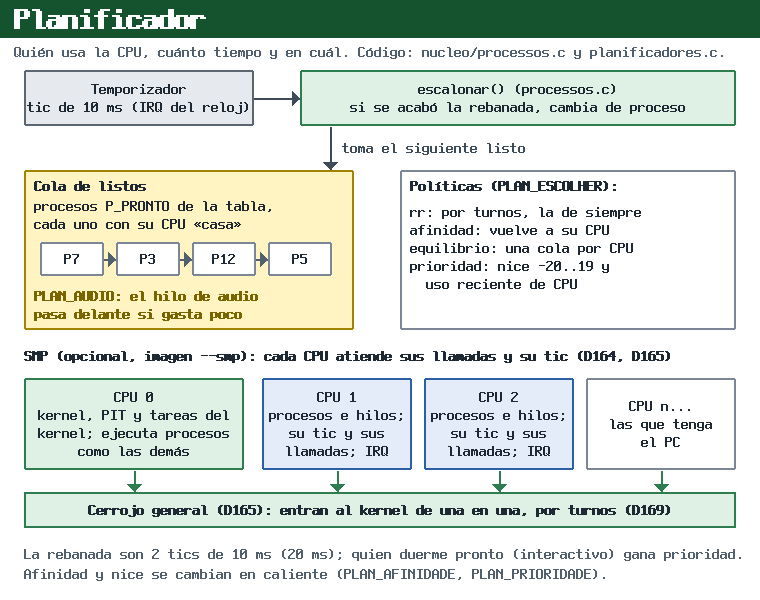

<!-- categoria: Conoce SaguiOS/Sistemas operativos; orden: 5; titulo: Escalonamento -->
# Escalonamento

[Español](05-planificacion.md) · [Português](05-planificacion_PT.md) · [English](05-planificacion_EN.md)

> Objetivo: entender como o núcleo decide qual processo usa a CPU e por quanto tempo, como o trabalho é dividido entre vários
> processadores e como se mede se a divisão é boa.

## 1. Teoria

### 1.1 O problema

Há mais processos prontos do que CPUs. Sempre que uma CPU fica livre, o **escalonador** decide qual processo executa a seguir.
Essas decisões têm objetivos conflitantes:

- **Justiça**: nenhum processo fica sem CPU.
- **Resposta**: um programa interativo (um teclado, uma janela) responde depressa.
- **Vazão**: a CPU faz muito trabalho e o cache continua quente.
- **Tempo real ou quase real**: um fluxo de áudio recebe a sua vez a tempo para não falhar.

### 1.2 Preempção e quantum

Um escalonador é **preemptivo** se pode tirar a CPU de um processo que não a cedeu. Ele se apoia no **temporizador**: a cada interrupção
de relógio o núcleo conta quanto tempo o processo rodou. Quando esgota o seu **quantum** (sua fatia de tempo), o núcleo o coloca de volta na
fila de prontos e escolhe outro.

- Quantum curto: boa resposta, mas mais trocas de contexto (cada troca tem um custo).
- Quantum longo: menos trocas, mas pior resposta.

O algoritmo básico é o **round-robin** (turnos circulares). Ele se combina com **prioridades** (valores que adiantam ou atrasam um
processo) ou com filas de vários níveis, como faz o Linux com o seu escalonador CFS ou os BSD com as suas filas.

### 1.3 Prioridades

Um processo com prioridade alta recebe a CPU antes. Para evitar a inanição (um processo de baixa prioridade que nunca executa), os
sistemas aumentam a prioridade dos que esperam há muito tempo (*aging*). No Unix, o valor **nice**, de -20 a 19, ajusta a prioridade:
quanto menor, maior a prioridade.

### 1.4 Multiprocessador

Com várias CPUs, o escalonador decide também **onde** cada processo executa:

- **Fila global**: todas as CPUs pegam de uma única lista. É simples, mas há disputa pela trava da lista.
- **Filas por CPU**: cada CPU tem a sua fila e a carga é periodicamente redistribuída (*load balancing*).
- **Afinidade**: um processo volta à CPU onde executou, porque o seu cache e os seus dados ainda estão lá.

O modelo **mestre/escravo** (o núcleo roda em apenas uma CPU) é o mais simples de validar. O modelo simétrico (SMP completo)
permite que o núcleo inteiro rode em várias CPUs ao mesmo tempo, com muito mais complexidade. Entre os dois há um ponto
intermediário muito usado: **todas as CPUs podem atender chamadas ao sistema, mas entram no núcleo uma de cada vez sob uma trava
geral** (o *big kernel lock* do Linux antigo). É o que o SaguiOS faz (capítulo 7).

### 1.5 Medir

Não basta que "pareça rápido". Mede-se:

- **Latência**: tempo desde que um processo está pronto até executar. É o que o usuário percebe.
- **Vazão** (*throughput*): trabalho concluído por unidade de tempo.
- **Justiça**: se a CPU repartida se aproxima da proporção pedida.

Benchmarks sintéticos (quantas operações por segundo) servem para comparar, mas os de latência (quanto tempo uma interação demora para
responder) descrevem melhor a experiência.

### 1.6 Algoritmos com um exemplo resolvido

Três processos chegam ao mesmo tempo com rajadas de CPU (o tempo de que precisam) de **P1 = 24**, **P2 = 3** e **P3 = 3** unidades de tempo.
Compara-se o tempo médio de espera (o tempo que cada processo passa sem CPU antes de terminar, sem contar o seu próprio trabalho).

**FCFS** (primeiro a chegar, primeiro a ser servido, sem preempção):

```
 P1                          P2   P3
 0                           24   27   30
```
Esperas: P1 = 0, P2 = 24, P3 = 27. Média = **17**. Um processo curto atrás de um longo espera muito: é o efeito comboio.

**SJF** (o de rajada mais curta primeiro, sem preempção):

```
 P2   P3   P1
 0    3    6                          30
```
Esperas: P2 = 0, P3 = 3, P1 = 6. Média = **3**. É ótimo para a espera média, mas precisa conhecer as rajadas futuras, que na prática são estimadas.

**Round-robin** com quantum de 4 unidades:

```
 P1   P2   P3   P1   P1   P1   P1   P1
 0    4    7    10   14   18   22   26   30
```
P2 termina em 7 (espera 7 - 3 = 4), P3 em 10 (espera 10 - 3 = 7) e P1 em 30 (espera 30 - 24 = 6). Média = (4 + 7 + 6) / 3 aprox. **5,7**.
É pior que o SJF na espera média, mas reparte a CPU e responde antes a cada processo que chega.

Mais um cálculo: se a troca de processo custa **s = 10 µs** e o quantum é **q**, a fração de CPU perdida é s / (q + s). Com q = 1 ms
são 10 / 1010 aprox. **1 %**; com q = 20 ms, 10 / 20010 aprox. **0,05 %**. Por isso o quantum não pode ser arbitrariamente curto.

### 1.7 Comparação: escalonadores reais

- **Linux** usa um escalonador de divisão justa (CFS, com o "tempo virtual" de cada tarefa), substituído nas versões recentes pelo EEVDF;
  para tempo real tem filas de prioridade fixa.
- **Windows** tem 32 níveis de prioridade e ajusta o quantum e a prioridade das threads interativas.
- **FreeBSD** usa filas por prioridade com o escalonador ULE, pensado para muitas CPUs.
- Todos combinam round-robin dentro de um mesmo nível com prioridades entre os níveis.

### 1.8 Mais políticas: filas múltiplas, envelhecimento e política versus mecanismo

- **Processos limitados por CPU ou por E/S.** Um processo que calcula quase sempre esgota o seu quantum; um interativo bloqueia
  cedo, esperando teclado ou disco. Um bom escalonador favorece os segundos: usam pouca CPU e qualquer atraso é muito perceptível.
- **Filas múltiplas com realimentação.** Há várias filas, da maior para a menor prioridade, com um quantum crescente (por exemplo
  1, 2, 4 e 8 unidades). Um processo entra na primeira e, cada vez que esgota o seu quantum, desce para a seguinte. Um que precisa
  de 15 unidades de CPU recebe 1 + 2 + 4 + 8 = 15 em apenas **4 turnos**, e não 15 turnos com quantum fixo de 1: há menos trocas
  de contexto e os processos interativos, que quase nunca esgotam o seu turno, ficam no alto.
- **Prever a rajada para o SJF.** Não se conhece a próxima rajada de CPU, então ela se estima com uma média que esquece o passado:
  *T seguinte = (rajada medida + T anterior) / 2*. Com uma estimativa inicial de 10 e rajadas medidas de 6, 4, 6 e 4, as estimativas
  são 8, 6, 6 e 5.
- **Envelhecimento.** Subir aos poucos a prioridade de quem espera há muito tempo impede que um processo de baixa prioridade nunca rode.
- **Política versus mecanismo.** O mecanismo (a fila, a troca de contexto, o valor `nice`) e a política (a quem cabe o turno) podem
  ser separados. O SaguiOS faz isso: o núcleo oferece o mecanismo e a política se escolhe entre quatro com o comando `planificador`.
- **Escalonamento garantido e de dois níveis.** No garantido, promete-se a cada um dos *n* processos 1/*n* da CPU e executa-se o que
  recebeu menos em relação ao prometido. No de dois níveis, um escalonador de baixo nível reparte a CPU entre os processos que estão
  na memória e outro, de alto nível, decide quais ficam na memória e quais são levados para o disco.

### 1.9 Quanta multiprogramação é necessária

Se cada processo passa uma fração *p* do seu tempo esperando a E/S, com *n* processos na memória a CPU fica ociosa só quando todos
esperam ao mesmo tempo (probabilidade *p* elevada a *n*, supondo que sejam independentes). A utilização é **1 - p^n**. Com *p* = 0,8:
um processo usa a CPU 20 % do tempo; dois, 36 %; quatro, **59 %**; oito, **83 %**. Por isso convém ter vários processos prontos, mas
cada um ocupa memória (capítulo 6): mais processos nem sempre é melhor.

## 2. Como o SaguiOS faz

- **Quantum.** `kernel/inc/processo.h` define `QUANTUM_TIQUES` como 2 ticks, ou seja 20 ms, com o relógio a 100 Hz (`kernel/inc/relogio.h`).
  O boot anuncia assim: "Procesos: round-robin cada 20 ms" (mensagem em espanhol).
- **Quatro políticas.** `kernel/nucleo/planificadores.c` as descreve no seu cabeçalho:
  - `rr`: round-robin global, o original e o padrão;
  - `afinidad` (afinidade): cada processo volta à sua CPU, e outra CPU só o pega se ele estiver há `FRIO_TIQUES` (30 ms) sem executar;
  - `equilibrio` (equilíbrio): uma fila por CPU e redistribuição a cada `PERIODO_EQUILIBRIO` (50 ms);
  - `prioridad` (prioridade): cada processo tem um `nice` (-20 a 19) e o seu uso recente.

  Escolhe-se no boot (`mkimagem.py --planificador`, bits do cabeçalho de boot) e ao vivo com o comando `planificador`
  (`userland/programas/planificador.c`), que mostra a política ativa e a sua explicação.
- **Prioridade de áudio.** A decisão **D436** acrescenta `PLAN_AUDIO` (`kernel/inc/abi.h`): uma thread marcada que fica pronta passa
  na frente das outras, com qualquer política, e se a sua CPU estiver executando outro processo, pede-se que escalone já. Só enquanto
  gasta pouco: `PLAN_AUDIO_MAX_USO` vale 5 ticks por período de cerca de 250 ms, então uma thread que monopoliza a CPU volta a
  revezar-se. Não é preciso ser administrador. O campo `prio_audio` de `processo_t` o guarda.
- **Nice.** `PLAN_PRIORIDADE` muda o `nice` de um processo (-20 a 19) e `PLAN_INFO` o consulta (`kernel/inc/abi.h`). Só conta na
  política `prioridad`.
- **Várias CPUs.** O SMP é opcional (imagem `--smp`, decisão D164). Com ele, **cada CPU executa processos e atende as suas próprias
  chamadas ao sistema, falhas e IRQs** (decisão D165), mas elas entram no núcleo uma de cada vez, sob a trava geral de
  `kernel/nucleo/trava_geral.c` (capítulo 7). A CPU 0 também executa processos, leva o tique do PIT e é a única que roda as tarefas
  do kernel. Enquanto uma CPU tem um processo escolhido (`na_cpu`), nenhuma outra o leva, e uma CPU ociosa dorme com `hlt` até que
  outra lhe mande uma IPI de despertar. As IRQs dos dispositivos são repartidas entre as CPUs secundárias (decisão D168). A escolha
  da CPU de cada processo está em `kernel/nucleo/planificadores.c`, que também trata a topologia SMT (as duas threads do mesmo núcleo
  físico) (decisão D174).
- **Medir.** `userland/programas/benchmark.c` mede desempenho monoprocessador e multiprocessador com uma pontuação (decisão D176).
  Para ver a carga ao vivo: `top` (mostra CPU e memória) e o Administrador de tarefas.




### 2.1 Decisões, alternativas e limites atuais

- **Decisão: quatro políticas selecionáveis.** A decisão **D174** permite escolher entre `rr`, `afinidad`, `equilibrio` e `prioridad`, no boot e ao vivo.
  Assim a mesma máquina pode ser usada para comparar as políticas em aula.
- **Decisão: prioridade de áudio sem privilégios.** A decisão **D436** acrescenta `PLAN_AUDIO`, limitado pelo uso, para que uma thread que mistura som
  não seja cortada sem que ninguém precise ser administrador.
- **Decisão: SMP opcional com trava geral.** A decisão **D164** só liga as CPUs secundárias quando pedido; a **D165** deixa cada CPU
  atender as suas chamadas sob uma trava geral (com turnos por ordem de chegada desde a **D169**). Substituiu o modelo mestre/escravo
  da D164, no qual as secundárias devolviam à CPU 0 tudo o que o núcleo precisava.
- **Limite: não há garantias de tempo real.** O `PLAN_AUDIO` melhora a resposta, mas não garante prazos (um sistema de tempo real os garante com uma análise prévia).
- **Limite: o `nice` só conta na política `prioridad`.** As outras políticas o ignoram.
- **Limite: medir é caro.** O benchmark (D176) mede vazão, não a latência de cada interação. Um estudo de latência precisaria de traces do escalonador,
  que o curso não inclui.

## 3. Experimento no SaguiOS

1. Digite `planificador`. Você verá a política ativa (por exemplo `rr`) e a lista das quatro com a sua explicação.
2. Abra o `top` e deixe-o por um momento. Use `top -n 3 -b` para uma saída fixa de três rodadas. Anote qual processo usa mais CPU.
3. Rode o benchmark com `benchmark` e anote a pontuação. Repita com outra política (se a imagem foi iniciada com `--smp`, o `planificador`
   permite trocar ao vivo) e compare.
4. Use `ps -c` para ordenar por CPU e compare com o `top`.

**O que observar:** com dois programas trabalhando ao mesmo tempo, cada um recebe metade da CPU, em turnos de 20 ms. Se você abrir um programa
interativo nesse meio-tempo, ele responde em poucos turnos: essa é a latência de que fala a teoria.

**Exercício prático adicional.** Com os processos P1 = 5, P2 = 2 e P3 = 8 (todos chegam no instante 0), desenhe no papel os diagramas de Gantt
de FCFS, de SJF e de round-robin com quantum 2. Calcule a espera média de cada um. Depois, no SaguiOS, inicie três programas de longa duração
(por exemplo `sleep 60 &` três vezes) e confira com `top` que eles dividem a CPU. Explique por que a divisão real não é igual à do papel.

## 4. Perguntas de revisão

1. Se o quantum é de 20 ms e há três processos prontos sem prioridades, quanto um processo espera no máximo antes de voltar a executar?
2. Por que um escalonador de afinidade pode ser mais rápido que um de fila global, mesmo dividindo a carga pior?
3. Um reprodutor de áudio perde amostras quando outro programa usa muita CPU. Explique como o `PLAN_AUDIO` ajuda e por que ele é limitado pelo uso.
4. O que você mediria para decidir se uma política é melhor que outra: o tempo médio de execução, a latência ou a vazão? Justifique.
5. Três processos chegam ao mesmo tempo com rajadas 10, 1 e 1. Qual a espera média com FCFS e com SJF? Explique por que o FCFS é ruim aqui.
6. Com trocas de processo de 10 µs e quantum de 1 ms, que fração da CPU é perdida? E com quantum de 20 ms?
7. Com *p* = 0,6, que utilização da CPU dá a multiprogramação com 3 processos? E com 6?
8. Com filas múltiplas (quantum 1, 2, 4, 8 e 16), de quantos turnos precisa um processo que pede 40 unidades de CPU? E com quantum
   fixo de 1?

## 5. Respostas

1. Com três processos prontos e turnos de 20 ms, cada um espera os turnos dos outros dois: no máximo 40 ms antes de voltar a executar
   (round-robin, sem prioridades).
2. Mantém o cache quente: um processo que volta à mesma CPU encontra os seus dados. O custo da divisão é menor. Mas pode deixar uma CPU ociosa
   se a divisão for desigual, por isso existe o roubo de trabalho após `FRIO_TIQUES`.
3. O `PLAN_AUDIO` faz a thread de áudio passar na frente. É limitado pelo uso porque, senão, um programa poderia monopolizar a CPU pedindo sempre
   essa prioridade. Sem limite não seria justo.
4. Depende do objetivo. Para um sistema interativo importa a latência; para computação em lote, a vazão. O tempo médio sozinho oculta os picos
   que o usuário percebe, por isso é bom medir as duas coisas.
5. FCFS: P1 (10) primeiro, depois P2 e P3. Esperas 0, 10 e 11: média = 7. SJF: P2 (0), P3 (1), P1 (2): esperas 0, 1 e 2, média = 1. O FCFS é ruim porque os
   processos curtos esperam atrás de um longo (efeito comboio).
6. Com 1 ms: 10 / (1000 + 10) aprox. 1 %. Com 20 ms: 10 / (20000 + 10) aprox. 0,05 %. Um quantum curto melhora a resposta mas custa mais CPU; por isso se escolhe um
   compromisso (o SaguiOS usa 20 ms).
7. Com 3 processos: 1 - 0,6³ = 1 - 0,216 = **78,4 %**. Com 6: 1 - 0,6^6 aprox. 1 - 0,047 = **95,3 %**. Cada processo extra rende menos.
8. Os quantums 1, 2, 4, 8 e 16 somam 31; faltam 9, que cabem num sexto turno (na fila de 32): **6 turnos**. Com quantum fixo de 1 são
   40 turnos, ou seja, 34 trocas de contexto a mais.
