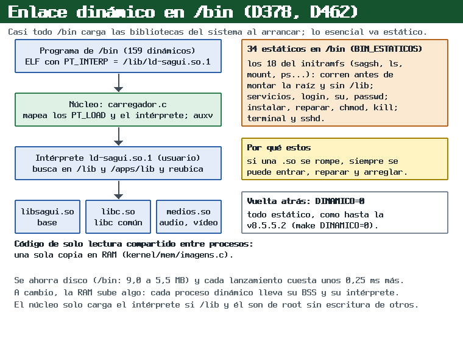
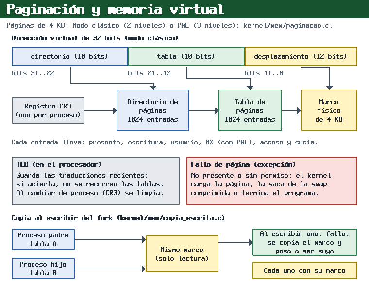
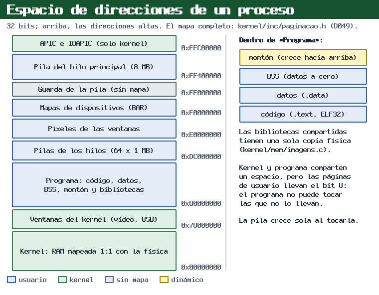

<!-- categoria: Conoce SaguiOS/Sistemas operativos; orden: 6; titulo: Memoria -->
# Memoria

[Español](06-memoria.md) · [Português](06-memoria_PT.md) · [English](06-memoria_EN.md)

> Objetivo: entender cómo cada proceso ve su propia memoria, cómo la traduce el procesador, qué pasa cuando falta
> memoria y cómo se comparten las bibliotecas.

## 1. Teoría

### 1.1 Espacio de direcciones virtual

Cada proceso cree que tiene toda la memoria para él: direcciones de 0 a 4 GB en un x86 de 32 bits. Esas direcciones son
**virtuales**. El procesador las traduce a **direcciones físicas** (la RAM real) usando una tabla que mantiene el
núcleo. Así se consiguen tres cosas:

- **Aislamiento**: un proceso no puede escribir en las direcciones físicas de otro, porque no las ve.
- **Flexibilidad**: el núcleo puede colocar las páginas donde quiera, incluso en un orden distinto al virtual.
- **Compartir**: dos procesos pueden tener una página en común (por ejemplo, el código de una biblioteca).

### 1.2 Paginación

La memoria se divide en **páginas** de tamaño fijo (4 KB en x86). La tabla de páginas asigna a cada página virtual un
marco físico y unos bits de permiso (presente, escritura, usuario, no ejecutable). En x86 de 32 bits la tabla es de dos
niveles: un **directorio** de 1024 entradas apunta a tablas de 1024 entradas, cada una con una página.

Con **PAE** (*Physical Address Extension*) la dirección física pasa de 32 a 36 bits o más, con tablas de tres niveles y
entradas de 64 bits. Permite usar más de 4 GB de RAM física, y añade el bit **NX** (*no execute*): una página de datos no
se puede ejecutar. Es la base de la protección contra código inyectado en datos.

### 1.3 TLB y el coste de traducir

Recorrer las tablas en cada acceso sería demasiado lento. El procesador guarda las traducciones recientes en la **TLB**
(*translation lookaside buffer*). Al cambiar de proceso, la TLB se vacía (cambio del registro `CR3`). Por eso el
núcleo intenta evitar vaciados innecesarios: las páginas **globales** del propio núcleo se marcan para que
sobrevivan al cambio, y tras cambiar una entrada se invalida solo esa (`invlpg`).

### 1.4 Fallo de página

Si el procesador no encuentra una página presente, o un permiso no se cumple, lanza una **excepción de fallo de página**
(vector 14). El núcleo decide qué hacer:

- Página que nunca se ha cargado (**carga bajo demanda**): la asigna y sigue.
- Página escrita tras un `fork` compartida (**copia al escribir**): la copia y sigue.
- Página que no existe ni se puede crear: error del programa (violación de segmento).
- Página que estaba en disco (**paginación a disco**): la lee y sigue.

### 1.5 Montón, pila y segmentos

Dentro del espacio de un proceso: el **código** y los **datos** vienen del ejecutable; la **pila** crece hacia abajo
para las llamadas; el **montón** (*heap*) crece hacia arriba para `malloc`. Un asignador como `malloc` reparte bloques
pequeños de páginas grandes, con tamaños en clases para no fragmentar demasiado.

### 1.6 Sin memoria: reemplazo y swap

Cuando no hay RAM libre, el núcleo elige una página que sacar: LRU (la menos usada recientemente) es la aproximación
clásica. Puede escribirla en **disco** (*swap*) o, como alternativa, **comprimirla en RAM**, que es más rápido que el disco.

### 1.7 Bibliotecas compartidas y enlace dinámico

Una biblioteca compartida (`.so` en Linux, `.dll` en Windows) tiene una sola copia de su código en memoria, mapeada en
todos los procesos que la usan. En el **enlace estático** el código se copia dentro de cada ejecutable. En el
**enlace dinámico** el ejecutable busca sus símbolos al arrancar (el *dynamic linker*), o con `dlopen`, en tiempo de
ejecución. Ahorra memoria, a costa de más arranque y de una capa más de seguridad.

### 1.8 Cálculo: el tamaño de las tablas de páginas en 32 bits

Con páginas de 4 KB, un espacio de 4 GB tiene 2³² / 2¹² = **2^20 páginas** (un millón). Una tabla plana con una entrada de
4 bytes por página ocupa 2^20 × 4 = **4 MB por proceso**, aunque el programa use 100 KB. La tabla de dos niveles lo reduce:
un directorio de 1024 entradas × 4 bytes = **4 KB**, y cada tabla de segundo nivel (también 4 KB) solo existe si hay
páginas usadas en su zona de 4 MB. Un programa de 2 MB (código, datos y pila en zonas separadas) necesita el directorio
más unas tres tablas: unos **16 KB** en total, frente a 4 MB.

### 1.9 Cálculo: tiempo efectivo de acceso con TLB

Supón que consultar la TLB cuesta **1 ns**, un acceso a la RAM **100 ns** y que un fallo de TLB requiere dos accesos a
las tablas (dos niveles) antes del acceso al dato. Un acierto cuesta 1 + 100 = 101 ns. Un fallo cuesta 1 + 2 × 100 + 100 =
301 ns. Con una tasa de aciertos *h*, el tiempo medio es:

- h = 0,98: 0,98 × 101 + 0,02 × 301 = **105 ns**;
- h = 0,90: 0,90 × 101 + 0,10 × 301 = **121 ns**.

Es decir, pasar de un 98 % a un 90 % de aciertos encarece el acceso casi un 15 %. Por eso la TLB es tan importante y por
qué se cuidan los cambios de proceso (apartado 1.3).

### 1.10 Ejemplo: reemplazo de páginas con 3 marcos

Cadena de referencias: **7, 0, 1, 2, 0, 3, 0, 4**, con 3 marcos de memoria. Un fallo es una referencia a una página que no
está en memoria.

| Referencia | 7 | 0 | 1 | 2 | 0 | 3 | 0 | 4 |
| --- | --- | --- | --- | --- | --- | --- | --- | --- |
| FIFO (sale la más antigua) | 7 | 7,0 | 7,0,1 | 0,1,2 | (acierto) | 1,2,3 | 2,3,0 | 3,0,4 |
| LRU (sale la menos usada recientemente) | 7 | 7,0 | 7,0,1 | 0,1,2 | 1,2,0 | 2,0,3 | 2,3,0 | 3,0,4 |

Fallos: **FIFO = 7** y **LRU = 6**. LRU acierta más porque la referencia 0 se usa a menudo, pero exige saber el orden de uso
en cada acceso, algo caro. El **reloj** (*clock*, o segunda oportunidad) es la aproximación barata: una página con bit de
referencia activo recibe otra oportunidad antes de salir.

### 1.11 Ejemplo: asignación de bloques de memoria y fragmentación

Huecos libres: 120, 400, 220 y 300 KB. Llega una petición de **210 KB**. Con *first fit* (el primer hueco que basta) se
elige el de 400 KB (sobran 190). Con *best fit* (el más ajustado) se elige el de 220 KB (sobran 10: un hueco casi inútil,
es fragmentación). Con *worst fit* (el mayor) se elige también el de 400 KB. La fragmentación externa es la memoria libre
repartida en huecos que no sirven para nada grande; la interna es el espacio sobrante dentro de un bloque asignado.

### 1.12 Más sobre el reemplazo: el óptimo, NRU y la anomalía de Belady

- **Óptimo.** Saca la página que tardará más en usarse. No se puede construir (exige conocer el futuro), pero sirve de
  cota para medir a los demás.
- **NRU (no usada recientemente).** El hardware pone un bit **R** (referenciada) al leer o escribir una página y un bit
  **M** (modificada) al escribirla; en x86 se llaman *accessed* y *dirty*. El sistema borra R cada cierto tiempo. Con R y M
  hay cuatro clases (0: ni R ni M; 1: solo M; 2: solo R; 3: R y M) y sale una de la clase más baja que no esté vacía. Es una
  aproximación barata del LRU.
- **Anomalía de Belady.** Con FIFO, más marcos pueden dar *más* fallos. Con la cadena 1, 2, 3, 4, 1, 2, 5, 1, 2, 3, 4, 5, FIFO
  da **9** fallos con 3 marcos y **10** con 4. El LRU y el óptimo no tienen esa anomalía: con 3 marcos dan 10 y 7 fallos, y
  con 4, 8 y 6.

### 1.13 Conjunto de trabajo e hiperpaginación

El **conjunto de trabajo** de un proceso son las páginas que ha usado en sus últimas referencias (o en su último intervalo
de tiempo). Mientras esas páginas estén en RAM, el proceso casi no falla. Si la suma de los conjuntos de trabajo de todos
los procesos no cabe, cada fallo expulsa una página que se necesitará enseguida: el sistema se pasa el tiempo moviendo
páginas y no avanza (**hiperpaginación**, *thrashing*). Las salidas son suspender procesos (bajar el grado de
multiprogramación) o dar más memoria. Además hay dos políticas: reemplazo **local** (cada proceso pierde sus propias
páginas) o **global** (se elige entre todas); la global se adapta mejor a las necesidades de cada uno, pero un proceso
voraz puede perjudicar a los demás.

Un fallo es carísimo comparado con un acceso. Si un acceso normal cuesta 100 ns y un fallo con disco 8 ms, una tasa de un
fallo cada 10 000 accesos (*p* = 10^-4) da un tiempo medio de 100 + 10^-4 × 8 000 000 aprox. **900 ns**: nueve veces más lento. Si el
fallo se resuelve descomprimiendo una página de RAM en unos 20 µs (cifras ilustrativas, como en SaguiOS con su swap
comprimida), el medio es 100 + 10^-4 × 20 000 = **102 ns**.

### 1.14 Tamaño de página, segmentación y tablas invertidas

- **Tamaño de página.** Páginas pequeñas desperdician poco en la última página de cada región (fragmentación interna), pero
  necesitan tablas mayores. Con un proceso de tamaño medio *s* y *e* bytes por entrada de tabla, el tamaño que minimiza el
  desperdicio total es raiz(2·*s*·*e*). Con *s* = 1 MB y *e* = 8 bytes sale raiz(16 777 216) = **4096 bytes**: el 4 KB que usa x86.
- **Segmentación.** En vez de un espacio lineal, el proceso tiene varios segmentos (código, datos, pila...), cada uno con su
  base, su límite y sus permisos. El x86 de 32 bits tiene segmentos y paginación; SaguiOS usa el modelo **plano** (todos los
  segmentos empiezan en 0 y cubren 4 GB: `kernel/arch/gdt.c`) y deja la protección a la paginación.
- **Tabla de páginas invertida.** Con espacios de 64 bits la tabla por proceso es demasiado grande; una tabla con una entrada
  por *marco físico* y una búsqueda por hash lo evita, a costa de buscar en cada fallo de TLB. No se usa en x86.

### 1.15 Llevar la cuenta de la memoria: mapa de bits y sistema de asociados

- **Mapa de bits.** Un bit por unidad de asignación (1 = ocupada). Con 1 GiB de RAM y páginas de 4 KiB hay 262 144 páginas, es
  decir, un mapa de **32 KiB**. Es sencillo, pero buscar un hueco de *n* páginas seguidas obliga a recorrer el mapa. Es lo que usa
  `kernel/mem/fisica.c` para las páginas físicas (apartado 2).
- **Lista de huecos.** Una lista enlazada de zonas libres y ocupadas (apartado 1.11): rápida de recorrer si hay pocos huecos.
- **Sistema de asociados (*buddy*).** La memoria se parte siempre en bloques de potencia de 2, y un bloque libre se divide por la
  mitad hasta tener el tamaño que se pide. Una petición de 70 KB sobre un bloque de 1024 KB lo divide en 512, 256 y 128: se
  entrega uno de **128 KB** (sobran 58 KB de fragmentación interna) y, al liberarlo, si su «gemelo» está libre, se funden de nuevo.
  Reunir bloques es muy rápido, a costa de ese desperdicio.

## 2. Así lo hace SaguiOS

- **Memoria física.** `kernel/mem/fisica.c` lleva un **mapa de bits** (un bit por página: 1 = ocupada) en tres zonas
  (decisiones D008 y D348). La función `memfisica_alocar` reserva una página libre.
- **Asignador del kernel.** `kernel/mem/heap.c` implementa `kmalloc` y `kfree`: bloques pequeños en clases de tamaño y
  bloques grandes en páginas enteras.
- **Paginación y PAE.** `kernel/mem/paginacao.c` implementa la paginación clásica y el **PAE**, con doble modo
  (decisiones D010, D049 y D349). El PAE soporta hasta 64 GB de RAM física y el bit NX. La frontera entre el núcleo y
  los programas está en 2 GB (decisión D049).
- **Memoria alta.** `kernel/mem/memalta.c` abre ventanas temporales para escribir en páginas físicas que no están
  mapeadas en el espacio del núcleo (decisión D348).
- **Copia al escribir.** `kernel/mem/copia_escrita.c` cuenta las referencias de las páginas compartidas por un `fork`
  (decisión D401). Es el capítulo 4 en la práctica: `fork` seguido de `exec` casi no copia.
- **Swap comprimida en RAM.** `kernel/mem/troca.c` y `kernel/mem/compressor.c`: cuando falta memoria, la página se
  comprime en la propia RAM en vez de escribirse a disco (decisión D352).
- **Pilas que crecen.** `kernel/nucleo/pilha.c` (decisión D186): la pila de usuario crece bajo demanda con una página
  de guarda.
- **Bibliotecas compartidas.** `kernel/mem/imagens.c` comparte entre procesos las páginas de solo lectura de cada
  biblioteca (fase 3 del enlace dinámico, decisión D378): un objeto por fichero, con cuenta de referencias y comparación byte
  a byte; lo escribible (datos, tabla GOT, BSS) es privado de cada proceso, así que no hace falta copia al escribir.
- **Enlace dinámico.** `userland/libdl/ld_sagui.c` y `ligador.c` forman el intérprete `/lib/ld-sagui.so.1`, que carga las
  bibliotecas de un ejecutable con `PT_INTERP` y atiende `dlopen` y `dlsym` (fases 1 y 2, decisión D378). Con la fase 3b
  (decisión **D462**) el enlace dinámico es de serie (`DINAMICO=1`): 159 programas de `/bin` se enlazan contra
  `/lib/libsagui.so.1`, `/lib/libc.so.1` y `/lib/libsagui_medios.so.1`, y 34 esenciales (los del initramfs, `login`, `su`,
  `chmod`, `kill`, `terminal`, `sshd`...) siguen siendo estáticos para poder reparar aunque falle una `.so`. `/bin` pasa de
  9,0 a 5,5 MB y cada lanzamiento cuesta unos 0,25 ms más; la RAM de la sesión sube unos 0,5 MB en reposo y unos 3 MB con ocho
  programas de ventana, porque cada proceso lleva su intérprete y su BSS. `make DINAMICO=0` vuelve a todo estático.

### 2.1 Decisiones, alternativas y límites actuales

- **Decisión: tres zonas de memoria física.** La decisión **D008** y la **D348** separan la zona baja, la alta (memoria alta
  para ventanas temporales) y la superior (con PAE, la RAM por encima de 4 GB). Cada zona tiene su mapa de bits
  (`kernel/mem/fisica.c`).
- **Decisión: PAE con doble modo.** La decisión **D349** soporta hasta 64 GB de RAM física y el bit NX. Un ordenador de 32
  bits antiguo sigue usando el modo clásico.
- **Decisión: la frontera en 2 GB.** La decisión **D049** reparte el espacio de cada proceso con el núcleo; un proceso no ve
  más de unos 2 GB de RAM gestionada. Es el límite práctico de la versión.
- **Decisión: swap comprimida en RAM.** La decisión **D352** comprime las páginas en la propia RAM (al estilo de zram) en
  vez de escribirlas a un disco; elige la víctima con un reloj de segunda oportunidad sobre las tablas de páginas
  (`kernel/mem/troca.c`).
- **Decisión: `/bin` dinámico de serie.** La decisión **D462** ahorra disco y deja los esenciales estáticos; el precio es
  algo más de RAM por proceso. Se puede deshacer con `DINAMICO=0`.
- **Límite: no hay ASLR.** La disposición de direcciones de los programas es fija. El plan de enlace dinámico lo deja como
  fase opcional (`docs/enlace-dinamico.md`, apartado 9). Linux y Windows lo aleatorizan para dificultar los ataques de
  desbordamiento.
- **Límite: el proceso sigue viendo 4 GB.** Con PAE el sistema tiene más RAM, pero cada proceso sigue con un espacio de 32
  bits. Para más de 4 GB por programa haría falta 64 bits, que SaguiOS no usa.

## 3. Experimento en SaguiOS

1. Escribe `mem`. Verás la RAM total según E820, la que gestiona el núcleo, la usada y la libre, y la zona baja y alta.
   Compara la cifra «Gestionada por el kernel» con la RAM total.
2. Escribe `free -h` para la vista legible de memoria, y `ps -s` para ordenar los procesos por memoria. El proceso que
   más ocupa aparece primero.
3. Escribe `top -o mem -n 2 -b` y compara la columna de memoria entre dos vueltas.
4. Abre **Información del PC** (Inicio > Sistema) y busca los datos de memoria.

**Qué observar:** la RAM «libre» casi nunca es la RAM total menos lo visible en `ps`: parte la usa el propio núcleo,
y la zona alta se reserva aparte. Esa diferencia es la que explica el reemplazo y la swap.

**Ejercicio práctico adicional.** Calcula, en papel, cuánta memoria ocupa la tabla de páginas plana de un proceso de
32 bits con páginas de 4 KB, y la de dos niveles de un programa de 300 KB. Después ejecuta `mem` y `ps -s` en SaguiOS y
compara la memoria del programa más grande con tu cálculo del tamaño de sus datos. Explica la diferencia (la memoria del
núcleo, las bibliotecas y la pila no son el código del programa).

## 4. Preguntas de repaso

1. ¿Qué ventaja tiene la memoria virtual para la protección? Da un caso concreto de un error que evita.
2. Explica con tus palabras qué pasa en un fallo de página de copia al escribir y por qué es más barato que copiar todo
   en el `fork`.
3. ¿Por qué la TLB se vacía al cambiar de proceso, y qué hace el núcleo para evitar vaciarla de más?
4. Un sistema tiene 512 MB de RAM y los programas piden 600 MB en total. ¿Qué mecanismos pueden permitir que funcione?

5. Con una tasa de aciertos de 95 %, 1 ns de TLB, 100 ns de RAM y un fallo de dos niveles, ¿cuál es el tiempo medio? Compara
   con 99 %.
6. Con la cadena de referencias 1, 2, 3, 1, 4, 2 y 3 marcos, cuenta los fallos de FIFO y de LRU.
7. Huecos de 150, 350, 500 y 250 KB; llega una petición de 240 KB. ¿Qué hueco elige *first fit* y cuál *best fit*? ¿Qué
    espacio sobra en cada caso?
8. Con la cadena 1, 2, 3, 4, 1, 2, 5, 1, 2, 3, 4, 5 y FIFO, ¿cuántos fallos hay con 3 marcos y con 4? ¿Qué anomalía ocurre?
9. Un proceso tiene 2 MB de tamaño medio y la tabla de páginas gasta 4 bytes por entrada. ¿Qué tamaño de página minimiza el
   desperdicio según la fórmula del apartado 1.14?
10. Un sistema pasa casi todo su tiempo paginando y la CPU está ociosa. ¿Qué ocurre y qué dos medidas pueden corregirlo?

## 5. Soluciones

1. Un programa no puede leer ni escribir la memoria de otro, porque sus direcciones virtuales apuntan a otras páginas
   físicas. Evita, por ejemplo, que un puntero mal calculado corrompa el proceso vecino.
2. El `fork` marca las páginas como de solo lectura y compartidas. Solo la primera escritura provoca la copia de esa
   página. Así `fork` seguido de `exec` no copia casi nada.
3. Porque las traducciones son de un espacio de direcciones concreto; cambiar `CR3` las invalidaría. El núcleo marca las
   páginas globales del núcleo para que no salgan de la TLB y usa `invlpg` para invalidar solo una entrada.
4. Puede comprimir páginas en RAM (SaguiOS usa la swap comprimida, D352), o sacar páginas a disco y recargarlas bajo
   demanda. También puede compartir bibliotecas para no duplicar su código.

### Respuestas a las preguntas adicionales

5. Con 95 %: 0,95 × 101 + 0,05 × 301 = 96,0 + 15,1 = **111 ns**. Con 99 %: 0,99 × 101 + 0,01 × 301 = 100 + 3,0 = **103 ns**.
   Subir del 95 % al 99 % reduce el tiempo cerca del 7 %.
6. FIFO: 1, 2 y 3 fallan y llenan los marcos; 1 acierta; 4 falla y saca la más antigua (1): quedan 2, 3, 4; 2 y 3 aciertan.
    Total: **4 fallos**. LRU: 1, 2 y 3 fallan; 1 acierta y pasa a ser la más reciente; 4 saca la menos usada (2); 2 falla y
    saca 3; 3 falla y saca 1. Total: **6 fallos**. Aquí FIFO gana a LRU: LRU no es siempre el mejor, solo suele serlo
    cuando el pasado predice el futuro.
7. *First fit*: 350 KB (el primer hueco que basta; sobran 110 KB). *Best fit*: 250 KB (el más ajustado; sobran 10 KB).
    Es un ejemplo del compromiso: best fit deja huecos pequeños inútiles (fragmentación externa), first fit es más rápido.
8. **9** fallos con 3 marcos y **10** con 4: la anomalía de Belady (más memoria, más fallos); solo ocurre en algoritmos como
   FIFO, no en LRU ni en el óptimo.
9. raiz(2 × 2 097 152 × 4) = raiz(16 777 216) = **4096 bytes**, es decir, páginas de 4 KB.
10. Es hiperpaginación: los conjuntos de trabajo no caben y cada fallo expulsa una página que se necesita enseguida, de modo que
    el tiempo se va en mover páginas (la CPU espera al disco). Se corrige suspendiendo procesos (menos multiprogramación) o
    dando más memoria.
