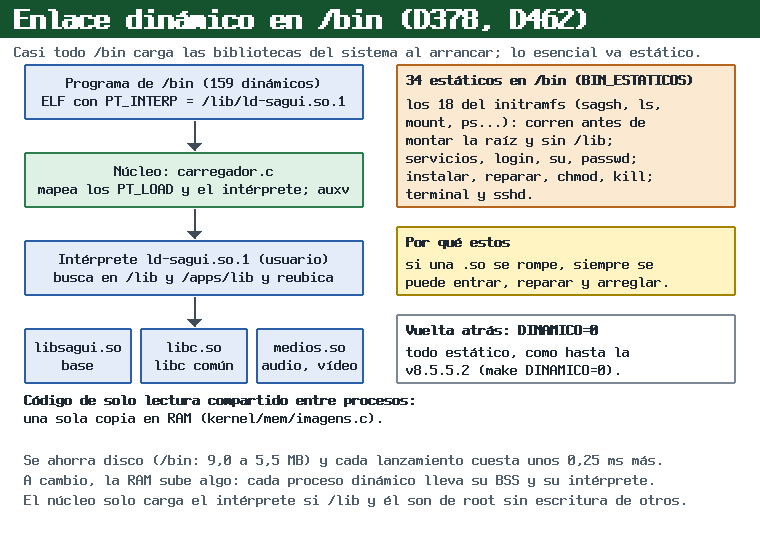
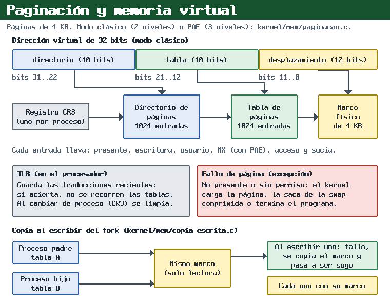
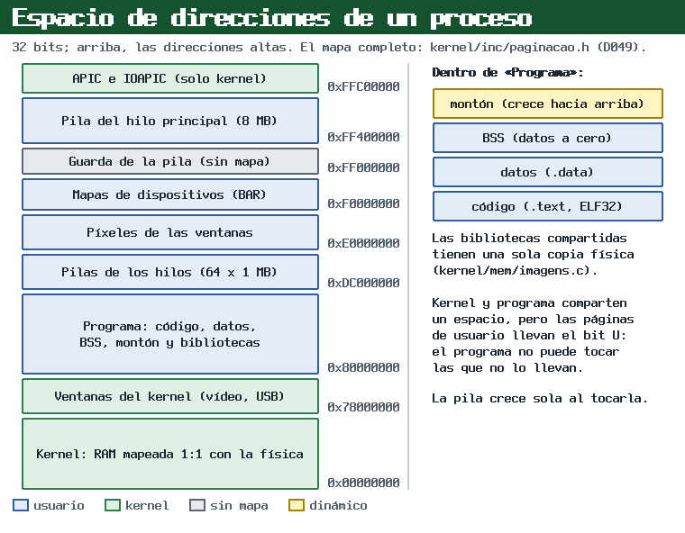

<!-- categoria: Conoce SaguiOS/Sistemas operativos; orden: 6; titulo: Memory -->
# Memory

[Español](06-memoria.md) · [Português](06-memoria_PT.md) · [English](06-memoria_EN.md)

> Goal: understand how each process sees its own memory, how the processor translates it, what happens when memory runs
> short, and how libraries are shared.

## 1. Theory

### 1.1 Virtual address space

Each process believes it has all the memory for itself: addresses from 0 to 4 GB on a 32-bit x86. Those addresses are
**virtual**. The processor translates them into **physical addresses** (the real RAM) using a table maintained by the
kernel. This achieves three things:

- **Isolation**: a process cannot write to the physical addresses of another, because it does not see them.
- **Flexibility**: the kernel can place pages wherever it wants, even in a different order from the virtual one.
- **Sharing**: two processes can have a page in common (for example, the code of a library).

### 1.2 Paging

Memory is divided into **pages** of fixed size (4 KB on x86). The page table assigns each virtual page a physical frame
and some permission bits (present, writable, user, non-executable). On 32-bit x86 the table has two levels: a **directory**
of 1024 entries points to tables of 1024 entries, each with a page.

With **PAE** (*Physical Address Extension*) the physical address grows from 32 to 36 bits or more, with three-level tables
and 64-bit entries. It allows more than 4 GB of physical RAM, and it adds the **NX** (*no execute*) bit: a data page
cannot be executed. It is the basis of protection against code injected into data.

### 1.3 TLB and the cost of translating

Walking the tables on every access would be too slow. The processor keeps recent translations in the **TLB**
(*translation lookaside buffer*). When switching processes, the TLB is emptied (change of the `CR3` register). That is why
the kernel tries to avoid unnecessary flushes: the kernel's own **global** pages are marked so that they survive the
change, and after changing one entry only that one is invalidated (`invlpg`).

### 1.4 Page fault

If the processor does not find a present page, or a permission is not met, it raises a **page fault exception** (vector
14). The kernel decides what to do:

- A page that was never loaded (**demand loading**): it allocates it and continues.
- A page written after a `fork` that was shared (**copy-on-write**): it copies it and continues.
- A page that does not exist and cannot be created: program error (segmentation violation).
- A page that was on disk (**paging to disk**): it reads it and continues.

### 1.5 Heap, stack and segments

Inside a process's space: the **code** and the **data** come from the executable; the **stack** grows downwards for calls;
the **heap** grows upwards for `malloc`. An allocator such as `malloc` hands out small blocks from large pages, with size
classes so as not to fragment too much.

### 1.6 Without memory: replacement and swap

When there is no free RAM, the kernel chooses a page to remove: LRU (the least recently used) is the classic
approximation. It can write it to **disk** (*swap*) or, as an alternative, **compress it in RAM**, which is faster than
disk.

### 1.7 Shared libraries and dynamic linking

A shared library (`.so` in Linux, `.dll` in Windows) has a single copy of its code in memory, mapped into every process that
uses it. In **static linking** the code is copied into each executable. In **dynamic linking** the executable looks up its
symbols when it starts (the *dynamic linker*), or with `dlopen`, at run time. It saves memory, at the cost of more start-up
work and one more layer of security concerns.

### 1.8 Calculation: the size of page tables in 32 bits

With 4 KB pages, a 4 GB space has 2³² / 2¹² = **2^20 pages** (one million). A flat table with one 4-byte entry per page takes
2^20 × 4 = **4 MB per process**, even if the program uses 100 KB. The two-level table reduces it: a directory of 1024 entries
× 4 bytes = **4 KB**, and each second-level table (also 4 KB) exists only if there are pages in use in its 4 MB zone. A
2 MB program (code, data and stack in separate zones) needs the directory plus about three tables: roughly **16 KB** in
total, instead of 4 MB.

### 1.9 Calculation: effective access time with a TLB

Suppose a TLB lookup costs **1 ns**, a RAM access **100 ns**, and a TLB miss requires two accesses to the tables (two
levels) before the access to the data. A hit costs 1 + 100 = 101 ns. A miss costs 1 + 2 × 100 + 100 = 301 ns. With a hit
rate *h*, the average time is:

- h = 0.98: 0.98 × 101 + 0.02 × 301 = **105 ns**;
- h = 0.90: 0.90 × 101 + 0.10 × 301 = **121 ns**.

So going from 98 % to 90 % hits makes access about 15 % slower. That is why the TLB matters so much, and why process switches
are watched (section 1.3).

### 1.10 Example: page replacement with 3 frames

Reference string: **7, 0, 1, 2, 0, 3, 0, 4**, with 3 frames of memory. A fault is a reference to a page that is not in
memory.

| Reference | 7 | 0 | 1 | 2 | 0 | 3 | 0 | 4 |
| --- | --- | --- | --- | --- | --- | --- | --- | --- |
| FIFO (the oldest leaves) | 7 | 7,0 | 7,0,1 | 0,1,2 | (hit) | 1,2,3 | 2,3,0 | 3,0,4 |
| LRU (the least recently used leaves) | 7 | 7,0 | 7,0,1 | 0,1,2 | 1,2,0 | 2,0,3 | 2,3,0 | 3,0,4 |

Faults: **FIFO = 7** and **LRU = 6**. LRU hits more often because page 0 is used again and again, but it needs to know the order
of use on each access, which is expensive. The **clock** algorithm (second chance) is the cheap approximation: a page with its
reference bit set gets another chance before leaving.

### 1.11 Example: allocating memory blocks and fragmentation

Free holes: 120, 400, 220 and 300 KB. A request for **210 KB** arrives. With *first fit* (the first hole that is big enough)
the 400 KB hole is chosen (190 KB left over). With *best fit* (the tightest one) the 220 KB hole is chosen (10 KB left over:
an almost useless hole, which is fragmentation). With *worst fit* (the largest) the 400 KB hole is also chosen. External
fragmentation is free memory split into holes too small to be useful; internal fragmentation is the unused space inside an
allocated block.

### 1.12 More on replacement: the optimum, NRU and Belady's anomaly

- **Optimum.** It removes the page that will take longest to be used. It cannot be built (it needs to know the future), but
  it serves as a bound to measure the others.
- **NRU (not recently used).** The hardware sets an **R** bit (referenced) when a page is read or written and an **M** bit
  (modified) when it is written; on x86 they are called *accessed* and *dirty*. The system clears R every so often. With R and
  M there are four classes (0: neither R nor M; 1: only M; 2: only R; 3: R and M) and a page from the lowest non-empty class
  is removed. It is a cheap approximation of LRU.
- **Belady's anomaly.** With FIFO, more frames can give *more* faults. With the string 1, 2, 3, 4, 1, 2, 5, 1, 2, 3, 4, 5, FIFO
  gives **9** faults with 3 frames and **10** with 4. LRU and the optimum do not have that anomaly: with 3 frames they give 10
  and 7 faults, and with 4, 8 and 6.

### 1.13 Working set and thrashing

The **working set** of a process is the pages it has used in its last references (or in its last time interval). While those
pages are in RAM, the process almost never faults. If the sum of the working sets of all processes does not fit, each fault
evicts a page that will be needed right away: the system spends its time moving pages and makes no progress
(**thrashing**). The ways out are suspending processes (lowering the degree of multiprogramming) or adding memory. There are
also two policies: **local** replacement (each process loses its own pages) or **global** (the victim is chosen among all of
them); the global one adapts better to each process's needs, but a greedy process can harm the others.

A fault is very expensive compared with an access. If a normal access costs 100 ns and a fault with a disk 8 ms, a rate of one
fault every 10,000 accesses (*p* = 10^-4) gives an average time of 100 + 10^-4 × 8,000,000 approx. **900 ns**: nine times slower. If
the fault is resolved by decompressing a page from RAM in about 20 µs (illustrative figures, as in SaguiOS with its compressed
swap), the average is 100 + 10^-4 × 20,000 = **102 ns**.

### 1.14 Page size, segmentation and inverted tables

- **Page size.** Small pages waste little in the last page of each region (internal fragmentation), but need bigger tables.
  With an average process size *s* and *e* bytes per table entry, the size that minimizes the total waste is sqrt(2·*s*·*e*). With
  *s* = 1 MB and *e* = 8 bytes the result is sqrt(16,777,216) = **4096 bytes**: the 4 KB that x86 uses.
- **Segmentation.** Instead of one linear space, the process has several segments (code, data, stack...), each with its base,
  limit and permissions. 32-bit x86 has segments and paging; SaguiOS uses the **flat** model (all segments start at 0 and cover
  4 GB: `kernel/arch/gdt.c`) and leaves protection to paging.
- **Inverted page table.** With 64-bit spaces the per-process table is too big; a table with one entry per *physical frame* and a
  hash lookup avoids it, at the cost of searching on every TLB miss. It is not used on x86.

### 1.15 Keeping track of memory: bitmap and buddy system

- **Bitmap.** One bit per allocation unit (1 = used). With 1 GiB of RAM and 4 KiB pages there are 262,144 pages, that is, a map of
  **32 KiB**. It is simple, but looking for a hole of *n* consecutive pages means walking the map. It is what `kernel/mem/fisica.c`
  uses for physical pages (section 2).
- **Hole list.** A linked list of free and used regions (section 1.11): quick to walk if there are few holes.
- **Buddy system.** Memory is always split into power-of-2 blocks, and a free block is halved until it has the requested size. A
  70 KB request on a 1024 KB block splits it into 512, 256 and 128: a **128 KB** one is handed out (58 KB of internal fragmentation
  is left) and, when it is freed, if its "twin" is free, they merge again. Merging blocks is very fast, at the cost of that waste.

## 2. How SaguiOS does it

- **Physical memory.** `kernel/mem/fisica.c` keeps a **bitmap** (one bit per page: 1 = occupied) in three zones (decisions
  D008 and D348). The function `memfisica_alocar` reserves a free page.
- **Kernel allocator.** `kernel/mem/heap.c` implements `kmalloc` and `kfree`: small blocks in size classes and large blocks
  in whole pages.
- **Paging and PAE.** `kernel/mem/paginacao.c` implements classic paging and **PAE**, with dual mode (decisions D010, D049
  and D349). PAE supports up to 64 GB of physical RAM and the NX bit. The boundary between the kernel and the programs is at
  2 GB (decision D049).
- **High memory.** `kernel/mem/memalta.c` opens temporary windows to write to physical pages that are not mapped in the
  kernel's space (decision D348).
- **Copy-on-write.** `kernel/mem/copia_escrita.c` counts the references of the pages shared by a `fork` (decision D401). It
  is chapter 4 in practice: `fork` followed by `exec` copies almost nothing.
- **Compressed swap in RAM.** `kernel/mem/troca.c` and `kernel/mem/compressor.c`: when memory runs short, the page is
  compressed in RAM itself instead of written to disk (decision D352).
- **Growing stacks.** `kernel/nucleo/pilha.c` (decision D186): the user stack grows on demand with a guard page.
- **Shared libraries.** `kernel/mem/imagens.c` shares between processes the read-only pages of each library (phase 3 of dynamic
  linking, decision D378): one object per file, with a reference count and a byte-by-byte comparison; what is writable (data,
  the GOT table, BSS) is private to each process, so no copy-on-write is needed.
- **Dynamic linking.** `userland/libdl/ld_sagui.c` and `ligador.c` form the interpreter `/lib/ld-sagui.so.1`, which loads the
  libraries of an executable with `PT_INTERP` and serves `dlopen` and `dlsym` (phases 1 and 2, decision D378). With phase 3b
  (decision **D462**) dynamic linking is the default (`DINAMICO=1`): 159 programs in `/bin` are linked against
  `/lib/libsagui.so.1`, `/lib/libc.so.1` and `/lib/libsagui_medios.so.1`, and 34 essential ones (those of the initramfs, `login`,
  `su`, `chmod`, `kill`, `terminal`, `sshd`...) stay static so the system can be repaired even if a `.so` breaks. `/bin` goes from
  9.0 to 5.5 MB and each launch costs about 0.25 ms more; session RAM grows by about 0.5 MB at rest and about 3 MB with eight
  window programs, because each process carries its interpreter and its BSS. `make DINAMICO=0` goes back to all static.

### 2.1 Decisions, alternatives and current limits

- **Decision: three zones of physical memory.** Decisions **D008** and **D348** separate the low zone, the high zone (high
  memory for temporary windows) and the upper zone (with PAE, RAM above 4 GB). Each zone has its own bitmap
  (`kernel/mem/fisica.c`).
- **Decision: PAE with dual mode.** Decision **D349** supports up to 64 GB of physical RAM and the NX bit. An old 32-bit
  computer keeps using the classic mode.
- **Decision: the boundary at 2 GB.** Decision **D049** divides each process's space with the kernel; a process does not see
  more than about 2 GB of managed RAM. It is the practical limit of this version.
- **Decision: compressed swap in RAM.** Decision **D352** compresses pages in RAM itself (zram style) instead of writing them to a
  disk; it chooses the victim with a second-chance clock over the page tables (`kernel/mem/troca.c`).
- **Decision: dynamic `/bin` by default.** Decision **D462** saves disk and leaves the essentials static; the price is a bit
  more RAM per process. It can be undone with `DINAMICO=0`.
- **Limit: there is no ASLR.** The address layout of programs is fixed. The dynamic linking plan leaves it as an optional phase
  (`docs/enlace-dinamico.md`, section 9). Linux and Windows randomize it to make overflow attacks harder.
- **Limit: a process still sees 4 GB.** With PAE the system has more RAM, but each process keeps a 32-bit space. More than 4 GB
  per program would need 64 bits, which SaguiOS does not use.

## 3. Experiment in SaguiOS

1. Type `mem`. You will see the total RAM according to E820, the amount the kernel manages, the used and the free memory,
   and the low and high zones. Compare the "Gestionada por el kernel" figure with the total RAM.
2. Type `free -h` for the readable memory view, and `ps -s` to sort processes by memory. The one using the most appears
   first.
3. Type `top -o mem -n 2 -b` and compare the memory column between two rounds.
4. Open **Información del PC** (System menu, Spanish name) and look for the memory data.

**What to observe:** the "free" RAM is almost never the total RAM minus what `ps` shows: part of it is used by the kernel
itself, and the high zone is reserved separately. That difference explains replacement and swap.

**Additional practical exercise.** On paper, calculate how much memory a flat page table of a 32-bit process with 4 KB pages
takes, and the two-level table of a 300 KB program. Then run `mem` and `ps -s` in SaguiOS and compare the memory of the
largest program with your estimate of its data size. Explain the difference (kernel memory, libraries and the stack are not
the program's code).

## 4. Review questions

1. What does virtual memory bring to protection? Give a concrete error that it prevents.
2. Explain in your own words what happens in a copy-on-write page fault and why it is cheaper than copying everything in
   `fork`.
3. Why is the TLB emptied when switching processes, and what does the kernel do to avoid emptying it too often?
4. A system has 512 MB of RAM and programs ask for 600 MB in total. What mechanisms can let it work?

5. With a 95 % hit rate, a 1 ns TLB, 100 ns RAM and a two-level miss, what is the average time? Compare with 99 %.
6. With the reference string 1, 2, 3, 1, 4, 2, 3 and 3 frames, count the faults of FIFO and of LRU.
7. Holes of 150, 350, 500 and 250 KB; a request for 240 KB arrives. Which hole does *first fit* choose and which does *best
    fit* choose? How much space is left over in each case?
8. With the string 1, 2, 3, 4, 1, 2, 5, 1, 2, 3, 4, 5 and FIFO, how many faults are there with 3 frames and with 4? What anomaly
   happens?
9. A process has an average size of 2 MB and the page table spends 4 bytes per entry. Which page size minimizes the waste
   according to the formula of section 1.14?
10. A system spends almost all its time paging and the CPU is idle. What is happening and which two measures can fix it?

## 5. Answers

1. A program cannot read or write another's memory, because its virtual addresses point to other physical pages. For
   example, it prevents a badly computed pointer from corrupting the neighbouring process.
2. `fork` marks the pages as read-only and shared. Only the first write causes the copy of that page. So `fork` followed by
   `exec` copies almost nothing.
3. Because the translations belong to a specific address space; changing `CR3` would invalidate them. The kernel marks the
   global pages so that they do not leave the TLB, and uses `invlpg` to invalidate just one entry.
4. It can compress pages in RAM (SaguiOS uses compressed swap, D352), or move pages to disk and reload them on demand. It
   can also share libraries so as not to duplicate their code.

### Answers to the additional questions

5. With 95 %: 0.95 × 101 + 0.05 × 301 = 96.0 + 15.1 = **111 ns**. With 99 %: 0.99 × 101 + 0.01 × 301 = 100.0 + 3.0 = **103 ns**.
   Going from 95 % to 99 % cuts the time by about 7 %.
6. FIFO: 1, 2 and 3 fault and fill the frames; 1 hits; 4 faults and removes the oldest (1): 2, 3, 4 remain; 2 and 3 hit.
    Total: **4 faults**. LRU: 1, 2 and 3 fault; 1 hits and becomes the most recent; 4 removes the least used (2); 2 faults and
    removes 3; 3 faults and removes 1. Total: **6 faults**. Here FIFO beats LRU: LRU is not always the best, only usually when
    the past predicts the future.
7. *First fit*: 350 KB (the first hole that is big enough; 110 KB left over). *Best fit*: 250 KB (the tightest; 10 KB left
    over). It shows the trade-off: best fit leaves small useless holes (external fragmentation), first fit is faster.
8. **9** faults with 3 frames and **10** with 4: Belady's anomaly (more memory, more faults); it only happens in algorithms like
   FIFO, not in LRU or the optimum.
9. sqrt(2 × 2,097,152 × 4) = sqrt(16,777,216) = **4096 bytes**, that is, 4 KB pages.
10. It is thrashing: the working sets do not fit and each fault evicts a page that is needed right away, so the time goes into
    moving pages (the CPU waits for the disk). It is fixed by suspending processes (less multiprogramming) or adding memory.
