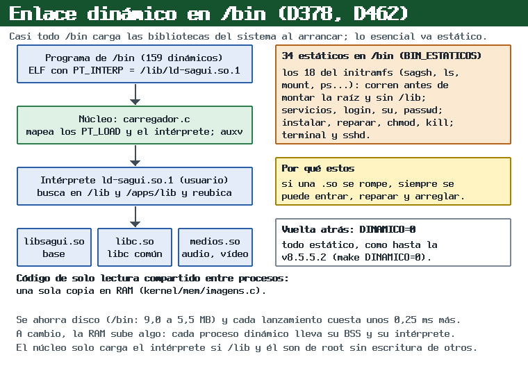
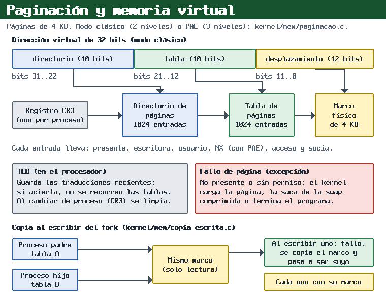
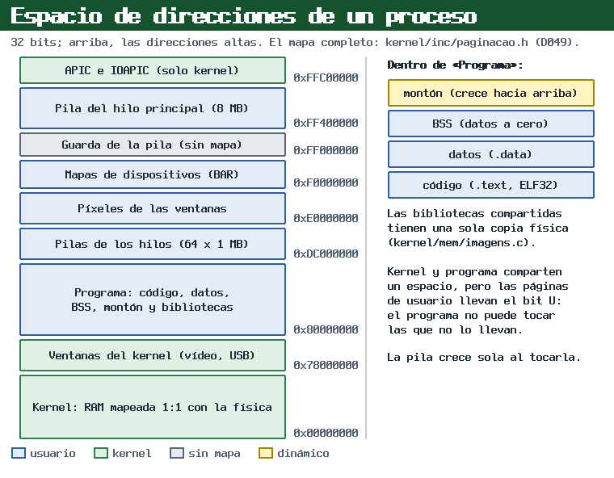

<!-- categoria: Conoce SaguiOS/Sistemas operativos; orden: 6; titulo: Memória -->
# Memória

[Español](06-memoria.md) · [Português](06-memoria_PT.md) · [English](06-memoria_EN.md)

> Objetivo: entender como cada processo vê a sua própria memória, como o processador a traduz, o que acontece quando a memória falta
> e como as bibliotecas são compartilhadas.

## 1. Teoria

### 1.1 Espaço de endereçamento virtual

Cada processo acredita que tem toda a memória para si: endereços de 0 a 4 GB num x86 de 32 bits. Esses endereços são **virtuais**. O processador
os traduz em **endereços físicos** (a RAM real) usando uma tabela mantida pelo núcleo. Isso garante três coisas:

- **Isolamento**: um processo não pode escrever nos endereços físicos de outro, porque não os enxerga.
- **Flexibilidade**: o núcleo pode colocar as páginas onde quiser, inclusive em uma ordem diferente da virtual.
- **Compartilhamento**: dois processos podem ter uma página em comum (por exemplo, o código de uma biblioteca).

### 1.2 Paginação

A memória é dividida em **páginas** de tamanho fixo (4 KB no x86). A tabela de páginas atribui a cada página virtual um quadro físico e
alguns bits de permissão (presente, escrita, usuário, não executável). No x86 de 32 bits a tabela tem dois níveis: um **diretório** de 1024
entradas aponta para tabelas de 1024 entradas, cada uma com uma página.

Com **PAE** (*Physical Address Extension*) o endereço físico passa de 32 para 36 bits ou mais, com tabelas de três níveis e entradas de 64 bits.
Permite mais de 4 GB de RAM física e acrescenta o bit **NX** (*no execute*): uma página de dados não pode ser executada. É a base da proteção
contra código injetado nos dados.

### 1.3 TLB e o custo de traduzir

Percorrer as tabelas a cada acesso seria lento demais. O processador guarda as traduções recentes na **TLB** (*translation lookaside buffer*).
Ao trocar de processo, a TLB é esvaziada (troca do registrador `CR3`). Por isso o núcleo tenta evitar esvaziamentos desnecessários: as páginas
**globais** do próprio núcleo são marcadas para sobreviver à troca, e depois de mudar uma entrada só essa é invalidada (`invlpg`).

### 1.4 Falha de página

Se o processador não encontra uma página presente, ou uma permissão não é cumprida, lança uma **exceção de falha de página** (vetor 14). O
núcleo decide o que fazer:

- Página que nunca foi carregada (**carga sob demanda**): aloca e continua.
- Página escrita depois de um `fork` compartilhado (**cópia na escrita**): copia e continua.
- Página que não existe nem pode ser criada: erro do programa (violação de segmento).
- Página que estava no disco (**paginação para o disco**): lê e continua.

### 1.5 Heap, pilha e segmentos

Dentro do espaço de um processo: o **código** e os **dados** vêm do executável; a **pilha** cresce para baixo nas chamadas; o **heap**
cresce para cima com o `malloc`. Um alocador como o `malloc` entrega pequenos blocos a partir de páginas grandes, com classes de tamanho para
não fragmentar demais.

### 1.6 Sem memória: substituição e swap

Quando não há RAM livre, o núcleo escolhe uma página para tirar: LRU (a menos usada recentemente) é a aproximação clássica. Ele pode gravá-la
no **disco** (*swap*) ou, como alternativa, **comprimi-la na RAM**, que é mais rápido que o disco.

### 1.7 Bibliotecas compartilhadas e ligação dinâmica

Uma biblioteca compartilhada (`.so` no Linux, `.dll` no Windows) tem uma única cópia do seu código na memória, mapeada em todos os processos que
a usam. Na **ligação estática** o código é copiado dentro de cada executável. Na **ligação dinâmica** o executável procura seus símbolos ao iniciar
(o *dynamic linker*), ou com `dlopen`, em tempo de execução. Economiza memória, ao custo de mais trabalho na inicialização e de mais uma camada
de questões de segurança.

### 1.8 Cálculo: o tamanho das tabelas de páginas em 32 bits

Com páginas de 4 KB, um espaço de 4 GB tem 2³² / 2¹² = **2^20 páginas** (um milhão). Uma tabela plana com uma entrada de 4 bytes por página ocupa
2^20 × 4 = **4 MB por processo**, mesmo que o programa use 100 KB. A tabela de dois níveis reduz isso: um diretório de 1024 entradas × 4 bytes =
**4 KB**, e cada tabela de segundo nível (também 4 KB) só existe se houver páginas em uso na sua zona de 4 MB. Um programa de 2 MB (código, dados e
pilha em zonas separadas) precisa do diretório mais cerca de três tabelas: uns **16 KB** no total, em vez de 4 MB.

### 1.9 Cálculo: tempo efetivo de acesso com TLB

Suponha que consultar a TLB custe **1 ns**, um acesso à RAM **100 ns**, e que uma falha de TLB exija dois acessos às tabelas (dois níveis) antes do
acesso ao dado. Um acerto custa 1 + 100 = 101 ns. Uma falha custa 1 + 2 × 100 + 100 = 301 ns. Com uma taxa de acertos *h*, o tempo médio é:

- h = 0,98: 0,98 × 101 + 0,02 × 301 = **105 ns**;
- h = 0,90: 0,90 × 101 + 0,10 × 301 = **121 ns**.

Ou seja, passar de 98 % para 90 % de acertos deixa o acesso cerca de 15 % mais lento. Por isso a TLB é tão importante, e por isso se cuida das
trocas de processo (seção 1.3).

### 1.10 Exemplo: substituição de páginas com 3 quadros

Cadeia de referências: **7, 0, 1, 2, 0, 3, 0, 4**, com 3 quadros de memória. Uma falha é uma referência a uma página que não está na memória.

| Referência | 7 | 0 | 1 | 2 | 0 | 3 | 0 | 4 |
| --- | --- | --- | --- | --- | --- | --- | --- | --- |
| FIFO (sai a mais antiga) | 7 | 7,0 | 7,0,1 | 0,1,2 | (acerto) | 1,2,3 | 2,3,0 | 3,0,4 |
| LRU (sai a menos usada recentemente) | 7 | 7,0 | 7,0,1 | 0,1,2 | 1,2,0 | 2,0,3 | 2,3,0 | 3,0,4 |

Falhas: **FIFO = 7** e **LRU = 6**. O LRU acerta mais porque a página 0 é usada repetidamente, mas precisa saber a ordem de uso a cada acesso,
o que é caro. O algoritmo do **relógio** (*clock*, ou segunda chance) é a aproximação barata: uma página com o bit de referência ativo recebe
outra chance antes de sair.

### 1.11 Exemplo: alocação de blocos de memória e fragmentação

Buracos livres: 120, 400, 220 e 300 KB. Chega um pedido de **210 KB**. Com *first fit* (o primeiro buraco que basta) escolhe-se o de 400 KB
(sobram 190). Com *best fit* (o mais justo) escolhe-se o de 220 KB (sobram 10: um buraco quase inútil, isso é fragmentação). Com *worst fit* (o
maior) escolhe-se também o de 400 KB. A fragmentação externa é a memória livre dividida em buracos pequenos demais para servir; a interna é o espaço
não usado dentro de um bloco alocado.

### 1.12 Mais sobre a substituição: o ótimo, o NRU e a anomalia de Belady

- **Ótimo.** Remove a página que vai demorar mais para ser usada. Não pode ser construído (exige conhecer o futuro), mas serve de
  limite para medir os demais.
- **NRU (não usada recentemente).** O hardware põe um bit **R** (referenciada) ao ler ou escrever uma página e um bit **M**
  (modificada) ao escrevê-la; no x86 chamam-se *accessed* e *dirty*. O sistema zera o R de tempos em tempos. Com R e M há quatro
  classes (0: nem R nem M; 1: só M; 2: só R; 3: R e M) e sai uma página da classe mais baixa que não esteja vazia. É uma
  aproximação barata do LRU.
- **Anomalia de Belady.** Com FIFO, mais quadros podem dar *mais* falhas. Com a sequência 1, 2, 3, 4, 1, 2, 5, 1, 2, 3, 4, 5, o FIFO
  dá **9** falhas com 3 quadros e **10** com 4. O LRU e o ótimo não têm essa anomalia: com 3 quadros dão 10 e 7 falhas, e com 4, 8 e 6.

### 1.13 Conjunto de trabalho e thrashing

O **conjunto de trabalho** de um processo são as páginas que ele usou nas suas últimas referências (ou no seu último intervalo de
tempo). Enquanto essas páginas estiverem na RAM, o processo quase não falha. Se a soma dos conjuntos de trabalho de todos os
processos não cabe, cada falha expulsa uma página que será necessária logo: o sistema passa o tempo movendo páginas e não avança
(**thrashing**). As saídas são suspender processos (baixar o grau de multiprogramação) ou dar mais memória. Há ainda duas políticas:
substituição **local** (cada processo perde as suas próprias páginas) ou **global** (a vítima é escolhida entre todas); a global se
adapta melhor às necessidades de cada um, mas um processo voraz pode prejudicar os outros.

Uma falha é caríssima comparada com um acesso. Se um acesso normal custa 100 ns e uma falha com disco 8 ms, uma taxa de uma falha a
cada 10 000 acessos (*p* = 10^-4) dá um tempo médio de 100 + 10^-4 × 8 000 000 aprox. **900 ns**: nove vezes mais lento. Se a falha se
resolve descomprimindo uma página da RAM em cerca de 20 µs (números ilustrativos, como no SaguiOS com a sua swap comprimida), a média
é 100 + 10^-4 × 20 000 = **102 ns**.

### 1.14 Tamanho de página, segmentação e tabelas invertidas

- **Tamanho de página.** Páginas pequenas desperdiçam pouco na última página de cada região (fragmentação interna), mas exigem
  tabelas maiores. Com um processo de tamanho médio *s* e *e* bytes por entrada da tabela, o tamanho que minimiza o desperdício total
  é raiz(2·*s*·*e*). Com *s* = 1 MB e *e* = 8 bytes sai raiz(16 777 216) = **4096 bytes**: os 4 KB que o x86 usa.
- **Segmentação.** Em vez de um espaço linear, o processo tem vários segmentos (código, dados, pilha...), cada um com a sua base, o
  seu limite e as suas permissões. O x86 de 32 bits tem segmentos e paginação; o SaguiOS usa o modelo **plano** (todos os segmentos
  começam em 0 e cobrem 4 GB: `kernel/arch/gdt.c`) e deixa a proteção para a paginação.
- **Tabela de páginas invertida.** Com espaços de 64 bits a tabela por processo é grande demais; uma tabela com uma entrada por
  *quadro físico* e uma busca por hash a evita, ao custo de procurar a cada falha de TLB. Não é usada no x86.

### 1.15 Levar a conta da memória: mapa de bits e sistema de companheiros

- **Mapa de bits.** Um bit por unidade de alocação (1 = ocupada). Com 1 GiB de RAM e páginas de 4 KiB há 262 144 páginas, ou seja, um
  mapa de **32 KiB**. É simples, mas procurar um buraco de *n* páginas seguidas obriga a percorrer o mapa. É o que `kernel/mem/fisica.c`
  usa para as páginas físicas (seção 2).
- **Lista de buracos.** Uma lista encadeada de regiões livres e ocupadas (seção 1.11): rápida de percorrer se há poucos buracos.
- **Sistema de companheiros (*buddy*).** A memória é sempre dividida em blocos de potência de 2, e um bloco livre se divide ao meio até
  ter o tamanho pedido. Um pedido de 70 KB sobre um bloco de 1024 KB o divide em 512, 256 e 128: entrega-se um de **128 KB** (sobram
  58 KB de fragmentação interna) e, ao liberá-lo, se o seu «gêmeo» está livre, fundem-se de novo. Reunir blocos é muito rápido, ao custo
  desse desperdício.

## 2. Como o SaguiOS faz

- **Memória física.** `kernel/mem/fisica.c` mantém um **mapa de bits** (um bit por página: 1 = ocupada) em três zonas (decisões D008 e D348).
  A função `memfisica_alocar` reserva uma página livre.
- **Alocador do núcleo.** `kernel/mem/heap.c` implementa `kmalloc` e `kfree`: pequenos blocos em classes de tamanho e blocos grandes em páginas inteiras.
- **Paginação e PAE.** `kernel/mem/paginacao.c` implementa a paginação clássica e o **PAE**, com modo duplo (decisões D010, D049 e D349).
  O PAE suporta até 64 GB de RAM física e o bit NX. A fronteira entre o núcleo e os programas está em 2 GB (decisão D049).
- **Memória alta.** `kernel/mem/memalta.c` abre janelas temporárias para escrever em páginas físicas que não estão mapeadas no espaço do núcleo (decisão D348).
- **Cópia na escrita.** `kernel/mem/copia_escrita.c` conta as referências das páginas compartilhadas por um `fork` (decisão D401). É o capítulo 4
  na prática: `fork` seguido de `exec` quase não copia.
- **Swap comprimida na RAM.** `kernel/mem/troca.c` e `kernel/mem/compressor.c`: quando falta memória, a página é comprimida na própria RAM em vez
  de gravada no disco (decisão D352).
- **Pilhas que crescem.** `kernel/nucleo/pilha.c` (decisão D186): a pilha de usuário cresce sob demanda com uma página de guarda.
- **Bibliotecas compartilhadas.** `kernel/mem/imagens.c` compartilha entre processos as páginas somente leitura de cada biblioteca
  (fase 3 da ligação dinâmica, decisão D378): um objeto por arquivo, com contagem de referências e comparação byte a byte; o que é
  gravável (dados, tabela GOT, BSS) é privado de cada processo, então não é preciso cópia na escrita.
- **Ligação dinâmica.** `userland/libdl/ld_sagui.c` e `ligador.c` formam o interpretador `/lib/ld-sagui.so.1`, que carrega as
  bibliotecas de um executável com `PT_INTERP` e atende `dlopen` e `dlsym` (fases 1 e 2, decisão D378). Com a fase 3b (decisão
  **D462**) a ligação dinâmica é o padrão (`DINAMICO=1`): 159 programas de `/bin` são ligados contra `/lib/libsagui.so.1`,
  `/lib/libc.so.1` e `/lib/libsagui_medios.so.1`, e 34 essenciais (os do initramfs, `login`, `su`, `chmod`, `kill`, `terminal`,
  `sshd`...) continuam estáticos para poder reparar mesmo que uma `.so` falhe. `/bin` passa de 9,0 para 5,5 MB e cada execução custa
  cerca de 0,25 ms a mais; a RAM da sessão sobe cerca de 0,5 MB em repouso e cerca de 3 MB com oito programas de janela, porque cada
  processo leva o seu interpretador e o seu BSS. `make DINAMICO=0` volta a tudo estático.

### 2.1 Decisões, alternativas e limites atuais

- **Decisão: três zonas de memória física.** As decisões **D008** e **D348** separam a zona baixa, a zona alta (memória alta para janelas temporárias)
  e a zona superior (com PAE, a RAM acima de 4 GB). Cada zona tem seu próprio mapa de bits (`kernel/mem/fisica.c`).
- **Decisão: PAE com modo duplo.** A decisão **D349** suporta até 64 GB de RAM física e o bit NX. Um computador antigo de 32 bits continua usando o modo clássico.
- **Decisão: a fronteira em 2 GB.** A decisão **D049** divide o espaço de cada processo com o núcleo; um processo não enxerga mais de cerca de 2 GB de RAM
  gerenciada. É o limite prático desta versão.
- **Decisão: swap comprimida na RAM.** A decisão **D352** comprime as páginas na própria RAM (ao estilo do zram) em vez de gravá-las
  num disco; escolhe a vítima com um relógio de segunda chance sobre as tabelas de páginas (`kernel/mem/troca.c`).
- **Decisão: `/bin` dinâmico por padrão.** A decisão **D462** economiza disco e deixa os essenciais estáticos; o preço é um pouco
  mais de RAM por processo. Pode ser desfeita com `DINAMICO=0`.
- **Limite: não há ASLR.** A disposição dos endereços dos programas é fixa. O plano de ligação dinâmica a deixa como fase opcional
  (`docs/enlace-dinamico.md`, seção 9). Linux e Windows a randomizam para dificultar ataques por estouro.
- **Limite: o processo continua vendo 4 GB.** Com PAE o sistema tem mais RAM, mas cada processo mantém um espaço de 32 bits. Mais de 4 GB por programa exigiria 64 bits, que o SaguiOS não usa.

## 3. Experimento no SaguiOS

1. Digite `mem`. Você verá a RAM total segundo o E820, a que o núcleo gerencia, a usada e a livre, e as zonas baixa e alta. Compare o valor
   "Gestionada por el kernel" com a RAM total.
2. Digite `free -h` para a visão legível da memória, e `ps -s` para ordenar os processos por memória. O que mais ocupa aparece primeiro.
3. Digite `top -o mem -n 2 -b` e compare a coluna de memória entre duas rodadas.
4. Abra **Información del PC** (menu Sistema, nome em espanhol) e procure os dados de memória.

**O que observar:** a RAM "livre" quase nunca é a RAM total menos o que o `ps` mostra: parte dela é usada pelo próprio núcleo, e a zona alta é
reservada à parte. Essa diferença explica a substituição e o swap.

**Exercício prático adicional.** Calcule, no papel, quanta memória ocupa a tabela de páginas plana de um processo de 32 bits com páginas de 4 KB,
e a de dois níveis de um programa de 300 KB. Depois rode `mem` e `ps -s` no SaguiOS e compare a memória do maior programa com o seu cálculo do
tamanho dos dados. Explique a diferença (a memória do núcleo, as bibliotecas e a pilha não são o código do programa).

## 4. Perguntas de revisão

1. O que a memória virtual traz para a proteção? Dê um erro concreto que ela evita.
2. Explique com suas palavras o que acontece numa falha de página de cópia na escrita e por que ela é mais barata que copiar tudo no `fork`.
3. Por que a TLB é esvaziada ao trocar de processo, e o que o núcleo faz para não esvaziá-la demais?
4. Um sistema tem 512 MB de RAM e os programas pedem 600 MB no total. Que mecanismos podem fazê-lo funcionar?
5. Com taxa de acerto de 95 %, 1 ns de TLB, 100 ns de RAM e falha de dois níveis, qual o tempo médio? Compare com 99 %.
6. Com a cadeia de referências 1, 2, 3, 1, 4, 2 e 3 e 3 quadros, conte as falhas de FIFO e de LRU.
7. Buracos de 150, 350, 500 e 250 KB; chega um pedido de 240 KB. Qual buraco o *first fit* escolhe e qual o *best fit*? Quanto sobra em cada caso?
8. Com a sequência 1, 2, 3, 4, 1, 2, 5, 1, 2, 3, 4, 5 e FIFO, quantas falhas há com 3 quadros e com 4? Que anomalia ocorre?
9. Um processo tem 2 MB de tamanho médio e a tabela de páginas gasta 4 bytes por entrada. Que tamanho de página minimiza o
   desperdício segundo a fórmula da seção 1.14?
10. Um sistema passa quase todo o tempo paginando e a CPU está ociosa. O que ocorre e que duas medidas podem corrigi-lo?

## 5. Respostas

1. Um programa não pode ler nem escrever a memória de outro, porque os seus endereços virtuais apontam para outras páginas físicas. Evita, por
   exemplo, que um ponteiro mal calculado corrompa o processo vizinho.
2. O `fork` marca as páginas como somente leitura e compartilhadas. Só a primeira escrita causa a cópia daquela página. Assim o `fork` seguido de `exec` não copia quase nada.
3. Porque as traduções pertencem a um espaço de endereçamento específico; trocar o `CR3` as invalidaria. O núcleo marca as páginas globais para que não saiam
   da TLB e usa `invlpg` para invalidar apenas uma entrada.
4. Pode comprimir páginas na RAM (o SaguiOS usa swap comprimida, D352), ou tirar páginas para o disco e recarregá-las sob demanda. Também pode compartilhar
   bibliotecas para não duplicar o código.
5. Com 95 %: 0,95 × 101 + 0,05 × 301 = 96,0 + 15,1 = **111 ns**. Com 99 %: 0,99 × 101 + 0,01 × 301 = 100,0 + 3,0 = **103 ns**. Passar de 95 % para 99 % reduz o tempo em cerca de 7 %.
6. FIFO: 1, 2 e 3 falham e enchem os quadros; 1 acerta; 4 falha e tira o mais antigo (1): ficam 2, 3, 4; 2 e 3 acertam. Total: **4 falhas**. LRU: 1, 2 e 3 falham; 1 acerta e passa a ser o mais recente; 4 tira o menos usado (2); 2 falha e tira 3; 3 falha e tira 1. Total: **6 falhas**. Aqui o FIFO vence o LRU: o LRU nem sempre é o melhor, só costuma sê-lo quando o passado prevê o futuro.
7. *First fit*: 350 KB (o primeiro buraco que basta; sobram 110 KB). *Best fit*: 250 KB (o mais justo; sobram 10 KB). Mostra o compromisso: o best fit deixa buracos pequenos inúteis (fragmentação externa), o first fit é mais rápido.
8. **9** falhas com 3 quadros e **10** com 4: a anomalia de Belady (mais memória, mais falhas); só ocorre em algoritmos como o FIFO,
   não no LRU nem no ótimo.
9. raiz(2 × 2 097 152 × 4) = raiz(16 777 216) = **4096 bytes**, ou seja, páginas de 4 KB.
10. É thrashing: os conjuntos de trabalho não cabem e cada falha expulsa uma página que é necessária logo, de modo que o tempo vai em
    mover páginas (a CPU espera o disco). Corrige-se suspendendo processos (menos multiprogramação) ou dando mais memória.
