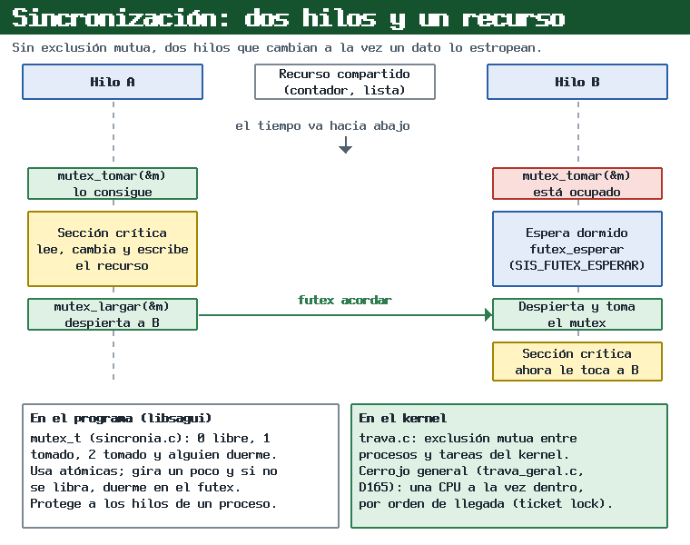

<!-- categoria: Conoce SaguiOS/Sistemas operativos; orden: 7; titulo: Concurrencia y sincronización -->
# Concurrencia y sincronización

[Español](07-concurrencia.md) · [Português](07-concurrencia_PT.md) · [English](07-concurrencia_EN.md)

> Objetivo: entender por qué dos cosas que ocurren «a la vez» se estropean entre sí, qué herramientas hay para evitarlo
> y cómo las usa el propio núcleo.

## 1. Teoría

### 1.1 Condiciones de carrera

Dos hilos (o una CPU y una interrupción) que leen y escriben la misma variable pueden entrelazar sus pasos. Un
ejemplo clásico: `contador = contador + 1` no es una instrucción, sino tres: leer, sumar, escribir. Si dos hilos leen el
mismo valor antes de que el otro escriba, una de las sumas se pierde. El resultado depende del orden de ejecución: es
una **condición de carrera**, y es difícil de reproducir porque el planificador decide el orden.

### 1.2 Sección crítica y exclusión mutua

La parte del código que accede a un recurso compartido es la **sección crítica**. La exclusión mutua garantiza que, como
mucho, un hilo está dentro a la vez. Hay que cumplir tres propiedades:

- **Exclusión**: nunca dos dentro a la vez.
- **Progreso**: si nadie está dentro y alguien quiere entrar, alguien entra.
- **Espera acotada**: nadie espera para siempre.

### 1.3 Herramientas

- **Instrucciones atómicas**: una operación indivisible, como `xchg` o `cmpxchg` en x86. Son la base de todo lo demás.
- **Cerrojo de giro** (*spinlock*): el hilo espera girando (ocupando la CPU) hasta que el cerrojo se libera. Es adecuado
  cuando la espera es muy corta, y no sirve para esperas largas.
- **Mutex**: si el cerrojo está ocupado, el hilo duerme y lo despiertan al liberarlo. Evita desperdiciar CPU.
- **Semáforo**: un contador que permite N entradas a la vez (N = 1 es un mutex).
- **Variables de condición**: esperar a que se cumpla una condición, no solo a que el cerrojo esté libre.
- **Futex** (*fast userspace mutex*, Linux): el caso rápido vive en espacio de usuario; solo entra en el núcleo cuando hay
  que dormir o despertar. Así un cerrojo sin contienda no cuesta una llamada al sistema.

### 1.4 Interbloqueo

Un **interbloqueo** (*deadlock*) ocurre cuando dos o más hilos se esperan en un círculo: A tiene el cerrojo 1 y espera el
2; B tiene el 2 y espera el 1. Hay cuatro condiciones (Coffman): exclusión mutua, retención y espera, sin expropiación y
espera circular. Romper una de ellas evita el interbloqueo. La práctica habitual es **ordenar los cerrojos** (siempre
primero el de número menor) y no mantener un cerrojo mientras se espera otro.

### 1.5 El cerrojo general del kernel

Un núcleo que nunca se preocupó del paralelismo puede protegerse con un único cerrojo general: solo una CPU está dentro
del núcleo a la vez. Es simple y seguro, pero limita la escalabilidad. Los núcleos modernos reemplazan ese cerrojo por
muchos cerrojos finos (por subsistema, por estructura). Linux pasó de un *big kernel lock* a cerrojos finos a lo largo de
años.

### 1.6 Comunicación entre procesos

Las tuberías (`pipe`) combinan sincronización y datos: el lector duerme si la tubería está vacía y el escritor duerme si
está llena. Los semáforos y los buzones de mensajes son otras formas de la misma idea.

### 1.7 Ejemplo: una actualización perdida, paso a paso

Dos hilos ejecutan `contador = contador + 1` una vez cada uno, y `contador` vale 5 al principio. Con este orden de pasos:

```
paso  hilo 1              hilo 2              contador
 1    leer contador (5)                         5
 2                        leer contador (5)     5
 3    sumar: 5 + 1 = 6                          5
 4    escribir 6                                6
 5                        sumar: 5 + 1 = 6      6
 6                        escribir 6            6
```

El resultado es 6, no 7: la escritura del hilo 2 pisa la del hilo 1. Si el orden fuera secuencial, el resultado sería 7. La
condición de carrera depende del orden, por eso el fallo aparece una vez de cada mil ejecuciones.

### 1.8 Ejemplo: productor y consumidor con semáforos

Un búfer de 4 huecos. Tres semáforos: `vacios` (4), `llenos` (0) y `mutex` (1). En pseudocódigo:

```
productor:                       consumidor:
  esperar(vacios)                  esperar(llenos)
  esperar(mutex)                   esperar(mutex)
  meter elemento                   sacar elemento
  avisar(mutex)                    avisar(mutex)
  avisar(llenos)                   avisar(vacios)
```

El orden importa: si el productor espera `mutex` antes que `vacios` y el búfer está lleno, se queda dentro de la sección
crítica esperando un hueco que solo puede liberar el consumidor, que también espera `mutex`. Es un interbloqueo (apartado 1.4).

Con la API de hilos de la libc de SaguiOS (`userland/libc/pthread.h`) el mutex sería `pthread_mutex_lock` y
`pthread_mutex_unlock` alrededor de la sección crítica; los semáforos se construirían sobre un mutex y una condición.

### 1.9 Grafo de recursos y el algoritmo del banquero

Un **grafo de recursos** dibuja procesos (P) y recursos (R): una arista P -> R significa que P espera R; una arista R -> P,
que R está asignado a P. Un ciclo indica interbloqueo si cada recurso tiene una sola unidad. Con varias unidades, un ciclo
no basta, y el **algoritmo del banquero** comprueba antes de conceder un recurso si existe una secuencia en la que todos
terminan. Es costoso, por eso en la práctica se prefiere evitar la espera circular ordenando los recursos.

### 1.10 Exclusión mutua con espera ocupada: de Peterson a `xchg`

Antes de tener cerrojos hechos por el hardware se intentó resolver la exclusión mutua solo con lecturas y escrituras:

- **Inhibir las interrupciones.** Dentro de la sección crítica no hay cambio de proceso. Lo usa un núcleo de un solo
  procesador, pero con varias CPU no basta (otra sigue corriendo) y no se puede dejar en manos de los programas.
- **Alternancia estricta.** Una variable `turno` dice a quién le toca. Obliga a turnarse aunque el otro no quiera entrar:
  incumple el progreso.
- **Algoritmo de Peterson** (para dos procesos, con dos variables):

```c
static atomic_int quiere[2];
static atomic_int turno;

static void entrar(int yo)
{
    int otro = 1 - yo;
    atomic_store(&quiere[yo], 1);
    atomic_store(&turno, otro);
    while (atomic_load(&quiere[otro]) && atomic_load(&turno) == otro)
        ;
}

static void salir(int yo)
{
    atomic_store(&quiere[yo], 0);
}
```

  Cada uno anuncia que quiere entrar (`quiere[yo]`), cede el turno al otro y espera mientras el otro quiera y sea su
  turno. Cumple exclusión, progreso y espera acotada. Pero supone que las lecturas y escrituras se ven en el orden del
  programa, y los procesadores modernos las reordenan: por eso hacen falta variables atómicas (como arriba) o barreras.
- **Instrucciones atómicas** (`xchg`, `cmpxchg`, `lock xadd`). El hardware hace «leer y escribir» como una sola operación
  indivisible, y con ellas se construye cualquier cerrojo: un *spinlock* repite `xchg` hasta ver que el cerrojo estaba
  libre. En SaguiOS, `kernel/nucleo/spinlock.c` usa `cmpxchg` y, tras 1024 intentos, duerme con `hlt` hasta la siguiente
  interrupción.
- **Cerrojo por turnos** (*ticket lock*). Quien llega saca un número y espera a que le toque, como en una carnicería.
  Garantiza la **espera acotada**: nadie adelanta a nadie, algo que un simple `xchg` no da (una CPU podría ganar siempre).
  Es el cerrojo general del kernel desde la decisión D169; bajo un hipervisor, donde a la CPU virtual a la que le toca el
  turno puede que no la estén ejecutando, vuelve a un cerrojo sin cola.

### 1.11 Monitores y variables de condición

Un **monitor** es un módulo cuyos procedimientos se ejecutan de uno en uno (el lenguaje pone la exclusión mutua) y que
ofrece **variables de condición** con `wait` y `signal`. En C se imita con un mutex y variables de condición. El
productor-consumidor del apartado 1.8, con un búfer de cuatro huecos y dos hilos, queda así (`pthread`, `userland/libc/pthread.h`):

```c
#include <pthread.h>
#include <stdio.h>

#define HUECOS 4
#define TOTAL  20

static int buffer[HUECOS];
static int cuenta, entra, sale;
static pthread_mutex_t m = PTHREAD_MUTEX_INITIALIZER;
static pthread_cond_t hay_hueco = PTHREAD_COND_INITIALIZER;
static pthread_cond_t hay_dato = PTHREAD_COND_INITIALIZER;

static void *productor(void *arg)
{
    int i;
    (void)arg;
    for (i = 1; i <= TOTAL; i++) {
        pthread_mutex_lock(&m);
        while (cuenta == HUECOS)
            pthread_cond_wait(&hay_hueco, &m);
        buffer[entra] = i;
        entra = (entra + 1) % HUECOS;
        cuenta++;
        pthread_cond_signal(&hay_dato);
        pthread_mutex_unlock(&m);
    }
    return NULL;
}

static void *consumidor(void *arg)
{
    int i, suma = 0;
    (void)arg;
    for (i = 0; i < TOTAL; i++) {
        pthread_mutex_lock(&m);
        while (cuenta == 0)
            pthread_cond_wait(&hay_dato, &m);
        suma += buffer[sale];
        sale = (sale + 1) % HUECOS;
        cuenta--;
        pthread_cond_signal(&hay_hueco);
        pthread_mutex_unlock(&m);
    }
    printf("suma = %d\n", suma);
    return NULL;
}

int main(void)
{
    pthread_t p, c;
    pthread_create(&p, NULL, productor, NULL);
    pthread_create(&c, NULL, consumidor, NULL);
    pthread_join(p, NULL);
    pthread_join(c, NULL);
    return 0;
}
```

Tres detalles. La espera va en un `while` y no en un `if`: al despertar hay que volver a comprobar la condición (otro hilo
pudo adelantarse, y una espera puede despertar sin aviso). `pthread_cond_wait` suelta el mutex mientras duerme y lo vuelve a
tomar al despertar. Y se avisa a la condición del otro lado: el productor avisa de que hay un dato, el consumidor de que hay
un hueco. Con la cuenta correcta el programa escribe `suma = 210`. Java lo hace con `synchronized`, `wait` y `notify`.

### 1.12 Problemas clásicos de sincronización

- **La cena de los filósofos.** Cinco filósofos en círculo con un tenedor entre cada par; para comer necesitan los dos que
  tienen a los lados. Si todos cogen el de su izquierda a la vez, nadie come: espera circular. Soluciones: coger los dos o
  ninguno, numerar los tenedores y coger siempre primero el de número menor (rompe el círculo) o dejar sentarse a cuatro
  como mucho.
- **Lectores y escritores.** Muchos lectores pueden leer a la vez, pero un escritor necesita estar solo. Si se da preferencia
  a los lectores, un escritor puede esperar para siempre (inanición); si se da a los escritores, esperan los lectores. La
  libc de SaguiOS tiene `pthread_rwlock_t`.
- **El barbero dormilón.** Una barbería con un barbero y varias sillas de espera: si no hay clientes, el barbero duerme; si
  no hay silla libre, el cliente se va. Es el modelo de un servidor con una cola limitada.

### 1.13 Paso de mensajes y barreras

- **Paso de mensajes.** `enviar(destino, mensaje)` y `recibir(origen, &mensaje)`. No se comparten datos y la sincronización
  viene incluida: el receptor espera hasta que llega algo. Sirve igual entre procesos que entre máquinas. En SaguiOS son las
  tuberías, los sockets (capítulo 10) y la cola de eventos de cada ventana.
- **Barrera.** Todos los hilos esperan a que hayan llegado todos antes de seguir. Es típica del cálculo en paralelo por fases:
  en AoEN, el reparto de trabajo por trozos entre hilos (decisión D393) termina cuando acaba el último trozo, y solo
  entonces sigue el hilo principal.

### 1.14 Qué hacer con el interbloqueo

- **Algoritmo del avestruz.** Ignorarlo. Si ocurre raras veces y evitarlo es caro, es lo que hacen muchos sistemas.
- **Detección y recuperación.** Buscar ciclos en el grafo de recursos y, al encontrarlos, matar un proceso o quitarle un
  recurso.
- **Evitarlo.** Conceder una petición solo si el estado resultante es **seguro**: existe un orden en que todos pueden
  terminar. Ejemplo: 12 unidades de un recurso; A tiene 4 y puede llegar a pedir 10, B tiene 2 y llegará a 5, C tiene 3 y
  llegará a 8. Quedan libres 12 - 9 = 3. B necesita 3 más: termina y devuelve 5, quedan 5 libres; C necesita 5: termina y
  quedan 8; A necesita 6: termina. El orden B, C, A existe, así que el estado es seguro. Si se concediera una unidad más a A
  (quedarían 2 libres), nadie podría terminar con lo que queda (B pide 3, C pide 5, A pide 5): estado **inseguro**, aunque
  todavía no haya interbloqueo. Eso comprueba el algoritmo del banquero.
- **Prevenirlo.** Negar una de las cuatro condiciones: no exigir exclusión mutua (colas de impresión que gestiona un solo
  proceso), pedir todo de golpe (no retener y esperar), permitir quitar recursos (expropiación) u ordenar los recursos (sin
  espera circular). Esta última es la regla práctica habitual: tomar los cerrojos siempre en el mismo orden (apartado 1.4).
- **Inanición y bloqueo activo.** No todo es interbloqueo: en la **inanición** nadie está bloqueado en círculo, pero uno
  nunca recibe el recurso (un lector que siempre pasa por delante de un escritor); en el **bloqueo activo** (*livelock*)
  los procesos reaccionan unos a otros sin parar y no avanzan, como dos personas que se apartan a la vez.
- **Otros casos.** En las bases de datos, el **bloqueo en dos fases** hace que cada transacción tome primero todos los cerrojos que
  necesita y solo después los suelte, y así se evita que los resultados parciales se mezclen. Y hay interbloqueos **sin recursos**:
  dos procesos que esperan un mensaje el uno del otro también se bloquean para siempre.

### 1.15 Inversión de prioridad

Un hilo de prioridad baja B tiene un cerrojo; un hilo de prioridad alta A lo necesita y duerme; un hilo de prioridad media M,
que no usa el cerrojo, le quita la CPU a B. Resultado: A espera por culpa de M. Se arregla con **herencia de prioridad**: B
hereda la de A mientras tenga el cerrojo. Le ocurrió a la sonda Mars Pathfinder en 1997. SaguiOS no tiene herencia de
prioridad: la prioridad de audio (`PLAN_AUDIO`, capítulo 5) está limitada por uso y un hilo de audio no debería esperar un
mutex que tenga un hilo corriente.

### 1.16 Cálculo: lo que gana un cerrojo general

Si una fracción *s* del tiempo se pasa dentro del núcleo (donde solo entra una CPU a la vez) y el resto se paraleliza, la
ganancia con *n* CPU es como mucho 1 / (*s* + (1 - *s*) / *n*). Con *s* = 0,1 y 4 CPU: 1 / (0,1 + 0,225) aprox. **3,1**; con
*s* = 0,3: 1 / (0,3 + 0,175) aprox. **2,1**. En KVM con 4 CPU, las decisiones D164, D165 y D169 midieron entre unas 2 y 3,4 veces con
cuatro procesos, según la carga (más con cálculo puro, menos con muchas llamadas al sistema): por debajo de las 4 veces
ideales porque el cerrojo, y el paso de su línea de caché de una CPU a otra, ponen un techo. Es el argumento para repartir
algún día el cerrojo en cerrojos por subsistema.

## 2. Así lo hace SaguiOS



- **Atómicas y cerrojos.** `kernel/nucleo/atomicas.c`, `kernel/nucleo/spinlock.c` y `kernel/nucleo/trava.c` dan las
  primitivas básicas. La base del SMP y del multihilo (atómicas, cerrojos, datos por CPU, mutex y semáforo) está en la
  decisión D150.
- **Futex.** `kernel/nucleo/hilos.c` implementa `futex_esperar(&palabra, valor)`: duerme si la palabra aún vale `valor`,
  y `futex_acordar(&palabra, n)` despierta a `n` de los que duermen en ella (decisión D167). Un hilo que duerme se
  registra en un canal común y el propio valor de la palabra decide quién despierta.
- **Cerrojo general.** `kernel/nucleo/trava_geral.c` implementa el cerrojo general del kernel (decisión D165): cada CPU
  atiende sus llamadas al sistema, pero solo la CPU que tiene el cerrojo está dentro del núcleo. El kernel se escribió
  para un solo procesador, con las interrupciones apagadas dentro, y el cerrojo general es lo que lo hace seguro con
  varias CPU.
- **Llamadas que esperan.** Cuando una llamada no puede completarse (leer una tubería vacía), el núcleo pone el
  proceso a dormir y retrocede `EIP` para repetir la llamada al despertar (`kernel/nucleo/sistema.c`, línea
  `eip -= 2`). Así no hay que guardar estado intermedio.
- **Tuberías.** `kernel/fs/pipe.c` duerme al lector si no queda nada y hay quien escriba.
- **Hilos y SMP.** Con el SMP encendido (decisión D164, imagen `--smp`), los hilos y procesos corren a la vez en distintas
  CPU y cada una entra al núcleo por turnos bajo el cerrojo general. Una CPU que espera una IRQ (`cpu_espera()`) suelta el
  cerrojo mientras duerme con `hlt`. Las modificaciones del planificador o de la FPU deben respetar el cerrojo.
- **Cerrojo por turnos.** Desde la decisión **D169** el cerrojo general es un *ticket lock* (`proximo` y `atendendo`, con
  `lock xadd`): las CPU entran por orden de llegada, y cada una guarda en su propia línea de caché si el cerrojo es suyo.
  `trava_geral_escolher()` lo cambia a un cerrojo sin cola si detecta un hipervisor.
- **Terminar un proceso que corre en otra CPU.** `processo_tirar_da_cpu` le manda una IPI y espera a que esa CPU quede
  esperando el cerrojo (`esperando_trava`); solo entonces se cierran sus ficheros y ventanas (decisión D165).
- **Hilos de la SDL.** La SDL 2 del sistema (D393) conecta `SDL_CreateThread`, los cerrojos, las condiciones y los
  semáforos con `thread_create` y el futex del sistema (anexo de la SDL).

### 2.1 Decisiones, alternativas y límites actuales

- **Decisión: primitivas atómicas y cerrojos en el núcleo.** La decisión **D150** da las atómicas, cerrojos, datos por CPU,
  mutex y semáforo que usan el SMP y el multihilo (`kernel/nucleo/atomicas.c`, `kernel/nucleo/trava.c`).
- **Decisión: el cerrojo general.** La decisión **D165** pone un cerrojo general: cada CPU atiende sus llamadas, pero solo
  una ejecuta el núcleo a la vez (`kernel/nucleo/trava_geral.c`). La **D169** lo reparte por turnos de llegada.
- **Decisión: hilos de usuario como entradas de la tabla.** La decisión **D167** comparte el espacio del líder y añade el
  futex (`kernel/nucleo/hilos.c`).
- **Decisión: SMP opcional.** La decisión **D164** lo deja fuera de la imagen normal: menos riesgo de condiciones de carrera
  mientras el núcleo sea de un solo procesador en la práctica.
- **Límite: la libc no es del todo segura entre hilos.** La decisión **D458** lo reconoce: `errno` es global, así que un
  programa con varios hilos no debe fiarse de él sin protegerlo.
- **Límite: el cerrojo general limita el paralelismo.** Con varias CPU, las llamadas al sistema de todas pasan por un solo
  cerrojo (decisión D165): mientras una CPU hace un `exec` o dibuja una ventana, las demás esperan para entrar. Es seguro y
  sencillo; es también el cuello de botella que habría que partir (apartado 1.16).

## 3. Experimento en SaguiOS

1. En el terminal escribe `sleep 30 | cat`. El `cat` espera datos de la tubería. Mientras tanto, abre el Administrador
   de tareas o escribe `ps` en otro terminal: el proceso `cat` aparece en estado `bloqueado`.
2. Cuando pasan los 30 segundos, `cat` termina y desaparece de la lista de `ps`.
3. Ejecuta `ps -c` y compara los estados de los procesos del terminal y los de `sleep`.

**Qué observar:** un proceso en espera no ocupa la CPU, pero sí una entrada en la tabla. Ese es el estado `bloqueado` de
la teoría: espera un evento y el planificador lo ignora hasta que llega.

**Ejercicio práctico adicional.** Escribe en C el productor y el consumidor del apartado 1.8 con dos hilos (`pthread_create`)
y un búfer de cuatro huecos, usando `pthread_mutex_t`. Quita la espera del `mutex` en el consumidor y observa si el
programa falla o se queda bloqueado. Describe el orden de llamadas que lo produce.

## 4. Preguntas de repaso

1. Escribe un ejemplo de condición de carrera con dos hilos que incrementan un contador, y explica por qué falla.
2. ¿Cuándo es mejor un spinlock que un mutex, y cuándo es peor?
3. Dos hilos toman dos cerrojos en orden inverso. Dibuja el interbloqueo y propón la solución.
4. ¿Qué ventaja tiene el cerrojo general frente a muchos cerrojos finos, y qué coste tiene?

5. Dos hilos incrementan un contador 1000 veces cada uno sin cerrojo, y el resultado final es 1734. ¿Qué ha pasado? ¿Cómo se
   corrige?
6. Dos procesos, A y B, tienen dos recursos R1 y R2. A toma R1 y pide R2; B toma R2 y pide R1. Dibuja el grafo de recursos
    y di si hay interbloqueo.
7. Un semáforo `vacios` vale 4 y `llenos` vale 0. ¿Cuántos elementos caben en el búfer del apartado 1.8 y cuántos hay al
    principio?
8. En el algoritmo de Peterson, ¿qué pasa si el otro proceso no quiere entrar? ¿Y si los dos quieren a la vez?
9. Cinco filósofos cogen a la vez el tenedor de su izquierda. ¿Qué ocurre y qué dos soluciones hay?
10. Hay 12 unidades de un recurso. A tiene 4 y puede llegar a pedir 10; B tiene 2 y llegará a 5; C tiene 3 y llegará a 8.
    ¿Es seguro el estado? ¿Y si se concede una unidad más a A?
11. Si el 20 % del tiempo se pasa dentro de un cerrojo general, ¿cuál es la ganancia máxima con 4 CPU?
12. Un hilo de audio de prioridad alta espera un mutex que tiene un hilo normal, al que otro hilo medio no deja correr.
    ¿Cómo se llama el fenómeno y cómo se corrige?

## 5. Soluciones

1. Dos hilos leen `contador = 5`, cada uno suma 1 y escribe 6: el resultado es 6, no 7. La suma no es atómica (lectura,
   suma, escritura), así que se pierde una actualización.
2. El spinlock es mejor si la sección crítica es muy corta y el cerrojo se suelta enseguida, porque evita el coste de
   dormir y despertar. Es peor si la espera es larga, porque quema CPU mientras espera.
3. Hilo A toma el cerrojo 1 y espera el 2; hilo B toma el 2 y espera el 1: círculo de espera. Solución: que todos tomen
   los cerrojos siempre en el mismo orden (primero el 1, luego el 2).
4. El cerrojo general es simple y seguro: el núcleo no tiene que razonar sobre cada estructura. Su coste es que solo una
   CPU ejecuta el núcleo a la vez, así que el paralelismo de las llamadas está limitado. Los cerrojos finos escalan
   mejor, pero son más difíciles de demostrar correctos.

### Respuestas a las preguntas adicionales

5. Hay actualizaciones perdidas: dos lecturas del mismo valor y dos escrituras que se pisan. Se corrige con un cerrojo (o
   una atómica como `fetch_add`) alrededor de la suma.
6. Aristas A -> R2, R2 -> B, B -> R1, R1 -> A: un ciclo, así que hay interbloqueo. La solución es que todos tomen R1 antes que R2.
7. Caben 4 elementos (el valor de `vacios` al principio). Al principio hay 0 elementos (el valor de `llenos`). Cada inserción
    resta a `vacios` y suma a `llenos`; así la suma de ambos es siempre 4.
8. Si el otro no quiere, `quiere[otro]` vale 0, la condición del `while` es falsa y entra sin esperar. Si los dos quieren a la
   vez, ambos ponen su `quiere` y cada uno cede el turno al otro; el que escribe `turno` el último es el que espera, así
   que entra el otro.
9. Cada uno tiene un tenedor y espera el de su vecino: espera circular, interbloqueo. Dos soluciones: numerar los tenedores y
   coger siempre primero el de menor número (rompe el círculo) o dejar sentarse a cuatro como máximo (siempre queda uno que
   puede coger los dos).
10. Libres: 12 - 9 = 3. B necesita 3: termina y quedan 5; C necesita 5: termina y quedan 8; A necesita 6: termina. El orden
    B, C, A existe: **seguro**. Con una unidad más para A, quedan 2 libres y B necesita 3, C 5 y A 5: ninguno puede terminar,
    así que el estado es **inseguro**.
11. 1 / (0,2 + 0,8 / 4) = 1 / 0,4 = **2,5**.
12. Es una **inversión de prioridad**: el hilo medio retrasa indirectamente al de audio. Se corrige con herencia de prioridad
    (el hilo que tiene el mutex hereda la prioridad del que lo espera) o evitando que el hilo de audio espere cerrojos que
    tengan hilos corrientes.
