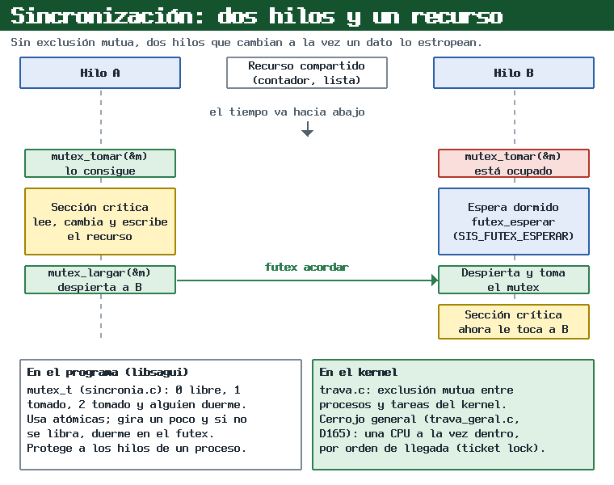

<!-- categoria: Conoce SaguiOS/Sistemas operativos; orden: 7; titulo: Concurrency and synchronization -->
# Concurrency and synchronization

[Español](07-concurrencia.md) · [Português](07-concurrencia_PT.md) · [English](07-concurrencia_EN.md)

> Goal: understand why two things that happen "at the same time" spoil each other, which tools exist to prevent it, and
> how the kernel itself uses them.

## 1. Theory

### 1.1 Race conditions

Two threads (or a CPU and an interrupt) that read and write the same variable can interleave their steps. A classic
example: `counter = counter + 1` is not one instruction but three: read, add, write. If two threads read the same value
before the other writes, one of the additions is lost. The result depends on the order of execution: this is a **race
condition**, and it is hard to reproduce because the scheduler decides the order.

### 1.2 Critical section and mutual exclusion

The part of the code that accesses a shared resource is the **critical section**. Mutual exclusion guarantees that at most
one thread is inside at a time. Three properties must hold:

- **Exclusion**: never two inside at the same time.
- **Progress**: if nobody is inside and someone wants to enter, someone enters.
- **Bounded waiting**: nobody waits forever.

### 1.3 Tools

- **Atomic instructions**: an indivisible operation, such as `xchg` or `cmpxchg` on x86. They are the basis of everything
  else.
- **Spinlock**: the thread waits by spinning (occupying the CPU) until the lock is released. Suitable when the wait is very
  short, not for long waits.
- **Mutex**: if the lock is taken, the thread sleeps and is woken when it is released. It avoids wasting CPU.
- **Semaphore**: a counter that allows N entries at a time (N = 1 is a mutex).
- **Condition variables**: wait until a condition holds, not just until the lock is free.
- **Futex** (*fast userspace mutex*, Linux): the fast path lives in user space; it enters the kernel only when it has to sleep
  or wake someone. Thus an uncontended lock does not cost a system call.

### 1.4 Deadlock

A **deadlock** happens when two or more threads wait for each other in a circle: A holds lock 1 and waits for 2; B holds 2
and waits for 1. There are four conditions (Coffman): mutual exclusion, hold and wait, no preemption and circular wait.
Breaking one of them prevents deadlock. The usual practice is to **order the locks** (always take the one with the lower
number first) and not to hold a lock while waiting for another.

### 1.5 The kernel-wide lock

A kernel that never worried about parallelism can be protected with a single global lock: only one CPU is inside the
kernel at a time. It is simple and safe, but it limits scalability. Modern kernels replace that lock with many fine-grained
locks (per subsystem, per structure). Linux moved from a *big kernel lock* to fine-grained locks over several years.

### 1.6 Communication between processes

Pipes (`pipe`) combine synchronization and data: the reader sleeps if the pipe is empty, and the writer sleeps if it is
full. Semaphores and message queues are other forms of the same idea.

### 1.7 Example: a lost update, step by step

Two threads each run `counter = counter + 1` once, and `counter` is 5 at the start. With this order of steps:

```
paso  hilo 1              hilo 2              contador
 1    leer contador (5)                         5
 2                        leer contador (5)     5
 3    sumar: 5 + 1 = 6                          5
 4    escribir 6                                6
 5                        sumar: 5 + 1 = 6      6
 6                        escribir 6            6
```

The result is 6, not 7: thread 2's write overwrites thread 1's. In a sequential order the result would be 7. The race depends
on the order, which is why the failure shows up once in a thousand runs.

### 1.8 Example: producer and consumer with semaphores

A buffer of 4 slots. Three semaphores: `empty` (4), `full` (0) and `mutex` (1). In pseudocode:

```
productor:                       consumidor:
  esperar(vacios)                  esperar(llenos)
  esperar(mutex)                   esperar(mutex)
  meter elemento                   sacar elemento
  avisar(mutex)                    avisar(mutex)
  avisar(llenos)                   avisar(vacios)
```

The order matters: if the producer waits for `mutex` before `empty` and the buffer is full, it stays inside the critical
section waiting for a slot that only the consumer can free, and the consumer also waits for `mutex`. That is a deadlock
(section 1.4).

With the thread API of the SaguiOS libc (`userland/libc/pthread.h`) the mutex would be `pthread_mutex_lock` and
`pthread_mutex_unlock` around the critical section; semaphores would be built from a mutex and a condition.

### 1.9 Resource graph and the banker's algorithm

A **resource graph** draws processes (P) and resources (R): an edge P -> R means P waits for R; an edge R -> P means R is
assigned to P. A cycle means deadlock when each resource has a single unit. With several units a cycle is not enough, and
the **banker's algorithm** checks, before granting a resource, whether there is a sequence in which all processes finish.
It is costly, so in practice avoiding circular waits by ordering resources is preferred.

### 1.10 Mutual exclusion with busy waiting: from Peterson to `xchg`

Before hardware-made locks, people tried to solve mutual exclusion with plain reads and writes:

- **Disabling interrupts.** Inside the critical section there is no process switch. A single-processor kernel uses it, but with
  several CPUs it is not enough (another one keeps running) and it cannot be left in the hands of programs.
- **Strict alternation.** A `turno` (turn) variable says whose turn it is. It forces taking turns even if the other does not
  want to enter: it breaks progress.
- **Peterson's algorithm** (for two processes, with two variables):

```c
static atomic_int quiere[2];
static atomic_int turno;

static void entrar(int yo)
{
    int otro = 1 - yo;
    atomic_store(&quiere[yo], 1);
    atomic_store(&turno, otro);
    while (atomic_load(&quiere[otro]) && atomic_load(&turno) == otro)
        ;
}

static void salir(int yo)
{
    atomic_store(&quiere[yo], 0);
}
```

  Each one announces that it wants to enter (`quiere[yo]`), gives the turn to the other and waits while the other wants to
  enter and it is the other's turn. It meets exclusion, progress and bounded waiting. But it assumes that reads and writes are
  seen in program order, and modern processors reorder them: that is why atomic variables (as above) or barriers are needed.
- **Atomic instructions** (`xchg`, `cmpxchg`, `lock xadd`). The hardware does "read and write" as a single indivisible
  operation, and any lock can be built with them: a *spinlock* repeats `xchg` until it sees the lock was free. In SaguiOS,
  `kernel/nucleo/spinlock.c` uses `cmpxchg` and, after 1024 attempts, sleeps with `hlt` until the next interrupt.
- **Ticket lock.** Whoever arrives takes a number and waits for their turn, as in a butcher's shop. It guarantees **bounded
  waiting**: nobody overtakes anybody, something a plain `xchg` does not give (a CPU could win every time). It is the
  kernel-wide lock since decision D169; under a hypervisor, where the virtual CPU whose turn it is may not be running, it goes
  back to a lock without a queue.

### 1.11 Monitors and condition variables

A **monitor** is a module whose procedures run one at a time (the language provides the mutual exclusion) and which offers
**condition variables** with `wait` and `signal`. In C it is imitated with a mutex and condition variables. The
producer-consumer of section 1.8, with a four-slot buffer and two threads, looks like this (`pthread`,
`userland/libc/pthread.h`):

```c
#include <pthread.h>
#include <stdio.h>

#define HUECOS 4
#define TOTAL  20

static int buffer[HUECOS];
static int cuenta, entra, sale;
static pthread_mutex_t m = PTHREAD_MUTEX_INITIALIZER;
static pthread_cond_t hay_hueco = PTHREAD_COND_INITIALIZER;
static pthread_cond_t hay_dato = PTHREAD_COND_INITIALIZER;

static void *productor(void *arg)
{
    int i;
    (void)arg;
    for (i = 1; i <= TOTAL; i++) {
        pthread_mutex_lock(&m);
        while (cuenta == HUECOS)
            pthread_cond_wait(&hay_hueco, &m);
        buffer[entra] = i;
        entra = (entra + 1) % HUECOS;
        cuenta++;
        pthread_cond_signal(&hay_dato);
        pthread_mutex_unlock(&m);
    }
    return NULL;
}

static void *consumidor(void *arg)
{
    int i, suma = 0;
    (void)arg;
    for (i = 0; i < TOTAL; i++) {
        pthread_mutex_lock(&m);
        while (cuenta == 0)
            pthread_cond_wait(&hay_dato, &m);
        suma += buffer[sale];
        sale = (sale + 1) % HUECOS;
        cuenta--;
        pthread_cond_signal(&hay_hueco);
        pthread_mutex_unlock(&m);
    }
    printf("suma = %d\n", suma);
    return NULL;
}

int main(void)
{
    pthread_t p, c;
    pthread_create(&p, NULL, productor, NULL);
    pthread_create(&c, NULL, consumidor, NULL);
    pthread_join(p, NULL);
    pthread_join(c, NULL);
    return 0;
}
```

Three details. The wait goes in a `while`, not an `if`: after waking up the condition must be checked again (another thread may
have got in first, and a wait can wake up without a signal). `pthread_cond_wait` releases the mutex while it sleeps and takes it
again on waking. And the signal goes to the condition on the other side: the producer signals that there is data, the consumer
that there is a free slot. With the right count the program prints `suma = 210`. Java does it with `synchronized`, `wait` and
`notify`.

### 1.12 Classic synchronization problems

- **The dining philosophers.** Five philosophers in a circle with one fork between each pair; to eat they need both forks next
  to them. If all take their left fork at once, nobody eats: circular wait. Solutions: take both or none, number the forks and
  always take the lower-numbered one first (it breaks the circle) or let at most four sit down.
- **Readers and writers.** Many readers can read at once, but a writer needs to be alone. If readers are given preference, a
  writer can wait forever (starvation); if writers are, the readers wait. The libc of SaguiOS has `pthread_rwlock_t`.
- **The sleeping barber.** A barber shop with one barber and several waiting chairs: with no customers the barber sleeps; with
  no free chair the customer leaves. It is the model of a server with a bounded queue.

### 1.13 Message passing and barriers

- **Message passing.** `send(destination, message)` and `receive(source, &message)`. No data is shared and the synchronization
  comes included: the receiver waits until something arrives. It works the same between processes as between machines. In
  SaguiOS these are pipes, sockets (chapter 10) and the event queue of each window.
- **Barrier.** All threads wait until everyone has arrived before going on. It is typical of phased parallel computation: in
  AoEN, the splitting of work in chunks among threads (decision D393) ends when the last chunk finishes, and only then does the
  main thread go on.

### 1.14 What to do about deadlock

- **The ostrich algorithm.** Ignore it. If it happens rarely and avoiding it is expensive, it is what many systems do.
- **Detection and recovery.** Look for cycles in the resource graph and, when one is found, kill a process or take a resource
  from it.
- **Avoidance.** Grant a request only if the resulting state is **safe**: there is an order in which everyone can finish.
  Example: 12 units of a resource; A holds 4 and may ask for up to 10, B holds 2 and will reach 5, C holds 3 and will reach 8.
  12 - 9 = 3 are free. B needs 3 more: it finishes and returns 5, leaving 5 free; C needs 5: it finishes and 8 are free; A needs
  6: it finishes. The order B, C, A exists, so the state is safe. If one more unit were granted to A (2 would be left free),
  nobody could finish with what remains (B asks 3, C asks 5, A asks 5): the state is **unsafe**, even though there is no deadlock
  yet. That is what the banker's algorithm checks.
- **Prevention.** Deny one of the four conditions: do not require mutual exclusion (print queues handled by a single process),
  ask for everything at once (no hold and wait), allow taking resources away (preemption) or order the resources (no circular
  wait). The last one is the usual practical rule: always take locks in the same order (section 1.4).
- **Starvation and livelock.** Not everything is deadlock: in **starvation** nobody is blocked in a circle, but one never gets
  the resource (a reader that always goes ahead of a writer); in **livelock** the processes keep reacting to each other and make
  no progress, like two people stepping aside at the same time.
- **Other cases.** In databases, **two-phase locking** makes each transaction first take all the locks it needs and only then release
  them, which keeps partial results from mixing. And there are deadlocks **without resources**: two processes waiting for a message from
  each other also block forever.

### 1.15 Priority inversion

A low-priority thread B holds a lock; a high-priority thread A needs it and sleeps; a medium-priority thread M, which does not
use the lock, takes the CPU from B. Result: A waits because of M. It is fixed with **priority inheritance**: B inherits A's
priority while it holds the lock. It happened to the Mars Pathfinder probe in 1997. SaguiOS has no priority inheritance: the
audio priority (`PLAN_AUDIO`, chapter 5) is limited by usage and an audio thread should not wait for a mutex held by an ordinary
thread.

### 1.16 Calculation: what a kernel-wide lock gains

If a fraction *s* of the time is spent inside the kernel (where only one CPU enters at a time) and the rest is parallelized, the
speedup with *n* CPUs is at most 1 / (*s* + (1 - *s*) / *n*). With *s* = 0.1 and 4 CPUs: 1 / (0.1 + 0.225) approx. **3.1**; with
*s* = 0.3: 1 / (0.3 + 0.175) approx. **2.1**. On KVM with 4 CPUs, decisions D164, D165 and D169 measured between about 2 and 3.4 times
with four processes, depending on the load (more with pure computation, less with many system calls): below the ideal 4 because
the lock, and the movement of its cache line from one CPU to another, set a ceiling. It is the argument for splitting the lock
into per-subsystem locks some day.

## 2. How SaguiOS does it



- **Atomics and locks.** `kernel/nucleo/atomicas.c`, `kernel/nucleo/spinlock.c` and `kernel/nucleo/trava.c` provide the
  basic primitives. The basis of SMP and multithreading (atomics, locks, per-CPU data, mutex and semaphore) is in decision
  D150.
- **Futex.** `kernel/nucleo/hilos.c` implements `futex_esperar(&word, value)`: it sleeps if the word still equals `value`,
  and `futex_acordar(&word, n)` wakes `n` of those sleeping on it (decision D167). A sleeping thread registers in a common
  channel and the word's own value decides who wakes.
- **Kernel-wide lock.** `kernel/nucleo/trava_geral.c` implements the kernel-wide lock (decision D165): each CPU serves its
  own system calls, but only the CPU holding the lock is inside the kernel. The kernel was written for a single processor,
  with interrupts disabled inside, and the global lock is what makes it safe with several CPUs.
- **Calls that wait.** When a call cannot complete (reading an empty pipe), the kernel puts the process to sleep and rewinds
  `EIP` to repeat the call on wake-up (`kernel/nucleo/sistema.c`, the line `eip -= 2`). So there is no intermediate state
  to keep.
- **Pipes.** `kernel/fs/pipe.c` sleeps the reader when nothing is left and there is a writer.
- **Threads and SMP.** With SMP on (decision D164, image `--smp`), threads and processes run at the same time on different CPUs
  and each one enters the kernel in turn under the kernel-wide lock. A CPU that waits for an IRQ (`cpu_espera()`) releases the
  lock while it sleeps with `hlt`. Changes to the scheduler or the FPU must respect the lock.
- **Ticket lock.** Since decision **D169** the kernel-wide lock is a *ticket lock* (`proximo` and `atendendo`, with `lock xadd`):
  CPUs enter in order of arrival, and each one keeps in its own cache line whether the lock is its own.
  `trava_geral_escolher()` switches it to a lock without a queue if it detects a hypervisor.
- **Terminating a process that runs on another CPU.** `processo_tirar_da_cpu` sends it an IPI and waits for that CPU to be
  waiting for the lock (`esperando_trava`); only then are its files and windows closed (decision D165).
- **SDL threads.** The system's SDL 2 (D393) connects `SDL_CreateThread`, locks, conditions and semaphores to `thread_create`
  and the system futex (SDL appendix).

### 2.1 Decisions, alternatives and current limits

- **Decision: atomic primitives and locks in the kernel.** Decision **D150** provides the atomics, locks, per-CPU data, mutex
  and semaphore used by SMP and multithreading (`kernel/nucleo/atomicas.c`, `kernel/nucleo/trava.c`).
- **Decision: the kernel-wide lock.** Decision **D165** puts a global lock in place: each CPU serves its own calls, but only one
  runs the kernel at a time (`kernel/nucleo/trava_geral.c`). **D169** hands it out in order of arrival.
- **Decision: user threads as table entries.** Decision **D167** shares the leader's space and adds the futex
  (`kernel/nucleo/hilos.c`).
- **Decision: optional SMP.** Decision **D164** keeps it out of the normal image: less risk of race conditions while the kernel
  effectively runs on one processor.
- **Limit: the libc is not fully thread-safe.** Decision **D458** admits it: `errno` is global, so a multithreaded program
  must not rely on it without protecting it.
- **Limit: the kernel-wide lock limits parallelism.** With several CPUs, the system calls of all of them pass through one lock
  (decision D165): while one CPU does an `exec` or draws a window, the others wait to enter. It is safe and simple; it is also
  the bottleneck that would have to be split (section 1.16).

## 3. Experiment in SaguiOS

1. In the terminal type `sleep 30 | cat`. The `cat` waits for data from the pipe. Meanwhile, open the Task manager or type
   `ps` in another terminal: the `cat` process appears in state `bloqueado` (blocked).
2. When the 30 seconds pass, `cat` ends with no data and disappears from the `ps` list.
3. Run `ps -c` and compare the states of the terminal's processes and those of `sleep`.

**What to observe:** a waiting process does not occupy the CPU, but it does occupy an entry in the table. That is the
`bloqueado` (blocked) state of the theory: it waits for an event and the scheduler ignores it until it arrives.

**Additional practical exercise.** Write in C the producer and consumer of section 1.8 with two threads (`pthread_create`)
and a buffer of four slots, using `pthread_mutex_t`. Remove the `mutex` wait in the consumer and observe whether the program
fails or blocks. Describe the order of calls that causes it.

## 4. Review questions

1. Write an example of a race condition with two threads that increment a counter, and explain why it fails.
2. When is a spinlock better than a mutex, and when is it worse?
3. Two threads take two locks in reverse order. Draw the deadlock and propose the solution.
4. What is the advantage of the kernel-wide lock over many fine-grained locks, and what does it cost?

5. Two threads increment a counter 1000 times each without a lock, and the final result is 1734. What happened? How is it
   fixed?
6. Two processes, A and B, have two resources R1 and R2. A takes R1 and requests R2; B takes R2 and requests R1. Draw the
    resource graph and say whether there is a deadlock.
7. A semaphore `empty` is 4 and `full` is 0. How many items fit in the buffer of section 1.8, and how many are there at
    the start?
8. In Peterson's algorithm, what happens if the other process does not want to enter? And if both want to at the same time?
9. Five philosophers take their left fork at the same time. What happens and what two solutions are there?
10. There are 12 units of a resource. A holds 4 and may ask for up to 10; B holds 2 and will reach 5; C holds 3 and will reach 8.
    Is the state safe? And if one more unit is granted to A?
11. If 20 % of the time is spent inside a kernel-wide lock, what is the maximum speedup with 4 CPUs?
12. A high-priority audio thread waits for a mutex held by an ordinary thread, which a medium thread does not let run. What is
    the phenomenon called and how is it fixed?

## 5. Answers

1. Two threads read `counter = 5`, each adds 1 and writes 6: the result is 6, not 7. The addition is not atomic (read,
   add, write), so one update is lost.
2. A spinlock is better if the critical section is very short and the lock is released quickly, because it avoids the cost
   of sleeping and waking. It is worse if the wait is long, because it burns CPU while waiting.
3. Thread A takes lock 1 and waits for 2; thread B takes 2 and waits for 1: a circle of waiting. Solution: all threads take
   the locks always in the same order (first 1, then 2).
4. The kernel-wide lock is simple and safe: the kernel does not have to reason about every structure. Its cost is that only
   one CPU runs the kernel at a time, so the parallelism of calls is limited. Fine-grained locks scale better, but they are
   harder to prove correct.

### Answers to the additional questions

5. There are lost updates: two reads of the same value and two writes that overwrite each other. It is fixed with a lock (or
   an atomic such as `fetch_add`) around the addition.
6. Edges A -> R2, R2 -> B, B -> R1, R1 -> A: a cycle, so there is a deadlock. The fix is for everyone to take R1 before R2.
7. Four items fit (the initial value of `empty`). At the start there are 0 items (the initial value of `full`). Each insertion
    subtracts from `empty` and adds to `full`, so their sum is always 4.
8. If the other does not want to, `quiere[otro]` is 0, the `while` condition is false and it enters without waiting. If both want
   to at the same time, both set their `quiere` and each gives the turn to the other; whoever writes `turno` last is the one that
   waits, so the other enters.
9. Each one holds one fork and waits for the neighbor's: circular wait, deadlock. Two solutions: number the forks and always take
   the lower-numbered one first (it breaks the circle) or let at most four sit down (there is always one that can take both).
10. Free: 12 - 9 = 3. B needs 3: it finishes and 5 are left; C needs 5: it finishes and 8 are left; A needs 6: it finishes. The
    order B, C, A exists: **safe**. With one more unit for A, 2 are left free and B needs 3, C 5 and A 5: nobody can finish, so
    the state is **unsafe**.
11. 1 / (0.2 + 0.8 / 4) = 1 / 0.4 = **2.5**.
12. It is a **priority inversion**: the medium thread indirectly delays the audio one. It is fixed with priority inheritance (the
    thread that holds the mutex inherits the priority of the one waiting for it) or by keeping the audio thread from waiting for
    locks that ordinary threads hold.
