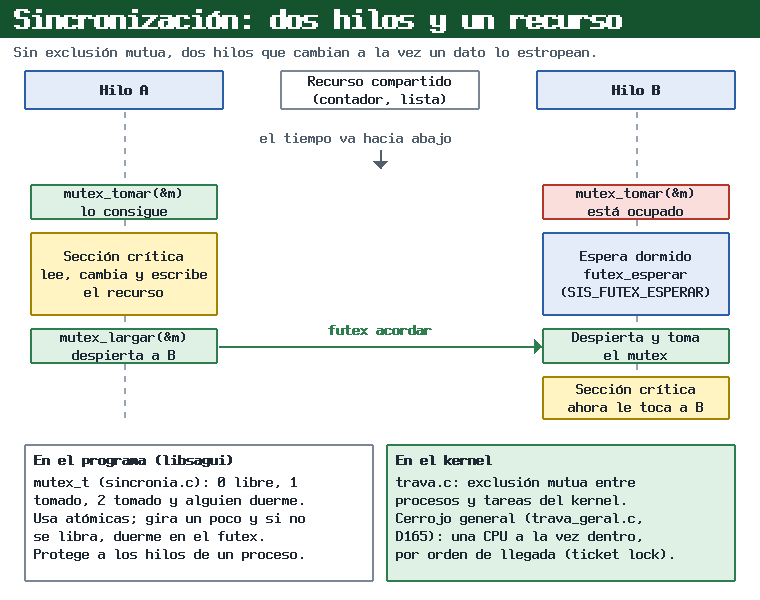

<!-- categoria: Conoce SaguiOS/Sistemas operativos; orden: 7; titulo: Concorrência e sincronização -->
# Concorrência e sincronização

[Español](07-concurrencia.md) · [Português](07-concurrencia_PT.md) · [English](07-concurrencia_EN.md)

> Objetivo: entender por que duas coisas que acontecem "ao mesmo tempo" se estragam mutuamente, quais ferramentas existem para evitar isso
> e como o próprio núcleo as usa.

## 1. Teoria

### 1.1 Condições de corrida

Duas threads (ou uma CPU e uma interrupção) que leem e escrevem a mesma variável podem intercalar seus passos. Um exemplo clássico:
`contador = contador + 1` não é uma instrução, mas três: ler, somar, escrever. Se duas threads leem o mesmo valor antes de a outra escrever,
uma das somas se perde. O resultado depende da ordem de execução: é uma **condição de corrida**, e é difícil de reproduzir porque o
escalonador decide a ordem.

### 1.2 Seção crítica e exclusão mútua

A parte do código que acessa um recurso compartilhado é a **seção crítica**. A exclusão mútua garante que, no máximo, uma thread está dentro
por vez. Três propriedades devem valer:

- **Exclusão**: nunca duas dentro ao mesmo tempo.
- **Progresso**: se ninguém está dentro e alguém quer entrar, alguém entra.
- **Espera limitada**: ninguém espera para sempre.

### 1.3 Ferramentas

- **Instruções atômicas**: uma operação indivisível, como `xchg` ou `cmpxchg` no x86. São a base de todo o resto.
- **Spinlock** (trava de giro): a thread espera girando (ocupando a CPU) até a trava ser liberada. Adequado quando a espera é muito curta,
  não para esperas longas.
- **Mutex**: se a trava está ocupada, a thread dorme e é acordada ao ser liberada. Evita desperdiçar CPU.
- **Semáforo**: um contador que permite N entradas ao mesmo tempo (N = 1 é um mutex).
- **Variáveis de condição**: esperar até que uma condição seja verdadeira, não só até a trava ficar livre.
- **Futex** (*fast userspace mutex*, Linux): o caminho rápido fica no espaço de usuário; só entra no núcleo quando é preciso dormir ou acordar
  alguém. Assim, uma trava sem disputa não custa uma chamada ao sistema.

### 1.4 Impasse

Um **impasse** (*deadlock*) acontece quando duas ou mais threads esperam umas pelas outras num círculo: A tem a trava 1 e espera a 2; B tem a 2
e espera a 1. Há quatro condições (Coffman): exclusão mútua, posse e espera, ausência de preempção e espera circular. Quebrar uma delas evita o
impasse. A prática habitual é **ordenar as travas** (sempre pegar primeiro a de número menor) e não manter uma trava enquanto se espera outra.

### 1.5 A trava geral do núcleo

Um núcleo que nunca se preocupou com paralelismo pode ser protegido com uma única trava geral: só uma CPU fica dentro do núcleo por vez. É simples
e seguro, mas limita a escalabilidade. Os núcleos modernos substituem essa trava por muitas travas finas (por subsistema, por estrutura). O Linux
passou de um *big kernel lock* para travas finas ao longo de anos.

### 1.6 Comunicação entre processos

Os pipes (`pipe`) combinam sincronização e dados: o leitor dorme se o pipe está vazio, e o escritor dorme se está cheio. Semáforos e filas de
mensagens são outras formas da mesma ideia.

### 1.7 Exemplo: uma atualização perdida, passo a passo

Duas threads executam `contador = contador + 1` uma vez cada, e `contador` vale 5 no início. Com esta ordem de passos:

```
paso  hilo 1              hilo 2              contador
 1    leer contador (5)                         5
 2                        leer contador (5)     5
 3    sumar: 5 + 1 = 6                          5
 4    escribir 6                                6
 5                        sumar: 5 + 1 = 6      6
 6                        escribir 6            6
```

O resultado é 6, não 7: a escrita da thread 2 sobrescreve a da thread 1. Numa ordem sequencial o resultado seria 7. A corrida depende da ordem,
por isso a falha aparece uma vez em cada mil execuções.

### 1.8 Exemplo: produtor e consumidor com semáforos

Um buffer de 4 posições. Três semáforos: `vazios` (4), `cheios` (0) e `mutex` (1). Em pseudocódigo:

```
productor:                       consumidor:
  esperar(vacios)                  esperar(llenos)
  esperar(mutex)                   esperar(mutex)
  meter elemento                   sacar elemento
  avisar(mutex)                    avisar(mutex)
  avisar(llenos)                   avisar(vacios)
```

A ordem importa: se o produtor espera o `mutex` antes de `vazios` e o buffer está cheio, ele fica dentro da seção crítica esperando uma posição
que só o consumidor pode liberar, e o consumidor também espera o `mutex`. É um impasse (seção 1.4).

Com a API de threads da libc do SaguiOS (`userland/libc/pthread.h`), o mutex seria `pthread_mutex_lock` e `pthread_mutex_unlock` em volta da
seção crítica; os semáforos seriam construídos sobre um mutex e uma condição.

### 1.9 Grafo de recursos e o algoritmo do banqueiro

Um **grafo de recursos** desenha processos (P) e recursos (R): uma aresta P -> R significa que P espera R; uma aresta R -> P, que R está atribuído
a P. Um ciclo indica impasse quando cada recurso tem uma única unidade. Com várias unidades, um ciclo não basta, e o **algoritmo do banqueiro**
verifica, antes de conceder um recurso, se existe uma sequência em que todos terminam. É caro, por isso na prática se prefere evitar a espera
circular ordenando os recursos.

### 1.10 Exclusão mútua com espera ocupada: de Peterson ao `xchg`

Antes de haver travas feitas pelo hardware, tentou-se resolver a exclusão mútua só com leituras e escritas:

- **Inibir as interrupções.** Dentro da seção crítica não há troca de processo. Um núcleo de um só processador a usa, mas com várias
  CPUs não basta (outra continua rodando) e não se pode deixá-la nas mãos dos programas.
- **Alternância estrita.** Uma variável `turno` diz de quem é a vez. Obriga a se revezar mesmo que o outro não queira entrar:
  descumpre o progresso.
- **Algoritmo de Peterson** (para dois processos, com duas variáveis):

```c
static atomic_int quiere[2];
static atomic_int turno;

static void entrar(int yo)
{
    int otro = 1 - yo;
    atomic_store(&quiere[yo], 1);
    atomic_store(&turno, otro);
    while (atomic_load(&quiere[otro]) && atomic_load(&turno) == otro)
        ;
}

static void salir(int yo)
{
    atomic_store(&quiere[yo], 0);
}
```

  Cada um anuncia que quer entrar (`quiere[yo]`), cede a vez ao outro e espera enquanto o outro quiser e for a vez dele. Cumpre
  exclusão, progresso e espera limitada. Mas supõe que as leituras e escritas são vistas na ordem do programa, e os processadores
  modernos as reordenam: por isso são necessárias variáveis atômicas (como acima) ou barreiras.
- **Instruções atômicas** (`xchg`, `cmpxchg`, `lock xadd`). O hardware faz «ler e escrever» como uma única operação indivisível, e
  com elas se constrói qualquer trava: um *spinlock* repete `xchg` até ver que a trava estava livre. No SaguiOS,
  `kernel/nucleo/spinlock.c` usa `cmpxchg` e, após 1024 tentativas, dorme com `hlt` até a próxima interrupção.
- **Trava por turnos** (*ticket lock*). Quem chega pega um número e espera a sua vez, como num açougue. Garante a **espera
  limitada**: ninguém passa na frente de ninguém, algo que um simples `xchg` não dá (uma CPU poderia ganhar sempre). É a trava geral
  do kernel desde a decisão D169; sob um hipervisor, onde a CPU virtual a quem cabe a vez pode não estar sendo executada, volta a uma
  trava sem fila.

### 1.11 Monitores e variáveis de condição

Um **monitor** é um módulo cujos procedimentos executam um de cada vez (a linguagem põe a exclusão mútua) e que oferece **variáveis de
condição** com `wait` e `signal`. Em C se imita com um mutex e variáveis de condição. O produtor-consumidor da seção 1.8, com um
buffer de quatro posições e duas threads, fica assim (`pthread`, `userland/libc/pthread.h`):

```c
#include <pthread.h>
#include <stdio.h>

#define HUECOS 4
#define TOTAL  20

static int buffer[HUECOS];
static int cuenta, entra, sale;
static pthread_mutex_t m = PTHREAD_MUTEX_INITIALIZER;
static pthread_cond_t hay_hueco = PTHREAD_COND_INITIALIZER;
static pthread_cond_t hay_dato = PTHREAD_COND_INITIALIZER;

static void *productor(void *arg)
{
    int i;
    (void)arg;
    for (i = 1; i <= TOTAL; i++) {
        pthread_mutex_lock(&m);
        while (cuenta == HUECOS)
            pthread_cond_wait(&hay_hueco, &m);
        buffer[entra] = i;
        entra = (entra + 1) % HUECOS;
        cuenta++;
        pthread_cond_signal(&hay_dato);
        pthread_mutex_unlock(&m);
    }
    return NULL;
}

static void *consumidor(void *arg)
{
    int i, suma = 0;
    (void)arg;
    for (i = 0; i < TOTAL; i++) {
        pthread_mutex_lock(&m);
        while (cuenta == 0)
            pthread_cond_wait(&hay_dato, &m);
        suma += buffer[sale];
        sale = (sale + 1) % HUECOS;
        cuenta--;
        pthread_cond_signal(&hay_hueco);
        pthread_mutex_unlock(&m);
    }
    printf("suma = %d\n", suma);
    return NULL;
}

int main(void)
{
    pthread_t p, c;
    pthread_create(&p, NULL, productor, NULL);
    pthread_create(&c, NULL, consumidor, NULL);
    pthread_join(p, NULL);
    pthread_join(c, NULL);
    return 0;
}
```

Três detalhes. A espera vai num `while` e não num `if`: ao acordar é preciso verificar de novo a condição (outra thread pode ter
passado na frente, e uma espera pode acordar sem aviso). `pthread_cond_wait` solta o mutex enquanto dorme e o pega de novo ao
acordar. E se avisa a condição do outro lado: o produtor avisa que há um dado, o consumidor que há uma posição livre. Com a conta
certa o programa escreve `suma = 210`. O Java faz isso com `synchronized`, `wait` e `notify`.

### 1.12 Problemas clássicos de sincronização

- **O jantar dos filósofos.** Cinco filósofos em círculo com um garfo entre cada par; para comer precisam dos dois que têm ao lado. Se
  todos pegam o da esquerda ao mesmo tempo, ninguém come: espera circular. Soluções: pegar os dois ou nenhum, numerar os garfos e
  pegar sempre primeiro o de número menor (quebra o círculo) ou deixar sentar no máximo quatro.
- **Leitores e escritores.** Muitos leitores podem ler ao mesmo tempo, mas um escritor precisa estar sozinho. Se se dá preferência aos
  leitores, um escritor pode esperar para sempre (inanição); se se dá aos escritores, esperam os leitores. A libc do SaguiOS tem
  `pthread_rwlock_t`.
- **O barbeiro dorminhoco.** Uma barbearia com um barbeiro e várias cadeiras de espera: sem clientes, o barbeiro dorme; sem cadeira
  livre, o cliente vai embora. É o modelo de um servidor com uma fila limitada.

### 1.13 Troca de mensagens e barreiras

- **Troca de mensagens.** `enviar(destino, mensagem)` e `receber(origem, &mensagem)`. Não se compartilham dados e a sincronização
  vem incluída: o receptor espera até que chegue algo. Serve igual entre processos e entre máquinas. No SaguiOS são os pipes, os
  sockets (capítulo 10) e a fila de eventos de cada janela.
- **Barreira.** Todas as threads esperam que todas tenham chegado antes de seguir. É típica do cálculo paralelo por fases: no AoEN, a
  divisão do trabalho em trechos entre threads (decisão D393) termina quando acaba o último trecho, e só então segue a thread
  principal.

### 1.14 O que fazer com o impasse

- **Algoritmo do avestruz.** Ignorá-lo. Se ocorre raramente e evitá-lo é caro, é o que muitos sistemas fazem.
- **Detecção e recuperação.** Procurar ciclos no grafo de recursos e, ao encontrá-los, matar um processo ou tirar-lhe um recurso.
- **Evitá-lo.** Conceder um pedido só se o estado resultante for **seguro**: existe uma ordem em que todos podem terminar. Exemplo:
  12 unidades de um recurso; A tem 4 e pode chegar a pedir 10, B tem 2 e chegará a 5, C tem 3 e chegará a 8. Ficam livres
  12 - 9 = 3. B precisa de mais 3: termina e devolve 5, ficam 5 livres; C precisa de 5: termina e ficam 8; A precisa de 6: termina. A
  ordem B, C, A existe, então o estado é seguro. Se se concedesse mais uma unidade a A (ficariam 2 livres), ninguém poderia terminar
  com o que resta (B pede 3, C pede 5, A pede 5): estado **inseguro**, embora ainda não haja impasse. É o que o algoritmo do
  banqueiro verifica.
- **Preveni-lo.** Negar uma das quatro condições: não exigir exclusão mútua (filas de impressão geridas por um só processo), pedir
  tudo de uma vez (sem reter e esperar), permitir tirar recursos (preempção) ou ordenar os recursos (sem espera circular). Esta última
  é a regra prática habitual: pegar as travas sempre na mesma ordem (seção 1.4).
- **Inanição e livelock.** Nem tudo é impasse: na **inanição** ninguém está bloqueado em círculo, mas um nunca recebe o recurso (um
  leitor que sempre passa na frente de um escritor); no **livelock** os processos reagem uns aos outros sem parar e não avançam,
  como duas pessoas que se afastam ao mesmo tempo.
- **Outros casos.** Nos bancos de dados, o **bloqueio em duas fases** faz cada transação pegar primeiro todas as travas de que precisa e
  só depois soltá-las, o que evita que resultados parciais se misturem. E há impasses **sem recursos**: dois processos que esperam uma
  mensagem um do outro também ficam bloqueados para sempre.

### 1.15 Inversão de prioridade

Uma thread de prioridade baixa B tem uma trava; uma thread de prioridade alta A a precisa e dorme; uma thread de prioridade média M,
que não usa a trava, tira a CPU de B. Resultado: A espera por culpa de M. Corrige-se com **herança de prioridade**: B herda a de A
enquanto tiver a trava. Aconteceu com a sonda Mars Pathfinder em 1997. O SaguiOS não tem herança de prioridade: a prioridade de áudio
(`PLAN_AUDIO`, capítulo 5) é limitada por uso e uma thread de áudio não deveria esperar um mutex que tenha uma thread comum.

### 1.16 Cálculo: o que ganha uma trava geral

Se uma fração *s* do tempo é passada dentro do núcleo (onde só entra uma CPU de cada vez) e o resto é paralelizado, o ganho com *n*
CPUs é no máximo 1 / (*s* + (1 - *s*) / *n*). Com *s* = 0,1 e 4 CPUs: 1 / (0,1 + 0,225) aprox. **3,1**; com *s* = 0,3: 1 / (0,3 + 0,175) aprox. 
**2,1**. No KVM com 4 CPUs, as decisões D164, D165 e D169 mediram entre cerca de 2 e 3,4 vezes com quatro processos, conforme a carga
(mais com cálculo puro, menos com muitas chamadas ao sistema): abaixo das 4 vezes ideais porque a trava, e a passagem da sua linha de
cache de uma CPU para outra, põem um teto. É o argumento para dividir algum dia a trava em travas por subsistema.

## 2. Como o SaguiOS faz



- **Atômicas e travas.** `kernel/nucleo/atomicas.c`, `kernel/nucleo/spinlock.c` e `kernel/nucleo/trava.c` fornecem as primitivas básicas. A base do
  SMP e do multithreading (atômicas, travas, dados por CPU, mutex e semáforo) está na decisão D150.
- **Futex.** `kernel/nucleo/hilos.c` implementa `futex_esperar(&palavra, valor)`: dorme se a palavra ainda vale `valor`, e `futex_acordar(&palavra, n)`
  acorda `n` dos que dormem nela (decisão D167). Uma thread que dorme se registra num canal comum e o próprio valor da palavra decide quem acorda.
- **Trava geral.** `kernel/nucleo/trava_geral.c` implementa a trava geral do núcleo (decisão D165): cada CPU atende as suas chamadas ao sistema, mas
  só a CPU que tem a trava está dentro do núcleo. O núcleo foi escrito para um único processador, com as interrupções desligadas lá dentro, e a trava
  geral é o que o torna seguro com várias CPUs.
- **Chamadas que esperam.** Quando uma chamada não pode ser concluída (ler um pipe vazio), o núcleo põe o processo para dormir e recua o `EIP` para
  repetir a chamada ao acordar (`kernel/nucleo/sistema.c`, a linha `eip -= 2`). Assim não é preciso guardar estado intermediário.
- **Pipes.** `kernel/fs/pipe.c` faz o leitor dormir quando não sobra nada e há quem escreva.
- **Threads e SMP.** Com o SMP ligado (decisão D164, imagem `--smp`), threads e processos rodam ao mesmo tempo em CPUs diferentes e
  cada uma entra no núcleo por turnos sob a trava geral. Uma CPU que espera uma IRQ (`cpu_espera()`) solta a trava enquanto dorme
  com `hlt`. As mudanças no escalonador ou na FPU devem respeitar a trava.
- **Trava por turnos.** Desde a decisão **D169** a trava geral é um *ticket lock* (`proximo` e `atendendo`, com `lock xadd`): as CPUs
  entram por ordem de chegada, e cada uma guarda na sua própria linha de cache se a trava é sua. `trava_geral_escolher()` a muda para
  uma trava sem fila se detecta um hipervisor.
- **Terminar um processo que roda em outra CPU.** `processo_tirar_da_cpu` lhe manda uma IPI e espera que essa CPU fique esperando a
  trava (`esperando_trava`); só então se fecham os seus arquivos e janelas (decisão D165).
- **Threads da SDL.** A SDL 2 do sistema (D393) liga `SDL_CreateThread`, as travas, as condições e os semáforos a `thread_create` e ao
  futex do sistema (anexo da SDL).

### 2.1 Decisões, alternativas e limites atuais

- **Decisão: primitivas atômicas e travas no núcleo.** A decisão **D150** fornece as atômicas, travas, dados por CPU, mutex e semáforo usados pelo SMP e pelo multithreading (`kernel/nucleo/atomicas.c`, `kernel/nucleo/trava.c`).
- **Decisão: a trava geral.** A decisão **D165** coloca uma trava geral: cada CPU atende as suas chamadas, mas só uma executa o
  núcleo por vez (`kernel/nucleo/trava_geral.c`). A **D169** a distribui por ordem de chegada.
- **Decisão: threads de usuário como entradas da tabela.** A decisão **D167** compartilha o espaço do líder e acrescenta o futex (`kernel/nucleo/hilos.c`).
- **Decisão: SMP opcional.** A decisão **D164** o mantém fora da imagem normal: menos risco de condições de corrida enquanto o núcleo efetivamente roda num só processador.
- **Limite: a libc não é totalmente segura entre threads.** A decisão **D458** o admite: `errno` é global, então um programa com várias threads não deve confiar nele sem protegê-lo.
- **Limite: a trava geral limita o paralelismo.** Com várias CPUs, as chamadas ao sistema de todas passam por uma única trava
  (decisão D165): enquanto uma CPU faz um `exec` ou desenha uma janela, as demais esperam para entrar. É seguro e simples; é também o
  gargalo que teria de ser dividido (seção 1.16).

## 3. Experimento no SaguiOS

1. No terminal, digite `sleep 30 | cat`. O `cat` espera dados do pipe. Enquanto isso, abra o Administrador de tarefas ou digite `ps` em outro terminal: o processo `cat` aparece no estado `bloqueado`.
2. Quando passarem os 30 segundos, o `cat` termina sem dados e desaparece da lista do `ps`.
3. Rode `ps -c` e compare os estados dos processos do terminal com os do `sleep`.

**O que observar:** um processo em espera não ocupa a CPU, mas ocupa uma entrada na tabela. Esse é o estado `bloqueado` da teoria: espera um evento e o escalonador o ignora até que ele chegue.

**Exercício prático adicional.** Escreva em C o produtor e o consumidor da seção 1.8 com duas threads (`pthread_create`) e um buffer de quatro posições, usando `pthread_mutex_t`. Remova a espera do `mutex` no consumidor e observe se o programa falha ou trava. Descreva a ordem de chamadas que provoca isso.

## 4. Perguntas de revisão

1. Escreva um exemplo de condição de corrida com duas threads que incrementam um contador, e explique por que falha.
2. Quando um spinlock é melhor que um mutex, e quando é pior?
3. Duas threads pegam duas travas em ordem inversa. Desenhe o impasse e proponha a solução.
4. Qual a vantagem da trava geral frente a muitas travas finas, e qual o seu custo?
5. Um semáforo `vazios` vale 4 e `cheios` vale 0. Quantos elementos cabem no buffer da seção 1.8 e quantos há no início?
6. Duas threads incrementam um contador 1000 vezes cada uma, sem trava, e o resultado final é 1734. O que aconteceu? Como se corrige?
7. Dois processos, A e B, têm dois recursos R1 e R2. A pega R1 e pede R2; B pega R2 e pede R1. Desenhe o grafo de recursos e diga se há impasse.
8. No algoritmo de Peterson, o que acontece se o outro processo não quer entrar? E se os dois querem ao mesmo tempo?
9. Cinco filósofos pegam ao mesmo tempo o garfo da esquerda. O que acontece e que duas soluções há?
10. Há 12 unidades de um recurso. A tem 4 e pode chegar a pedir 10; B tem 2 e chegará a 5; C tem 3 e chegará a 8. O estado é seguro? E
    se se concede mais uma unidade a A?
11. Se 20 % do tempo é passado dentro de uma trava geral, qual é o ganho máximo com 4 CPUs?
12. Uma thread de áudio de prioridade alta espera um mutex que tem uma thread comum, à qual outra thread média não deixa rodar. Como se
    chama o fenômeno e como se corrige?

## 5. Respostas

1. Duas threads leem `contador = 5`, cada uma soma 1 e escreve 6: o resultado é 6, não 7. A soma não é atômica (ler, somar, escrever), então uma atualização se perde.
2. O spinlock é melhor se a seção crítica é muito curta e a trava é liberada logo, porque evita o custo de dormir e acordar. É pior se a espera é longa, porque queima CPU enquanto espera.
3. A thread A pega a trava 1 e espera a 2; a thread B pega a 2 e espera a 1: um círculo de espera. Solução: todas as threads pegam as travas sempre na mesma ordem (primeiro a 1, depois a 2).
4. A trava geral é simples e segura: o núcleo não precisa raciocinar sobre cada estrutura. Seu custo é que só uma CPU executa o núcleo por vez, então o paralelismo das chamadas é limitado. As travas finas escalam melhor, mas são mais difíceis de provar corretas.
5. Cabem 4 elementos (o valor inicial de `vazios`). No início há 0 elementos (o valor inicial de `cheios`). Cada inserção subtrai de `vazios` e soma a `cheios`, então a soma dos dois é sempre 4.
6. Há atualizações perdidas: duas leituras do mesmo valor e duas escritas que se sobrescrevem. Corrige-se com uma trava (ou uma atômica como `fetch_add`) em volta da soma.
7. Arestas A -> R2, R2 -> B, B -> R1, R1 -> A: um ciclo, portanto há impasse. A solução é que todos peguem R1 antes de R2.
8. Se o outro não quer, `quiere[otro]` vale 0, a condição do `while` é falsa e entra sem esperar. Se os dois querem ao mesmo tempo, ambos
   põem o seu `quiere` e cada um cede a vez ao outro; quem escreve `turno` por último é quem espera, então entra o outro.
9. Cada um tem um garfo e espera o do vizinho: espera circular, impasse. Duas soluções: numerar os garfos e pegar sempre primeiro o de
   menor número (quebra o círculo) ou deixar sentar no máximo quatro (sempre sobra um que pode pegar os dois).
10. Livres: 12 - 9 = 3. B precisa de 3: termina e ficam 5; C precisa de 5: termina e ficam 8; A precisa de 6: termina. A ordem B, C, A
    existe: **seguro**. Com mais uma unidade para A, ficam 2 livres e B precisa de 3, C de 5 e A de 5: ninguém pode terminar, então o
    estado é **inseguro**.
11. 1 / (0,2 + 0,8 / 4) = 1 / 0,4 = **2,5**.
12. É uma **inversão de prioridade**: a thread média atrasa indiretamente a de áudio. Corrige-se com herança de prioridade (a thread
    que tem o mutex herda a prioridade da que o espera) ou evitando que a thread de áudio espere travas que threads comuns tenham.
