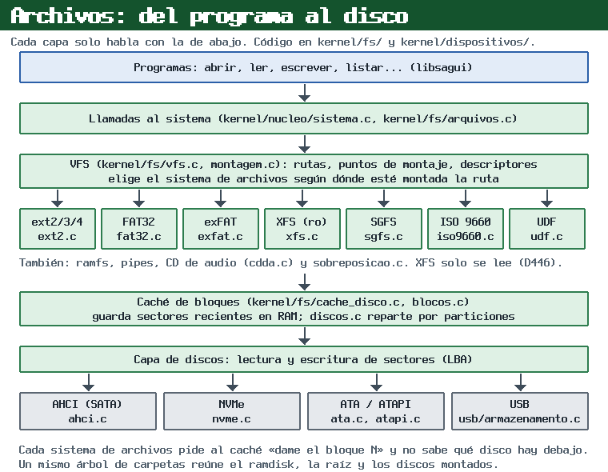
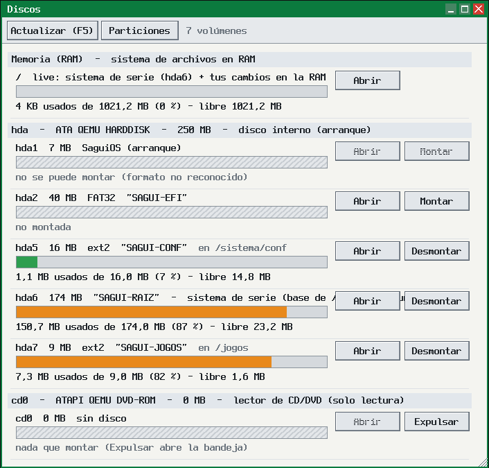

<!-- categoria: Conoce SaguiOS/Sistemas operativos; orden: 8; titulo: Sistemas de archivos -->
# Sistemas de archivos

[Español](08-sistemas-de-archivos.md) · [Português](08-sistemas-de-archivos_PT.md) · [English](08-sistemas-de-archivos_EN.md)

> Objetivo: entender cómo un archivo se convierte en bloques de disco, cómo el VFS presenta sistemas distintos con la
> misma interfaz, por qué existe el diario y cómo se controlan los permisos.

## 1. Teoría

### 1.1 Del disco al archivo

Un disco es una secuencia de **sectores** (512 bytes o 4 KB). Un sistema de archivos los agrupa en **bloques** y añade una
estructura: qué bloques pertenecen a qué archivo, cómo se llama, quién lo puede usar. Los elementos básicos son:

- **Inodo**: el registro de un archivo. Guarda su tamaño, sus permisos, sus fechas y los punteros a sus bloques.
  El nombre no está en el inodo, sino en una entrada de directorio que apunta a él.
- **Bloques de datos**: el contenido. Un archivo grande necesita índices (directos, indirectos, *extents*) para encontrar
  todos sus bloques.
- **Mapa de bloques e inodos libres**: qué está ocupado.
- **Directorio**: una tabla de nombres que apunta a inodos.

### 1.2 VFS: una interfaz para muchos sistemas

El **VFS** (*virtual file system*) es una capa que ofrece a los programas las mismas llamadas (`open`, `read`, `write`)
y las traduce al sistema concreto: ext4, FAT32, ISO 9660, una tubería o la terminal. Linux lo introdujo; los BSD tienen
su propia versión (`vnode`). Gracias a él un programa no sabe si el archivo está en un pendrive FAT o en un disco ext4.

### 1.3 Caché de bloques

Leer el disco es lento. La **caché de bloques** guarda en RAM los bloques usados recientemente. Dos técnicas:

- **Lectura anticipada** (*read-ahead*): si se lee en secuencia, se cargan los siguientes bloques antes de pedirlos.
- **Escritura diferida** (*write-back*): la escritura va a la caché y se vuelca al disco después. Es más rápido, pero un
  corte de corriente puede perder datos: por eso hace falta sincronizar (`sync`) y apagar con orden.

### 1.4 Diario (*journal*)

Si la máquina se apaga a mitad de una escritura, el sistema de archivos puede quedar incoherente (un inodo apunta a
bloques que no existen). El **diario** guarda primero en una zona de registro lo que se va a cambiar y solo después lo
aplica. Al montar tras un fallo, se reproduce el diario y se completa o se deshace. ext3 y ext4 usan **JBD2**; NTFS tiene
su registro de transacciones; XFS tiene su propio diario.

### 1.5 Sistemas de archivos habituales

| Sistema | Uso típico | Características |
| --- | --- | --- |
| **ext2** | Discos de Linux sin diario | Inodos con punteros directos e indirectos. Sencillo y fácil de estudiar. |
| **ext4** | Discos de Linux por defecto | Diario JBD2, *extents*, grandes volúmenes. |
| **FAT32** | Pendrives y tarjetas, muy compatible | Tabla de asignación de archivos; límite de 4 GB por archivo. |
| **exFAT** | Pendrives y tarjetas grandes | Como FAT, sin el límite de 4 GB; sin diario. |
| **ISO 9660 / UDF** | CD y DVD | Sólo lectura en la práctica; UDF es el de los DVD. |
| **XFS** | Servidores y grandes volúmenes | Extents y árboles B+; muy usado en Linux. |

### 1.6 Permisos y usuarios

Cada archivo tiene un **dueño**, un **grupo** y tres clases de permiso (`rwx`) para dueño, grupo y el resto. El
sistema comprueba los permisos en cada `open`. Se identifica a cada proceso con un **uid** y un **gid**. Un administrador
(uid 0) salta esas comprobaciones.

### 1.7 Cálculo: el tamaño máximo de un archivo con inodos

En ext2 con bloques de 4 KB, cada puntero ocupa 4 bytes, así que un bloque de punteros guarda 4096 / 4 = **1024** punteros.
El inodo tiene 12 punteros directos, uno indirecto simple, uno doble y uno triple. El número máximo de bloques es:

12 + 1024 + 1024² + 1024³ = 1 074 791 436 bloques, y 1 074 791 436 × 4 KB aprox. **4 TiB**.

Con bloques de 1 KB, cada bloque guarda 256 punteros y el máximo baja a unos **16 GiB**. Por eso el tamaño de bloque
importa: en ext2 los bloques grandes permiten archivos mayores. En FAT32, en cambio, el tamaño del archivo está en un campo
de 32 bits: el máximo es 2³² - 1 bytes, unos 4 GiB, con independencia del tamaño de bloque (cluster).

### 1.8 Comparativa: la caché y el VFS en otros sistemas

- **Linux** unifica la caché de páginas: los archivos y los bloques de disco se cachean en las mismas páginas, con
  reemplazo por listas activas e inactivas. El VFS usa inodos y *dentries* (entradas de directorio en caché).
- **FreeBSD** usa un VFS con *vnodes* y una caché unificada de memoria virtual, que comparte la RAM con los programas.
- **Windows** usa un gestor de caché independiente que mapea archivos en memoria, y NTFS con su registro de transacciones.
- **SaguiOS** usa una caché de bloques separada del VFS, con lectura anticipada y escritura diferida (`kernel/fs/cache_disco.c`).
  Es más simple de leer, aunque menos integrada con la memoria de los programas.

### 1.9 Cómo se reparte el espacio: contigua, enlazada, FAT e inodos

¿Cómo sabe el sistema qué bloques forman un archivo?

| Método | Idea | Ventaja | Problema |
| --- | --- | --- | --- |
| Contigua | Los bloques van seguidos: inicio y longitud | Lectura rapidísima y acceso directo | Fragmentación externa; el archivo no puede crecer |
| Lista enlazada | Cada bloque guarda el número del siguiente | Sin fragmentación externa | Acceso directo lento: hay que recorrer la lista |
| Tabla FAT | Los enlaces van en una tabla aparte, en memoria | Acceso directo recorriendo solo la tabla | La tabla crece con el disco |
| Inodo | Una tabla de punteros por archivo | Solo se carga la del archivo abierto | Los archivos grandes necesitan indirectos |
| *Extents* | Tramos (inicio, longitud) en vez de un puntero por bloque | Un archivo grande cabe en pocos tramos | Más complejo de mantener |

El tamaño del **bloque** es un compromiso: uno grande lee más datos por acceso, pero desperdicia más en el último bloque de
cada archivo. Con archivos de 2 KB de media y bloques de 4 KB se pierde la mitad del espacio; con bloques de 1 KB, solo un
cuarto.

Cálculo de la FAT: un disco de 32 GiB con *clusters* de 4 KiB tiene 32 GiB / 4 KiB = 8 388 608 clusters. Con 4 bytes por
entrada, la FAT ocupa **32 MiB**. Cuanto mayor es el disco, más cuesta tener la FAT en memoria, y por eso FAT no se usa en
volúmenes grandes.

### 1.10 Directorios y enlaces

Un directorio es un archivo especial que guarda una tabla de **nombre -> inodo**. Resolver una ruta es recorrerla componente a
componente. Para abrir `/home/ana/nota.txt` con la caché vacía, el sistema lee el inodo de `/` y su bloque de datos (para
encontrar `home`), el inodo de `home` y su bloque, el de `ana` y su bloque, y por fin el inodo de `nota.txt`: **7 lecturas**
antes del primer byte del archivo. La caché de bloques (apartado 1.3) existe, en buena parte, para evitarlas.

- **Enlace duro.** Otra entrada de directorio que apunta al mismo inodo. El inodo cuenta sus nombres y el archivo solo
  desaparece al borrar el último; no puede cruzar sistemas de archivos.
- **Enlace simbólico.** Un archivo pequeño cuyo contenido es una ruta. Puede apuntar a otro sistema de archivos o a algo que ya
  no existe (enlace roto).

### 1.11 Extents, árboles B+ y grupos de asignación (el caso de XFS)

Un archivo de 1 GiB contiguo, con bloques de 4 KiB, necesitaría 262 144 punteros de 4 bytes (**1 MiB** de punteros) con inodos
al estilo ext2, y un solo *extent* de unos 16 bytes si está en un tramo. XFS usa *extents* y, si el archivo está muy
fragmentado, los guarda en un **árbol B+**; sus carpetas pasan de una lista dentro del inodo a bloques con una tabla de
*hash* y, al crecer, a un árbol. Divide el volumen en **grupos de asignación** independientes, para que varios hilos asignen
espacio a la vez sin estorbarse, y en su versión 5 protege los metadatos con una suma de comprobación (CRC32C).

### 1.12 Fiabilidad: `fsck` o diario

Sin diario, tras un apagado incorrecto hay que revisar **todo** el volumen (`fsck`): su coste crece con el tamaño del disco.
Leer 2 TB a 100 MB/s son 20 000 s, unas **5,6 horas**. Con diario solo se reproduce lo que estaba a medias: si el diario es de
128 MB, a la misma velocidad son unos **1,3 s**. El diario no protege de los fallos del disco (sectores dañados), por eso se
hacen además copias de seguridad.

### 1.13 Qué es un archivo: nombre, tipo, acceso y atributos

Un archivo es una unidad de información con nombre que sobrevive a los programas. Su **nombre** puede llevar una extensión que
sugiere el contenido; su **tipo** puede ser normal, directorio o especial (un dispositivo de bloques o de caracteres, como en Unix, donde
un teclado o un disco también «son» archivos). El **acceso** puede ser secuencial (de principio a fin) o aleatorio (con una posición, como
`seek`). Sus **atributos** son el tamaño, el dueño, los permisos y las fechas. Las operaciones básicas son crear, borrar, abrir, cerrar,
leer, escribir y posicionarse. Un **archivo mapeado en memoria** se pone en el espacio de direcciones del proceso: leer y escribir son
accesos a memoria y el fallo de página trae el contenido del disco; SaguiOS no lo ofrece en su libc (los programas usan `open`, `read`,
`write` y `lseek`, con la caché de bloques por debajo).

## 2. Así lo hace SaguiOS

- **VFS.** `kernel/fs/vfs.c` decide a qué sistema pertenece cada descriptor. La tabla de archivos abiertos de cada
  proceso está en `kernel/fs/arquivos.c`. La llamada `write` de `kernel/fs/arquivos.c` llama a `vfs_escrever`
  (capítulo 3).
- **Montajes.** `kernel/fs/montagem.c` mantiene la tabla de montajes y `/etc/fstab` (decisión D040). La orden `mount`
  (`userland/programas/mount.c`) acepta `-t fat32|exfat|ext2|ext3|ext4|xfs|iso9660|udf|cd|auto` y opciones `ro`, `rw`, `uid=`, `gid=`.
- **Discos y particiones.** `kernel/fs/discos.c` y `kernel/fs/blocos.c` dan acceso a los sectores y gestionan la tabla de
  particiones (decisiones D040 y D179).
- **Caché de bloques.** `kernel/fs/cache_disco.c` tiene lectura anticipada y escritura diferida (decisión D281). El
  DMA del IDE se describe en el capítulo 9.
- **ext2, ext3 y ext4.** `kernel/fs/ext2.c` y `kernel/fs/jbd2.c`. Al montar se reproduce el diario JBD2 (decisión D326).
  La escritura con diario está escrita pero desactivada, según esa decisión. La raíz `SAGUI-RAIZ` es ext2 (decisión D379).
- **FAT32, exFAT, CD y DVD.** `kernel/fs/fat32.c`, `kernel/fs/exfat.c`, `kernel/fs/iso9660.c`, `kernel/fs/udf.c` (decisión
  D233, UDF en solo lectura) y `kernel/fs/cdda.c` para CD de audio.
- **SGFS (ramdisk).** `kernel/fs/sgfs.c` lee el formato del ramdisk: una tabla de entradas con rutas completas, ordenada,
  seguida de los datos. Es el sistema mínimo del arranque (capítulo 2).
- **Raíz en disco o en RAM.** `kernel/fs/raiz.c`, `kernel/fs/sobreposicao.c` (capa escribible sobre el medio de solo
  lectura, como el *overlayfs*) y `kernel/fs/ramfs.c` (decisión D379).
- **Permisos y usuarios.** Dueño, grupo y `rwx` (decisión D282); usuarios y llamadas privilegiadas (decisión D255).
  Las órdenes `chmod`, `chown`, `id` y `whoami` están en `userland/programas/`.
- **XFS (solo lectura).** `kernel/fs/xfs.c` (decisión **D446**) lee volúmenes XFS de Linux, versiones 4 y 5: superbloque,
  grupos de asignación, inodos locales, con *extents* y con árbol B+, y carpetas en sus cinco formas (con la búsqueda por
  *hash* bajando por el árbol). En la v5 comprueba las sumas CRC32C: si un objeto falla da error de E/S y el resto del volumen
  se sigue leyendo. **No reproduce el diario**: al montar solo mira si quedó limpio y, si no, monta igual en solo lectura con
  un aviso. Se monta con `mount -t xfs` (o por la detección automática) y es siempre de solo lectura, aunque se pida `-o rw`.
  Está escrito desde cero con la especificación pública del formato: el código de Linux es GPL-2.0-only y no se mezcla con la
  GPL v3.

### 2.1 Decisiones, alternativas y límites actuales

- **Decisión: montajes y `fstab`.** La decisión **D040** trae la capa de montaje (`kernel/fs/montagem.c`) y la persistencia
  en ext2/ext4. La decisión **D179** gestiona las particiones y un instalador.
- **Decisión: caché de bloques con lectura anticipada y escritura diferida.** La decisión **D281** añade el DMA del IDE y
  la caché que cuesta menos que leer el disco cada vez.
- **Decisión: el diario se reproduce al montar.** La decisión **D326** reproduce el diario JBD2 de ext3/ext4. La escritura
  con diario está escrita pero **desactivada**: en esta versión el sistema de archivos escribe sin diario.
- **Decisión: raíz en ext2 y medio de solo lectura con capa escribible.** La decisión **D379** (`SAGUI-RAIZ` y
  `kernel/fs/sobreposicao.c`).
- **Límite: permisos `rwx` sin listas de control de acceso.** La decisión **D282** da dueño, grupo y `rwx`, no ACL.
- **Decisión: XFS propio y de solo lectura primero.** La decisión **D446** lee XFS sin escribirlo: es lo que más ayuda a quien
  llega con un disco de Linux y lo que menos arriesga los datos. El diseño deja preparada la escritura (caché de búferes con
  marca de sucio, un solo recorrido de árbol B+).
- **Límite: XFS es de solo lectura y no está completo.** El diario no se reproduce, los atributos extendidos se ignoran, los
  archivos del volumen de tiempo real no se leen y un archivo de 4 GB o más se lee hasta 4 GB - 1 (el VFS cuenta posiciones
  en 32 bits). Los enlaces simbólicos relativos se siguen; uno absoluto, roto o en bucle se ve como un archivo cuyo contenido es
  el destino, porque el VFS de SaguiOS no tiene enlaces. La escritura (fase 2 de `docs/xfs.md`) queda para más adelante.

## 3. Experimento en SaguiOS

1. Escribe `df -h`. Verás cada sistema montado, su tipo y su uso. Localiza la raíz `/` y su tipo.
2. Escribe `mount` (sin argumentos) para ver los montajes. Compara con `df`.
3. Escribe `ls -l /ayuda` para ver permisos, dueño y tamaño de cada archivo. Interpreta la columna de permisos: tipo
   (`d` o `-`) y tres grupos `rwx`.
4. Abre **Discos** (Inicio > Sistema > Discos) para ver las particiones y sus sistemas de archivos.
5. Con un archivo de tu carpeta, prueba `chmod 600 nombre` y luego `ls -l`. Vuelve a `chmod 644` si lo necesitas.

**Qué observar:** el programa usa siempre `ls` y `chmod`, sin saber si el archivo está en ext2 o en FAT. Eso lo resuelve
el VFS, no el programa.

**Ejercicio práctico adicional.** Calcula el tamaño máximo de un archivo en ext2 con bloques de 2 KB (512 punteros por
bloque) y compáralo con el de 4 KB. Después escribe en SaguiOS `df -h` y `mount` y anota qué sistema de archivos
tiene cada punto de montaje. Explica por qué un pendrive FAT32 no admite un archivo de vídeo de 5 GB.

## 4. Preguntas de repaso

1. ¿Qué guarda un inodo y qué no guarda? ¿Dónde está el nombre de un archivo?
2. ¿Por qué un corte de corriente con escritura diferida puede dejar datos perdidos, y cómo ayuda el diario?
3. Explica por qué FAT32 no sirve para un archivo de 5 GB y qué sistema lo resuelve.
4. Un usuario con permiso `r--` en un archivo intenta escribirlo. ¿En qué momento lo rechaza el sistema, y qué llamada
   lo decide?

5. Un archivo ext2 de 40 KB con bloques de 4 KB: ¿cuántos bloques de datos usa? ¿Cuántos con bloques de 1 KB?
6. ¿Qué diferencia hay entre la caché de bloques de SaguiOS y la caché de páginas de Linux? ¿Qué ventaja tiene la de Linux?
7. ¿Por qué el diario protege de un corte de luz y la escritura diferida sin diario no? Responde en dos frases.
8. Un disco de 8 GiB con *clusters* de 4 KiB usa FAT de 4 bytes por entrada. ¿Cuánto ocupa la FAT?
9. ¿Cuántas lecturas de disco hacen falta, con la caché vacía, para abrir `/a/b/c`?
10. Reiniciar tras un apagado incorrecto tarda cinco horas sin diario y dos segundos con diario. Explica por qué.
11. Un archivo tiene dos enlaces duros y un enlace simbólico. Se borra uno de los nombres duros. ¿Qué pasa con el archivo y con el
    enlace simbólico?

## 5. Soluciones

1. El inodo guarda tamaño, permisos, fechas y punteros a bloques. El nombre está en la entrada de directorio que apunta al
   inodo: el mismo inodo puede tener varios nombres (enlaces duros).
2. Los datos escritos en caché aún no están en disco. Un corte los pierde, y el sistema puede quedar a medio escribir.
   El diario registra primero el cambio, así que al volver se completa o se deshace sin dejar incoherencias.
3. FAT32 guarda el tamaño del archivo en 32 bits: el máximo es 4 GB menos un byte. exFAT (o un sistema con extents, como
   ext4) lo resuelve.
4. Lo decide `open` con modo de escritura, en el VFS y los permisos del inodo: el sistema comprueba si el uid del
   proceso coincide con el dueño o el grupo, y el `r--` no permite escribir. Un administrador lo salta.

### Respuestas a las preguntas adicionales

5. Con 4 KB, 40 / 4 = **10 bloques** (los 10 punteros directos alcanzan, sin indirecto). Con 1 KB, 40 bloques.
6. La de SaguiOS es un bloque de caché para el disco, separada de la memoria de los programas. La de Linux comparte las
   mismas páginas con los archivos abiertos y con la memoria: el reemplazo es global y más eficiente.
7. El diario escribe primero el cambio pendiente en una zona de registro; tras un corte, se reproduce o se deshace.
   Sin diario, una escritura a medias puede dejar el inodo y los bloques en desacuerdo, y nada indica cuál es el correcto.
8. 8 GiB / 4 KiB = 2 097 152 clusters × 4 bytes = **8 MiB**.
9. Inodo de `/`, su bloque, inodo de `a`, su bloque, inodo de `b`, su bloque e inodo de `c`: **7 lecturas**.
10. Sin diario hay que revisar todo el volumen (el coste crece con el tamaño del disco); con diario solo se reproduce lo que
    estaba a medias, que es una zona de tamaño fijo y pequeña.
11. El archivo sigue existiendo, porque su inodo todavía tiene otro nombre. Un enlace simbólico guarda una ruta, no el inodo: si
    la ruta que guarda era el nombre borrado, queda **roto**; si era el otro nombre, sigue funcionando.
