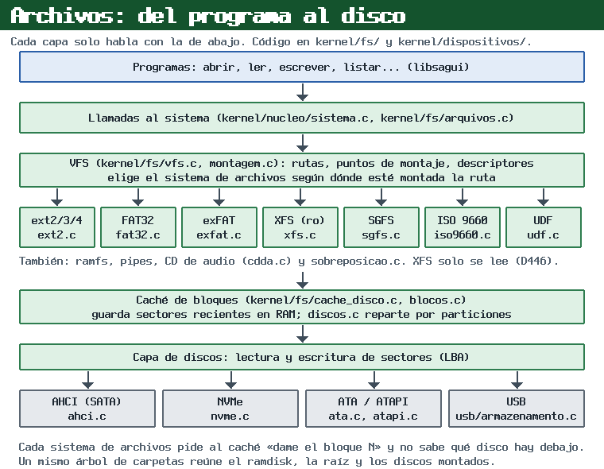
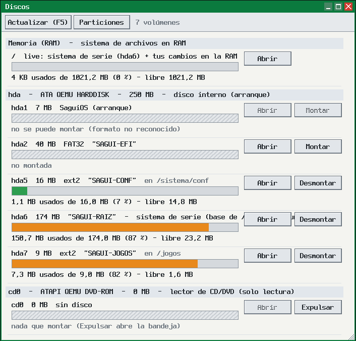

<!-- categoria: Conoce SaguiOS/Sistemas operativos; orden: 8; titulo: File systems -->
# File systems

[Español](08-sistemas-de-archivos.md) · [Português](08-sistemas-de-archivos_PT.md) · [English](08-sistemas-de-archivos_EN.md)

> Goal: understand how a file becomes disk blocks, how the VFS presents different systems with the same interface, why the
> journal exists and how permissions are controlled.

## 1. Theory

### 1.1 From disk to file

A disk is a sequence of **sectors** (512 bytes or 4 KB). A file system groups them into **blocks** and adds a structure:
which blocks belong to which file, what it is called, who may use it. The basic elements are:

- **Inode**: the record of a file. It stores its size, permissions, dates and pointers to its blocks. The name is not in
  the inode; a directory entry that points to it holds the name.
- **Data blocks**: the content. A large file needs indexes (direct, indirect, *extents*) to find all its blocks.
- **Free block and inode map**: what is in use.
- **Directory**: a table of names that point to inodes.

### 1.2 VFS: one interface for many systems

The **VFS** (*virtual file system*) is a layer that offers programs the same calls (`open`, `read`, `write`) and translates
them to the concrete system: ext4, FAT32, ISO 9660, a pipe or the terminal. Linux introduced it; the BSDs have their own
version (`vnode`). Thanks to it a program does not know whether the file is on a FAT pendrive or an ext4 disk.

### 1.3 Block cache

Reading the disk is slow. The **block cache** keeps recently used blocks in RAM. Two techniques:

- **Read-ahead**: if reading is sequential, the next blocks are loaded before they are requested.
- **Write-back**: the write goes to the cache and is flushed to disk later. It is faster, but a power cut can lose data:
  that is why syncing (`sync`) and orderly shutdown are needed.

### 1.4 Journal

If the machine turns off in the middle of a write, the file system can be inconsistent (an inode points to blocks that do not
exist). The **journal** first records in a log area what is going to change and only then applies it. After a failure, when
mounting, the journal is replayed and the operation is completed or undone. ext3 and ext4 use **JBD2**; NTFS has its
transaction log; XFS has its own journal.

### 1.5 Common file systems

| System | Typical use | Features |
| --- | --- | --- |
| **ext2** | Linux disks without a journal | Inodes with direct and indirect pointers. Simple and easy to study. |
| **ext4** | Default Linux disks | JBD2 journal, *extents*, large volumes. |
| **FAT32** | Pendrives and cards, very compatible | File allocation table; 4 GB limit per file. |
| **exFAT** | Large pendrives and cards | Like FAT, without the 4 GB limit; no journal. |
| **ISO 9660 / UDF** | CDs and DVDs | Read-only in practice; UDF is the DVD format. |
| **XFS** | Servers and large volumes | Extents and B+ trees; widely used on Linux. |

### 1.6 Permissions and users

Each file has an **owner**, a **group** and three permission sets (`rwx`) for owner, group and everyone else. The system checks
permissions on each `open`. Each process is identified with a **uid** and a **gid**. An administrator (uid 0) skips those
checks.

### 1.7 Calculation: the maximum file size with inodes

In ext2 with 4 KB blocks, each pointer takes 4 bytes, so a pointer block holds 4096 / 4 = **1024** pointers. The inode has 12
direct pointers, one single-indirect, one double-indirect and one triple-indirect pointer. The maximum number of blocks is:

12 + 1024 + 1024² + 1024³ = 1 074 791 436 blocks, and 1 074 791 436 × 4 KB approx. **4 TiB**.

With 1 KB blocks, each block holds 256 pointers and the maximum drops to about **16 GiB**. That is why the block size matters:
in ext2 larger blocks allow larger files. In FAT32, by contrast, the file size is a 32-bit field: the maximum is 2³² - 1 bytes,
about 4 GiB, whatever the cluster size.

### 1.8 Comparison: cache and VFS in other systems

- **Linux** unifies the page cache: files and disk blocks are cached in the same pages, with replacement by active and inactive
  lists. The VFS uses inodes and *dentries* (cached directory entries).
- **FreeBSD** uses a VFS with *vnodes* and a unified virtual-memory cache, which shares RAM with programs.
- **Windows** uses a separate cache manager that maps files into memory, and NTFS with its transaction log.
- **SaguiOS** uses a block cache separate from the VFS, with read-ahead and write-back (`kernel/fs/cache_disco.c`). It is
  simpler to read, although less integrated with the programs' memory.

### 1.9 How space is assigned: contiguous, linked, FAT and inodes

How does the system know which blocks make up a file?

| Method | Idea | Advantage | Problem |
| --- | --- | --- | --- |
| Contiguous | The blocks go one after another: start and length | Very fast reading and direct access | External fragmentation; the file cannot grow |
| Linked list | Each block stores the number of the next | No external fragmentation | Slow direct access: the list must be walked |
| FAT table | The links live in a separate table, in memory | Direct access by walking only the table | The table grows with the disk |
| Inode | A table of pointers per file | Only the open file's table is loaded | Big files need indirect blocks |
| *Extents* | Runs (start, length) instead of one pointer per block | A big file fits in few runs | More complex to maintain |

The **block** size is a compromise: a big one reads more data per access, but wastes more in the last block of each file. With
files of 2 KB on average and 4 KB blocks, half the space is lost; with 1 KB blocks, only a quarter.

FAT calculation: a 32 GiB disk with 4 KiB *clusters* has 32 GiB / 4 KiB = 8,388,608 clusters. With 4 bytes per entry, the FAT
takes **32 MiB**. The bigger the disk, the more it costs to keep the FAT in memory, which is why FAT is not used on big volumes.

### 1.10 Directories and links

A directory is a special file that stores a table of **name -> inode**. Resolving a path means walking it component by component.
To open `/home/ana/nota.txt` with an empty cache, the system reads the inode of `/` and its data block (to find `home`), the
inode of `home` and its block, that of `ana` and its block, and finally the inode of `nota.txt`: **7 reads** before the first
byte of the file. The block cache (section 1.3) exists, to a large extent, to avoid them.

- **Hard link.** Another directory entry that points to the same inode. The inode counts its names and the file only disappears
  when the last one is deleted; it cannot cross file systems.
- **Symbolic link.** A small file whose content is a path. It can point to another file system or to something that no longer
  exists (a broken link).

### 1.11 Extents, B+ trees and allocation groups (the XFS case)

A contiguous 1 GiB file, with 4 KiB blocks, would need 262,144 pointers of 4 bytes (**1 MiB** of pointers) with ext2-style
inodes, and a single *extent* of about 16 bytes if it is in one run. XFS uses *extents* and, if the file is very fragmented,
stores them in a **B+ tree**; its directories go from a list inside the inode to blocks with a *hash* table and, as they grow,
to a tree. It splits the volume into independent **allocation groups**, so several threads can allocate space at once without
getting in each other's way, and in its version 5 it protects the metadata with a checksum (CRC32C).

### 1.12 Reliability: `fsck` or journal

Without a journal, after an improper shutdown the **whole** volume has to be checked (`fsck`): its cost grows with the size of
the disk. Reading 2 TB at 100 MB/s takes 20,000 s, about **5.6 hours**. With a journal only what was half-done is replayed: if the
journal is 128 MB, at the same speed it takes about **1.3 s**. The journal does not protect against disk failures (damaged
sectors), which is why backups are also made.

### 1.13 What a file is: name, type, access and attributes

A file is a named unit of information that outlives programs. Its **name** can carry an extension that hints at the content; its **type**
can be regular, directory or special (a block or character device, as in Unix, where a keyboard or a disk are also "files"). **Access** can
be sequential (from start to end) or random (with a position, like `seek`). Its **attributes** are the size, the owner, the permissions and
the dates. The basic operations are create, delete, open, close, read, write and seek. A **memory-mapped file** is placed in the process's
address space: reading and writing are memory accesses and the page fault brings the content from disk; SaguiOS does not offer it in its
libc (programs use `open`, `read`, `write` and `lseek`, with the block cache underneath).

## 2. How SaguiOS does it

- **VFS.** `kernel/fs/vfs.c` decides which system each descriptor belongs to. The table of open files of each process is in
  `kernel/fs/arquivos.c`. The `write` call in `kernel/fs/arquivos.c` calls `vfs_escrever` (chapter 3).
- **Mounts.** `kernel/fs/montagem.c` keeps the mount table and `/etc/fstab` (decision D040). The `mount` command
  (`userland/programas/mount.c`) accepts `-t fat32|exfat|ext2|ext3|ext4|xfs|iso9660|udf|cd|auto` and options `ro`, `rw`, `uid=`, `gid=`.
- **Disks and partitions.** `kernel/fs/discos.c` and `kernel/fs/blocos.c` give access to sectors and manage the partition
  table (decisions D040 and D179).
- **Block cache.** `kernel/fs/cache_disco.c` has read-ahead and write-back (decision D281). The IDE DMA is described in
  chapter 9.
- **ext2, ext3 and ext4.** `kernel/fs/ext2.c` and `kernel/fs/jbd2.c`. When mounting, the JBD2 journal is replayed (decision
  D326). Journaled writing is written but disabled, according to that decision. The `SAGUI-RAIZ` root is ext2 (decision D379).
- **FAT32, exFAT, CD and DVD.** `kernel/fs/fat32.c`, `kernel/fs/exfat.c`, `kernel/fs/iso9660.c`, `kernel/fs/udf.c` (decision
  D233, UDF read-only) and `kernel/fs/cdda.c` for audio CDs.
- **SGFS (ramdisk).** `kernel/fs/sgfs.c` reads the ramdisk format: a sorted table of entries with full paths, followed by the
  data. It is the minimal system of the boot (chapter 2).
- **Root on disk or in RAM.** `kernel/fs/raiz.c`, `kernel/fs/sobreposicao.c` (a writable layer over the read-only medium, like
  Linux overlayfs) and `kernel/fs/ramfs.c` (decision D379).
- **Permissions and users.** Owner, group and `rwx` (decision D282); users and privileged calls (decision D255). The commands
  `chmod`, `chown`, `id` and `whoami` are in `userland/programas/`.
- **XFS (read-only).** `kernel/fs/xfs.c` (decision **D446**) reads Linux XFS volumes, versions 4 and 5: superblock, allocation
  groups, local inodes, with *extents* and with a B+ tree, and directories in their five forms (with the *hash* lookup going down
  the tree). In v5 it checks the CRC32C sums: if an object fails it gives an I/O error and the rest of the volume keeps being
  read. It **does not replay the journal**: when mounting it only looks at whether it was left clean and, if not, mounts anyway as
  read-only with a warning. It is mounted with `mount -t xfs` (or by automatic detection) and is always read-only, even if
  `-o rw` is requested. It was written from scratch from the format's public specification: the Linux code is GPL-2.0-only and
  is not mixed with GPL v3.

### 2.1 Decisions, alternatives and current limits

- **Decision: mounts and `fstab`.** Decision **D040** brings the mount layer (`kernel/fs/montagem.c`) and persistence in ext2/ext4.
  Decision **D179** manages partitions and an installer.
- **Decision: block cache with read-ahead and write-back.** Decision **D281** adds the IDE DMA and the cache that saves reading
  the disk every time.
- **Decision: the journal is replayed on mount.** Decision **D326** replays the JBD2 journal of ext3/ext4. Journaled writing is
  written but **disabled**: in this version the file system writes without a journal.
- **Decision: ext2 root and a read-only medium with a writable layer.** Decision **D379** (`SAGUI-RAIZ` and
  `kernel/fs/sobreposicao.c`).
- **Limit: `rwx` permissions without access control lists.** Decision **D282** gives owner, group and `rwx`, not ACLs.
- **Decision: our own XFS, read-only first.** Decision **D446** reads XFS without writing it: it is what helps most someone who
  arrives with a Linux disk and what risks the data least. The design leaves writing ready (buffer cache with a dirty mark, a
  single B+ tree walk).
- **Limit: XFS is read-only and not complete.** The journal is not replayed, extended attributes are ignored, files of the
  real-time volume are not read and a file of 4 GB or more is read up to 4 GB - 1 (the VFS counts positions in 32 bits).
  Relative symbolic links are followed; an absolute, broken or looping one is seen as a file whose content is the target, because
  the SaguiOS VFS has no links. Writing (phase 2 of `docs/xfs.md`) is left for later.

## 3. Experiment in SaguiOS

1. Type `df -h`. You will see each mounted system, its type and its use. Find the root `/` and its type.
2. Type `mount` (without arguments) to see the mounts. Compare with `df`.
3. Type `ls -l /ayuda` to see permissions, owner and size of each file. Interpret the permissions column: type (`d` or `-`) and
   three `rwx` groups.
4. Open **Discos** (Start > System > Discos; the menu keeps the Spanish name) to see the partitions and their file systems.
5. With a file in your folder, try `chmod 600 name` and then `ls -l`. Go back to `chmod 644` if you need to.

**What to observe:** the program always uses `ls` and `chmod`, without knowing whether the file is on ext2 or FAT. The VFS
resolves that, not the program.

**Additional practical exercise.** Calculate the maximum file size in ext2 with 2 KB blocks (512 pointers per block) and
compare it with the 4 KB one. Then type `df -h` and `mount` in SaguiOS and note which file system each mount point has.
Explain why a FAT32 pendrive does not accept a 5 GB video file.

## 4. Review questions

1. What does an inode store and what does it not store? Where is the name of a file?
2. Why can a power cut with write-back lose data, and how does the journal help?
3. Explain why FAT32 cannot hold a 5 GB file and which system solves it.
4. A user with `r--` permission on a file tries to write it. At what moment does the system refuse, and which call decides it?
5. A 40 KB ext2 file with 4 KB blocks: how many data blocks does it use? And with 1 KB blocks?
6. What is the difference between the SaguiOS block cache and the Linux page cache? What is the advantage of Linux's?
7. Why does the journal protect against a power cut while write-back without a journal does not? Answer in two sentences.
8. An 8 GiB disk with 4 KiB *clusters* uses FAT with 4 bytes per entry. How much does the FAT take?
9. How many disk reads are needed, with an empty cache, to open `/a/b/c`?
10. Restarting after an improper shutdown takes five hours without a journal and two seconds with one. Explain why.
11. A file has two hard links and one symbolic link. One of the hard names is deleted. What happens to the file and to the
    symbolic link?

## 5. Answers

1. The inode stores size, permissions, dates and pointers to blocks. The name is in the directory entry that points to the
   inode: the same inode can have several names (hard links).
2. Data written to the cache is not yet on disk. A power cut loses it, and the system can be left half-written. The journal
   records the change first, so on restart it is either completed or undone without leaving inconsistencies.
3. FAT32 stores the file size in 32 bits: the maximum is 4 GB minus one byte. exFAT (or a system with extents, such as ext4)
   solves it.
4. `open` decides, in the VFS, when it is asked for write mode: the system checks whether the process uid matches the owner or
   the group, and `r--` does not allow writing. An administrator skips the check.
5. With 4 KB, 40 / 4 = **10 blocks** (the 10 direct pointers are enough, no indirect block is needed). With 1 KB, 40 blocks.
6. SaguiOS's cache is a disk block cache, separate from the memory of programs. Linux's shares the same pages between open files
   and memory: its replacement is global and more efficient.
7. The journal first writes the pending change to a log area; after a cut it is replayed or undone. Without a journal, a half-done
   write can leave the inode and the blocks disagreeing, and nothing indicates which one is right.
8. 8 GiB / 4 KiB = 2,097,152 clusters × 4 bytes = **8 MiB**.
9. Inode of `/`, its block, inode of `a`, its block, inode of `b`, its block and inode of `c`: **7 reads**.
10. Without a journal the whole volume has to be checked (the cost grows with the disk size); with a journal only what was
    half-done is replayed, a small area of fixed size.
11. The file still exists, because its inode still has another name. A symbolic link stores a path, not the inode: if the path
    it stores was the deleted name, it is left **broken**; if it was the other name, it keeps working.
