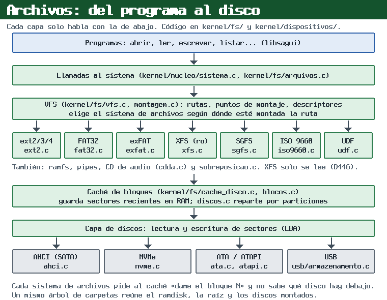
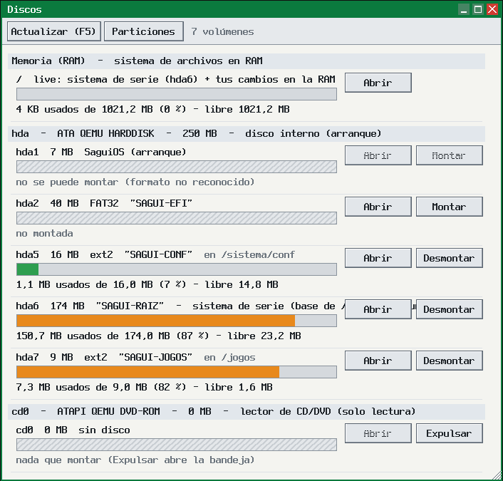

<!-- categoria: Conoce SaguiOS/Sistemas operativos; orden: 8; titulo: Sistemas de arquivos -->
# Sistemas de arquivos

[Español](08-sistemas-de-archivos.md) · [Português](08-sistemas-de-archivos_PT.md) · [English](08-sistemas-de-archivos_EN.md)

> Objetivo: entender como um arquivo se converte em blocos de disco, como o VFS apresenta sistemas diferentes com a mesma interface, por que
> existe o diário e como as permissões são controladas.

## 1. Teoria

### 1.1 Do disco ao arquivo

Um disco é uma sequência de **setores** (512 bytes ou 4 KB). Um sistema de arquivos os agrupa em **blocos** e acrescenta uma estrutura: quais blocos
pertencem a qual arquivo, como ele se chama, quem pode usá-lo. Os elementos básicos são:

- **Inodo**: o registro de um arquivo. Guarda seu tamanho, permissões, datas e ponteiros para os seus blocos. O nome não está no inodo; uma entrada de
  diretório que aponta para ele guarda o nome.
- **Blocos de dados**: o conteúdo. Um arquivo grande precisa de índices (diretos, indiretos, *extents*) para encontrar todos os seus blocos.
- **Mapa de blocos e inodos livres**: o que está ocupado.
- **Diretório**: uma tabela de nomes que apontam para inodos.

### 1.2 VFS: uma interface para muitos sistemas

O **VFS** (*virtual file system*) é uma camada que oferece aos programas as mesmas chamadas (`open`, `read`, `write`) e as traduz para o sistema
concreto: ext4, FAT32, ISO 9660, um pipe ou o terminal. O Linux o introduziu; os BSD têm sua própria versão (`vnode`). Graças a ele, um programa não
sabe se o arquivo está num pendrive FAT ou num disco ext4.

### 1.3 Cache de blocos

Ler o disco é lento. A **cache de blocos** guarda na RAM os blocos usados recentemente. Duas técnicas:

- **Leitura antecipada** (*read-ahead*): se a leitura é sequencial, os blocos seguintes são carregados antes de serem pedidos.
- **Escrita diferida** (*write-back*): a escrita vai para a cache e é descarregada no disco depois. É mais rápido, mas uma queda de energia pode perder
  dados: por isso é preciso sincronizar (`sync`) e desligar com ordem.

### 1.4 Diário (*journal*)

Se a máquina desliga no meio de uma escrita, o sistema de arquivos pode ficar inconsistente (um inodo aponta para blocos que não existem). O **diário**
registra primeiro, numa área de log, o que vai ser alterado e só depois aplica a mudança. Após uma falha, ao montar, o diário é reproduzido e a operação
é concluída ou desfeita. O ext3 e o ext4 usam **JBD2**; o NTFS tem seu registro de transações; o XFS tem seu próprio diário.

### 1.5 Sistemas de arquivos comuns

| Sistema | Uso típico | Características |
| --- | --- | --- |
| **ext2** | Discos Linux sem diário | Inodos com ponteiros diretos e indiretos. Simples e fácil de estudar. |
| **ext4** | Discos Linux padrão | Diário JBD2, *extents*, volumes grandes. |
| **FAT32** | Pendrives e cartões, muito compatível | Tabela de alocação de arquivos; limite de 4 GB por arquivo. |
| **exFAT** | Pendrives e cartões grandes | Como o FAT, sem o limite de 4 GB; sem diário. |
| **ISO 9660 / UDF** | CD e DVD | Somente leitura na prática; o UDF é o formato do DVD. |
| **XFS** | Servidores e volumes grandes | Extents e árvores B+; muito usado no Linux. |

### 1.6 Permissões e usuários

Cada arquivo tem um **dono**, um **grupo** e três conjuntos de permissão (`rwx`) para o dono, o grupo e os demais. O sistema verifica as permissões
em cada `open`. Cada processo é identificado com um **uid** e um **gid**. Um administrador (uid 0) ignora essas verificações.

### 1.7 Cálculo: o tamanho máximo de um arquivo com inodos

No ext2 com blocos de 4 KB, cada ponteiro ocupa 4 bytes, então um bloco de ponteiros guarda 4096 / 4 = **1024** ponteiros. O inodo tem 12 ponteiros
diretos, um indireto simples, um duplo e um triplo. O número máximo de blocos é:

12 + 1024 + 1024² + 1024³ = 1 074 791 436 blocos, e 1 074 791 436 × 4 KB aprox. **4 TiB**.

Com blocos de 1 KB, cada bloco guarda 256 ponteiros e o máximo cai para cerca de **16 GiB**. Por isso o tamanho do bloco importa: no ext2 blocos maiores
permitem arquivos maiores. No FAT32, por outro lado, o tamanho do arquivo está num campo de 32 bits: o máximo é 2³² - 1 bytes, cerca de 4 GiB, independentemente
do tamanho do cluster.

### 1.8 Comparação: cache e VFS em outros sistemas

- **Linux** unifica a cache de páginas: arquivos e blocos de disco são guardados nas mesmas páginas, com substituição por listas ativas e inativas. O VFS
  usa inodos e *dentries* (entradas de diretório em cache).
- **FreeBSD** usa um VFS com *vnodes* e uma cache unificada de memória virtual, que compartilha a RAM com os programas.
- **Windows** usa um gerenciador de cache separado que mapeia arquivos na memória, e o NTFS com seu registro de transações.
- **SaguiOS** usa uma cache de blocos separada do VFS, com leitura antecipada e escrita diferida (`kernel/fs/cache_disco.c`). É mais simples de ler,
  embora menos integrada com a memória dos programas.

### 1.9 Como o espaço é distribuído: contíguo, encadeado, FAT e inodos

Como o sistema sabe quais blocos formam um arquivo?

| Método | Ideia | Vantagem | Problema |
| --- | --- | --- | --- |
| Contíguo | Os blocos vão seguidos: início e comprimento | Leitura muito rápida e acesso direto | Fragmentação externa; o arquivo não pode crescer |
| Lista encadeada | Cada bloco guarda o número do seguinte | Sem fragmentação externa | Acesso direto lento: é preciso percorrer a lista |
| Tabela FAT | Os encadeamentos ficam numa tabela à parte, na memória | Acesso direto percorrendo só a tabela | A tabela cresce com o disco |
| Inodo | Uma tabela de ponteiros por arquivo | Só se carrega a do arquivo aberto | Os arquivos grandes precisam de indiretos |
| *Extents* | Trechos (início, comprimento) em vez de um ponteiro por bloco | Um arquivo grande cabe em poucos trechos | Mais complexo de manter |

O tamanho do **bloco** é um compromisso: um grande lê mais dados por acesso, mas desperdiça mais no último bloco de cada arquivo.
Com arquivos de 2 KB em média e blocos de 4 KB perde-se metade do espaço; com blocos de 1 KB, só um quarto.

Cálculo da FAT: um disco de 32 GiB com *clusters* de 4 KiB tem 32 GiB / 4 KiB = 8 388 608 clusters. Com 4 bytes por entrada, a FAT
ocupa **32 MiB**. Quanto maior o disco, mais custa ter a FAT na memória, e por isso a FAT não se usa em volumes grandes.

### 1.10 Diretórios e links

Um diretório é um arquivo especial que guarda uma tabela de **nome -> inodo**. Resolver um caminho é percorrê-lo componente a
componente. Para abrir `/home/ana/nota.txt` com o cache vazio, o sistema lê o inodo de `/` e o seu bloco de dados (para achar
`home`), o inodo de `home` e o seu bloco, o de `ana` e o seu bloco, e por fim o inodo de `nota.txt`: **7 leituras** antes do
primeiro byte do arquivo. O cache de blocos (seção 1.3) existe, em boa parte, para evitá-las.

- **Link físico (hard link).** Outra entrada de diretório que aponta para o mesmo inodo. O inodo conta os seus nomes e o arquivo só
  desaparece ao apagar o último; não pode cruzar sistemas de arquivos.
- **Link simbólico.** Um arquivo pequeno cujo conteúdo é um caminho. Pode apontar para outro sistema de arquivos ou para algo que
  já não existe (link quebrado).

### 1.11 Extents, árvores B+ e grupos de alocação (o caso do XFS)

Um arquivo de 1 GiB contíguo, com blocos de 4 KiB, precisaria de 262 144 ponteiros de 4 bytes (**1 MiB** de ponteiros) com inodos ao
estilo ext2, e um único *extent* de cerca de 16 bytes se estiver num trecho. O XFS usa *extents* e, se o arquivo está muito
fragmentado, os guarda numa **árvore B+**; os seus diretórios passam de uma lista dentro do inodo a blocos com uma tabela de *hash* e,
ao crescer, a uma árvore. Divide o volume em **grupos de alocação** independentes, para que várias threads aloquem espaço ao mesmo
tempo sem se atrapalhar, e na sua versão 5 protege os metadados com uma soma de verificação (CRC32C).

### 1.12 Confiabilidade: `fsck` ou diário

Sem diário, após um desligamento incorreto é preciso verificar **todo** o volume (`fsck`): o seu custo cresce com o tamanho do disco.
Ler 2 TB a 100 MB/s são 20 000 s, cerca de **5,6 horas**. Com diário só se reproduz o que estava pela metade: se o diário é de 128 MB,
à mesma velocidade são cerca de **1,3 s**. O diário não protege contra falhas do disco (setores danificados), por isso também se
fazem cópias de segurança.

### 1.13 O que é um arquivo: nome, tipo, acesso e atributos

Um arquivo é uma unidade de informação com nome que sobrevive aos programas. O seu **nome** pode levar uma extensão que sugere o conteúdo; o
seu **tipo** pode ser normal, diretório ou especial (um dispositivo de blocos ou de caracteres, como no Unix, onde um teclado ou um disco
também «são» arquivos). O **acesso** pode ser sequencial (do início ao fim) ou aleatório (com uma posição, como `seek`). Os seus **atributos**
são o tamanho, o dono, as permissões e as datas. As operações básicas são criar, apagar, abrir, fechar, ler, escrever e posicionar-se. Um
**arquivo mapeado em memória** é colocado no espaço de endereços do processo: ler e escrever são acessos à memória e a falha de página traz
o conteúdo do disco; o SaguiOS não o oferece na sua libc (os programas usam `open`, `read`, `write` e `lseek`, com o cache de blocos por baixo).

## 2. Como o SaguiOS faz

- **VFS.** `kernel/fs/vfs.c` decide a qual sistema pertence cada descritor. A tabela de arquivos abertos de cada processo está em `kernel/fs/arquivos.c`.
  A chamada `write` de `kernel/fs/arquivos.c` chama `vfs_escrever` (capítulo 3).
- **Montagens.** `kernel/fs/montagem.c` mantém a tabela de montagens e o `/etc/fstab` (decisão D040). O comando `mount` (`userland/programas/mount.c`)
  aceita `-t fat32|exfat|ext2|ext3|ext4|xfs|iso9660|udf|cd|auto` e as opções `ro`, `rw`, `uid=`, `gid=`.
- **Discos e partições.** `kernel/fs/discos.c` e `kernel/fs/blocos.c` dão acesso aos setores e gerenciam a tabela de partições (decisões D040 e D179).
- **Cache de blocos.** `kernel/fs/cache_disco.c` tem leitura antecipada e escrita diferida (decisão D281). O DMA do IDE é descrito no capítulo 9.
- **ext2, ext3 e ext4.** `kernel/fs/ext2.c` e `kernel/fs/jbd2.c`. Ao montar, o diário JBD2 é reproduzido (decisão D326). A escrita com diário está escrita
  mas desativada, segundo essa decisão. A raiz `SAGUI-RAIZ` é ext2 (decisão D379).
- **FAT32, exFAT, CD e DVD.** `kernel/fs/fat32.c`, `kernel/fs/exfat.c`, `kernel/fs/iso9660.c`, `kernel/fs/udf.c` (decisão D233, UDF somente leitura) e
  `kernel/fs/cdda.c` para CDs de áudio.
- **SGFS (ramdisk).** `kernel/fs/sgfs.c` lê o formato do ramdisk: uma tabela ordenada de entradas com caminhos completos, seguida dos dados. É o sistema
  mínimo do boot (capítulo 2).
- **Raiz no disco ou na RAM.** `kernel/fs/raiz.c`, `kernel/fs/sobreposicao.c` (uma camada gravável sobre o meio somente leitura, como o overlayfs do Linux)
  e `kernel/fs/ramfs.c` (decisão D379).
- **Permissões e usuários.** Dono, grupo e `rwx` (decisão D282); usuários e chamadas privilegiadas (decisão D255). Os comandos `chmod`, `chown`, `id` e
  `whoami` estão em `userland/programas/`.
- **XFS (somente leitura).** `kernel/fs/xfs.c` (decisão **D446**) lê volumes XFS do Linux, versões 4 e 5: superbloco, grupos de
  alocação, inodos locais, com *extents* e com árvore B+, e diretórios nas suas cinco formas (com a busca por *hash* descendo pela
  árvore). Na v5 verifica as somas CRC32C: se um objeto falha, dá erro de E/S e o resto do volume continua sendo lido. **Não reproduz
  o diário**: ao montar só olha se ficou limpo e, se não, monta mesmo assim em somente leitura com um aviso. Monta-se com
  `mount -t xfs` (ou pela detecção automática) e é sempre somente leitura, mesmo que se peça `-o rw`. Foi escrito do zero a partir da
  especificação pública do formato: o código do Linux é GPL-2.0-only e não se mistura com a GPL v3.

### 2.1 Decisões, alternativas e limites atuais

- **Decisão: montagens e `fstab`.** A decisão **D040** traz a camada de montagem (`kernel/fs/montagem.c`) e a persistência em ext2/ext4. A decisão **D179**
  gerencia as partições e um instalador.
- **Decisão: cache de blocos com leitura antecipada e escrita diferida.** A decisão **D281** acrescenta o DMA do IDE e a cache que evita ler o disco a cada vez.
- **Decisão: o diário é reproduzido ao montar.** A decisão **D326** reproduz o diário JBD2 de ext3/ext4. A escrita com diário está escrita mas **desativada**:
  nesta versão o sistema de arquivos escreve sem diário.
- **Decisão: raiz em ext2 e meio somente leitura com camada gravável.** A decisão **D379** (`SAGUI-RAIZ` e `kernel/fs/sobreposicao.c`).
- **Limite: permissões `rwx` sem listas de controle de acesso.** A decisão **D282** dá dono, grupo e `rwx`, não ACL.
- **Decisão: XFS próprio e somente leitura primeiro.** A decisão **D446** lê XFS sem escrevê-lo: é o que mais ajuda quem chega com um
  disco do Linux e o que menos arrisca os dados. O projeto deixa a escrita preparada (cache de buffers com marca de sujo, um único
  percurso de árvore B+).
- **Limite: o XFS é somente leitura e não está completo.** O diário não é reproduzido, os atributos estendidos são ignorados, os
  arquivos do volume de tempo real não são lidos e um arquivo de 4 GB ou mais é lido até 4 GB - 1 (o VFS conta posições em 32
  bits). Os links simbólicos relativos são seguidos; um absoluto, quebrado ou em laço é visto como um arquivo cujo conteúdo é o
  destino, porque o VFS do SaguiOS não tem links. A escrita (fase 2 de `docs/xfs.md`) fica para mais adiante.

## 3. Experimento no SaguiOS

1. Digite `df -h`. Você verá cada sistema montado, seu tipo e seu uso. Localize a raiz `/` e o seu tipo.
2. Digite `mount` (sem argumentos) para ver as montagens. Compare com o `df`.
3. Digite `ls -l /ayuda` para ver permissões, dono e tamanho de cada arquivo. Interprete a coluna de permissões: o tipo (`d` ou `-`) e três grupos `rwx`.
4. Abra **Discos** (Início > Sistema > Discos; o menu mantém o nome em espanhol) para ver as partições e seus sistemas de arquivos.
5. Com um arquivo da sua pasta, teste `chmod 600 nome` e depois `ls -l`. Volte para `chmod 644` se precisar.

**O que observar:** o programa sempre usa `ls` e `chmod`, sem saber se o arquivo está no ext2 ou no FAT. Quem resolve isso é o VFS, não o programa.

**Exercício prático adicional.** Calcule o tamanho máximo de um arquivo no ext2 com blocos de 2 KB (512 ponteiros por bloco) e compare com o de 4 KB. Depois
digite `df -h` e `mount` no SaguiOS e anote qual sistema de arquivos tem cada ponto de montagem. Explique por que um pendrive FAT32 não aceita um arquivo de vídeo de 5 GB.

## 4. Perguntas de revisão

1. O que um inodo guarda e o que não guarda? Onde está o nome de um arquivo?
2. Por que uma queda de energia com escrita diferida pode perder dados, e como o diário ajuda?
3. Explique por que o FAT32 não comporta um arquivo de 5 GB e qual sistema resolve isso.
4. Um usuário com permissão `r--` num arquivo tenta escrevê-lo. Em que momento o sistema recusa, e qual chamada decide?
5. Um arquivo ext2 de 40 KB com blocos de 4 KB: quantos blocos de dados usa? E com blocos de 1 KB?
6. Qual a diferença entre a cache de blocos do SaguiOS e a cache de páginas do Linux? Qual a vantagem da do Linux?
7. Por que o diário protege contra uma queda de energia e a escrita diferida sem diário não? Responda em duas frases.
8. Um disco de 8 GiB com *clusters* de 4 KiB usa FAT de 4 bytes por entrada. Quanto ocupa a FAT?
9. Quantas leituras de disco são necessárias, com o cache vazio, para abrir `/a/b/c`?
10. Reiniciar após um desligamento incorreto leva cinco horas sem diário e dois segundos com diário. Explique por quê.
11. Um arquivo tem dois links físicos e um link simbólico. Apaga-se um dos nomes físicos. O que acontece com o arquivo e com o link
    simbólico?

## 5. Respostas

1. O inodo guarda tamanho, permissões, datas e ponteiros para blocos. O nome está na entrada de diretório que aponta para o inodo: o mesmo inodo pode ter vários nomes (links físicos).
2. Os dados escritos na cache ainda não estão no disco. Uma queda de energia os perde, e o sistema pode ficar com uma escrita pela metade. O diário registra a mudança primeiro, então, ao voltar, ela é concluída ou desfeita sem deixar inconsistências.
3. O FAT32 guarda o tamanho do arquivo em 32 bits: o máximo é 4 GB menos um byte. O exFAT (ou um sistema com *extents*, como o ext4) resolve isso.
4. O `open` decide, no VFS, quando é pedido o modo de escrita: o sistema verifica se o uid do processo coincide com o dono ou com o grupo, e o `r--` não permite escrever. Um administrador ignora a verificação.
5. Com 4 KB, 40 / 4 = **10 blocos** (os 10 ponteiros diretos bastam, não é preciso bloco indireto). Com 1 KB, 40 blocos.
6. A cache do SaguiOS é uma cache de blocos do disco, separada da memória dos programas. A do Linux compartilha as mesmas páginas entre arquivos abertos e memória: a substituição é global e mais eficiente.
7. O diário grava primeiro a mudança pendente numa área de log; após a queda, ela é reproduzida ou desfeita. Sem diário, uma escrita pela metade pode deixar o inodo e os blocos em desacordo, e nada indica qual está certo.
8. 8 GiB / 4 KiB = 2 097 152 clusters × 4 bytes = **8 MiB**.
9. Inodo de `/`, o seu bloco, inodo de `a`, o seu bloco, inodo de `b`, o seu bloco e inodo de `c`: **7 leituras**.
10. Sem diário é preciso verificar todo o volume (o custo cresce com o tamanho do disco); com diário só se reproduz o que estava
    pela metade, uma área pequena de tamanho fixo.
11. O arquivo continua existindo, porque o seu inodo ainda tem outro nome. Um link simbólico guarda um caminho, não o inodo: se o
    caminho que guarda era o nome apagado, fica **quebrado**; se era o outro nome, continua funcionando.
