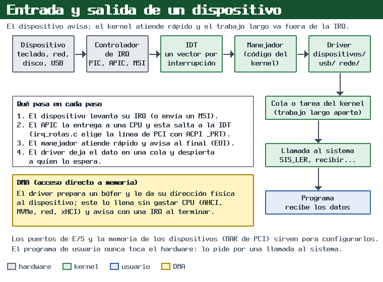

<!-- categoria: Conoce SaguiOS/Sistemas operativos; orden: 9; titulo: Entrada y salida y drivers -->
# Entrada y salida y drivers

[Español](09-entrada-salida.md) · [Português](09-entrada-salida_PT.md) · [English](09-entrada-salida_EN.md)

> Objetivo: entender cómo un dispositivo avisa al procesador, cómo se mueven los datos sin ocupar la CPU y cómo se
> organiza el código de un driver para que el resto del núcleo no dependa del hardware concreto.

## 1. Teoría

### 1.1 Dispositivos y controladores

Un dispositivo (disco, tarjeta de red, teclado) no se conecta directamente a la CPU. Tiene un **controlador** con
registros que el sistema lee y escribe, y que se pueden ver como **puertos de E/S** o como **memoria mapeada** (las
direcciones de sus registros aparecen en el espacio físico). El **driver** es el código del sistema operativo que habla
con ese controlador.

### 1.2 Cómo avisa un dispositivo: interrupciones

Hay tres formas de saber que un dispositivo ha terminado algo:

- **Sondeo** (*polling*): el driver pregunta repetidamente al controlador. Es simple, predecible y desperdicia CPU si el
  dispositivo tarda.
- **Interrupciones**: el dispositivo levanta una línea (IRQ) y la CPU atiende cuando puede. Es eficiente para eventos
  poco frecuentes, pero cada interrupción tiene un coste y puede llegar en momentos inoportunos.
- **Interrupciones por mensaje** (MSI, MSI-X): el dispositivo escribe en memoria para avisar, sin líneas compartidas.
  Es el modo de los dispositivos modernos (PCIe, NVMe).

Los controladores de interrupciones han evolucionado: el **PIC 8259** (dos chips en cascada, de los PC de siempre), el
**APIC** local de cada CPU y el **IOAPIC** que reparte las líneas de los dispositivos entre las CPU.

### 1.3 DMA

Copiar datos byte a byte con la CPU (E/S programada, PIO) ocupa el procesador. Con **DMA** (*direct memory access*) un
controlador copia datos entre el dispositivo y la memoria por su cuenta, y avisa al final con una interrupción. Un
controlador de DMA con **bus master** es un dispositivo que puede leer y escribir la memoria del sistema.

### 1.4 Pilas de datos y colas

Los controladores modernos (AHCI, NVMe, xHCI) trabajan con **colas de órdenes** en memoria: el sistema deja una lista de
peticiones y el dispositivo las atiende. Eso permite muchas peticiones en vuelo y reordenarlas.

### 1.5 Modelo de drivers

Un buen driver separa:

- la **parte que habla con el hardware** (registros, interrupciones, DMA);
- la **parte pura**: la decodificación, los cálculos y las reglas, que no tocan hardware y se pueden probar en un PC.

Así el resto del núcleo ve una interfaz común (un «disco», un «interfaz de red») y el driver concreto queda detrás.
Linux organiza esto con su modelo de buses y controladores; Windows con sus controladores WDM y KMDF.

### 1.6 Cálculo: sondeo, interrupciones y DMA con números

Copiar **100 MB** desde disco por E/S programada (PIO) con instrucciones de 2 bytes que cuestan 1 µs cada una ocupa a la
CPU: 100 × 1024 × 1024 / 2 = 52 428 800 instrucciones, unos **52 segundos** de CPU. Con DMA, la CPU programa el
controlador y atiende una interrupción por bloque de 64 KB: 1600 bloques × 10 µs de atención = **16 ms** de CPU. Son cifras
ilustrativas, pero muestran por qué el DMA existe. El sondeo del apartado 1.2 sigue siendo útil cuando la espera es muy
corta, y las interrupciones cuando es larga.

### 1.7 Comparativa: modelos de driver en otros sistemas

| Sistema | Modelo | Ejemplo |
| --- | --- | --- |
| Linux | buses y controladores, con colas de bloques (*blk-mq*) | `drivers/` con módulos |
| Windows | controladores WDM y KMDF, con pila de almacenamiento (*storport*) | `StorAHCI` |
| FreeBSD | CAM (almacenamiento) y GEOM (capas de disco) | `ahci(4)` |
| SaguiOS | drivers en `kernel/dispositivos/` con la parte pura en `*_logica.h` | `ahci.c`, `nvme.c` |

### 1.8 El software de E/S, por capas

Para que el resto del sistema no dependa de cada aparato, el software de E/S se organiza en capas:

1. **Manejador de interrupciones.** Lo más corto posible: reconoce la interrupción, anota qué ha pasado y despierta a quien
   esperaba.
2. **Driver.** Habla con el controlador de un dispositivo concreto: escribe sus registros, prepara el DMA y vigila los errores.
3. **Software independiente del dispositivo.** Lo común: nombres, permisos, reserva de búferes, errores generales. Es lo que
   permite que `read` valga para un disco, una tubería o un teclado.
4. **Software de usuario.** Bibliotecas y programas, como un servidor de impresión que guarda los trabajos en una cola
   (*spooling*) para que ningún programa monopolice el dispositivo.

Dos técnicas recorren las capas: el **búfer** (guardar los datos en memoria entre dos velocidades distintas) y el **tratamiento
de errores** (un fallo transitorio se reintenta; uno persistente se comunica hacia arriba). La regla de oro es hacer lo largo
fuera de la interrupción: si el trabajo de un dispositivo tarda, lo hace un proceso o una tarea del núcleo.

### 1.9 Discos: planificar el brazo

En un disco magnético, el tiempo lo domina el **desplazamiento del brazo** (*seek*) entre cilindros. Con el brazo en el
cilindro 50 y las peticiones 95, 180, 34, 119, 11, 123, 62 y 64, comparamos cuánto se desplaza en total:

| Algoritmo | Orden de atención | Desplazamiento |
| --- | --- | --- |
| FCFS (por orden de llegada) | 95, 180, 34, 119, 11, 123, 62, 64 | **644** cilindros |
| SSTF (la más cercana primero) | 62, 64, 34, 11, 95, 119, 123, 180 | **236** |
| Ascensor o SCAN (barrer hacia arriba y luego hacia abajo) | 62, 64, 95, 119, 123, 180, 34, 11 | **299** |

SSTF es el más corto pero puede dejar sin servir a una petición lejana (inanición); el ascensor se acerca y es justo. En un SSD
o un NVMe no hay brazo y esto no importa: lo que cuenta es mantener la cola de órdenes llena. En el código de `kernel/fs/` y de
los drivers de disco de SaguiOS no hay planificación del brazo: las peticiones se atienden por orden, con la caché de bloques
y la lectura anticipada (capítulo 8) delante.

Un caso aparte es el **disco en RAM**: una parte de la memoria se presenta como un disco. No tiene tiempo de desplazamiento y es el más
rápido, pero se pierde al apagar. El ramdisk de SaguiOS (`kernel/fs/sgfs.c` y `ramfs.c`, capítulo 2) es de esta familia.

### 1.10 RAID

Un **RAID** junta varios discos para ganar velocidad o fiabilidad. Con cuatro discos de 1 TB: RAID 0 (reparte los datos) da
**4 TB** y más velocidad, pero si falla un disco se pierde todo; RAID 1 (espejo, dos pares) da **2 TB** y tolera el fallo de
un disco de cada par; RAID 5 (reparto con paridad) da **3 TB** y tolera un fallo. La paridad es el XOR de los bloques:
con A = 1100, B = 1010 y C = 0110, la paridad es P = 0000, y si se pierde B se recupera como P xor A xor C = 1010. SaguiOS
no incluye RAID.

### 1.11 Relojes y terminales

- **Reloj.** Un temporizador de hardware interrumpe cada cierto tiempo (el **tic**); el núcleo cuenta tics para llevar la hora,
  despertar a los procesos que duermen y repartir la CPU (el quantum del capítulo 5). Un tic más corto da más precisión, pero
  más interrupciones: a 100 Hz hay una cada 10 ms.
- **Terminal.** Entre el teclado y el programa hay una disciplina de línea: en modo **canónico** se edita la línea (borrar, eco) y
  el programa recibe la línea entera al pulsar Intro; en modo **crudo** recibe cada tecla. El terminal también convierte
  Ctrl+C en una interrupción del programa que corre. En SaguiOS lo hace `userland/programas/terminal.c` (eco, Retroceso,
  Intro, Ctrl+D y Ctrl+C), encima del teclado de `kernel/dispositivos/teclado.c`.

## 2. Así lo hace SaguiOS

- **Interrupciones.** `kernel/arch/pic.c` (8259), `kernel/arch/lapic.c` (APIC local) y `kernel/arch/ioapic.c`
  (IOAPIC). El IOAPIC es opcional (decisión D166) y tiene una vuelta atrás: si falla, se usa el 8259. La asignación de
  líneas a partir de la tabla `_PRT` de ACPI se decide en `kernel/arch/irq_rotas.c` (decisión D211).
- **Bus PCI.** `kernel/dispositivos/pci.c` enumera los dispositivos; `kernel/dispositivos/bar.c` gestiona las ventanas
  de memoria de cada dispositivo (BAR), y `kernel/dispositivos/pci_realoc.c` recoloca las BAR de 64 bits por debajo de 4 GB.
- **Discos.** `kernel/dispositivos/ata.c` es el driver del IDE. Su cabecera describe la E/S por **PIO** (decisión D040);
  la decisión D281 añadió el DMA bus master y la caché de bloques `kernel/fs/cache_disco.c`, que lee por adelantado y
  escribe diferido. Para el detalle, conviene leer la cabecera de `ata.c` y la decisión. `kernel/dispositivos/ahci.c` es el SATA (decisión D155), `kernel/dispositivos/nvme.c` el NVMe.
- **Interrupciones en NVMe.** El comentario de `kernel/dispositivos/nvme.c` dice que el driver no usa interrupciones:
  el kernel no tiene MSI/MSI-X y solo funciona con INTx y el IOAPIC. Es una decisión de diseño documentada, no un olvido.
- **USB.** `kernel/usb/usb.c` enumera dispositivos, hubs y conexión en caliente. Los controladores son `kernel/usb/xhci.c`,
  `ehci.c`, `ohci.c` y `uhci.c`. Las clases: `armazenamento.c` (pendrives, con órdenes SCSI), `hid.c` (teclados y
  ratones) y `usbaudio.c`. Ver `docs/usb3.md`.
- **Sonido.** `kernel/dispositivos/audio.c` es el mezclador; `hda.c` y `ac97.c` son las tarjetas. La prioridad de los hilos
  de audio se trata en el capítulo 5 (decisión D436).
- **Reloj.** `kernel/dispositivos/relogio.c` programa el PIT a 100 Hz (1.193.182 Hz de reloj dividido), que es el tic del
  planificador (`TIQUES_POR_SEGUNDO` en `kernel/inc/relogio.h`).
- **Toda espera tiene plazo.** Los drivers de AHCI y NVMe (`ahci.c`, `nvme.c`) esperan al controlador con sondeo y un plazo
  medido con el TSC (`prazo.h`): si el controlador no responde, la orden falla (el NVMe incluso se apaga) y el sistema sigue, en vez de quedarse colgado
  (decisiones D155 y D199).
- **Trabajo largo fuera de la interrupción: `ure`.** El Ethernet USB (`kernel/rede/ure.c`, decisión **D433**) no hace sus
  transferencias en la pila de red, que corre con las interrupciones apagadas y no puede esperar: el envío va a una cola de 16
  tramas y una tarea del núcleo, llamada `ure`, arranca el chip, vacía la cola y lee el estado del enlace cada 250 ms. Es la
  separación del apartado 1.8 en pequeño.
- **Modelo de drivers.** Los ficheros `*_logica.h` de `kernel/dispositivos` y `kernel/rede` son la parte pura: por ejemplo
  `kernel/rede/r8169_logica.h` o `kernel/rede/wifi_pcie_logica.h`. Así se prueban en el PC sin tarjeta.
- **Código de otros proyectos.** Los drivers de Linux (GPL-2.0) y de los BSD viven aislados en `kernel/terceros/`
  (decisiones D034 y D073; registro en `docs/terceros.md`). `make SEM_GPL=1` compila sin los de Linux.

### 2.1 Decisiones, alternativas y límites actuales

- **Decisión: IDE por PIO primero.** La decisión **D040** arranca el disco ATA sin DMA: es la vía más simple para la primera
  versión. La decisión **D281** después añade el DMA bus master.
- **Decisión: IOAPIC opcional con vuelta atrás.** La decisión **D166** reparte las IRQ por el IOAPIC, pero se puede volver
  al 8259 si algo falla.
- **Decisión: enrutado PCI por la tabla `_PRT` de ACPI.** La decisión **D211** usa la tabla real de la placa para saber qué
  línea corresponde a cada dispositivo (`kernel/arch/irq_rotas.c`).
- **Decisión: sin MSI en el kernel.** El NVMe no usa interrupciones: el kernel solo tiene INTx e IOAPIC (`nvme.c`). Es una
  limitación consciente, anotada en el código como mejora posible.
- **Límite: el driver de disco ATA es el de compatibilidad.** Para discos modernos está el AHCI (D155) y el NVMe; el IDE
  queda para máquinas antiguas.

## 3. Experimento en SaguiOS

1. Escribe `lspci`. Verás los dispositivos PCI detectados. Elige uno (por ejemplo el controlador de disco) y busca
   su driver en `kernel/dispositivos/`.
2. Escribe `dmesg -n 40 IRQ` (o busca `IRQ` en el Visor de registros). Verás qué línea de interrupción se asignó a cada
   dispositivo.
3. Abre **Discos** (Inicio > Sistema > Discos) y compara los discos con los que muestra `lspci`.
4. Abre **Información del PC** (Inicio > Sistema) y busca la sección de dispositivos.

**Qué observar:** cada dispositivo tiene una línea de interrupción o un bloque de registros. Si dos dispositivos compartieran
una línea, el driver tendría que comprobar cuál la ha activado.

**Ejercicio práctico adicional.** Ejecuta `lspci` en SaguiOS y elige un dispositivo PCI. Después busca en `dmesg -n 60 IRQ`
la línea que se le asignó. Explica por qué dos dispositivos pueden compartir una línea en el 8259 y cómo lo resuelve el
IOAPIC.

## 4. Preguntas de repaso

1. ¿Qué ventaja tiene el DMA frente a la E/S programada (PIO) para copiar 100 MB desde un disco?
2. ¿En qué se diferencian el sondeo y las interrupciones? Pon un caso donde el sondeo sea mejor.
3. ¿Por qué un driver separa la «parte pura» de la parte que toca hardware? Da un beneficio concreto para este proyecto.
4. Un dispositivo hace una operación de E/S que tarda 5 ms. Compara el coste de esperar con sondeo y con interrupción.

5. Copiar 1 GB por PIO con instrucciones de 2 bytes a 1 µs: ¿cuántos segundos de CPU? ¿Y con DMA, con bloques de 64 KB y
   10 µs por interrupción?
6. ¿Por qué el sondeo puede ser mejor que una interrupción para un dispositivo que responde en 2 µs? Compara el coste de
   ambas formas.
7. ¿Qué ventaja tiene separar la parte pura de un driver (`*_logica.h`) de la que habla con el hardware?
8. Con el brazo en el cilindro 40 y las peticiones 10, 70, 30 y 90, ¿cuántos cilindros se recorren con FCFS y con SSTF?
9. Con cuatro discos de 2 TB, ¿qué capacidad útil da RAID 0, RAID 1 (en dos pares) y RAID 5?
10. ¿Por qué el manejador de interrupciones debe ser corto y dónde se hace el trabajo largo?

## 5. Soluciones

1. Con DMA, el controlador copia los datos a la memoria sin que la CPU haga cada byte; la CPU puede hacer otro trabajo y
   solo atiende el aviso final. Con PIO, la CPU copia cada palabra y no puede hacer nada más.
2. El sondeo pregunta periódicamente; las interrupciones avisan cuando termina. El sondeo es mejor si la operación es
   muy corta (menos que el coste de una interrupción) o en un bucle de arranque donde no hay interrupciones activas.
3. Porque la parte pura se puede probar en el PC, sin la tarjeta. En SaguiOS, por ejemplo, `r8169_logica.h` decodifica
   los descriptores de la tarjeta y se valida sin hardware.
4. Con sondeo, la CPU gira 5 ms comprobando el registro: 5 ms de CPU perdidos. Con interrupción, la CPU ejecuta otros
   procesos y solo gasta el coste del aviso y de la rutina de atención.

### Respuestas a las preguntas adicionales

5. PIO: 1024 × 1024 × 1024 / 2 = 536 870 912 instrucciones × 1 µs aprox. **537 s** (unos 9 minutos de CPU). DMA: 16 384 bloques ×
   10 µs = **0,16 s**.
6. Atender una interrupción cuesta un cambio de contexto y una entrada en el núcleo, más que 2 µs de espera. Si el
   dispositivo responde en 2 µs, sondear gasta menos CPU que preparar la interrupción.
7. La parte pura se prueba en el PC sin tarjeta, y el resto del núcleo ve una interfaz común. Un fallo de decodificación se
   detecta antes de tocar el hardware.
8. FCFS: 40 a 10 (30), a 70 (60), a 30 (40), a 90 (60): **190**. SSTF: de 40 a 30 (10), a 10 (20), a 70 (60), a 90 (20): **110**.
9. RAID 0: **8 TB**; RAID 1: **4 TB**; RAID 5: **6 TB** (la capacidad de un disco se gasta en paridad).
10. Mientras corre el manejador, el resto de interrupciones (y a veces la CPU entera) esperan, y la latencia de todo el sistema
    sube. El trabajo largo se deja a un proceso o una tarea del núcleo que el manejador despierta, como hace la tarea `ure`.
