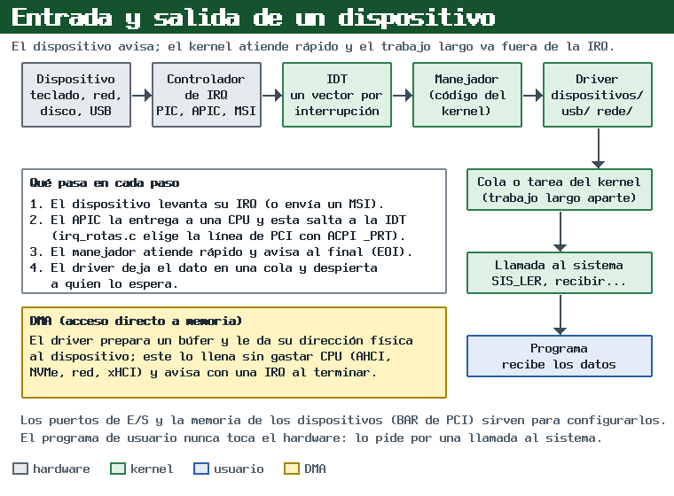

<!-- categoria: Conoce SaguiOS/Sistemas operativos; orden: 9; titulo: Input/output and drivers -->
# Input/output and drivers

[Español](09-entrada-salida.md) · [Português](09-entrada-salida_PT.md) · [English](09-entrada-salida_EN.md)

> Goal: understand how a device signals the processor, how data moves without occupying the CPU, and how a driver's code is
> organized so that the rest of the kernel does not depend on the specific hardware.

## 1. Theory

### 1.1 Devices and controllers

A device (disk, network card, keyboard) is not connected directly to the CPU. It has a **controller** with registers that the
system reads and writes, which can be seen as **I/O ports** or as **memory-mapped** registers (their addresses appear in the
physical space). The **driver** is the operating-system code that talks to that controller.

### 1.2 How a device signals: interrupts

There are three ways of knowing that a device has finished something:

- **Polling**: the driver repeatedly asks the controller. It is simple and predictable, and it wastes CPU if the device is slow.
- **Interrupts**: the device raises a line (IRQ) and the CPU responds when it can. It is efficient for infrequent events, but
  each interrupt has a cost and can arrive at an awkward moment.
- **Message-signalled interrupts** (MSI, MSI-X): the device writes to memory to signal, without shared lines. It is the mode of
  modern devices (PCIe, NVMe).

Interrupt controllers have evolved: the **8259 PIC** (two chips in cascade, from the classic PCs), the per-CPU **local APIC**
and the **IOAPIC** that distributes device lines among the CPUs.

### 1.3 DMA

Copying data byte by byte with the CPU (programmed I/O, PIO) occupies the processor. With **DMA** (*direct memory access*) a
controller copies data between the device and memory on its own, and signals the end with an interrupt. A DMA controller with
**bus mastering** is a device that can read and write system memory.

### 1.4 Command queues

Modern controllers (AHCI, NVMe, xHCI) work with **command queues** in memory: the system leaves a list of requests and the device
serves them. That allows many requests in flight and reordering them.

### 1.5 Driver model

A good driver separates:

- the **part that talks to the hardware** (registers, interrupts, DMA);
- the **pure part**: decoding, calculations and rules, which do not touch hardware and can be tested on a PC.

This way the rest of the kernel sees a common interface (a "disk", a "network interface") and the specific driver stays behind
it. Linux organizes this with its bus and driver model; Windows with its WDM and KMDF drivers.

### 1.6 Calculation: polling, interrupts and DMA with numbers

Copying **100 MB** from a disk by programmed I/O (PIO) with 2-byte instructions costing 1 µs each occupies the CPU: 100 × 1024 ×
1024 / 2 = 52 428 800 instructions, about **52 seconds** of CPU. With DMA, the CPU programs the controller and handles one
interrupt per 64 KB block: 1600 blocks × 10 µs of handling = **16 ms** of CPU. The figures are illustrative, but they show why DMA
exists. Polling from section 1.2 is still useful when the wait is very short, and interrupts when it is long.

### 1.7 Comparison: driver models in other systems

| System | Model | Example |
| --- | --- | --- |
| Linux | buses and drivers, with block queues (*blk-mq*) | `drivers/` with modules |
| Windows | WDM and KMDF drivers, with a storage stack (*storport*) | `StorAHCI` |
| FreeBSD | CAM (storage) and GEOM (disk layers) | `ahci(4)` |
| SaguiOS | drivers in `kernel/dispositivos/` with the pure part in `*_logica.h` | `ahci.c`, `nvme.c` |

### 1.8 I/O software, in layers

So that the rest of the system does not depend on each device, I/O software is organized in layers:

1. **Interrupt handler.** As short as possible: it acknowledges the interrupt, notes what happened and wakes whoever was
   waiting.
2. **Driver.** It talks to the controller of a specific device: it writes its registers, prepares the DMA and watches for
   errors.
3. **Device-independent software.** What is common: names, permissions, buffer allocation, general errors. It is what lets
   `read` work for a disk, a pipe or a keyboard.
4. **User software.** Libraries and programs, such as a print server that keeps jobs in a queue (*spooling*) so that no
   program monopolizes the device.

Two techniques run through the layers: the **buffer** (keeping data in memory between two different speeds) and **error
handling** (a transient failure is retried; a persistent one is reported upward). The golden rule is to do long work outside the
interrupt: if a device's work takes long, a process or a kernel task does it.

### 1.9 Disks: scheduling the arm

On a magnetic disk, time is dominated by the **arm movement** (*seek*) between cylinders. With the arm at cylinder 50 and the
requests 95, 180, 34, 119, 11, 123, 62 and 64, we compare how far it moves in total:

| Algorithm | Order of service | Movement |
| --- | --- | --- |
| FCFS (in order of arrival) | 95, 180, 34, 119, 11, 123, 62, 64 | **644** cylinders |
| SSTF (closest first) | 62, 64, 34, 11, 95, 119, 123, 180 | **236** |
| Elevator or SCAN (sweep up, then down) | 62, 64, 95, 119, 123, 180, 34, 11 | **299** |

SSTF is the shortest but can leave a distant request unserved (starvation); the elevator comes close and is fair. On an SSD or
an NVMe there is no arm and this does not matter: what counts is keeping the command queue full. In the code of `kernel/fs/` and
of the SaguiOS disk drivers there is no arm scheduling: requests are served in order, with the block cache and read-ahead
(chapter 8) in front.

A separate case is the **RAM disk**: a part of memory is presented as a disk. It has no seek time and is the fastest, but it is lost at
power-off. The SaguiOS ramdisk (`kernel/fs/sgfs.c` and `ramfs.c`, chapter 2) belongs to this family.

### 1.10 RAID

A **RAID** joins several disks to gain speed or reliability. With four 1 TB disks: RAID 0 (it stripes the data) gives **4 TB**
and more speed, but if one disk fails everything is lost; RAID 1 (mirror, two pairs) gives **2 TB** and tolerates the failure of
one disk in each pair; RAID 5 (striping with parity) gives **3 TB** and tolerates one failure. Parity is the XOR of the blocks:
with A = 1100, B = 1010 and C = 0110, the parity is P = 0000, and if B is lost it is recovered as P xor A xor C = 1010. SaguiOS
does not include RAID.

### 1.11 Clocks and terminals

- **Clock.** A hardware timer interrupts every so often (the **tick**); the kernel counts ticks to keep the time, wake sleeping
  processes and share the CPU (the quantum of chapter 5). A shorter tick gives more precision, but more interrupts: at 100 Hz
  there is one every 10 ms.
- **Terminal.** Between the keyboard and the program there is a line discipline: in **canonical** mode the line is edited
  (erase, echo) and the program receives the whole line when Enter is pressed; in **raw** mode it receives each key. The terminal
  also turns Ctrl+C into an interrupt for the running program. In SaguiOS `userland/programas/terminal.c` does it (echo,
  Backspace, Enter, Ctrl+D and Ctrl+C), on top of the keyboard of `kernel/dispositivos/teclado.c`.

## 2. How SaguiOS does it

- **Interrupts.** `kernel/arch/pic.c` (8259), `kernel/arch/lapic.c` (local APIC) and `kernel/arch/ioapic.c` (IOAPIC). The IOAPIC
  is optional (decision D166) and has a fallback: if something fails, the 8259 is used. The assignment of lines from the ACPI
  `_PRT` table is decided in `kernel/arch/irq_rotas.c` (decision D211).
- **PCI bus.** `kernel/dispositivos/pci.c` enumerates the devices; `kernel/dispositivos/bar.c` manages each device's memory windows
  (BAR), and `kernel/dispositivos/pci_realoc.c` relocates 64-bit BARs below 4 GB.
- **Disks.** `kernel/dispositivos/ata.c` is the IDE driver. Its header describes PIO I/O (decision D040); decision D281 added
  bus-master DMA and the block cache `kernel/fs/cache_disco.c`, which reads ahead and writes back. For the details, read the header
  of `ata.c` and the decision. `kernel/dispositivos/ahci.c` is SATA (decision D155), `kernel/dispositivos/nvme.c` is NVMe.
- **Interrupts in NVMe.** The comment in `kernel/dispositivos/nvme.c` says the driver uses no interrupts: the kernel has no
  MSI/MSI-X and works only with INTx and the IOAPIC. It is a documented design decision, not an oversight.
- **USB.** `kernel/usb/usb.c` enumerates devices, hubs and hot plugging. The controllers are `kernel/usb/xhci.c`, `ehci.c`,
  `ohci.c` and `uhci.c`. The classes: `armazenamento.c` (pendrives, with SCSI commands), `hid.c` (keyboards and mice) and
  `usbaudio.c`. See `docs/usb3.md`.
- **Sound.** `kernel/dispositivos/audio.c` is the mixer; `hda.c` and `ac97.c` are the sound cards. The priority of audio threads is
  covered in chapter 5 (decision D436).
- **Clock.** `kernel/dispositivos/relogio.c` programs the PIT at 100 Hz (the 1 193 182 Hz clock divided), which is the scheduler
  tick (`TIQUES_POR_SEGUNDO` in `kernel/inc/relogio.h`).
- **Every wait has a deadline.** The AHCI and NVMe drivers (`ahci.c`, `nvme.c`) wait for the controller by polling with a deadline
  measured with the TSC (`prazo.h`): if the controller does not answer, the command fails (the NVMe is even switched off) and the system goes on, instead of hanging
  (decisions D155 and D199).
- **Long work outside the interrupt: `ure`.** The USB Ethernet (`kernel/rede/ure.c`, decision **D433**) does not do its transfers
  in the network stack, which runs with interrupts off and cannot wait: sending goes to a queue of 16 frames and a kernel task,
  called `ure`, starts the chip, empties the queue and reads the link state every 250 ms. It is the separation of section 1.8 in
  miniature.
- **Driver model.** The `*_logica.h` files in `kernel/dispositivos` and `kernel/rede` are the pure part: for example
  `kernel/rede/r8169_logica.h` or `kernel/rede/wifi_pcie_logica.h`. This way they are tested on the PC without a card.
- **Code from other projects.** Drivers from Linux (GPL-2.0) and the BSDs live isolated in `kernel/terceros/` (decisions D034 and
  D073; record in `docs/terceros.md`). `make SEM_GPL=1` builds without the Linux ones.

### 2.1 Decisions, alternatives and current limits

- **Decision: PIO IDE first.** Decision **D040** starts the ATA disk without DMA: the simplest path for the first version.
  Decision **D281** then adds bus-master DMA.
- **Decision: optional IOAPIC with fallback.** Decision **D166** distributes IRQs through the IOAPIC, but it can go back to the
  8259 if something fails.
- **Decision: PCI routing from the ACPI `_PRT` table.** Decision **D211** uses the board's real table to know which line goes to
  each device.
- **Limit: no MSI in the kernel.** NVMe does not use interrupts: the kernel has only INTx and IOAPIC (`nvme.c`). It is a conscious
  limit, noted in the code as a possible improvement.
- **Limit: the ATA disk driver is the compatibility one.** For modern disks there is AHCI (D155) and NVMe; IDE is left for old
  machines.

## 3. Experiment in SaguiOS

1. Type `lspci`. You will see the detected PCI devices. Choose one (for example the disk controller) and find its driver in
   `kernel/dispositivos/`.
2. Type `dmesg -n 40 IRQ` (or search `IRQ` in the Event viewer; the menu keeps the Spanish name). You will see which interrupt line
   was assigned to each device.
3. Open **Discos** (Start > System > Discos) and compare the disks with those shown by `lspci`.
4. Open **Información del PC** (Start > System) and look for the devices section.

**What to observe:** each device has an interrupt line or a block of registers. If two devices shared a line, the driver would have
to check which one raised it.

**Additional practical exercise.** Type `lspci` and `dmesg -n 60 IRQ` as above, then pick two devices and write, for each one, its
driver file, its interrupt line and whether it uses PIO, DMA or interrupts according to its driver's header. Explain the difference.

## 4. Review questions

1. What advantage does DMA have over programmed I/O (PIO) for copying 100 MB from a disk?
2. How do polling and interrupts differ? Give a case where polling is better.
3. Why does a driver separate the "pure part" from the part that touches the hardware? Give one concrete benefit for this project.
4. A device performs an I/O operation that takes 5 ms. Compare the cost of waiting by polling and by interrupt.
5. Copying 1 GB by PIO with 2-byte instructions at 1 µs: how many seconds of CPU? And with DMA, with 64 KB blocks and 10 µs per
   interrupt?
6. Why can polling be better than an interrupt for a device that responds in 2 µs? Compare the cost of both ways.
7. What advantage does separating the pure part of a driver (`*_logica.h`) from the part that talks to the hardware have?
8. With the arm at cylinder 40 and the requests 10, 70, 30 and 90, how many cylinders are crossed with FCFS and with SSTF?
9. With four 2 TB disks, what usable capacity do RAID 0, RAID 1 (in two pairs) and RAID 5 give?
10. Why must the interrupt handler be short, and where is the long work done?

## 5. Answers

1. With DMA, the controller copies the data to memory without the CPU handling each byte; the CPU can do other work and only handles
   the final signal. With PIO, the CPU copies every word and cannot do anything else.
2. Polling asks periodically; interrupts signal when the operation ends. Polling is better if the operation is very short (less
   than the cost of an interrupt) or in a boot loop where interrupts are not active.
3. Because the pure part can be tested on the PC, without the card. In SaguiOS, for example, `r8169_logica.h` decodes the card's
   descriptors and can be validated without hardware.
4. With polling, the CPU spins for 5 ms checking the register: 5 ms of CPU lost. With an interrupt, the CPU runs other processes and
   only pays the cost of the signal and the handler.
5. PIO: 1024 × 1024 × 1024 / 2 = 536 870 912 instructions × 1 µs approx. **537 s** (about 9 minutes of CPU). DMA: 16 384 blocks × 10 µs =
   **0.16 s**.
6. Handling an interrupt costs a context switch and an entry into the kernel, which is more than 2 µs of waiting. If the device
   responds in 2 µs, polling spends less CPU than preparing an interrupt.
7. The pure part is tested on the PC without the card, and the rest of the kernel sees a common interface. A decoding error is
   detected before touching the hardware.
8. FCFS: 40 to 10 (30), to 70 (60), to 30 (40), to 90 (60): **190**. SSTF: from 40 to 30 (10), to 10 (20), to 70 (60), to 90 (20): **110**.
9. RAID 0: **8 TB**; RAID 1: **4 TB**; RAID 5: **6 TB** (the capacity of one disk is spent on parity).
10. While the handler runs, the other interrupts (and sometimes the whole CPU) wait, and the latency of the whole system rises. The
    long work is left to a process or a kernel task that the handler wakes up, as the `ure` task does.
