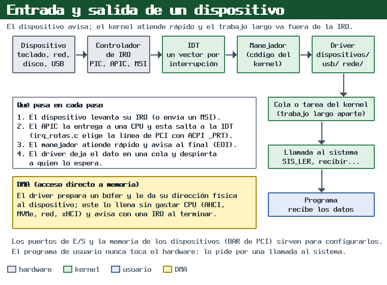
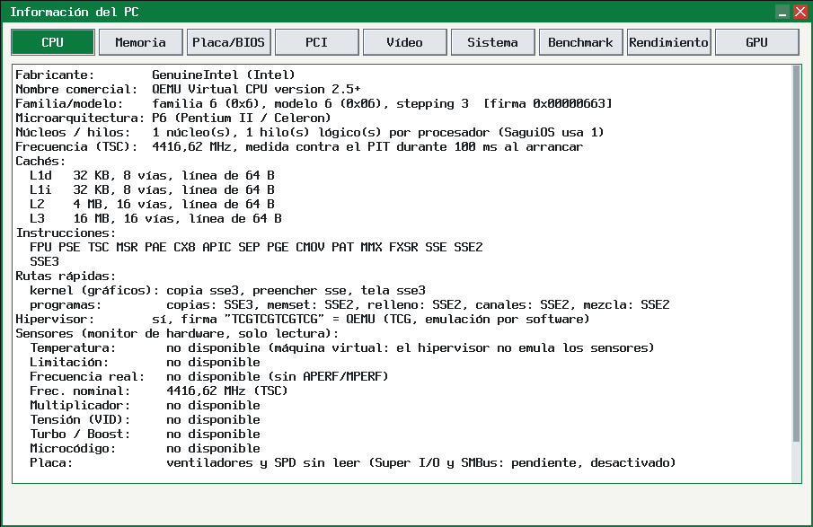

<!-- categoria: Conoce SaguiOS/Sistemas operativos; orden: 9; titulo: Entrada e saída e drivers -->
# Entrada e saída e drivers

[Español](09-entrada-salida.md) · [Português](09-entrada-salida_PT.md) · [English](09-entrada-salida_EN.md)

> Objetivo: entender como um dispositivo avisa o processador, como os dados se movem sem ocupar a CPU e como o código de um driver é organizado para que o
> resto do núcleo não dependa do hardware específico.

## 1. Teoria

### 1.1 Dispositivos e controladores

Um dispositivo (disco, placa de rede, teclado) não se conecta diretamente à CPU. Tem um **controlador** com registradores que o sistema lê e escreve, que podem
ser vistos como **portas de E/S** ou como registradores **mapeados em memória** (seus endereços aparecem no espaço físico). O **driver** é o código do sistema
operacional que conversa com esse controlador.

### 1.2 Como um dispositivo avisa: interrupções

Há três formas de saber que um dispositivo terminou algo:

- **Sondagem** (*polling*): o driver pergunta repetidamente ao controlador. É simples e previsível, e desperdiça CPU se o dispositivo demora.
- **Interrupções**: o dispositivo levanta uma linha (IRQ) e a CPU atende quando pode. É eficiente para eventos pouco frequentes, mas cada interrupção tem
  um custo e pode chegar num momento inoportuno.
- **Interrupções por mensagem** (MSI, MSI-X): o dispositivo escreve na memória para avisar, sem linhas compartilhadas. É o modo dos dispositivos modernos (PCIe, NVMe).

Os controladores de interrupção evoluíram: o **PIC 8259** (dois chips em cascata, dos PCs clássicos), o **APIC** local de cada CPU e o **IOAPIC**, que
reparte as linhas dos dispositivos entre as CPUs.

### 1.3 DMA

Copiar dados byte a byte com a CPU (E/S programada, PIO) ocupa o processador. Com **DMA** (*direct memory access*) um controlador copia dados entre o
dispositivo e a memória por conta própria, e avisa o fim com uma interrupção. Um controlador de DMA com **bus mastering** é um dispositivo que pode ler e
escrever a memória do sistema.

### 1.4 Filas de comandos

Os controladores modernos (AHCI, NVMe, xHCI) trabalham com **filas de comandos** na memória: o sistema deixa uma lista de pedidos e o dispositivo os atende.
Isso permite muitos pedidos em voo e reordená-los.

### 1.5 Modelo de drivers

Um bom driver separa:

- a **parte que conversa com o hardware** (registradores, interrupções, DMA);
- a **parte pura**: decodificação, cálculos e regras, que não tocam o hardware e podem ser testados num PC.

Assim o resto do núcleo enxerga uma interface comum (um "disco", uma "interface de rede") e o driver específico fica por trás dela. O Linux organiza isso
com o seu modelo de barramentos e drivers; o Windows, com os drivers WDM e KMDF.

### 1.6 Cálculo: sondagem, interrupções e DMA com números

Copiar **100 MB** de um disco por E/S programada (PIO) com instruções de 2 bytes que custam 1 µs cada ocupa a CPU: 100 × 1024 × 1024 / 2 = 52 428 800 instruções,
cerca de **52 segundos** de CPU. Com DMA, a CPU programa o controlador e atende uma interrupção por bloco de 64 KB: 1600 blocos × 10 µs de atendimento =
**16 ms** de CPU. São números ilustrativos, mas mostram por que o DMA existe. A sondagem da seção 1.2 continua útil quando a espera é muito curta, e as
interrupções quando ela é longa.

### 1.7 Comparação: modelos de driver em outros sistemas

| Sistema | Modelo | Exemplo |
| --- | --- | --- |
| Linux | barramentos e controladores, com filas de blocos (*blk-mq*) | `drivers/` com módulos |
| Windows | drivers WDM e KMDF, com pilha de armazenamento (*storport*) | `StorAHCI` |
| FreeBSD | CAM (armazenamento) e GEOM (camadas de disco) | `ahci(4)` |
| SaguiOS | drivers em `kernel/dispositivos/` com a parte pura em `*_logica.h` | `ahci.c`, `nvme.c` |

### 1.8 O software de E/S, em camadas

Para que o resto do sistema não dependa de cada aparelho, o software de E/S se organiza em camadas:

1. **Tratador de interrupções.** O mais curto possível: reconhece a interrupção, anota o que aconteceu e acorda quem esperava.
2. **Driver.** Fala com o controlador de um dispositivo concreto: escreve os seus registradores, prepara o DMA e vigia os erros.
3. **Software independente do dispositivo.** O que é comum: nomes, permissões, reserva de buffers, erros gerais. É o que permite que
   `read` valha para um disco, um pipe ou um teclado.
4. **Software de usuário.** Bibliotecas e programas, como um servidor de impressão que guarda os trabalhos numa fila (*spooling*)
   para que nenhum programa monopolize o dispositivo.

Duas técnicas percorrem as camadas: o **buffer** (guardar os dados na memória entre duas velocidades diferentes) e o **tratamento de
erros** (uma falha transitória se repete; uma persistente é comunicada para cima). A regra de ouro é fazer o trabalho longo fora da
interrupção: se o trabalho de um dispositivo demora, quem o faz é um processo ou uma tarefa do núcleo.

### 1.9 Discos: escalonar o braço

Num disco magnético, o tempo é dominado pelo **deslocamento do braço** (*seek*) entre cilindros. Com o braço no cilindro 50 e os
pedidos 95, 180, 34, 119, 11, 123, 62 e 64, comparamos quanto ele se desloca no total:

| Algoritmo | Ordem de atendimento | Deslocamento |
| --- | --- | --- |
| FCFS (por ordem de chegada) | 95, 180, 34, 119, 11, 123, 62, 64 | **644** cilindros |
| SSTF (o mais próximo primeiro) | 62, 64, 34, 11, 95, 119, 123, 180 | **236** |
| Elevador ou SCAN (varrer para cima e depois para baixo) | 62, 64, 95, 119, 123, 180, 34, 11 | **299** |

O SSTF é o mais curto, mas pode deixar sem atender um pedido distante (inanição); o elevador se aproxima e é justo. Num SSD ou num
NVMe não há braço e isso não importa: o que conta é manter cheia a fila de comandos. No código de `kernel/fs/` e dos drivers de disco
do SaguiOS não há escalonamento do braço: os pedidos são atendidos em ordem, com o cache de blocos e a leitura antecipada (capítulo
8) na frente.

Um caso à parte é o **disco em RAM**: uma parte da memória é apresentada como um disco. Não tem tempo de deslocamento e é o mais rápido,
mas se perde ao desligar. O ramdisk do SaguiOS (`kernel/fs/sgfs.c` e `ramfs.c`, capítulo 2) é desta família.

### 1.10 RAID

Um **RAID** junta vários discos para ganhar velocidade ou confiabilidade. Com quatro discos de 1 TB: o RAID 0 (distribui os dados) dá
**4 TB** e mais velocidade, mas se um disco falha perde-se tudo; o RAID 1 (espelho, dois pares) dá **2 TB** e tolera a falha de um
disco de cada par; o RAID 5 (distribuição com paridade) dá **3 TB** e tolera uma falha. A paridade é o XOR dos blocos: com A = 1100,
B = 1010 e C = 0110, a paridade é P = 0000, e se B se perde recupera-se como P xor A xor C = 1010. O SaguiOS não inclui RAID.

### 1.11 Relógios e terminais

- **Relógio.** Um temporizador de hardware interrompe de tempos em tempos (o **tique**); o núcleo conta tiques para manter a hora,
  acordar os processos que dormem e repartir a CPU (o quantum do capítulo 5). Um tique mais curto dá mais precisão, mas mais
  interrupções: a 100 Hz há uma a cada 10 ms.
- **Terminal.** Entre o teclado e o programa há uma disciplina de linha: no modo **canônico** a linha é editada (apagar, eco) e o
  programa recebe a linha inteira ao pressionar Enter; no modo **cru** recebe cada tecla. O terminal também converte Ctrl+C numa
  interrupção do programa em execução. No SaguiOS quem faz isso é `userland/programas/terminal.c` (eco, Backspace, Enter, Ctrl+D e
  Ctrl+C), sobre o teclado de `kernel/dispositivos/teclado.c`.

## 2. Como o SaguiOS faz

- **Interrupções.** `kernel/arch/pic.c` (8259), `kernel/arch/lapic.c` (APIC local) e `kernel/arch/ioapic.c` (IOAPIC). O IOAPIC é opcional (decisão D166) e tem
  retorno: se algo falha, usa-se o 8259. A atribuição das linhas a partir da tabela `_PRT` do ACPI é decidida em `kernel/arch/irq_rotas.c` (decisão D211).
- **Barramento PCI.** `kernel/dispositivos/pci.c` enumera os dispositivos; `kernel/dispositivos/bar.c` gerencia as janelas de memória de cada dispositivo (BAR),
  e `kernel/dispositivos/pci_realoc.c` realoca BARs de 64 bits abaixo de 4 GB.
- **Discos.** `kernel/dispositivos/ata.c` é o driver do IDE. O cabeçalho descreve a E/S por PIO (decisão D040); a decisão D281 acrescentou o DMA bus master e a
  cache de blocos `kernel/fs/cache_disco.c`, que lê antecipadamente e escreve de forma diferida. Para os detalhes, leia o cabeçalho de `ata.c` e a decisão.
  `kernel/dispositivos/ahci.c` é o SATA (decisão D155), `kernel/dispositivos/nvme.c` é o NVMe.
- **Interrupções no NVMe.** O comentário de `kernel/dispositivos/nvme.c` diz que o driver não usa interrupções: o núcleo não tem MSI/MSI-X e funciona só com
  INTx e IOAPIC. É uma decisão de projeto documentada, não um esquecimento.
- **USB.** `kernel/usb/usb.c` enumera dispositivos, hubs e a conexão a quente. Os controladores são `kernel/usb/xhci.c`, `ehci.c`, `ohci.c` e `uhci.c`. As classes:
  `armazenamento.c` (pendrives, com comandos SCSI), `hid.c` (teclados e mouses) e `usbaudio.c`. Veja `docs/usb3.md`.
- **Som.** `kernel/dispositivos/audio.c` é o misturador; `hda.c` e `ac97.c` são as placas de som. A prioridade das threads de áudio é tratada no capítulo 5
  (decisão D436).
- **Relógio.** `kernel/dispositivos/relogio.c` programa o PIT a 100 Hz (o relógio de 1 193 182 Hz dividido), que é o tique do escalonador
  (`TIQUES_POR_SEGUNDO` em `kernel/inc/relogio.h`).
- **Toda espera tem prazo.** Os drivers de AHCI e NVMe (`ahci.c`, `nvme.c`) esperam o controlador por polling com um prazo medido com
  o TSC (`prazo.h`): se o controlador não responde, o comando falha (o NVMe chega a ser desligado) e o sistema continua, em vez de travar (decisões D155 e D199).
- **Trabalho longo fora da interrupção: `ure`.** O Ethernet USB (`kernel/rede/ure.c`, decisão **D433**) não faz as suas transferências
  na pilha de rede, que roda com as interrupções desligadas e não pode esperar: o envio vai para uma fila de 16 quadros e uma tarefa
  do núcleo, chamada `ure`, inicia o chip, esvazia a fila e lê o estado do link a cada 250 ms. É a separação da seção 1.8 em miniatura.
- **Modelo de drivers.** Os arquivos `*_logica.h` de `kernel/dispositivos` e `kernel/rede` são a parte pura: por exemplo `kernel/rede/r8169_logica.h` ou
  `kernel/rede/wifi_pcie_logica.h`. Assim são testados no PC sem a placa.
- **Código de outros projetos.** Os drivers do Linux (GPL-2.0) e dos BSD vivem isolados em `kernel/terceros/` (decisões D034 e D073; registro em `docs/terceros.md`).
  `make SEM_GPL=1` compila sem os do Linux.

### 2.1 Decisões, alternativas e limites atuais

- **Decisão: IDE por PIO primeiro.** A decisão **D040** inicia o disco ATA sem DMA: é o caminho mais simples para a primeira versão. A decisão **D281** acrescenta depois o DMA bus master.
- **Decisão: IOAPIC opcional com retorno.** A decisão **D166** reparte as IRQs pelo IOAPIC, mas pode voltar ao 8259 se algo falhar.
- **Decisão: roteamento PCI pela tabela `_PRT` do ACPI.** A decisão **D211** usa a tabela real da placa para saber qual linha corresponde a cada dispositivo.
- **Limite: sem MSI no núcleo.** O NVMe não usa interrupções: o núcleo só tem INTx e IOAPIC (`nvme.c`). É um limite consciente, anotado no código como melhoria possível.
- **Limite: o driver de disco ATA é o de compatibilidade.** Para discos modernos há o AHCI (D155) e o NVMe; o IDE fica para máquinas antigas.

## 3. Experimento no SaguiOS

1. Digite `lspci`. Você verá os dispositivos PCI detectados. Escolha um (por exemplo o controlador de disco) e procure o seu driver em `kernel/dispositivos/`.
2. Digite `dmesg -n 40 IRQ` (ou procure `IRQ` no Visor de registros; o menu mantém o nome em espanhol). Você verá qual linha de interrupção foi atribuída a cada dispositivo.
3. Abra **Discos** (Início > Sistema > Discos) e compare os discos com os que `lspci` mostra.
4. Abra **Información del PC** (Início > Sistema) e procure a seção de dispositivos.

**O que observar:** cada dispositivo tem uma linha de interrupção ou um bloco de registradores. Se dois dispositivos compartilhassem uma linha, o driver teria de verificar qual deles a acionou.

**Exercício prático adicional.** Rode `lspci` e `dmesg -n 60 IRQ` como acima, depois escolha dois dispositivos e escreva, para cada um, o arquivo do driver, a sua linha de interrupção
e se usa PIO, DMA ou interrupções segundo o cabeçalho do driver. Explique a diferença.

## 4. Perguntas de revisão

1. Qual a vantagem do DMA frente à E/S programada (PIO) para copiar 100 MB de um disco?
2. Em que se diferenciam a sondagem e as interrupções? Dê um caso em que a sondagem seja melhor.
3. Por que um driver separa a "parte pura" da parte que toca o hardware? Dê um benefício concreto para este projeto.
4. Um dispositivo faz uma operação de E/S que dura 5 ms. Compare o custo de esperar por sondagem e por interrupção.
5. Copiar 1 GB por PIO com instruções de 2 bytes a 1 µs: quantos segundos de CPU? E com DMA, com blocos de 64 KB e 10 µs por interrupção?
6. Por que a sondagem pode ser melhor que uma interrupção para um dispositivo que responde em 2 µs? Compare o custo das duas formas.
7. Que vantagem tem separar a parte pura de um driver (`*_logica.h`) da parte que fala com o hardware?
8. Com o braço no cilindro 40 e os pedidos 10, 70, 30 e 90, quantos cilindros se percorrem com FCFS e com SSTF?
9. Com quatro discos de 2 TB, que capacidade útil dão RAID 0, RAID 1 (em dois pares) e RAID 5?
10. Por que o tratador de interrupções deve ser curto e onde se faz o trabalho longo?

## 5. Respostas

1. Com DMA, o controlador copia os dados para a memória sem que a CPU trate cada byte; a CPU pode fazer outro trabalho e só atende o aviso final. Com PIO, a CPU copia cada palavra e não pode fazer mais nada.
2. A sondagem pergunta periodicamente; as interrupções avisam quando a operação termina. A sondagem é melhor se a operação é muito curta (menos que o custo de uma interrupção) ou num laço de boot em que as interrupções não estão ativas.
3. Porque a parte pura pode ser testada no PC, sem a placa. No SaguiOS, por exemplo, `r8169_logica.h` decodifica os descritores da placa e pode ser validado sem hardware.
4. Por sondagem, a CPU gira 5 ms verificando o registrador: 5 ms de CPU perdidos. Com interrupção, a CPU executa outros processos e só paga o custo do aviso e do tratador.
5. PIO: 1024 × 1024 × 1024 / 2 = 536 870 912 instruções × 1 µs aprox. **537 s** (cerca de 9 minutos de CPU). DMA: 16 384 blocos × 10 µs = **0,16 s**.
6. Atender uma interrupção custa uma troca de contexto e uma entrada no núcleo, mais do que 2 µs de espera. Se o dispositivo responde em 2 µs, a sondagem gasta menos CPU que preparar uma interrupção.
7. A parte pura é testada no PC sem a placa, e o resto do núcleo enxerga uma interface comum. Um erro de decodificação é detectado antes de tocar o hardware.
8. FCFS: de 40 a 10 (30), a 70 (60), a 30 (40), a 90 (60): **190**. SSTF: de 40 a 30 (10), a 10 (20), a 70 (60), a 90 (20): **110**.
9. RAID 0: **8 TB**; RAID 1: **4 TB**; RAID 5: **6 TB** (a capacidade de um disco é gasta em paridade).
10. Enquanto o tratador roda, as demais interrupções (e às vezes a CPU inteira) esperam, e a latência de todo o sistema sobe. O
    trabalho longo se deixa a um processo ou a uma tarefa do núcleo que o tratador acorda, como faz a tarefa `ure`.
