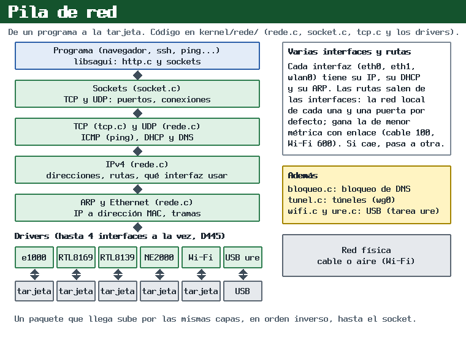

<!-- categoria: Conoce SaguiOS/Sistemas operativos; orden: 10; titulo: Redes -->
# Redes

[Español](10-redes.md) · [Português](10-redes_PT.md) · [English](10-redes_EN.md)

> Objetivo: entender cómo viaja un mensaje por capas desde un programa hasta otro ordenador, cómo se encuentran las
> direcciones y qué hace el sistema operativo con los sockets.

## 1. Teoría

### 1.1 Capas

Una comunicación de red se organiza en capas, cada una con su responsabilidad. El modelo TCP/IP tiene cuatro:

| Capa | Función | Ejemplo |
| --- | --- | --- |
| Aplicación | El protocolo del programa | HTTP, SSH, DNS |
| Transporte | Entrega extremo a extremo, con o sin fiabilidad | TCP, UDP |
| Red | Direcciones y rutas entre redes | IPv4, ICMP |
| Enlace | Entrega dentro de una red local | Ethernet, Wi-Fi, ARP |

Cada capa añade su cabecera al mensaje (encapsulación) y el receptor la quita al subir.

### 1.2 Direcciones y rutas

- **Dirección MAC**: identifica una tarjeta en la red local. Se usa en la capa de enlace.
- **Dirección IP**: identifica un equipo en la red global. Se busca con **ARP** (la IP de destino se traduce a MAC en la
  misma red) y, si el destino está fuera, se envía al **router** o puerta de enlace.
- **Tabla de rutas**: para cada destino, por qué interfaz salir y a qué puerta. La **ruta por defecto** es la que
  sirve para todo lo demás.
- **DHCP** es el protocolo que da al equipo su IP, máscara, puerta y servidor DNS al conectarse.
- **DNS** traduce nombres (`ejemplo.org`) a IP.

### 1.3 TCP y UDP

- **UDP** envía datagramas sin conexión y sin garantías: rápido, útil para vídeo o consultas DNS.
- **TCP** establece una conexión (tres mensajes de apertura), numera los bytes, retransmite lo perdido y controla el
  flujo y la congestión. Es lo que usan la web y SSH.

### 1.4 Sockets

Un **socket** es el extremo de una comunicación que el programa ve como un descriptor de archivo. Las llamadas típicas
son `socket`, `bind`, `listen`, `accept`, `connect`, `send` y `recv`. Un servidor escucha en un **puerto**; el sistema
entrega cada paquete al socket que lo espera.

### 1.5 Alternativas

Linux tiene su pila en el núcleo (y su espacio de usuario `iproute2`); los BSD tienen una pila muy estudiada y su
herramienta `pf` para el filtrado. Con micronúcleos (MINIX), la pila de red es un proceso de usuario, lo que la aísla pero
añade mensajes.

### 1.6 Cálculo: la cabecera y el tamaño de un segmento TCP

Una trama Ethernet lleva como máximo 1500 bytes de datos (MTU). Quitando la cabecera IPv4 (20 bytes) y la TCP (20 bytes), el
**tamaño máximo de segmento** (MSS) es 1500 - 40 = **1460 bytes**. En el cable, cada trama añade 14 (cabecera Ethernet), 4
(FCS), 8 (preámbulo) y 12 (separación) bytes: 1538 bytes en total. La parte útil es 1460 / 1538 aprox. **95 %**.

La ventana de TCP limita la velocidad. Con una ventana de 64 KB y un tiempo de ida y vuelta (RTT) de 50 ms, la velocidad
máxima es 65 536 / 0,05 aprox. **1,3 MB/s**, unos 10,5 Mbit/s, aunque el enlace sea de 100 Mbit/s. Por eso el RTT importa tanto
como el ancho de banda.

### 1.7 Comparativa: pilas de red

- **Linux** tiene la pila en el núcleo, con cola de paquetes, *netfilter* para el filtrado y la herramienta `iproute2`.
- **FreeBSD** usa `pf` (cortafuegos) y `ifconfig`/`route`; su pila es muy estudiada y de referencia.
- **Windows** tiene la pila TCP/IP en el núcleo y el cortafuegos de Windows como capa aparte.
- **MINIX 3** pone la pila de red en un proceso de usuario: se aísla y se reinicia, a costa de mensajes.

### 1.8 Rutas: el prefijo más largo y la métrica

Cada interfaz aporta una **ruta de red local** (los destinos de su red salen directamente por ella) y, si tiene puerta de
enlace, una **ruta por defecto**. Para cada paquete el sistema elige la ruta que **coincide con más bits** del destino (el
prefijo más largo) y, si hay varias rutas por defecto, la de menor **métrica** (el coste que se le da a una interfaz).
Ejemplo: `eth0` con 192.168.1.10/24, puerta 192.168.1.1 y métrica 100; `wlan0` con 10.0.0.7/24, puerta 10.0.0.1 y métrica 600.

- A 192.168.1.55: coincide con la red local de `eth0` (/24): se manda directo por `eth0`.
- A 10.0.0.20: igual, por `wlan0`.
- A 8.8.8.8: no coincide con ninguna red local; hay dos rutas por defecto y gana `eth0` (100 < 600), vía 192.168.1.1. Si el
  cable se desenchufa, la ruta pasa sola a `wlan0`.

### 1.9 Fiabilidad sobre UDP

UDP no confirma nada. Para tener fiabilidad encima hace falta: **números de secuencia** (para ordenar y descubrir lo perdido),
**confirmaciones** (el receptor dice qué ha recibido) y un **plazo de reenvío** (si no llega la confirmación a tiempo, se
manda otra vez). El plazo se calcula a partir del tiempo de ida y vuelta medido, suavizado: *RTT suavizado = 0,875 × anterior +
0,125 × nueva medida*. Con un RTT suavizado de 20 ms y una medida nueva de 36 ms, el valor pasa a 17,5 + 4,5 = **22 ms**. Si el
plazo es 1,5 veces el RTT más 25 ms, con 22 ms de RTT es **58 ms**; si vuelve a fallar, se duplica (retroceso exponencial) hasta
un máximo, para no saturar una red ya mala. Es, en pequeño, lo que hace TCP.

### 1.10 Sistemas distribuidos: mensajes, llamadas remotas y estado replicado

Cuando el servicio está en otra máquina, el paso de mensajes (capítulo 7) cruza la red y aparecen problemas nuevos:

- **Llamada a procedimiento remoto (RPC).** Para el programa parece una llamada normal; por debajo, un *stub* empaqueta los
  argumentos, los manda, espera la respuesta y la desempaqueta. A diferencia de una llamada local, puede fallar a medias:
  si no llega la respuesta, ¿se ejecutó o no? Con reenvíos se obtiene «al menos una vez» y hay que hacer las operaciones
  idempotentes.
- **No hay un reloj común.** Cada máquina tiene el suyo. Para ordenar sucesos basta a menudo un contador lógico que sube con
  cada mensaje.
- **Estado replicado.** Todos tienen una copia y hay que mantenerlas iguales. Una forma barata: si la simulación es
  **determinista**, solo viajan las órdenes y cada máquina calcula lo mismo (*lockstep*). Es lo que hace el multijugador de
  AoEN en red local (decisión **D461**): la partida se divide en turnos de 3 a 6 tics de 1/30 s (por defecto 4, unos 133 ms),
  una orden dada en el turno *t* se ejecuta en el *t* + 2 en todas las máquinas, y al terminar cada turno se comparan sumas
  de comprobación del estado; si no coinciden, se avisa de la **desincronización**. Mandar el estado entero de unas 5000
  entidades de 16 bytes en cada turno serían 80 KB por turno, unos 4,8 Mbit/s a 7,5 turnos por segundo; mandar solo las
  órdenes son unos cientos de bytes por turno (cifras ilustrativas). El precio: la partida va a la velocidad de la máquina más
  lenta y cualquier diferencia de cálculo entre máquinas rompe la partida.

## 2. Así lo hace SaguiOS

- **Pila de red.** `kernel/rede/rede.c` implementa Ethernet, ARP (con caché y cola de espera), IPv4, ICMP (`ping`),
  UDP, DHCP con renovación y DNS, según su cabecera.
- **TCP y sockets.** `kernel/rede/tcp.c` y `kernel/rede/socket.c`. La interfaz de programa está en `kernel/inc/abi.h`,
  con las llamadas de red del sistema.
- **Drivers de tarjetas.** `e1000.c`, `r8169.c`, `rtl8139.c`, `ne2000.c` y `alc.c` en `kernel/rede/`. El driver recibe
  y envía tramas de Ethernet; la pila hace el resto. Los Wi-Fi son `wifi.c` (cliente 802.11), `rtl8188eu.c`, `rt2870.c`
  y `ar9485.c`, con WPA2 y WPA3 en `kernel/lib/wpa.c` y `kernel/lib/sae.c`. El Ethernet USB de Realtek (RTL8152, RTL8153 y
  RTL8156) es `ure.c` (decisión **D433**, con la secuencia de arranque de OpenBSD y una tarea del núcleo propia).
- **Túnel y VPN.** `kernel/rede/tunel.c` es la interfaz `wg0` de WireGuard (`docs/wireguard.md`).
- **Bloqueo de publicidad por DNS.** `kernel/rede/bloqueo.c` filtra las consultas DNS que van a dominios de publicidad
  (decisión D218). El servidor DNS para la red local lo ofrece la orden `dnsbloqueo` del intérprete.
- **Varias interfaces (decisión D445).** La pila lleva hasta cuatro interfaces a la vez (`iface_t` en `kernel/rede/rede.c`):
  `eth0`, `eth1`... las tarjetas PCI, el USB detrás de ellas y `wlan0` el Wi-Fi. Cada una tiene su dirección, su DHCP, su
  estado de enlace, su métrica (cable 100, Wi-Fi 600) y su propio ARP: un ARP solo se contesta por la interfaz por la que llegó.
  Las rutas no son una tabla aparte, se derivan de las interfaces (la red local de cada una y una ruta por defecto por cada
  una con puerta de enlace) y gana la de menor métrica entre las que tienen enlace. Si una cae (cable desenchufado, `ifconfig
  eth0 down`, USB retirado), la ruta por defecto pasa sola a la siguiente y se vacía la caché de DNS. Un paquete con la
  dirección de una interfaz como origen sale por ella, y cada conexión TCP guarda su dirección local: una conexión sigue por su
  interfaz aunque cambie la ruta por defecto.
- **Órdenes.** `userland/programas/ifconfig.c` muestra y configura las interfaces; `ping` usa ICMP.

### 2.1 Decisiones, alternativas y límites actuales

- **Decisión: la pila completa en el núcleo.** `kernel/rede/rede.c` concentra Ethernet, ARP, IPv4, ICMP, UDP, DHCP y DNS. Es
  el modelo monolítico del capítulo 1, aplicado a la red.
- **Decisión: varias interfaces sin tabla de rutas editable.** La decisión **D445** deriva las rutas de las interfaces porque una
  tabla aparte habría que mantenerla en caliente con cada DHCP, cada enchufe y cada desenchufe, que es justo donde se rompe.
- **Decisión: bloqueo de publicidad por DNS.** La decisión **D218** filtra las consultas en el propio resolvedor del kernel
  (`kernel/rede/bloqueo.c`), y ofrece un servidor DNS para la red local.
- **Límite: IPv6 se descarta.** `kernel/rede/rede.c` cuenta las tramas IPv6 como descartadas: no hay pila IPv6 en esta
  versión.
- **Límite: las rutas no se editan.** Con una dirección por interfaz y sin reenvío entre redes, la tabla de rutas sale entera de
  las interfaces; no hay `route add` ni rutas estáticas hacia redes remotas, y SaguiOS no hace de enrutador. Una conexión TCP
  de una interfaz que cae se pierde.
- **Límite: sin cortafuegos de usuario.** El filtrado que hay es de DNS, no un cortafuegos general de paquetes.

## 3. Experimento en SaguiOS

1. Escribe `ifconfig`. Verás las interfaces, su dirección MAC, su IP y su estado. Anota la IP de la tarjeta.
2. Escribe `ping` seguido de la puerta de enlace que aparece en la configuración (en QEMU suele ser `10.0.2.2`).
   Observa el tiempo de respuesta.
3. Escribe `ping` a un nombre de dominio. Si falla, el DNS no ha respondido: separa así el problema de nombres del de
   conectividad.
4. Compara con lo que enseña el Visor de registros al filtrar por «Red» (la categoría de registro de red).

**Qué observar:** `ping` a la IP funciona aunque el DNS falle. Eso separa la capa de red (IP) de la capa de nombres (DNS),
y es la diferencia que más conviene entender al depurar una conexión.

**Ejercicio práctico adicional.** Con `ping` a la puerta de enlace, anota el tiempo de ida y vuelta (RTT) de cinco
respuestas. Con el RTT medio y una ventana de 16 KB, calcula la velocidad máxima de TCP. Explica por qué, con ese valor,
descargar más rápido exige una ventana mayor, no un enlace más rápido.

## 4. Preguntas de repaso

1. ¿Qué ocurre, paso a paso, cuando un programa envía un paquete a una IP de otra red? Menciona ARP y la tabla de rutas.
2. ¿Por qué UDP es adecuado para DNS, y TCP para una descarga?
3. Un equipo tiene IP pero no navega. ¿Qué pruebas harías en orden para encontrar la capa que falla?
4. ¿Qué tarea hace el socket `accept` que no hace `connect`?

5. Una red de 10 Mbit/s y una ventana de 64 KB con RTT de 10 ms: ¿qué limita la velocidad? ¿Y con RTT de 200 ms?
6. Calcula la eficiencia de una trama Ethernet con 500 bytes de datos (sin MSS, sin TCP), con la misma cuenta de cabeceras.
7. ¿Por qué la pila de red de MINIX 3 es más segura frente a fallos pero más lenta que la de Linux?
8. Con `eth0` (192.168.1.10/24, métrica 100) y `wlan0` (10.0.0.7/24, métrica 600), ¿por dónde sale un paquete a 10.0.0.20? ¿Y uno
   a 1.1.1.1? ¿Y si se desenchufa el cable de `eth0`?
9. Un canal fiable sobre UDP mide RTT suavizado de 40 ms y una medida nueva de 80 ms. ¿Cuál es el nuevo RTT suavizado y el plazo
   de reenvío (1,5 × RTT + 25 ms)?
10. ¿Por qué en un juego de red con *lockstep* un cálculo distinto en una máquina (un número en coma flotante redondeado distinto,
    por ejemplo) rompe la partida?

## 5. Soluciones

1. El programa entrega los datos al socket; la pila construye el paquete con la IP de destino. Si el destino está fuera de
   la red local, la tabla de rutas elige la puerta por defecto. ARP resuelve la MAC de la puerta (no la del destino final),
   y la trama va a la tarjeta.
2. Una consulta DNS es pequeña y se puede repetir; UDP es más rápido y no necesita conexión. Una descarga necesita entrega
   completa y en orden: TCP lo garantiza con números de secuencia y retransmisiones.
3. Primero, `ping` a la puerta (capa de red y enlace); después, `ping` a una IP pública (si funciona, la red sale); luego,
   `ping` a un nombre (DNS). El primer fallo marca la capa.
4. `connect` inicia la conexión del lado del cliente. `accept` espera en el servidor a que llegue un cliente y crea un
   socket nuevo para atenderlo.

### Respuestas a las preguntas adicionales

5. Con RTT de 10 ms: 65 536 / 0,01 aprox. 6,5 MB/s aprox. 52 Mbit/s, así que el enlace de 10 Mbit/s es el límite. Con RTT de 200 ms:
   65 536 / 0,2 aprox. 327 KB/s aprox. 2,6 Mbit/s: limita la ventana.
6. 500 / (500 + 14 + 4 + 8 + 12 + 20 + 20) = 500 / 578 aprox. **87 %**, donde los 40 últimos bytes son las cabeceras IP y TCP.
7. Porque un fallo en un servicio de usuario no tumba el núcleo, pero cada paquete cruza fronteras de proceso con mensajes:
   más coste en cada envío.
8. A 10.0.0.20: por `wlan0` (red local, prefijo más largo). A 1.1.1.1: por `eth0` (ruta por defecto de menor métrica). Sin el cable,
   `eth0` pierde el enlace y la ruta por defecto pasa a `wlan0`.
9. 0,875 × 40 + 0,125 × 80 = 35 + 10 = **45 ms**; plazo = 1,5 × 45 + 25 = **92,5 ms**.
10. Porque cada máquina solo recibe las órdenes y calcula el resto: si un resultado difiere aunque sea en un bit, los estados
    se separan poco a poco y las sumas de comprobación dejan de coincidir (desincronización). Por eso la simulación debe ser
    determinista.
