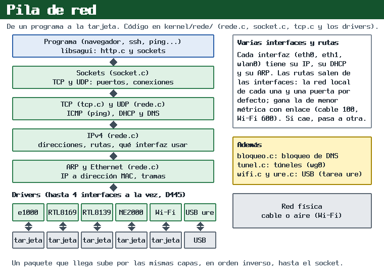

<!-- categoria: Conoce SaguiOS/Sistemas operativos; orden: 10; titulo: Networking -->
# Networking

[Español](10-redes.md) · [Português](10-redes_PT.md) · [English](10-redes_EN.md)

> Goal: understand how a message travels in layers from a program to another computer, how addresses are found and what the
> operating system does with sockets.

## 1. Theory

### 1.1 Layers

A network communication is organized in layers, each with its own responsibility. The TCP/IP model has four:

| Layer | Function | Example |
| --- | --- | --- |
| Application | The program's protocol | HTTP, SSH, DNS |
| Transport | End-to-end delivery, with or without reliability | TCP, UDP |
| Network | Addresses and routes between networks | IPv4, ICMP |
| Link | Delivery within a local network | Ethernet, Wi-Fi, ARP |

Each layer adds its header to the message (encapsulation) and the receiver removes it on the way up.

### 1.2 Addresses and routes

- **MAC address**: identifies a card on the local network. It is used at the link layer.
- **IP address**: identifies a computer in the global network. It is found with **ARP** (the destination IP is translated to a MAC
  on the same network) and, if the destination is outside, the packet is sent to the **router** or gateway.
- **Routing table**: for each destination, which interface to leave by and which gateway to use. The **default route** serves
  everything else.
- **DHCP** is the protocol that gives the computer its IP, mask, gateway and DNS server when it connects.
- **DNS** translates names (`example.org`) to IPs.

### 1.3 TCP and UDP

- **UDP** sends connectionless datagrams without guarantees: fast, useful for video or DNS queries.
- **TCP** establishes a connection (three messages to open), numbers the bytes, retransmits what was lost and controls flow and
  congestion. It is what the web and SSH use.

### 1.4 Sockets

A **socket** is the end of a communication that the program sees as a file descriptor. The typical calls are `socket`, `bind`,
`listen`, `accept`, `connect`, `send` and `recv`. A server listens on a **port**; the system delivers each packet to the socket
waiting for it.

### 1.5 Alternatives

Linux has its stack in the kernel (and the user-space `iproute2`); the BSDs have a well-studied stack and the `pf` filter. With
microkernels (MINIX), the network stack is a user process, which isolates it but adds messages.

### 1.6 Calculation: packet overhead and TCP segment size

An Ethernet frame carries at most 1500 bytes of data (MTU). Removing the IPv4 header (20 bytes) and the TCP header (20 bytes), the
**maximum segment size** (MSS) is 1500 - 40 = **1460 bytes**. On the wire, each frame adds 14 (Ethernet header), 4 (FCS), 8
(preamble) and 12 (gap) bytes: 1538 bytes in total. The useful part is 1460 / 1538 approx. **95 %**.

The TCP window limits speed. With a 64 KB window and a round-trip time (RTT) of 50 ms, the maximum speed is 65 536 / 0.05 approx. 
**1.3 MB/s**, about 10.5 Mbit/s, even if the link is 100 Mbit/s. That is why the RTT matters as much as the bandwidth.

### 1.7 Comparison: network stacks

- **Linux** has the stack in the kernel, with a packet queue, *netfilter* for filtering and the `iproute2` tool.
- **FreeBSD** uses `pf` (firewall) and `ifconfig`/`route`; its stack is highly studied and a reference.
- **Windows** has the TCP/IP stack in the kernel and the Windows firewall as a separate layer.
- **MINIX 3** puts the network stack in a user process: it is isolated and restarted, at the cost of messages.

### 1.8 Routes: the longest prefix and the metric

Each interface contributes a **local network route** (destinations on its network go straight out through it) and, if it has a
gateway, a **default route**. For each packet the system picks the route that **matches the most bits** of the destination (the
longest prefix) and, if there are several default routes, the one with the lowest **metric** (the cost given to an interface).
Example: `eth0` with 192.168.1.10/24, gateway 192.168.1.1 and metric 100; `wlan0` with 10.0.0.7/24, gateway 10.0.0.1 and metric 600.

- To 192.168.1.55: it matches the local network of `eth0` (/24): sent directly through `eth0`.
- To 10.0.0.20: the same, through `wlan0`.
- To 8.8.8.8: it matches no local network; there are two default routes and `eth0` wins (100 < 600), via 192.168.1.1. If the
  cable is unplugged, the route moves to `wlan0` by itself.

### 1.9 Reliability over UDP

UDP confirms nothing. To get reliability on top you need: **sequence numbers** (to order and to find what was lost),
**acknowledgments** (the receiver says what it has received) and a **retransmission timeout** (if the acknowledgment does not
arrive in time, it is sent again). The timeout is computed from the measured round-trip time, smoothed: *smoothed RTT =
0.875 × previous + 0.125 × new measurement*. With a smoothed RTT of 20 ms and a new measurement of 36 ms, the value becomes
17.5 + 4.5 = **22 ms**. If the timeout is 1.5 times the RTT plus 25 ms, with a 22 ms RTT it is **58 ms**; if it fails again it
is doubled (exponential backoff) up to a maximum, so as not to flood an already bad network. It is, in miniature, what TCP does.

### 1.10 Distributed systems: messages, remote calls and replicated state

When the service is on another machine, message passing (chapter 7) crosses the network and new problems appear:

- **Remote procedure call (RPC).** To the program it looks like a normal call; underneath, a *stub* packs the arguments, sends
  them, waits for the reply and unpacks it. Unlike a local call, it can fail halfway: if the reply does not arrive, was it
  executed or not? With retransmissions you get "at least once" and operations must be made idempotent.
- **There is no common clock.** Each machine has its own. To order events a logical counter that goes up with each message is
  often enough.
- **Replicated state.** Everyone has a copy and they must be kept equal. A cheap way: if the simulation is **deterministic**,
  only the orders travel and each machine computes the same thing (*lockstep*). That is what AoEN's local-network multiplayer
  does (decision **D461**): the game is split into turns of 3 to 6 ticks of 1/30 s (4 by default, about 133 ms), an order given
  in turn *t* is executed in turn *t* + 2 on all machines, and at the end of each turn checksums of the state are compared; if
  they do not match, a **desynchronization** is reported. Sending the whole state of about 5000 entities of 16 bytes every turn
  would be 80 KB per turn, about 4.8 Mbit/s at 7.5 turns per second; sending only the orders is a few hundred bytes per turn
  (illustrative figures). The price: the game runs at the speed of the slowest machine and any difference in computation
  between machines breaks the game.

## 2. How SaguiOS does it

- **Network stack.** `kernel/rede/rede.c` implements Ethernet, ARP (with cache and queue), IPv4, ICMP (`ping`), UDP, DHCP with
  renewal and DNS, according to its header.
- **TCP and sockets.** `kernel/rede/tcp.c` and `kernel/rede/socket.c`. The program interface is in `kernel/inc/abi.h`, with the
  system's network calls.
- **Card drivers.** `e1000.c`, `r8169.c`, `rtl8139.c`, `ne2000.c` and `alc.c` in `kernel/rede/`. The driver receives and
  sends Ethernet frames; the stack does the rest. The Wi-Fi ones are `wifi.c` (802.11 client), `rtl8188eu.c`, `rt2870.c` and
  `ar9485.c`, with WPA2 and WPA3 in `kernel/lib/wpa.c` and `kernel/lib/sae.c`. Realtek's USB Ethernet (RTL8152, RTL8153 and
  RTL8156) is `ure.c` (decision **D433**, with OpenBSD's start-up sequence and a kernel task of its own).
- **Tunnel and VPN.** `kernel/rede/tunel.c` is the WireGuard `wg0` interface (`docs/wireguard.md`).
- **DNS ad blocking.** `kernel/rede/bloqueo.c` filters DNS queries to advertising domains (decision D218). The DNS server for the
  local network is offered by the `dnsbloqueo` command of the shell.
- **Several interfaces (decision D445).** The stack carries up to four interfaces at once (`iface_t` in `kernel/rede/rede.c`):
  `eth0`, `eth1`... the PCI cards, the USB one behind them and `wlan0` the Wi-Fi. Each has its address, its DHCP, its link
  state, its metric (cable 100, Wi-Fi 600) and its own ARP: an ARP is only answered on the interface it came in on. Routes are
  not a separate table, they are derived from the interfaces (the local network of each one and one default route for each one
  with a gateway) and the one with the lowest metric among those with a link wins. If one goes down (cable unplugged,
  `ifconfig eth0 down`, USB removed), the default route moves to the next by itself and the DNS cache is emptied. A packet with
  the address of an interface as its source leaves through it, and each TCP connection keeps its local address: a connection
  stays on its interface even if the default route changes.
- **Commands.** `userland/programas/ifconfig.c` shows and configures the interfaces; `ping` uses ICMP.

### 2.1 Decisions, alternatives and current limits

- **Decision: the full stack in the kernel.** `kernel/rede/rede.c` concentrates Ethernet, ARP, IPv4, ICMP, UDP, DHCP and DNS. It is the
  monolithic model of chapter 1, applied to the network.
- **Decision: several interfaces without an editable routing table.** Decision **D445** derives the routes from the interfaces
  because a separate table would have to be kept up to date with every DHCP, every plug and every unplug, which is exactly where
  it breaks.
- **Decision: DNS ad blocking.** Decision **D218** filters queries in the kernel's own resolver (`kernel/rede/bloqueo.c`), and offers
  a DNS server for the local network.
- **Limit: IPv6 is discarded.** `kernel/rede/rede.c` counts IPv6 frames as discarded: there is no IPv6 stack in this version.
- **Limit: routes are not editable.** With one address per interface and no forwarding between networks, the routing table comes
  entirely from the interfaces; there is no `route add` or static routes to remote networks, and SaguiOS does not act as a
  router. A TCP connection on an interface that goes down is lost.
- **Limit: no user-level firewall.** The filtering that exists is DNS filtering, not a general packet firewall.

## 3. Experiment in SaguiOS

1. Type `ifconfig`. You will see the interfaces, their MAC address, IP and state. Note the card's IP.
2. Type `ping` followed by the gateway shown in the configuration (in QEMU it is usually `10.0.2.2`). Observe the response time.
3. Type `ping` to a domain name. If it fails, DNS did not respond: this separates the naming problem from the connectivity problem.
4. Compare with what the Event viewer shows when filtered by "Red" (the network log category).

**What to observe:** `ping` to the IP works even when DNS fails. That separates the network layer (IP) from the naming layer (DNS), and
it is the difference most worth understanding when debugging a connection.

**Additional practical exercise.** With `ping` to the gateway, note the round-trip time (RTT) of five replies. With the average RTT and a
16 KB window, calculate the maximum TCP speed. Explain why, with that value, downloading faster requires a larger window, not a faster
link.

## 4. Review questions

1. What happens, step by step, when a program sends a packet to an IP on another network? Mention ARP and the routing table.
2. Why is UDP suitable for DNS, and TCP for a download?
3. A computer has an IP but cannot browse. What tests would you do, in order, to find the layer that fails?
4. What does the socket `accept` do that `connect` does not?
5. A 10 Mbit/s network and a 64 KB window with 10 ms RTT: what limits the speed? And with 200 ms RTT?
6. Calculate the efficiency of an Ethernet frame with 500 bytes of data (without MSS, without TCP), with the same header count.
7. Why is the MINIX 3 network stack safer against failures but slower than Linux's?
8. With `eth0` (192.168.1.10/24, metric 100) and `wlan0` (10.0.0.7/24, metric 600), which way does a packet to 10.0.0.20 go? And one
   to 1.1.1.1? And if the cable of `eth0` is unplugged?
9. A reliable channel over UDP measures a smoothed RTT of 40 ms and a new measurement of 80 ms. What are the new smoothed RTT and
   the retransmission timeout (1.5 × RTT + 25 ms)?
10. Why does a different computation on one machine (a floating-point number rounded differently, for example) break a *lockstep*
    network game?

## 5. Answers

1. The program hands the data to the socket; the stack builds the packet with the destination IP. If the destination is outside the
   local network, the routing table picks the default gateway. ARP resolves the gateway's MAC (not the final destination's), and the frame
   goes to the card.
2. A DNS query is small and can be repeated; UDP is faster and needs no connection. A download needs complete, ordered delivery: TCP
   guarantees it with sequence numbers and retransmissions.
3. First, `ping` the gateway (network and link layers); then, `ping` a public IP (if it works, the network is reaching out); then, `ping` a
   name (DNS). The first failure marks the layer.
4. `connect` starts the connection on the client side. `accept` waits in the server for a client to arrive and creates a new socket to
   serve it.
5. With RTT 10 ms: 65 536 / 0.01 approx. 6.5 MB/s approx. 52 Mbit/s, so the 10 Mbit/s link is the limit. With RTT 200 ms: 65 536 / 0.2 approx. 327 KB/s approx. 
   2.6 Mbit/s: the window limits it.
6. 500 / (500 + 14 + 4 + 8 + 12 + 20 + 20) = 500 / 578 approx. **87 %**, where the last 40 bytes are the IP and TCP headers.
7. Because a failure in a user-space service does not bring down the kernel, but each packet crosses process boundaries with messages:
   more cost on each send.
8. To 10.0.0.20: through `wlan0` (local network, longest prefix). To 1.1.1.1: through `eth0` (default route with the lowest metric).
   Without the cable, `eth0` loses its link and the default route moves to `wlan0`.
9. 0.875 × 40 + 0.125 × 80 = 35 + 10 = **45 ms**; timeout = 1.5 × 45 + 25 = **92.5 ms**.
10. Because each machine only receives the orders and computes the rest: if a result differs even by one bit, the states drift
    apart and the checksums stop matching (desynchronization). That is why the simulation must be deterministic.
