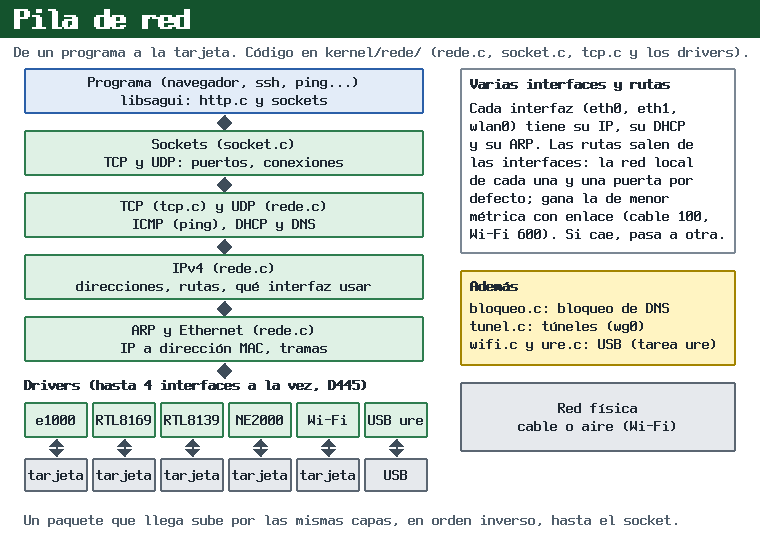

<!-- categoria: Conoce SaguiOS/Sistemas operativos; orden: 10; titulo: Redes -->
# Redes

[Español](10-redes.md) · [Português](10-redes_PT.md) · [English](10-redes_EN.md)

> Objetivo: entender como uma mensagem viaja, em camadas, de um programa até outro computador, como os endereços são encontrados e o que o sistema
> operacional faz com os sockets.

## 1. Teoria

### 1.1 Camadas

Uma comunicação de rede é organizada em camadas, cada uma com a sua responsabilidade. O modelo TCP/IP tem quatro:

| Camada | Função | Exemplo |
| --- | --- | --- |
| Aplicação | O protocolo do programa | HTTP, SSH, DNS |
| Transporte | Entrega fim a fim, com ou sem confiabilidade | TCP, UDP |
| Rede | Endereços e rotas entre redes | IPv4, ICMP |
| Enlace | Entrega dentro de uma rede local | Ethernet, Wi-Fi, ARP |

Cada camada acrescenta o seu cabeçalho à mensagem (encapsulamento), e o receptor o retira ao subir.

### 1.2 Endereços e rotas

- **Endereço MAC**: identifica uma placa na rede local. É usado na camada de enlace.
- **Endereço IP**: identifica um computador na rede global. É encontrado com **ARP** (o IP de destino é traduzido para um MAC na mesma rede) e, se o destino
  estiver fora, o pacote é enviado ao **roteador** ou gateway.
- **Tabela de rotas**: para cada destino, por qual interface sair e qual gateway usar. A **rota padrão** serve para tudo o mais.
- **DHCP** é o protocolo que dá ao computador seu IP, máscara, gateway e servidor DNS ao se conectar.
- **DNS** traduz nomes (`exemplo.org`) para IPs.

### 1.3 TCP e UDP

- **UDP** envia datagramas sem conexão e sem garantias: rápido, útil para vídeo ou consultas DNS.
- **TCP** estabelece uma conexão (três mensagens para abrir), numera os bytes, retransmite o que se perdeu e controla o fluxo e o congestionamento. É o que
  a web e o SSH usam.

### 1.4 Sockets

Um **socket** é a ponta de uma comunicação que o programa vê como um descritor de arquivo. As chamadas típicas são `socket`, `bind`, `listen`, `accept`,
`connect`, `send` e `recv`. Um servidor escuta numa **porta**; o sistema entrega cada pacote ao socket que o espera.

### 1.5 Alternativas

O Linux tem sua pilha no núcleo (e a ferramenta de espaço de usuário `iproute2`); os BSD têm uma pilha muito estudada e o filtro `pf`. Com microkernels
(MINIX), a pilha de rede é um processo de usuário, o que a isola mas acrescenta mensagens.

### 1.6 Cálculo: sobrecarga dos cabeçalhos e tamanho de um segmento TCP

Um quadro Ethernet leva no máximo 1500 bytes de dados (MTU). Tirando o cabeçalho IPv4 (20 bytes) e o TCP (20 bytes), o **tamanho máximo de segmento** (MSS) é
1500 - 40 = **1460 bytes**. No cabo, cada quadro acrescenta 14 (cabeçalho Ethernet), 4 (FCS), 8 (preâmbulo) e 12 (intervalo) bytes: 1538 bytes ao todo.
A parte útil é 1460 / 1538 aprox. **95 %**.

A janela do TCP limita a velocidade. Com uma janela de 64 KB e um tempo de ida e volta (RTT) de 50 ms, a velocidade máxima é 65 536 / 0,05 aprox. **1,3 MB/s**,
cerca de 10,5 Mbit/s, mesmo que o enlace seja de 100 Mbit/s. Por isso o RTT importa tanto quanto a largura de banda.

### 1.7 Comparação: pilhas de rede

- **Linux** tem a pilha no núcleo, com fila de pacotes, *netfilter* para filtragem e a ferramenta `iproute2`.
- **FreeBSD** usa `pf` (firewall) e `ifconfig`/`route`; sua pilha é muito estudada e é referência.
- **Windows** tem a pilha TCP/IP no núcleo e o firewall do Windows como camada separada.
- **MINIX 3** coloca a pilha de rede num processo de usuário: fica isolada e é reiniciada, ao custo de mensagens.

### 1.8 Rotas: o prefixo mais longo e a métrica

Cada interface contribui com uma **rota de rede local** (os destinos da sua rede saem diretamente por ela) e, se tem gateway, com
uma **rota padrão**. Para cada pacote o sistema escolhe a rota que **coincide com mais bits** do destino (o prefixo mais longo) e,
se há várias rotas padrão, a de menor **métrica** (o custo dado a uma interface). Exemplo: `eth0` com 192.168.1.10/24, gateway
192.168.1.1 e métrica 100; `wlan0` com 10.0.0.7/24, gateway 10.0.0.1 e métrica 600.

- Para 192.168.1.55: coincide com a rede local de `eth0` (/24): enviado direto por `eth0`.
- Para 10.0.0.20: igual, por `wlan0`.
- Para 8.8.8.8: não coincide com nenhuma rede local; há duas rotas padrão e ganha `eth0` (100 < 600), via 192.168.1.1. Se o cabo
  for desconectado, a rota passa sozinha para `wlan0`.

### 1.9 Confiabilidade sobre UDP

O UDP não confirma nada. Para ter confiabilidade por cima são necessários: **números de sequência** (para ordenar e descobrir o
que se perdeu), **confirmações** (o receptor diz o que recebeu) e um **prazo de reenvio** (se a confirmação não chega a tempo,
envia-se de novo). O prazo se calcula a partir do tempo de ida e volta medido, suavizado: *RTT suavizado = 0,875 × anterior +
0,125 × nova medida*. Com um RTT suavizado de 20 ms e uma nova medida de 36 ms, o valor passa a 17,5 + 4,5 = **22 ms**. Se o
prazo é 1,5 vez o RTT mais 25 ms, com 22 ms de RTT é **58 ms**; se falhar de novo, dobra (recuo exponencial) até um máximo, para
não saturar uma rede já ruim. É, em miniatura, o que o TCP faz.

### 1.10 Sistemas distribuídos: mensagens, chamadas remotas e estado replicado

Quando o serviço está em outra máquina, a troca de mensagens (capítulo 7) cruza a rede e aparecem problemas novos:

- **Chamada de procedimento remoto (RPC).** Para o programa parece uma chamada normal; por baixo, um *stub* empacota os argumentos,
  os envia, espera a resposta e a desempacota. Ao contrário de uma chamada local, pode falhar pela metade: se a resposta não chega,
  foi executada ou não? Com reenvios obtém-se «pelo menos uma vez» e as operações precisam ser idempotentes.
- **Não há relógio comum.** Cada máquina tem o seu. Para ordenar acontecimentos costuma bastar um contador lógico que sobe a cada
  mensagem.
- **Estado replicado.** Todos têm uma cópia e é preciso mantê-las iguais. Uma forma barata: se a simulação é **determinista**, só
  viajam as ordens e cada máquina calcula o mesmo (*lockstep*). É o que faz o multijogador do AoEN em rede local (decisão **D461**):
  a partida se divide em turnos de 3 a 6 tiques de 1/30 s (por padrão 4, cerca de 133 ms), uma ordem dada no turno *t* é executada
  no *t* + 2 em todas as máquinas, e ao fim de cada turno se comparam somas de verificação do estado; se não coincidem, avisa-se da
  **dessincronização**. Enviar o estado inteiro de umas 5000 entidades de 16 bytes a cada turno seriam 80 KB por turno, cerca de
  4,8 Mbit/s a 7,5 turnos por segundo; enviar só as ordens são algumas centenas de bytes por turno (números ilustrativos). O preço:
  a partida corre à velocidade da máquina mais lenta e qualquer diferença de cálculo entre máquinas quebra a partida.

## 2. Como o SaguiOS faz

- **Pilha de rede.** `kernel/rede/rede.c` implementa Ethernet, ARP (com cache e fila), IPv4, ICMP (`ping`), UDP, DHCP com renovação e DNS, segundo o seu cabeçalho.
- **TCP e sockets.** `kernel/rede/tcp.c` e `kernel/rede/socket.c`. A interface para programas está em `kernel/inc/abi.h`, com as chamadas de rede do sistema.
- **Drivers de placas.** `e1000.c`, `r8169.c`, `rtl8139.c`, `ne2000.c` e `alc.c` em `kernel/rede/`. O driver recebe e envia quadros
  Ethernet; a pilha faz o resto. Os Wi-Fi são `wifi.c` (cliente 802.11), `rtl8188eu.c`, `rt2870.c` e `ar9485.c`, com WPA2 e WPA3
  em `kernel/lib/wpa.c` e `kernel/lib/sae.c`. O Ethernet USB da Realtek (RTL8152, RTL8153 e RTL8156) é `ure.c` (decisão **D433**,
  com a sequência de inicialização do OpenBSD e uma tarefa do núcleo própria).
- **Túnel e VPN.** `kernel/rede/tunel.c` é a interface `wg0` do WireGuard (`docs/wireguard.md`).
- **Bloqueio de propaganda por DNS.** `kernel/rede/bloqueo.c` filtra as consultas DNS a domínios de propaganda (decisão D218). O servidor DNS para a rede
  local é oferecido pelo comando `dnsbloqueo` do shell.
- **Várias interfaces (decisão D445).** A pilha leva até quatro interfaces ao mesmo tempo (`iface_t` em `kernel/rede/rede.c`): `eth0`,
  `eth1`... as placas PCI, a USB atrás delas e `wlan0` o Wi-Fi. Cada uma tem o seu endereço, o seu DHCP, o seu estado de link, a sua
  métrica (cabo 100, Wi-Fi 600) e o seu próprio ARP: um ARP só é respondido pela interface por onde chegou. As rotas não são uma
  tabela à parte, derivam das interfaces (a rede local de cada uma e uma rota padrão por cada uma com gateway) e ganha a de menor
  métrica entre as que têm link. Se uma cai (cabo desconectado, `ifconfig eth0 down`, USB retirado), a rota padrão passa sozinha
  para a seguinte e o cache de DNS é esvaziado. Um pacote com o endereço de uma interface como origem sai por ela, e cada conexão
  TCP guarda o seu endereço local: uma conexão segue pela sua interface mesmo que a rota padrão mude.
- **Comandos.** `userland/programas/ifconfig.c` mostra e configura as interfaces; o `ping` usa ICMP.

### 2.1 Decisões, alternativas e limites atuais

- **Decisão: a pilha completa no núcleo.** `kernel/rede/rede.c` concentra Ethernet, ARP, IPv4, ICMP, UDP, DHCP e DNS. É o modelo monolítico do capítulo 1
  aplicado à rede.
- **Decisão: várias interfaces sem tabela de rotas editável.** A decisão **D445** deriva as rotas das interfaces porque uma tabela à
  parte teria de ser mantida em dia a cada DHCP, a cada conexão e a cada desconexão, que é justamente onde ela quebra.
- **Decisão: bloqueio de propaganda por DNS.** A decisão **D218** filtra as consultas no próprio resolvedor do núcleo (`kernel/rede/bloqueo.c`) e oferece um
  servidor DNS para a rede local.
- **Limite: IPv6 é descartado.** `kernel/rede/rede.c` conta os quadros IPv6 como descartados: não há pilha IPv6 nesta versão.
- **Limite: as rotas não se editam.** Com um endereço por interface e sem encaminhamento entre redes, a tabela de rotas sai inteira
  das interfaces; não há `route add` nem rotas estáticas para redes remotas, e o SaguiOS não faz o papel de roteador. Uma conexão
  TCP de uma interface que cai é perdida.
- **Limite: sem firewall de usuário.** A filtragem que existe é de DNS, não um firewall geral de pacotes.

## 3. Experimento no SaguiOS

1. Digite `ifconfig`. Você verá as interfaces, seu endereço MAC, IP e estado. Anote o IP da placa.
2. Digite `ping` seguido do gateway que aparece na configuração (no QEMU costuma ser `10.0.2.2`). Observe o tempo de resposta.
3. Digite `ping` para um nome de domínio. Se falhar, o DNS não respondeu: isso separa o problema de nomes do problema de conectividade.
4. Compare com o que o Visor de registros mostra ao filtrar por «Red» (a categoria de registro de rede).

**O que observar:** o `ping` para o IP funciona mesmo quando o DNS falha. Isso separa a camada de rede (IP) da camada de nomes (DNS), e é a diferença mais
útil de entender ao depurar uma conexão.

**Exercício prático adicional.** Com `ping` para o gateway, anote o tempo de ida e volta (RTT) de cinco respostas. Com o RTT médio e uma janela de 16 KB,
calcule a velocidade máxima do TCP. Explique por que, com esse valor, baixar mais rápido exige uma janela maior, e não um enlace mais rápido.

## 4. Perguntas de revisão

1. O que acontece, passo a passo, quando um programa envia um pacote para um IP de outra rede? Mencione ARP e a tabela de rotas.
2. Por que o UDP é adequado para DNS, e o TCP para um download?
3. Um computador tem IP mas não navega. Que testes você faria, em ordem, para encontrar a camada que falha?
4. O que o `accept` do socket faz que o `connect` não faz?
5. Uma rede de 10 Mbit/s e uma janela de 64 KB com RTT de 10 ms: o que limita a velocidade? E com RTT de 200 ms?
6. Calcule a eficiência de um quadro Ethernet com 500 bytes de dados (sem MSS, sem TCP), com a mesma conta de cabeçalhos.
7. Por que a pilha de rede do MINIX 3 é mais segura contra falhas, mas mais lenta que a do Linux?
8. Com `eth0` (192.168.1.10/24, métrica 100) e `wlan0` (10.0.0.7/24, métrica 600), por onde sai um pacote para 10.0.0.20? E um para
   1.1.1.1? E se o cabo de `eth0` for desconectado?
9. Um canal confiável sobre UDP mede RTT suavizado de 40 ms e uma nova medida de 80 ms. Qual é o novo RTT suavizado e o prazo de
   reenvio (1,5 × RTT + 25 ms)?
10. Por que, num jogo de rede com *lockstep*, um cálculo diferente numa máquina (um número de ponto flutuante arredondado de outro
    jeito, por exemplo) quebra a partida?

## 5. Respostas

1. O programa entrega os dados ao socket; a pilha constrói o pacote com o IP de destino. Se o destino está fora da rede local, a tabela de rotas escolhe o gateway
   padrão. O ARP resolve o MAC do gateway (não o do destino final), e o quadro vai para a placa.
2. Uma consulta DNS é pequena e pode ser repetida; o UDP é mais rápido e não precisa de conexão. Um download precisa de entrega completa e em ordem: o TCP garante isso
   com números de sequência e retransmissões.
3. Primeiro, `ping` para o gateway (camadas de rede e enlace); depois, `ping` para um IP público (se funciona, a rede está saindo); por fim, `ping` para um nome
   (DNS). A primeira falha marca a camada.
4. O `connect` inicia a conexão do lado do cliente. O `accept` espera no servidor a chegada de um cliente e cria um socket novo para atendê-lo.
5. Com RTT de 10 ms: 65 536 / 0,01 aprox. 6,5 MB/s aprox. 52 Mbit/s, então o enlace de 10 Mbit/s é o limite. Com RTT de 200 ms: 65 536 / 0,2 aprox. 327 KB/s aprox. 2,6 Mbit/s:
   a janela é que limita.
6. 500 / (500 + 14 + 4 + 8 + 12 + 20 + 20) = 500 / 578 aprox. **87 %**, onde os últimos 40 bytes são os cabeçalhos IP e TCP.
7. Porque uma falha num serviço de usuário não derruba o núcleo, mas cada pacote atravessa fronteiras de processo com mensagens: mais custo em cada envio.
8. Para 10.0.0.20: por `wlan0` (rede local, prefixo mais longo). Para 1.1.1.1: por `eth0` (rota padrão de menor métrica). Sem o cabo,
   `eth0` perde o link e a rota padrão passa para `wlan0`.
9. 0,875 × 40 + 0,125 × 80 = 35 + 10 = **45 ms**; prazo = 1,5 × 45 + 25 = **92,5 ms**.
10. Porque cada máquina só recebe as ordens e calcula o resto: se um resultado difere mesmo por um bit, os estados se separam aos poucos
    e as somas de verificação deixam de coincidir (dessincronização). Por isso a simulação deve ser determinista.
