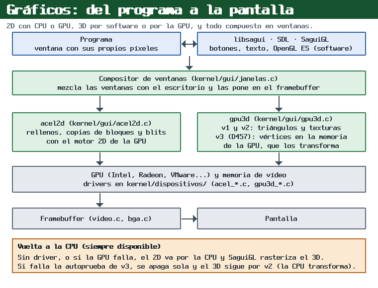

<!-- categoria: Conoce SaguiOS/Sistemas operativos; orden: 11; titulo: Gráficos -->
# Gráficos

[Español](11-graficos.md) · [Português](11-graficos_PT.md) · [English](11-graficos_EN.md)

> Objetivo: entender cómo se dibuja una pantalla desde el framebuffer hasta la GPU, quién decide qué ventana se ve
> encima de cuál y cómo se reparte el trabajo entre CPU y tarjeta gráfica.

## 1. Teoría

### 1.1 Framebuffer

La pantalla se describe como una zona de memoria: el **framebuffer**. Cada píxel ocupa unos bytes (por ejemplo 32 bits
ARGB), y lo que se escribe ahí aparece en pantalla en la siguiente actualización. Con **doble búfer** se dibuja en una
copia oculta y se copia de golpe a la visible, para que no se vea un dibujo a medias (parpadeo).

### 1.2 Compositor y gestor de ventanas

Un **gestor de ventanas** decide qué ventana está encima, dónde está cada una, cuál tiene el foco (recibe el teclado) y
qué zonas hay que repintar. Un **compositor** combina las ventanas en el búfer final, con recorte (lo que queda fuera no
se dibuja) y transparencia. Los sistemas modernos componen en la GPU.

### 1.3 Aceleración 2D y 3D

- **2D acelerado**: la GPU rellena rectángulos, copia bloques (*blit*) y mezcla colores sin que la CPU toque cada píxel.
- **3D**: la GPU recibe triángulos, los transforma, les aplica textura y luz, y los rasteriza. Se programa con APIs como
  OpenGL, OpenGL ES, Direct3D o Vulkan.
- **Por qué es difícil**: cada tarjeta tiene su propio formato de comandos, su memoria y su ciclo de datos. Por eso las
  APIs de alto nivel tienen un **driver** por tarjeta debajo.

### 1.4 Vuelta a la CPU

Una tarjeta sin driver, o un dibujo que la GPU no sabe hacer, debe volver a la CPU. Un sistema bien diseñado lo hace
**sin cambiar lo que ve el programa**: la API sigue igual y el resultado es el mismo, solo cambia la velocidad. Esto
tiene coste: copiar la textura o el cuadro de vuelta a la RAM cuesta tiempo, y a veces la CPU gana a la GPU.

### 1.5 Alternativas

- Linux: DRM/KMS para el modo gráfico y Mesa como biblioteca de usuario con driver por GPU; Wayland o X.org componen.
- Windows: WDDM, con el compositor DWM en el sistema.
- BSD: DRM portado desde Linux y X.org.

### 1.6 Cálculo: el presupuesto de tiempo de un cuadro

Una pantalla de 1024 × 768 con 4 bytes por píxel ocupa 1024 × 768 × 4 = **3 MB** por cuadro. A 60 cuadros por segundo son
**180 MB/s** de escritura. Un cuadro tiene 1 / 60 s aprox. **16,7 ms** de presupuesto. Si la CPU copia el cuadro a 1 GB/s, cuesta
3 ms, casi un quinto del tiempo disponible, sin contar la lógica de la aplicación. Por eso se intenta que la GPU escriba
directamente en pantalla y que el compositor copie solo las zonas que cambian (recorte).

### 1.7 Comparativa: gráficos en otros sistemas

| Sistema | Modo gráfico | Compositor | Aceleración |
| --- | --- | --- | --- |
| Linux | DRM/KMS (modo y framebuffer del núcleo) | Wayland o X.org con compositor | Mesa como biblioteca de usuario |
| Windows | WDDM (controlador de pantalla) | DWM, el compositor del sistema | Direct3D |
| FreeBSD | DRM portado de Linux | X.org o Wayland | Mesa |
| SaguiOS | VESA con doble búfer y BGA | Gestor de ventanas en el propio núcleo (`janelas.c`) | gpu3d por driver, con vuelta a la CPU |

### 1.8 La memoria de vídeo y la caché: *write-combining*

La memoria de la tarjeta gráfica no se puede cachear como la RAM: si cada escritura de la CPU fuera una transacción suelta por el
bus, copiar un cuadro sería lentísimo. El modo **write-combining** (WC) hace que la CPU junte las escrituras en un búfer de 64
bytes y las mande de una vez; leer sigue siendo lento, así que un sistema gráfico dibuja en un búfer de atrás en la RAM y solo
**copia** al framebuffer, sin leerlo nunca. En SaguiOS lo activa `kernel/mem/wc.c` (con PAT si el procesador lo tiene, y si no con
un MTRR).

### 1.9 3D: dónde se transforman los vértices

Un triángulo en 3D pasa por varias etapas: transformar sus vértices (multiplicarlos por matrices para llevarlos a la pantalla),
recortarlos, rasterizarlos (decidir qué píxeles cubre) y colorearlos con textura y luz. Hay dos reparos del trabajo:

- **Transforma la CPU** y manda a la GPU triángulos ya en píxeles. Es lo más simple y lo que hacían las tarjetas antiguas, pero
  la CPU repite la cuenta para todos los vértices en cada cuadro. Un mundo de unos 55 000 vértices a 60 cuadros por segundo son
  3,3 millones de vértices por segundo por la CPU, además de enviarlos todos otra vez.
- **Los guarda y transforma la GPU.** Los vértices se suben **una vez** a la memoria de la tarjeta (un *búfer de vértices*) y en
  cada cuadro solo se le manda la matriz y una orden «dibuja este búfer». Es lo que hace gpu3d v3 (apartado 2).

El resultado medido (decisión D457): en un Amilo con Radeon X1400, la escena del «mundo» pasó de 46 a **206** cuadros por
segundo, y en un portátil Dell con Intel UHD 620, de 119 a **1666**; las escenas que no usan búferes de vértices no cambian.

## 2. Así lo hace SaguiOS

- **Framebuffer y vídeo.** `kernel/dispositivos/video.c` es el modo VESA con doble búfer; `kernel/dispositivos/bga.c` es la
  tarjeta de QEMU/Bochs y `kernel/dispositivos/vga_texto.c` el modo texto.
- **Compositor y ventanas.** `kernel/gui/janelas.c` es el gestor de ventanas: decide la ventana de encima, la arrastra y
  la cierra. `kernel/gui/barra.c` es la barra de tareas y `kernel/gui/area_trabalho.c` el escritorio.
- **Dibujo.** `kernel/gui/desenho.c` (recorte y dibujo) y `kernel/lib/rapido.c` (copias rápidas con las instrucciones de
  la CPU disponibles: SSE, SSE2...).
- **Aceleración 2D.** `kernel/inc/acel2d.h` define la capa común; `kernel/dispositivos/motor_gpu.c` gestiona el motor de
  la GPU y `kernel/dispositivos/acel_radeon.c`, `acel_intel.c`, `acel_nv.c`, `acel_vmware.c` y otros son los drivers.
  El soporte por familia y su versión están en `docs/gpus.md`.
- **Aceleración 3D (gpu3d).** `kernel/gui/gpu3d.c` y `kernel/inc/gpu3d.h` son la capa común: eligen el driver, lo
  autoprueban, tienen el dueño del motor y medidas. Los drivers son `kernel/dispositivos/gpu3d_r500.c`,
  `gpu3d_r600.c` (Radeon R6xx y R7xx), `gpu3d_evergreen.c`, `gpu3d_intel.c` y el simulado `gpu3d_sim.c`.
  - **gpu3d v1**: la interfaz inicial (operaciones 1 a 7), con triángulos, texturas simples y Z.
  - **gpu3d v2** (decisión D425): operaciones 8 a 13, varias unidades de textura, esténcil, DXT y dibujo en textura, con
    **bits de capacidad** (`G3D_CAP_*`) que el driver anuncia solo si pasa su prueba. Se añade sin cambiar la v1: un
    driver que no sabe v2 sigue funcionando (decisión D426 para las R5xx y R6xx/R7xx; D427 para Evergreen).
  - **gpu3d v3** (decisión **D457**): operaciones 15 a 18. La GPU guarda los vértices en su memoria (`GPU3D_OP_VBUF`) y los
    transforma: una `GPU3D_OP_TRANSF` por cuadro (las matrices) y un `GPU3D_OP_DESENHAR3` por búfer (más `GPU3D_OP_LUZES`).
    Los búferes son de la capa: ella lleva la cuenta de cada hueco, valida cada dibujo y **expulsa el menos usado** cuando
    uno nuevo no cabe (el programa recibe `GPU3D_EXPULSO` y lo vuelve a subir); el driver solo reparte memoria y dibuja. La
    transformación de referencia está **en el kernel** (`kernel/gui/gpu3d_v3.c`, con enteros: coma flotante IEEE por software,
    porque el kernel no usa la FPU) y sirve de v3 al driver simulado y de patrón a la **autoprueba v3**, que dibuja tres escenas
    por el driver y por la CPU y compara las imágenes. Si no cuadran, v3 se apaga sola (`bits3` a 0), el 3D sigue por v2 y
    se anota en el registro. SaguiGL usa v3 dibujo a dibujo cuando todos sus arrays están en búferes de vértices;
    `SAGUI_GL_V3=0` la quita. Drivers: Radeon R5xx, R6xx/R7xx (solo se anuncia sola en la tarjeta probada, una RV710) e Intel
    Gen9. La interfaz de virtio y Virgil 3D (`gpu3d_virgl`, prevista para la versión 9) será un driver más, no otra versión.
- **Vuelta a la CPU.** SaguiGL (la biblioteca de OpenGL ES 1.1 de usuario) dibuja por software si no hay driver 3D para la
  tarjeta, y manda a la GPU lo que el driver pueda. Un driver puede responder «no lo hago, sigue por software». Así el
  programa no se entera.
- **Presentar sin volver a la RAM.** Con la decisión D432, el cuadro se presenta sin copiarlo de vuelta a la RAM. La
  decisión D391 trata cómo vuelve a la RAM el cuadro escrito por la GPU (en las R5xx, por la GART).
- **Aceleración en juegos.** AoEN dibuja el terreno y los sprites con la GPU de forma opcional (decisión D436): el modo
  de dibujo por CPU sigue igual.

### 2.1 Decisiones, alternativas y límites actuales

- **Decisión: el compositor está en el núcleo.** `kernel/gui/janelas.c` decide la ventana de encima. Es más simple y de
  menos capas que un servidor de ventanas separado, a costa de que un fallo de la interfaz afecta al núcleo.
- **Decisión: capa 3D común y drivers por familia.** Las decisiones **D284** (Radeon R7xx), **D285** (Intel Gen3) y
  **D287** (Radeon R5xx) añaden drivers sobre `kernel/gui/gpu3d.c`. Qué tarjetas tienen soporte está en `docs/gpus.md`.
- **Decisión: gpu3d v2 sin cambiar la v1.** La decisión **D425** añade operaciones y bits de capacidad; los drivers
  antiguos siguen funcionando (decisiones D426 y D427).
- **Decisión: v3 se añade sin tocar v2 y con la CPU como referencia.** La decisión **D457** no escribe a mano los píxeles
  esperados de la autoprueba: la propia CPU (dentro del kernel) es el patrón, así que cualquier driver nuevo se mide contra lo
  mismo, y un driver que falle solo pierde su v3, nunca el 3D entero.
- **Decisión: presentar sin volver a la RAM.** La decisión **D432** deja que la GPU escriba el cuadro en pantalla.
- **Límite: v3 no está en todos los drivers.** Evergreen todavía no la tiene, y en las R6xx/R7xx solo se ha probado una tarjeta;
  el resto sigue por v2, con la CPU transformando los vértices. Las luces de ES 1.1 y la niebla exponencial aún no las hace la
  GPU en R6xx/R7xx.
- **Límite: la aceleración en juegos es opcional.** AoEN dibuja por la GPU solo si se activa (decisión D436); el modo por
  CPU sigue igual.

## 3. Experimento en SaguiOS

1. Escribe `gpu3d probar --ver` (si la imagen tiene GPU 3D) y mira las etapas de prueba. Si no hay driver, el resultado
   dice que no hay soporte: eso es la vuelta a la CPU en acción.
2. Escribe `acel2d` para ver qué acelerador 2D se usa, o por qué se usa la CPU.
3. Abre el **Visor de registros** y filtra por «GPU» para ver los registros de `[GPU3D]` y `[ACEL2D]`.
4. Abre **Información del PC** y busca la tarjeta gráfica detectada.

**Qué observar:** el mismo programa de OpenGL ES funciona con o sin tarjeta. Lo que cambia es el registro: si hay driver
y pasa la prueba, la GPU dibuja; si no, la CPU dibuja con el mismo resultado.

**Ejercicio práctico adicional.** Con los números del apartado 1.6, calcula cuántos cuadros por segundo podría copiar
la CPU a 1 GB/s si solo dedicara el 50 % de su tiempo al dibujo. Después ejecuta `acel2d` y `gpu3d probar --ver` en SaguiOS
y explica qué dice cada resultado sobre quién dibuja.

## 4. Preguntas de repaso

1. ¿Qué ventaja tiene el doble búfer, y qué pasaría con una sola copia del framebuffer?
2. ¿Qué diferencia hay entre el compositor y el gestor de ventanas?
3. Un programa usa OpenGL ES y la tarjeta no tiene driver 3D. ¿Qué cambia en el programa y qué cambia en el sistema?
4. ¿Por qué una capa común de GPU con «bits de capacidad» permite añadir funciones sin romper los drivers antiguos?

5. Una pantalla de 800 × 600 con 2 bytes por píxel: ¿cuántos MB por cuadro? ¿Cuánto tiempo de CPU cuesta copiarla a 500 MB/s?
6. ¿Por qué el compositor vive en el núcleo en SaguiOS, y cuál es el riesgo de esa decisión?
7. ¿Qué evita la decisión D432 y por qué importa para el presupuesto de tiempo del apartado 1.6?
8. Un mundo tiene 60 000 vértices de 20 bytes. ¿Cuánto se sube una vez con v3? Si cada cuadro se reenviaran los vértices ya
   transformados (20 bytes cada uno) a 60 cuadros por segundo, ¿cuántos MB/s serían?
9. ¿Por qué el kernel calcula la transformación de referencia con enteros, y para qué sirve?
10. La autoprueba v3 de un driver no cuadra con la referencia. ¿Qué ocurre con el 3D?

## 5. Soluciones

1. Con doble búfer se dibuja en una copia oculta y se muestra completa, sin parpadeo. Con una sola copia, el usuario ve
   el dibujo a medias.
2. El gestor decide la posición y el orden de las ventanas; el compositor las combina en la imagen final, con recorte y
   transparencia.
3. Nada cambia en el programa: la API es la misma. En el sistema, SaguiGL dibuja por software en lugar de mandar triángulos
   a la GPU. Solo cambia la velocidad.
4. Porque cada driver anuncia solo lo que sabe hacer. Una función nueva se activa con un bit, así que un driver antiguo
   simplemente no lo anuncia y la capa le envía lo que sí entiende.

### Respuestas a las preguntas adicionales

5. 800 × 600 × 2 = 960 000 bytes aprox. **0,92 MB**. A 500 MB/s, unos 1,8 ms de CPU por cuadro.
6. Es más simple y tiene menos capas que un servidor de ventanas aparte, porque dibujo y decisiones de ventanas comparten código. El
   riesgo: un fallo en la interfaz puede afectar a todo el núcleo, no solo a un programa.
7. Evita copiar el cuadro de vuelta de la GPU a la RAM. Con 3 MB por cuadro y 60 cuadros por segundo, esa copia gastaría buena parte
   de los 16,7 ms del apartado 1.6.
8. 60 000 × 20 = 1 200 000 bytes, es decir, unos **1,2 MB** una sola vez. Reenviar cada cuadro: 1,2 MB × 60 = **72 MB/s**.
9. El kernel no usa la FPU, así que hace la coma flotante IEEE por software con enteros, con el mismo resultado bit a bit que
   la CPU. Sirve de patrón de la autoprueba: se dibuja una escena por el driver y otra por la CPU y se comparan, sin píxeles
   esperados escritos a mano.
10. Solo se apaga v3 (`bits3` pasa a 0): el 3D sigue por v2, con la CPU transformando los vértices. El 3D entero solo se
    apaga si la GPU deja de responder.
