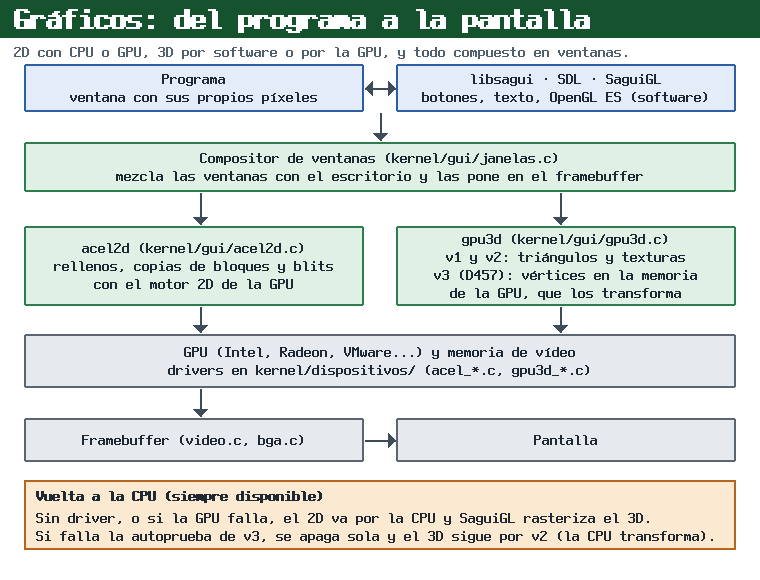

<!-- categoria: Conoce SaguiOS/Sistemas operativos; orden: 11; titulo: Graphics -->
# Graphics

[Español](11-graficos.md) · [Português](11-graficos_PT.md) · [English](11-graficos_EN.md)

> Goal: understand how a screen is drawn from the framebuffer to the GPU, who decides which window is seen above which one, and
> how the work is shared between CPU and graphics card.

## 1. Theory

### 1.1 Framebuffer

The screen is described as a memory area: the **framebuffer**. Each pixel takes a few bytes (for example 32-bit ARGB), and what is
written there appears on screen at the next refresh. With **double buffering** the drawing is done in a hidden copy and then copied
at once to the visible one, so that no half-drawn image is seen (flicker).

### 1.2 Compositor and window manager

A **window manager** decides which window is on top, where each one is, which has focus (it receives the keyboard) and which areas
must be repainted. A **compositor** combines the windows into the final buffer, with clipping (what falls outside is not drawn) and
transparency. Modern systems compose on the GPU.

### 1.3 2D and 3D acceleration

- **Accelerated 2D**: the GPU fills rectangles, copies blocks (*blit*) and blends colors without the CPU touching each pixel.
- **3D**: the GPU receives triangles, transforms them, applies texture and light, and rasterizes them. It is programmed with APIs such
  as OpenGL, OpenGL ES, Direct3D or Vulkan.
- **Why it is hard**: each card has its own command format, memory and data cycle. That is why high-level APIs have a **driver** per card
  underneath.

### 1.4 Falling back to the CPU

A card without a driver, or a drawing the GPU cannot do, must fall back to the CPU. A well-designed system does it **without changing
what the program sees**: the API stays the same and the result is the same, only the speed changes. This has a cost: copying the texture or
the frame back to RAM takes time, and sometimes the CPU wins over the GPU.

### 1.5 Alternatives

- Linux: DRM/KMS for the graphics mode and Mesa as a user library with a driver per GPU; Wayland or X.org compose.
- Windows: WDDM, with the DWM compositor in the system.
- BSD: DRM ported from Linux and X.org.

### 1.6 Calculation: the time budget of a frame

A 1024 × 768 screen with 4 bytes per pixel takes 1024 × 768 × 4 = **3 MB** per frame. At 60 frames per second that is **180 MB/s** of
writes. A frame has 1 / 60 s approx. **16.7 ms** of budget. If the CPU copies the frame at 1 GB/s, it costs 3 ms, almost a fifth of the time
available, without counting the application's logic. That is why the GPU is made to write directly to the screen and the compositor
copies only the areas that change (clipping).

### 1.7 Comparison: graphics in other systems

| System | Graphics mode | Compositor | Acceleration |
| --- | --- | --- | --- |
| Linux | DRM/KMS (kernel mode and framebuffer) | Wayland or X.org with a compositor | Mesa as a user library |
| Windows | WDDM (display driver) | DWM, the system compositor | Direct3D |
| FreeBSD | DRM ported from Linux | X.org or Wayland | Mesa |
| SaguiOS | VESA with double buffering and BGA | Window manager in the kernel itself (`janelas.c`) | gpu3d per driver, with fallback to the CPU |

### 1.8 Video memory and the cache: *write-combining*

The graphics card's memory cannot be cached like RAM: if each CPU write were a separate bus transaction, copying a frame would
be very slow. The **write-combining** (WC) mode makes the CPU gather writes in a 64-byte buffer and send them at once; reading
is still slow, so a graphics system draws in a back buffer in RAM and only **copies** to the framebuffer, never reading it.
In SaguiOS `kernel/mem/wc.c` turns it on (with PAT if the processor has it, and otherwise with an MTRR).

### 1.9 3D: where vertices are transformed

A triangle in 3D goes through several stages: transforming its vertices (multiplying them by matrices to bring them to the
screen), clipping them, rasterizing them (deciding which pixels they cover) and coloring them with texture and light. The work
can be split in two ways:

- **The CPU transforms** and sends the GPU triangles already in pixels. It is the simplest and what old cards did, but the CPU
  repeats the computation for every vertex on every frame. A world of about 55,000 vertices at 60 frames per second is 3.3
  million vertices per second on the CPU, besides sending them all again.
- **The GPU keeps and transforms them.** The vertices are uploaded **once** to the card's memory (a *vertex buffer*) and on each
  frame only the matrix and a "draw this buffer" command are sent. It is what gpu3d v3 does (section 2).

The measured result (decision D457): on an Amilo with a Radeon X1400, the "world" scene went from 46 to **206** frames per
second, and on a Dell laptop with Intel UHD 620, from 119 to **1666**; scenes that do not use vertex buffers do not change.

## 2. How SaguiOS does it

- **Framebuffer and video.** `kernel/dispositivos/video.c` is the VESA mode with double buffering; `kernel/dispositivos/bga.c` is the
  QEMU/Bochs card and `kernel/dispositivos/vga_texto.c` the text mode.
- **Compositor and windows.** `kernel/gui/janelas.c` is the window manager: it decides the window on top, drags it and closes it.
  `kernel/gui/barra.c` is the taskbar and `kernel/gui/area_trabalho.c` the desktop.
- **Drawing.** `kernel/gui/desenho.c` (clipping and drawing) and `kernel/lib/rapido.c` (fast copies with the CPU instructions available:
  SSE, SSE2...).
- **2D acceleration.** `kernel/inc/acel2d.h` defines the common layer; `kernel/dispositivos/motor_gpu.c` manages the GPU engine and
  `kernel/dispositivos/acel_radeon.c`, `acel_intel.c`, `acel_nv.c`, `acel_vmware.c` and others are the drivers. Support per family and its
  version are in `docs/gpus.md`.
- **3D acceleration (gpu3d).** `kernel/gui/gpu3d.c` and `kernel/inc/gpu3d.h` are the common layer: they choose the driver, self-test it,
  own the engine and keep measurements. The drivers are `kernel/dispositivos/gpu3d_r500.c`, `gpu3d_r600.c` (Radeon R6xx and R7xx),
  `gpu3d_evergreen.c`, `gpu3d_intel.c` and the simulated `gpu3d_sim.c`.
  - **gpu3d v1**: the initial interface (operations 1 to 7), with triangles, simple textures and Z.
  - **gpu3d v2** (decision D425): operations 8 to 13, several texture units, stencil, DXT and drawing into a texture, with
    **capability bits** (`G3D_CAP_*`) that the driver announces only when it passes its test. It is added without changing v1: a driver
    that does not know v2 keeps working (decision D426 for R5xx and R6xx/R7xx; D427 for Evergreen).
  - **gpu3d v3** (decision **D457**): operations 15 to 18. The GPU keeps the vertices in its memory (`GPU3D_OP_VBUF`) and
    transforms them: one `GPU3D_OP_TRANSF` per frame (the matrices) and one `GPU3D_OP_DESENHAR3` per buffer (plus
    `GPU3D_OP_LUZES`). The buffers belong to the layer: it keeps the count of each slot, validates each draw and **evicts the
    least used one** when a new one does not fit (the program receives `GPU3D_EXPULSO` and uploads it again); the driver only
    hands out memory and draws. The reference transformation is **in the kernel** (`kernel/gui/gpu3d_v3.c`, with integers:
    software IEEE floating point, because the kernel does not use the FPU) and serves as v3 for the simulated driver and as the
    standard for the **v3 self-test**, which draws three scenes through the driver and through the CPU and compares the images.
    If they do not match, v3 turns itself off (`bits3` to 0), the 3D goes on through v2 and a note is made in the log. SaguiGL
    uses v3 draw by draw when all its arrays are in vertex buffers; `SAGUI_GL_V3=0` removes it. Drivers: Radeon R5xx, R6xx/R7xx
    (it only announces itself on the tested card, an RV710) and Intel Gen9. The virtio and Virgil 3D interface (`gpu3d_virgl`,
    foreseen for version 9) will be one more driver, not another version.
- **Falling back to the CPU.** SaguiGL (the user-space OpenGL ES 1.1 library) draws in software if there is no 3D driver for the card, and
  sends to the GPU whatever the driver can do. A driver can answer "I do not do that, continue in software". So the program does not notice.
- **Presenting without going back to RAM.** With decision D432, the frame is presented without copying it back to RAM. Decision D391 covers
  how the GPU-written frame returns to RAM (on R5xx, through the GART).
- **Game acceleration.** AoEN draws the terrain and sprites on the GPU optionally (decision D436): the CPU drawing mode stays the same.

### 2.1 Decisions, alternatives and current limits

- **Decision: the compositor is in the kernel.** `kernel/gui/janelas.c` decides the window on top. It is simpler and has fewer layers than a
  separate window server, at the cost that an interface failure affects the kernel.
- **Decision: a common 3D layer and drivers per family.** Decisions **D284** (Radeon R7xx), **D285** (Intel Gen3) and **D287** (Radeon R5xx)
  add drivers on `kernel/gui/gpu3d.c`. Which cards are supported is in `docs/gpus.md`.
- **Decision: gpu3d v2 without changing v1.** Decision **D425** adds operations and capability bits; the older drivers keep working
  (decisions D426 and D427).
- **Decision: v3 is added without touching v2 and with the CPU as reference.** Decision **D457** does not hand-write the
  expected pixels of the self-test: the CPU itself (inside the kernel) is the standard, so any new driver is measured against
  the same thing, and a driver that fails only loses its v3, never the whole 3D.
- **Decision: presenting without going back to RAM.** Decision **D432** lets the GPU write the frame to the screen.
- **Limit: v3 is not in all drivers.** Evergreen does not have it yet, and on R6xx/R7xx only one card has been tested; the rest
  goes on through v2, with the CPU transforming the vertices. ES 1.1 lights and exponential fog are not yet done by the GPU on
  R6xx/R7xx.
- **Limit: game acceleration is optional.** AoEN draws on the GPU only if it is enabled (decision D436); the CPU mode stays the same.

## 3. Experiment in SaguiOS

1. Type `gpu3d probar --ver` (if the image has 3D GPU) and look at the test stages. If there is no driver, the result says there is no
   support: that is the fallback to the CPU in action.
2. Type `acel2d` to see which 2D accelerator is used, or why the CPU is used.
3. Open the Event viewer (Visor de registros) and filter by "GPU" to see the `[GPU3D]` and `[ACEL2D]` messages.
4. Open **Información del PC** and look for the detected graphics card.

**What to observe:** the same OpenGL ES program works with or without a card. What changes is the log: if there is a driver and it passes the
test, the GPU draws; if not, the CPU draws with the same result.

**Additional practical exercise.** With the figures of section 1.6, calculate how many frames per second the CPU could copy at 1 GB/s if it
spent only 50 % of its time on drawing. Then run `acel2d` and `gpu3d probar --ver` in SaguiOS and explain what each result says about who draws.

## 4. Review questions

1. What advantage does double buffering have, and what would happen with a single copy of the framebuffer?
2. What is the difference between the compositor and the window manager?
3. A program uses OpenGL ES and the card has no 3D driver. What changes in the program and what changes in the system?
4. Why does a common GPU layer with "capability bits" allow adding functions without breaking old drivers?
5. An 800 × 600 screen with 2 bytes per pixel: how many MB per frame? How much CPU time does copying it at 500 MB/s cost?
6. Why does the compositor live in the kernel in SaguiOS, and what is the risk of that choice?
7. What does decision D432 avoid, and why does it matter for the frame budget of section 1.6?
8. A world has 60,000 vertices of 20 bytes. How much is uploaded once with v3? If every frame the already-transformed vertices (20
   bytes each) were resent at 60 frames per second, how many MB/s would that be?
9. Why does the kernel compute the reference transformation with integers, and what is it for?
10. A driver's v3 self-test does not match the reference. What happens to the 3D?

## 5. Answers

1. With double buffering the drawing is made in a hidden copy and shown whole, without flicker. With a single copy, the user sees the
   drawing half-done.
2. The manager decides the position and order of the windows; the compositor combines them into the final image, with clipping and
   transparency.
3. Nothing changes in the program: the API is the same. In the system, SaguiGL draws in software instead of sending triangles to the GPU.
   Only the speed changes.
4. Because each driver announces only what it can do. A new function is enabled with a bit, so an old driver simply does not announce it
   and the layer sends it only what it understands.
5. 800 × 600 × 2 = 960 000 bytes approx. **0.92 MB**. At 500 MB/s, about 1.8 ms of CPU per frame.
6. It is simpler and has fewer layers than a separate window server, because drawing and window decisions share the same code. The risk:
   a failure in the interface can affect the kernel as a whole, not only one program.
7. It avoids copying the frame back from the GPU to RAM. At 3 MB per frame and 60 frames per second, that copy would cost a large part of
   the 16.7 ms budget of section 1.6.
8. 60,000 × 20 = 1,200,000 bytes, that is, about **1.2 MB** just once. Resending every frame: 1.2 MB × 60 = **72 MB/s**.
9. The kernel does not use the FPU, so it does IEEE floating point in software with integers, with the same bit-for-bit result as
   the CPU. It serves as the standard of the self-test: one scene is drawn through the driver and another through the CPU and
   they are compared, with no hand-written expected pixels.
10. Only v3 is turned off (`bits3` becomes 0): the 3D goes on through v2, with the CPU transforming the vertices. The whole 3D is
    only turned off if the GPU stops responding.
