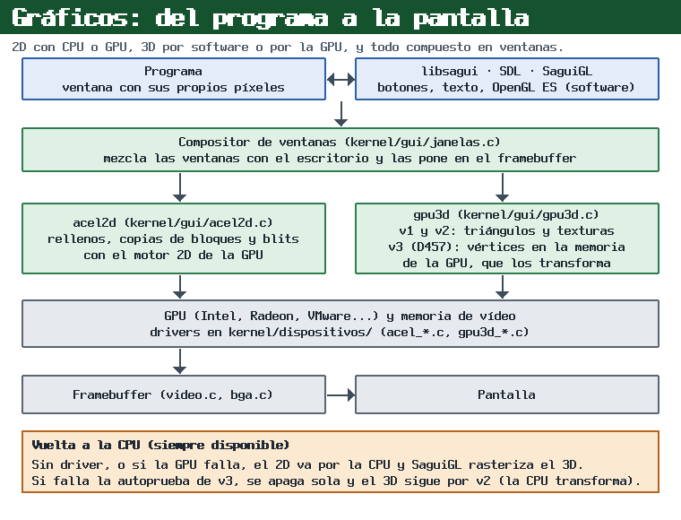

<!-- categoria: Conoce SaguiOS/Sistemas operativos; orden: 11; titulo: Gráficos -->
# Gráficos

[Español](11-graficos.md) · [Português](11-graficos_PT.md) · [English](11-graficos_EN.md)

> Objetivo: entender como uma tela é desenhada, do framebuffer até a GPU, quem decide qual janela aparece sobre qual, e como o trabalho se divide
> entre a CPU e a placa gráfica.

## 1. Teoria

### 1.1 Framebuffer

A tela é descrita como uma área de memória: o **framebuffer**. Cada pixel ocupa alguns bytes (por exemplo 32 bits ARGB), e o que é escrito ali aparece
na tela na próxima atualização. Com **dupla bufferização** o desenho é feito numa cópia oculta e depois copiado de uma vez para a visível, para que
não se veja um desenho pela metade (cintilação).

### 1.2 Compositor e gerenciador de janelas

Um **gerenciador de janelas** decide qual janela fica por cima, onde está cada uma, qual tem o foco (recebe o teclado) e quais áreas precisam ser repintadas.
Um **compositor** combina as janelas no buffer final, com recorte (o que fica fora não é desenhado) e transparência. Os sistemas modernos compõem na GPU.

### 1.3 Aceleração 2D e 3D

- **2D acelerado**: a GPU preenche retângulos, copia blocos (*blit*) e mistura cores sem que a CPU toque cada pixel.
- **3D**: a GPU recebe triângulos, os transforma, aplica textura e luz, e os rasteriza. Programa-se com APIs como OpenGL, OpenGL ES, Direct3D ou Vulkan.
- **Por que é difícil**: cada placa tem seu próprio formato de comandos, sua memória e seu ciclo de dados. Por isso as APIs de alto nível têm um **driver** por placa
  por baixo.

### 1.4 Volta à CPU

Uma placa sem driver, ou um desenho que a GPU não sabe fazer, deve voltar para a CPU. Um sistema bem projetado faz isso **sem mudar o que o programa vê**: a API
continua igual e o resultado é o mesmo, só muda a velocidade. Isso tem custo: copiar a textura ou o quadro de volta para a RAM leva tempo, e às vezes a CPU vence a GPU.

### 1.5 Alternativas

- Linux: DRM/KMS para o modo gráfico e Mesa como biblioteca de usuário com driver por GPU; Wayland ou X.org compõem.
- Windows: WDDM, com o compositor DWM no sistema.
- BSD: DRM portado do Linux e X.org.

### 1.6 Cálculo: o orçamento de tempo de um quadro

Uma tela de 1024 × 768 com 4 bytes por pixel ocupa 1024 × 768 × 4 = **3 MB** por quadro. A 60 quadros por segundo são **180 MB/s** de escrita. Um quadro tem
1 / 60 s aprox. **16,7 ms** de orçamento. Se a CPU copia o quadro a 1 GB/s, custa 3 ms, quase um quinto do tempo disponível, sem contar a lógica do aplicativo.
Por isso se procura que a GPU escreva diretamente na tela e que o compositor copie só as áreas que mudam (recorte).

### 1.7 Comparação: gráficos em outros sistemas

| Sistema | Modo gráfico | Compositor | Aceleração |
| --- | --- | --- | --- |
| Linux | DRM/KMS (modo e framebuffer do núcleo) | Wayland ou X.org com compositor | Mesa como biblioteca de usuário |
| Windows | WDDM (driver de vídeo) | DWM, o compositor do sistema | Direct3D |
| FreeBSD | DRM portado do Linux | X.org ou Wayland | Mesa |
| SaguiOS | VESA com dupla bufferização e BGA | Gerenciador de janelas no próprio núcleo (`janelas.c`) | gpu3d por driver, com volta à CPU |

### 1.8 A memória de vídeo e o cache: *write-combining*

A memória da placa gráfica não pode ser guardada em cache como a RAM: se cada escrita da CPU fosse uma transação solta no
barramento, copiar um quadro seria lentíssimo. O modo **write-combining** (WC) faz a CPU juntar as escritas num buffer de 64 bytes e
enviá-las de uma vez; ler continua lento, então um sistema gráfico desenha num buffer de trás na RAM e só **copia** para o
framebuffer, sem nunca lê-lo. No SaguiOS quem o ativa é `kernel/mem/wc.c` (com PAT se o processador o tem, e senão com um MTRR).

### 1.9 3D: onde se transformam os vértices

Um triângulo em 3D passa por várias etapas: transformar os seus vértices (multiplicá-los por matrizes para levá-los à tela), recortá-los,
rasterizá-los (decidir que pixels cobrem) e colori-los com textura e luz. O trabalho pode se dividir de duas formas:

- **A CPU transforma** e envia à GPU triângulos já em pixels. É o mais simples e o que faziam as placas antigas, mas a CPU repete a
  conta para todos os vértices em cada quadro. Um mundo de cerca de 55 000 vértices a 60 quadros por segundo são 3,3 milhões de
  vértices por segundo pela CPU, além de enviá-los todos de novo.
- **A GPU os guarda e transforma.** Os vértices são enviados **uma vez** à memória da placa (um *buffer de vértices*) e em cada
  quadro só se manda a matriz e uma ordem «desenhe este buffer». É o que faz a gpu3d v3 (seção 2).

O resultado medido (decisão D457): num Amilo com Radeon X1400, a cena do «mundo» passou de 46 para **206** quadros por segundo, e num
notebook Dell com Intel UHD 620, de 119 para **1666**; as cenas que não usam buffers de vértices não mudam.

## 2. Como o SaguiOS faz

- **Framebuffer e vídeo.** `kernel/dispositivos/video.c` é o modo VESA com dupla bufferização; `kernel/dispositivos/bga.c` é a placa do QEMU/Bochs e
  `kernel/dispositivos/vga_texto.c` o modo texto.
- **Compositor e janelas.** `kernel/gui/janelas.c` é o gerenciador de janelas: decide a janela de cima, a arrasta e a fecha. `kernel/gui/barra.c` é a barra
  de tarefas e `kernel/gui/area_trabalho.c` a área de trabalho.
- **Desenho.** `kernel/gui/desenho.c` (recorte e desenho) e `kernel/lib/rapido.c` (cópias rápidas com as instruções da CPU disponíveis: SSE, SSE2...).
- **Aceleração 2D.** `kernel/inc/acel2d.h` define a camada comum; `kernel/dispositivos/motor_gpu.c` gerencia o motor da GPU e
  `kernel/dispositivos/acel_radeon.c`, `acel_intel.c`, `acel_nv.c`, `acel_vmware.c` e outros são os drivers. O suporte por família e a sua versão estão em `docs/gpus.md`.
- **Aceleração 3D (gpu3d).** `kernel/gui/gpu3d.c` e `kernel/inc/gpu3d.h` são a camada comum: escolhem o driver, o autotestam, são donos do motor e guardam medidas.
  Os drivers são `kernel/dispositivos/gpu3d_r500.c`, `gpu3d_r600.c` (Radeon R6xx e R7xx), `gpu3d_evergreen.c`, `gpu3d_intel.c` e o simulado `gpu3d_sim.c`.
  - **gpu3d v1**: a interface inicial (operações 1 a 7), com triângulos, texturas simples e Z.
  - **gpu3d v2** (decisão D425): operações 8 a 13, várias unidades de textura, estêncil, DXT e desenho numa textura, com **bits de capacidade** (`G3D_CAP_*`) que o driver
    anuncia só quando passa no seu teste. É acrescentada sem mudar a v1: um driver que não conhece a v2 continua funcionando (decisão D426 para as R5xx e R6xx/R7xx;
    D427 para o Evergreen).
  - **gpu3d v3** (decisão **D457**): operações 15 a 18. A GPU guarda os vértices na sua memória (`GPU3D_OP_VBUF`) e os transforma: uma
    `GPU3D_OP_TRANSF` por quadro (as matrizes) e um `GPU3D_OP_DESENHAR3` por buffer (mais `GPU3D_OP_LUZES`). Os buffers são da camada:
    ela leva a conta de cada vaga, valida cada desenho e **expulsa o menos usado** quando um novo não cabe (o programa recebe
    `GPU3D_EXPULSO` e o envia de novo); o driver só reparte memória e desenha. A transformação de referência está **no kernel**
    (`kernel/gui/gpu3d_v3.c`, com inteiros: ponto flutuante IEEE por software, porque o kernel não usa a FPU) e serve de v3 ao
    driver simulado e de padrão para o **autoteste v3**, que desenha três cenas pelo driver e pela CPU e compara as imagens. Se não
    coincidem, a v3 se desliga sozinha (`bits3` a 0), o 3D segue pela v2 e se anota no registro. O SaguiGL usa a v3 desenho a desenho
    quando todos os seus arrays estão em buffers de vértices; `SAGUI_GL_V3=0` a remove. Drivers: Radeon R5xx, R6xx/R7xx (só se
    anuncia sozinha na placa testada, uma RV710) e Intel Gen9. A interface de virtio e Virgil 3D (`gpu3d_virgl`, prevista para a
    versão 9) será mais um driver, não outra versão.
- **Volta à CPU.** O SaguiGL (a biblioteca de OpenGL ES 1.1 de usuário) desenha por software se não há driver 3D para a placa, e envia à GPU o que o driver puder fazer.
  Um driver pode responder "eu não faço isso, continue por software". Assim o programa não percebe.
- **Apresentar sem voltar à RAM.** Com a decisão D432, o quadro é apresentado sem ser copiado de volta para a RAM. A decisão D391 trata de como o quadro escrito pela
  GPU volta à RAM (nas R5xx, pela GART).
- **Aceleração em jogos.** O AoEN desenha o terreno e os sprites na GPU de forma opcional (decisão D436): o modo de desenho pela CPU continua igual.

### 2.1 Decisões, alternativas e limites atuais

- **Decisão: o compositor está no núcleo.** `kernel/gui/janelas.c` decide a janela de cima. É mais simples e tem menos camadas que um servidor de janelas separado,
  ao custo de que uma falha da interface afete o núcleo.
- **Decisão: uma camada 3D comum e drivers por família.** As decisões **D284** (Radeon R7xx), **D285** (Intel Gen3) e **D287** (Radeon R5xx) acrescentam drivers sobre
  `kernel/gui/gpu3d.c`. Quais placas têm suporte está em `docs/gpus.md`.
- **Decisão: gpu3d v2 sem mudar a v1.** A decisão **D425** acrescenta operações e bits de capacidade; os drivers antigos continuam funcionando (decisões D426 e D427).
- **Decisão: a v3 se acrescenta sem tocar a v2 e com a CPU como referência.** A decisão **D457** não escreve à mão os pixels esperados
  do autoteste: a própria CPU (dentro do kernel) é o padrão, então qualquer driver novo é medido contra o mesmo, e um driver que
  falha só perde a sua v3, nunca o 3D inteiro.
- **Decisão: apresentar sem voltar à RAM.** A decisão **D432** deixa a GPU escrever o quadro na tela.
- **Limite: a v3 não está em todos os drivers.** O Evergreen ainda não a tem, e nas R6xx/R7xx só uma placa foi testada; o resto segue
  pela v2, com a CPU transformando os vértices. As luzes do ES 1.1 e a névoa exponencial ainda não são feitas pela GPU nas R6xx/R7xx.
- **Limite: a aceleração em jogos é opcional.** O AoEN desenha na GPU só se for ativada (decisão D436); o modo por CPU continua igual.

## 3. Experimento no SaguiOS

1. Digite `gpu3d probar --ver` (se a imagem tiver GPU 3D) e observe as etapas do teste. Se não houver driver, o resultado diz que não há suporte: é a volta à CPU em ação.
2. Digite `acel2d` para ver qual acelerador 2D é usado, ou por que se usa a CPU.
3. Abra o **Visor de registros** e filtre por «GPU» para ver as mensagens `[GPU3D]` e `[ACEL2D]`.
4. Abra **Información del PC** e procure a placa gráfica detectada.

**O que observar:** o mesmo programa de OpenGL ES funciona com ou sem placa. O que muda é o registro: se há driver e ele passa no teste, a GPU desenha; se não, a CPU desenha com o mesmo resultado.

**Exercício prático adicional.** Com os números do apartado 1.6, calcule quantos quadros por segundo a CPU poderia copiar a 1 GB/s se dedicasse só 50 % do seu tempo ao desenho.
Depois rode `acel2d` e `gpu3d probar --ver` no SaguiOS e explique o que cada resultado diz sobre quem desenha.

## 4. Perguntas de revisão

1. Qual a vantagem da dupla bufferização, e o que aconteceria com uma única cópia do framebuffer?
2. Qual a diferença entre o compositor e o gerenciador de janelas?
3. Um programa usa OpenGL ES e a placa não tem driver 3D. O que muda no programa e o que muda no sistema?
4. Por que uma camada comum de GPU com "bits de capacidade" permite acrescentar funções sem quebrar os drivers antigos?
5. Uma tela de 800 × 600 com 2 bytes por pixel: quantos MB por quadro? Quanto tempo de CPU custa copiá-la a 500 MB/s?
6. Por que o compositor vive no núcleo no SaguiOS, e qual é o risco dessa escolha?
7. O que a decisão D432 evita, e por que isso importa para o orçamento de tempo do apartado 1.6?
8. Um mundo tem 60 000 vértices de 20 bytes. Quanto se envia uma vez com a v3? Se a cada quadro se reenviassem os vértices já
   transformados (20 bytes cada) a 60 quadros por segundo, quantos MB/s seriam?
9. Por que o kernel calcula a transformação de referência com inteiros, e para que serve?
10. O autoteste v3 de um driver não coincide com a referência. O que acontece com o 3D?

## 5. Respostas

1. Com a dupla bufferização o desenho é feito numa cópia oculta e mostrado inteiro, sem cintilação. Com uma cópia só, o usuário vê o desenho pela metade.
2. O gerenciador decide a posição e a ordem das janelas; o compositor as combina na imagem final, com recorte e transparência.
3. Nada muda no programa: a API é a mesma. No sistema, o SaguiGL desenha por software em vez de enviar triângulos à GPU. Só muda a velocidade.
4. Porque cada driver anuncia só o que sabe fazer. Uma função nova é ativada por um bit, então um driver antigo simplesmente não a anuncia, e a camada lhe envia só o que ele entende.
5. 800 × 600 × 2 = 960 000 bytes aprox. **0,92 MB**. A 500 MB/s, cerca de 1,8 ms de CPU por quadro.
6. É mais simples e tem menos camadas do que um servidor de janelas separado, porque o desenho e as decisões de janela compartilham o mesmo código. O risco: uma falha na interface pode afetar o núcleo inteiro, não só um programa.
7. Evita copiar o quadro de volta da GPU para a RAM. Com 3 MB por quadro e 60 quadros por segundo, essa cópia custaria uma parte grande dos 16,7 ms do apartado 1.6.
8. 60 000 × 20 = 1 200 000 bytes, ou seja, cerca de **1,2 MB** uma única vez. Reenviar a cada quadro: 1,2 MB × 60 = **72 MB/s**.
9. O kernel não usa a FPU, então faz o ponto flutuante IEEE por software com inteiros, com o mesmo resultado bit a bit que a CPU. Serve
   de padrão do autoteste: desenha-se uma cena pelo driver e outra pela CPU e se comparam, sem pixels esperados escritos à mão.
10. Só se desliga a v3 (`bits3` passa a 0): o 3D segue pela v2, com a CPU transformando os vértices. O 3D inteiro só se desliga se a
    GPU deixa de responder.
